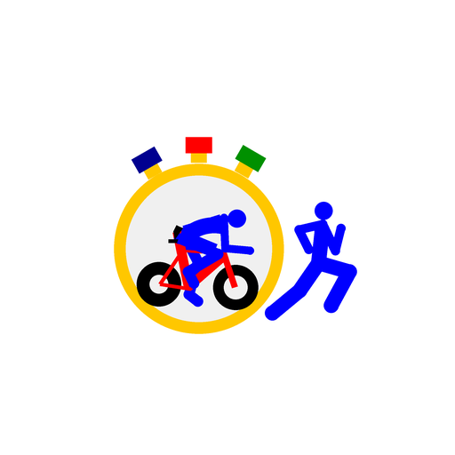
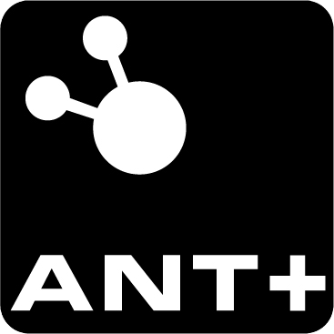
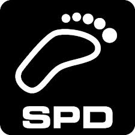
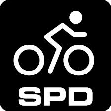
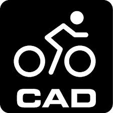
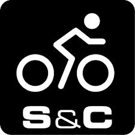

  

<h1 align="center">aTrainingTracker</h1>

  <strong>The serious athlete's tracking cockpit for Android.</strong> 
  High-performance telemetry, dual ANT+™ &amp; Bluetooth LE connectivity, advanced sports physiology, offline maps, and automated route clustering.

  

  📖 <strong><a href="docs/index.md">Online User Guide</a></strong> &bull;
  🇩🇪 <a href="docs/guide/de/index.md">Benutzerhandbuch (Deutsch)</a> &bull;
  🇬🇧 <a href="docs/guide/en/index.md">User Guide (English)</a>

---

aTrainingTracker is an open-source, high-performance sports tracking cockpit designed for endurance athletes who demand precision, deep physiological telemetry, and zero-touch automation. While the primary focus is providing a solid, glanceable cockpit experience during your session, the app also includes comprehensive post-workout analytics, Skiba $W'_{\text{bal}}$ and Coggan power metrics, long-term volume tracking (Periods 2.0 & PMC), and automatic route clustering (*Lieblingsstrecken*). By leveraging simultaneous multi-sensor connectivity (ANT+ and Bluetooth LE), it transforms your smartphone into a dedicated training computer.

           
   
  <em>Featuring wireless ANT+™ connectivity. Visit <a href="https://www.thisisant.com/directory">www.thisisant.com/directory</a> for compatible products.</em>

### Focused on Performance, Minimize Interaction

For those who want to track every detail of their training without wasting time on their phone. aTrainingTracker is powerful yet simple:
*   **Zero-Touch Automation**: Once configured, just press **Start**. The app automagically determines the sport (Run/Bike) and the specific equipment (bike or shoes) based on the remote sensors detected during the session.
*   **Best-Sensor Logic**: Intelligent priority system selects the highest quality data source (e.g., preferring a dedicated ANT+ or BTLE speed sensor over GPS-based speed for superior precision).
*   **Cloud Ready**: Automatic synchronization with **Strava**, **Dropbox**, and **Google Drive**. Your data is ready for analysis on your computer (WKO+, Golden Cheetah) by the time you've finished your post-workout shower.
*   **Privacy First & Local Sovereignty**: 100% ad-free, no mandatory account or proprietary cloud backend. All tracked workouts and metrics remain stored exclusively in your local on-device SQLite database.

## Main Features:

*   **Extensive Sensor Support**:
    *   **ANT+**: Heart Rate, Run Speed/Cadence, Bike Speed, Bike Cadence, Combined Speed & Cadence, Power Meters, and Temperature.
    *   **Bluetooth LE**: Heart Rate, Cycling Speed/Cadence, Running Speed/Cadence.
*   **Multi-Sensor Pairing**: Pair an unlimited number of sensors; the app automatically connects to what is available when you start.
*   **Advanced Sports Physiology**: Real-time Coggan Normalized Power ($\text{NP}$), Intensity Factor ($\text{IF}$), Training Stress Score ($\text{TSS}$), Variability Index ($\text{VI}$), Skiba Anaerobic Work Capacity balance ($W'_{\text{bal}}$), Efficiency Factor ($\text{EF}$), Aerobic Decoupling ($\text{Pw:Hr}$), and longitudinal Performance Management Chart ($\text{PMC}$: CTL, ATL, TSB).
*   **Highly Customizable Cockpits**: Build your perfect dashboard by swiping through multiple configurable views. Cockpits are sport-type dependent, ensuring you always see the exact metrics relevant to your current activity (e.g., Power/Cadence for cycling vs. Pace for running).
*   **Versatile Export & Import**: Native support for **.FIT** (flexible binary format), **.TCX**, **.GPX**, **.CSV**, and Golden Cheetah formats.
*   **Cloud Integration**: Automatic synchronization triad with **Strava**, **Dropbox**, and **Google Drive** for seamless data backup and cross-platform analysis.
*   **Navigation & Lieblingsstrecken**: Automatic spatial route clustering into named favorite courses (*Lieblingsstrecken*), GPX route imports, Strava segment racing, and live map follow-me navigation with elevation profile scrubbers.
*   **Social Sharing**: Generate and share high-resolution workout snapshots that combine your map, elevation profile, and key physiological metrics into a single image.
*   **Multilingual**: 100% localized in 9 languages: English, German, Spanish, French, Italian, Portuguese, Dutch, Polish, and Japanese.
*   **Periods 2.0 & Training History**: Multi-year summaries, yearly activity contribution heatmaps, and customizable training volume periods.

## More than two Decades ago, I had a Dream

This project began as a vision more than two decades ago. Back then, I was an engineering student exploring the first possibilities of mobile coding with Java Midlets. When jogging, I wore a heart rate strap and a simple wrist watch. Expensive watches that could store data were just appearing but out of reach for me. 

I dreamt of a future where the mobile phone—with its massive storage, large display, and computational power—could act as the ultimate training log, gathering and storing every bit of data from remote sensors.

Over the years, I transitioned from a casual jogger to a passionate triathlete. By the time the first smartphones supporting the ANT+ protocol hit the market in 2011, I was ready. I bought one immediately, but found that none of the available apps were powerful or automated enough for a serious athlete. 

So, I started coding.

After many years of active development and use, the project saw a lengthy hiatus between 2019 and 2025. However, my passion for the ultimate tracking cockpit never faded. I have now returned to the project with renewed energy, modernizing the user interface while keeping the solid core tracking logic intact.

Recently, I have invested significantly more time in refining this code than in actual training, and I am proud to share this labor of love with the community.

## Support & Contributing

We welcome support from the community to keep aTrainingTracker the best tool for serious athletes:
*   **Report Issues**: Add feature requests or bug reports on [GitHub](https://github.com/rainerblind/aTrainingTracker/issues).
*   **Contribute Code**: Pull requests for Java or Kotlin improvements are always welcome.
*   **Translate**: Help localize the app into your mother tongue. No coding is required—just simple text translation.

---
*Wireless ANT+™ connectivity. Visit www.thisisant.com/directory for compatible products.*
