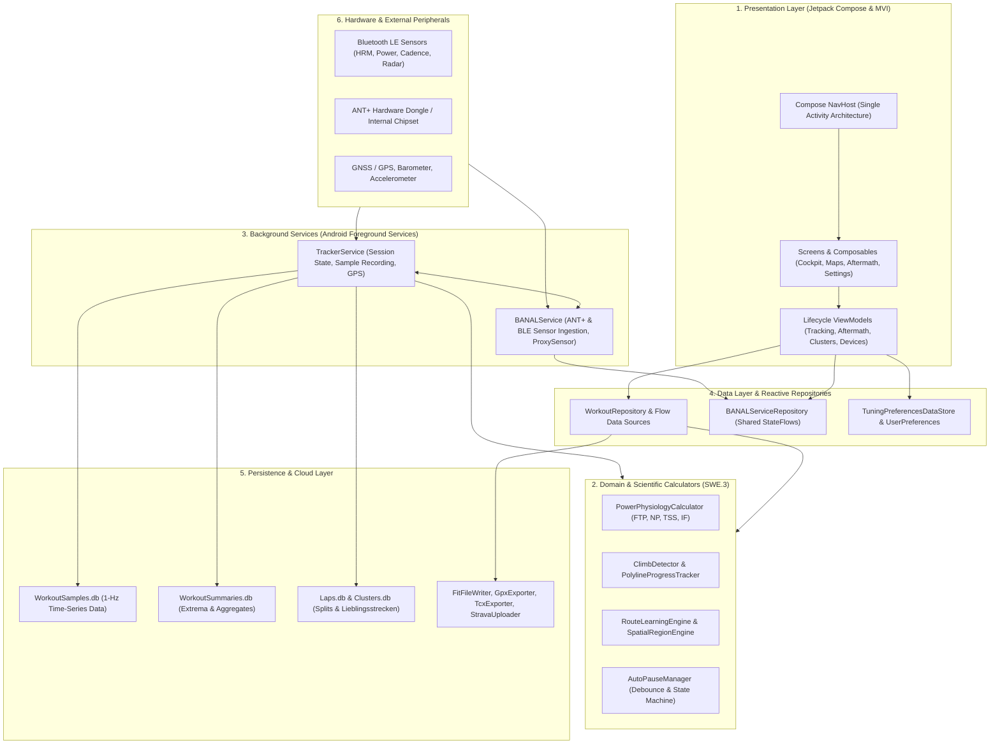
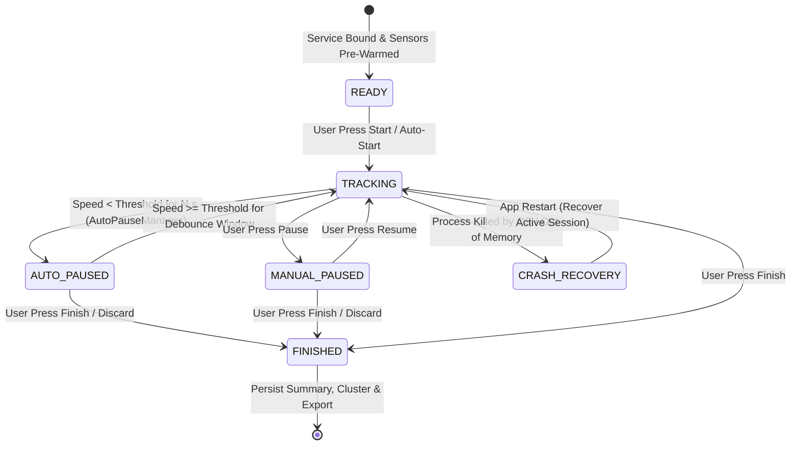
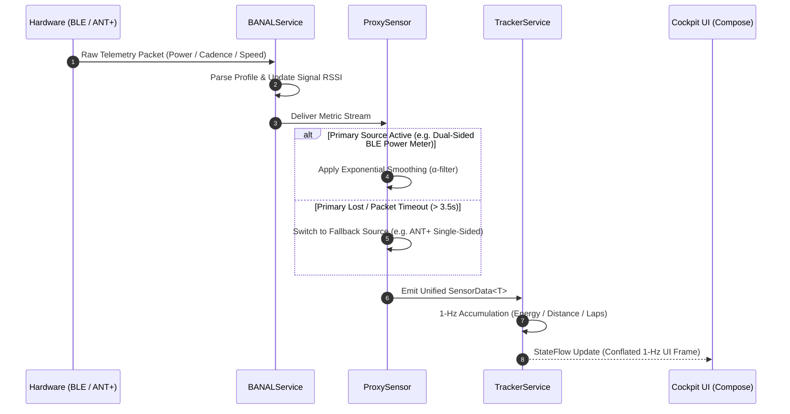
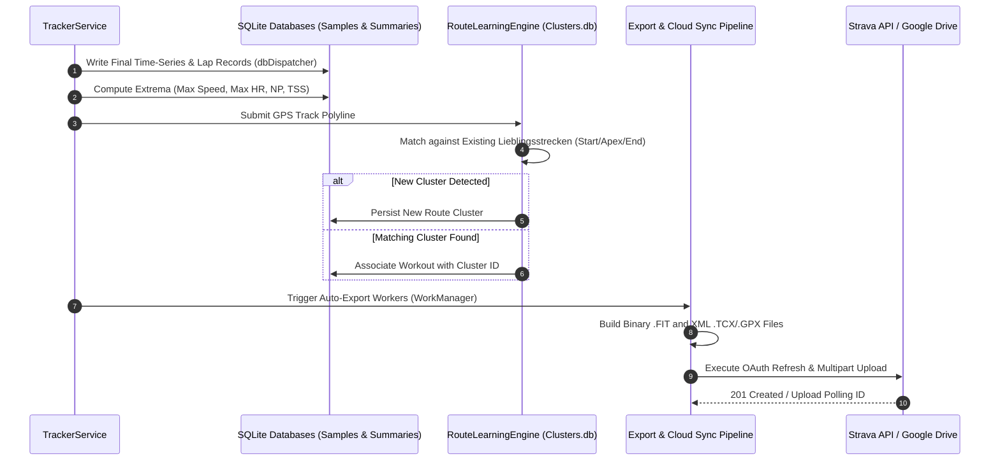

# Software Architecture: aTrainingTracker (ASPICE SWE.2)

This document establishes the comprehensive software architectural design and component interfaces of **aTrainingTracker**, fulfilling the **Automotive SPICE (ASPICE v3.1 / v4.0) SWE.2** standard across Base Practices `BP.1` through `BP.5`.

---

## 1. Architectural Overview & Component Model (SWE.2.BP1, BP2)

aTrainingTracker is engineered as an offline-first, reactive Android fitness tracking platform combining real-time hardware telemetry ingestion (ANT+ and Bluetooth Low Energy) with high-performance Jetpack Compose user interfaces, multi-layer SQLite persistence, and mathematical domain engines.

### 1.1 Architectural Layers & Subsystems
1. **Presentation Layer (Compose MVI)**: Single-activity architecture (`MainActivityWithNavigation`) hosting a declarative Compose `NavHost`. UI components observe unidirectional `StateFlow` streams from ViewModels with zero direct Android framework service binding.
2. **Domain & Scientific Engine Layer**: Pure JVM mathematical models executing signal filtering (α-exponential smoothing, moving averages), physiological modeling (Normalized Power, Training Stress Score, Intensity Factor, Zone distributions), spatial clustering (Lieblingsstrecken / DBSCAN line clustering), and climb categorization (`ClimbDetector`).
3. **Service Layer**: Two specialized Android foreground services (`location|health` foreground service types):
   - `BANALService`: Manages ANT+ and BLE peripheral lifecycles, connection arbitration, and sensor failover.
   - `TrackerService`: Coordinates session recording, active/pause timers, 1-Hz high-precision database serialization, and crash recovery.
4. **Data & Repository Layer**: Exposes conflated reactive flows, in-memory caching, and asynchronous mutation channels. Decouples UI controllers from SQLite storage.
5. **Persistence & Serialization Layer**: Specialized SQLite database managers utilizing WAL mode and serialized dispatchers, complemented by streaming binary FIT, XML GPX, and TCX exporters and background cloud upload workers.

---

## 2. Requirement Allocation to Architecture (SWE.2.BP3)

All system requirements across the 9 living domain shards are allocated directly to corresponding architectural subsystems:

| Domain Shard | Requirement Prefix Families | Allocated Architectural Components | Primary Responsibilities |
| :--- | :--- | :--- | :--- |
| **Tracking & Live Sensor Cockpit** | `CON`, `FIL`, `FUSION`, `SEN`, `TRK`, `WEA` | `BANALService`, `TrackerService`, `ProxySensor`, `MySensorManager`, `AutoPauseManager` | ANT+/BLE telemetry ingestion, sensor fusion, auto-pause debounce, 1-Hz sample recording. |
| **Post-Workout Analytics & Periods** | `PER`, `PERF` | `WorkoutRepository`, `PowerPhysiologyCalculator`, `ZoneDistributionCalculator`, `PeriodsRepository` | Physiological computation (NP, TSS), 5/7 power zone distributions, period statistics & trend filters. |
| **Maps, Polylines & Navigation** | `GEO`, `MAP`, `NAV`, `ROU` | `ClimbDetector`, `PolylineProgressTracker`, `MapFragmentWithTrackViewModel`, `ATrainingTrackerMap` | Web Mercator tile rendering, polyline compression, climb categorization, live segment gate matching. |
| **Persistence, Migration & Cloud Export** | `DAT`, `EXP`, `EXT`, `MIG` | `WorkoutSamplesDb`, `WorkoutSummariesDatabaseManager`, `FitFileWriter`, `StravaUploader`, `GoogleDriveBackupManager` | Time-series SQLite storage, schema migration, Strava OAuth/upload retry, FIT/TCX/GPX serialization. |
| **Settings, Profiles & Localization** | `LOC`, `MON`, `PRI`, `SET` | `TuningPreferencesDataStore`, `EquipmentDatabaseManager`, `PrivacyZoneManager`, `BillingManager`, `ProFeatureManager`, `SensorQuotaReconciliationManager` | DataStore persistence, 9-locale string parity, sensor quotas, monetization, vehicle equipment, GPS obfuscation. |
| **UI Components & Design System** | `UI`, `UNT` | Jetpack Compose theme (`TTTheme`), `MetricItem`, `ElevationProfile`, `CustomLineChart`, `AppModalBottomSheet`, `WorkoutPhotoStrip`, `WorkoutTimePhotoPickerSheet` | High-contrast AMOLED theming, responsive landscape layouts, chart scrubbing, reusable Compose components, chronological workout photo selection. |
| **Engineering Process & Stability** | `ARC`, `BLD`, `BUG`, `INT`, `LIV`, `LOG`, `MAN`, `NFR`, `PRO`, `REG`, `SEC`, `STB`, `STR`, `TOOL`, `TST` | ASPICE Dual-Agent Quality Gates, `jira_util.py`, `verify_requirement_governance.py`, ProGuard rules | CI/CD build hygiene, Chesterton's fence archaeology, crash resilience, process kill simulation. |
| **Jubilee Milestones & App Reviews** | `REV` | `MilestoneDetector`, `FirstJubileeCelebrationDialog`, `InAppReviewManager` | Milestone counting, achievement celebration, Google Play in-app review prompting. |
| **Project Governance & Store Presence** | `STP` | `StoreMetadataContractTest`, Google Play assets, screenshots | Google Play store presence parity, localized descriptions, automated metadata validation. |

---

## 3. Dynamic Behavior & State Machines (SWE.2.BP4)

### 3.1 Workout Tracking Lifecycle & Crash Recovery
The recording state machine transitions deterministically between `READY`, `TRACKING`, `AUTO_PAUSED`, `MANUAL_PAUSED`, and `FINISHED`. State persistence ensures uninterrupted recovery across unexpected system process termination.

### 3.2 Dual-Protocol Sensor Arbitration & Failover
`ProxySensor` dynamically resolves the highest-accuracy telemetry source among competing physical interfaces (ANT+, Bluetooth Low Energy, Smartphone Internal Sensors, and DEM lookup).

### 3.3 Post-Workout Persistence, Route Clustering & Cloud Export
Upon session completion, the recording pipeline persists all time-series samples and metadata asynchronously, triggers route clustering, and queues background cloud synchronization.

---

## 4. Concurrency, Threading & Resource Invariants (SWE.2.BP5)

### 4.1 Coroutine Dispatcher Separation
To prevent UI jank, thread contention, and Android SQLite database lock errors, execution threads are strictly partitioned:
- **`Dispatchers.Main`**: Exclusively dedicated to Jetpack Compose rendering, UI animations, and immediate state consumption. Strictly zero file I/O or SQLite database operations.
- **`Dispatchers.IO`**: Network operations (Strava API, Google Drive, TCX downloads), filesystem exports, and JSON file parsing.
- **`dbDispatcher` (`Executors.newSingleThreadExecutor().asCoroutineDispatcher()`)**: Dedicated single-threaded dispatcher serializing all writes and transaction commits across SQLite database managers (`WorkoutSamplesDb`, `WorkoutSummariesDatabaseManager`, `LapsDatabaseManager`). Guarantees zero `SQLiteDatabaseLockedException`.

### 4.2 Foreground Service & Permission Governance
- `TrackerService` and `BANALService` run as explicit Android Foreground Services with `location|health` foreground service types declared in `AndroidManifest.xml`.
- Runtime permissions (`ACCESS_FINE_LOCATION`, `BLUETOOTH_SCAN`, `BLUETOOTH_CONNECT`, `BODY_SENSORS`) are guarded defensibly on startup; missing permissions gracefully degrade telemetry without crash loops or unhandled exceptions (`REQ-STB-008`).

### 4.3 SQLite Schema Migration & Data Integrity Invariants
- All SQLite databases employ an idempotent schema upgrade architecture (`onUpgrade` parity).
- Schema alterations execute non-destructive `ALTER TABLE ADD COLUMN` operations within defensive `try-catch` blocks checking existing column presence via `PRAGMA table_info`.
- Under no circumstances does schema migration drop user tables or purge historical telemetry records.

### 4.4 Status Bar Notification Architecture & Monolithic Density Packaging (`REQ-UI-452`)
- **Monochrome Status Bar Silhouette**: All foreground service and application status bar notifications (`TrackerService`, `TrainingApplication`, `WorkoutDeletionNotificationManager`, `ExportNotificationManager`, `SensorBatteryNotificationManager`) route through dedicated density-independent vector asset `ic_stat_notify_logo.xml` (24x24dp, `#FFFFFF` with alpha channel). Colored multi-density raster PNGs are prohibited in `.setSmallIcon(...)` to prevent `SystemUI` Binder IPC `RemoteServiceException` / `BadForegroundServiceNotificationException` crashes.
- **Monolithic Density App Bundle Packaging**: In `app/build.gradle`, `bundle { density { enableSplit = false } }` is enforced to ensure all drawable resources remain packaged inside `base.apk`, preventing Split-APK resource desynchronization across Android devices.

### 4.5 Paired Bluetooth LE Address Resolution, Scan-Assisted Connection & Search Lifecycle (`REQ-CON-023`)
- **Random Static MAC Classification & Address Type**: Unbonded BLE fitness peripherals commonly utilize Random Static MAC addresses (identifiable by bits 47..46 = `11b`, i.e. `(firstOctet & 0xC0) == 0xC0`). When Android's `BluetoothRemoteDevices` cache is empty (e.g. after phone reboot or Bluetooth toggle), calling `getRemoteDevice(mAddress)` defaults to `ADDRESS_TYPE_PUBLIC`, causing peripherals to ignore `CONNECT_IND`. On API 33+, `MyBTLEDevice` explicitly invokes `BluetoothAdapter.getRemoteLeDevice(mAddress, ADDRESS_TYPE_RANDOM)`.
- **Active Scan-Assisted Cache Warming**: `MyBTLEDevice` executes a lightweight, address-filtered `BluetoothLeScanner` scan during `startSearching()` (permission-gated by `BLUETOOTH_SCAN` on API 31+ or `BLUETOOTH_ADMIN` / `ACCESS_FINE_LOCATION` on API < 31). The scan is unconditionally stopped on GATT connection (`STATE_CONNECTED`), timeout, manual disconnect, or device shutdown.
- **Configurable Search Duration**: Sequential search in `DeviceManager` honors `TrainingApplication.getBtleSearchPeriodMs()` (range $3\text{--}15$s, default 5s) instead of legacy hardcoded 10s intervals, preventing head-of-line blocking when paired sensors are offline.

### 4.6 Chronological MediaStore Querying & Workout Photo Picker Permissions (`REQ-UI-455`)
- **Temporal Window Querying**: Runtime media read permissions (`READ_MEDIA_IMAGES` on API 33+, `READ_MEDIA_VISUAL_USER_SELECTED` on API 34+, and `READ_EXTERNAL_STORAGE` on API <= 32) enable `WorkoutPhotoManager` to pre-filter local photos matching the workout time window `[startTimeMs - 5m .. endTimeMs + 5m]` via `MediaStore.Images.Media.EXTERNAL_CONTENT_URI` using `DATE_TAKEN` with fallback to `DATE_ADDED * 1000L`.
- **Zero-Dead-End Fallback Architecture**: In compliance with Android privacy invariants, permission denial or zero matching images seamlessly and automatically triggers fallback to `ActivityResultContracts.PickMultipleVisualMedia()`, ensuring zero dead-ends and allowing athletes to browse their full gallery without permissions.
- **Rule 73 Stacked Button Ergonomics**: `WorkoutTimePhotoPickerSheet` is presented via `AppModalBottomSheet(scrollable = false)` hosting a 3-column `LazyVerticalGrid` and vertically stacked full-width CTAs ("Hinzufügen (<count>)" and "Alle Bilder anzeigen"), eliminating horizontal button starvation in German and other localized viewports.

### 4.7 Subscription Downgrade Sensor Quota Reconciliation (`REQ-SET-084.2`, `REQ-SET-084.5`, `REQ-SET-084.7`)
- **Centralized Reconciliation Management**: `SensorQuotaReconciliationManager` governs sensor pairing quotas across the application, decoupling reconciliation logic from `DeviceListViewModel`.
- **Global Lifecycle Triggers & Presentation**: Evaluates paired sensor count against `MAX_FREE_PAIRED_DEVICES = 2` upon application start/resume (`MainActivityWithNavigation.onResume`), tracking cockpit entry (`TrackingTabsScreen`), reactive transitions to Free tier (`!isProActive()`), and pre-tracking actions in `ControlTrackingViewModel`. Presents `KeepTwoSensorsBottomSheet` globally within `ATrainingTrackerApp`.
- **Heuristic Default Preselection & Unpair Recommendation (`ATT-5490`)**:
  - `determineDefaultKeepDeviceIds` preselects `SPEED_AND_LOCATION_GOOGLE_FUSED` over `SPEED_AND_LOCATION_GPS` in Slot 1 when both location sensors are paired (preserving whichever single location sensor is paired if only one exists). Slot 2 prioritizes the most recently active external remote sensor (`protocol != Protocol.SMARTPHONE`), evaluating `isConnected == true` first and raw epoch millisecond `lastSeen` timestamps second. Only when no external remote sensors exist does the heuristic fall back to `ALTITUDE_FROM_PRESSURE` (Barometer) and remaining smartphone devices.
  - `determineRecommendedUnpairDeviceId` recommends unpairing `ALTITUDE_FROM_PRESSURE` first; if both Google Fused and GPS are paired, it recommends unpairing `SPEED_AND_LOCATION_GPS` next, ensuring the athlete's preferred Google Fused location source is retained.
- **In-Ride Suppression & Non-Destructive Pruning**: Reconciliation is strictly suppressed during active workout recording (`!isTracking()`). Unselected sensors are marked `PAIRED = 0` in persistence while custom names, calibration factors, wheel circumferences, and equipment links remain 100% intact.
- **Service-Level Hardware Connection Clamping**: As defense-in-depth, `DeviceManager.startSearchForPairedDevices()` clamps remote device creation to `MAX_FREE_PAIRED_DEVICES = 2` on Free tier to prevent connecting excess hardware prior to UI reconciliation.

### 4.8 Location Sensor Priority & Fresh-Installation Default Pairing (`REQ-TRK-024`)
- **Google Fused Priority Over GPS**: In `MySensorManager`, `DeviceType.SPEED_AND_LOCATION_GOOGLE_FUSED` strictly precedes `DeviceType.SPEED_AND_LOCATION_GPS` across `SPEED_PRIORITY`, `ALTITUDE_PRIORITY`, and `LOCATION_PRIORITY`. While dedicated physical wheel/footpod sensors (`RUN_SPEED`, `BIKE_SPEED`, `BIKE_POWER`) and barometric pressure sensors (`ALTITUDE_FROM_PRESSURE`) retain absolute precedence, Google Fused Location Provider delivers faster time-to-first-fix and greater trajectory stability than raw GPS when location-derived speed, distance, altitude, or coordinates are utilized.
- **Fresh Installation Default Pairing & De-Googled Fallback**: On fresh database initialization (`DevicesDatabaseManager.DevicesDbHelper.addLocationDevicesToDb`), Google Play Services availability is evaluated via `GooglePlayServicesUtil.isGooglePlayServicesAvailable(mContext) == ConnectionResult.SUCCESS`. If available, `SPEED_AND_LOCATION_GOOGLE_FUSED` is paired by default (`PAIRED = true`) and raw GPS is left unpaired (`PAIRED = false`). On de-Googled environments where Play Services is absent or unresolvable, the system deterministically falls back to pairing raw GPS (`PAIRED = true`). Existing installations and database upgrades preserve the athlete's persisted sensor pairing configuration without modification.

