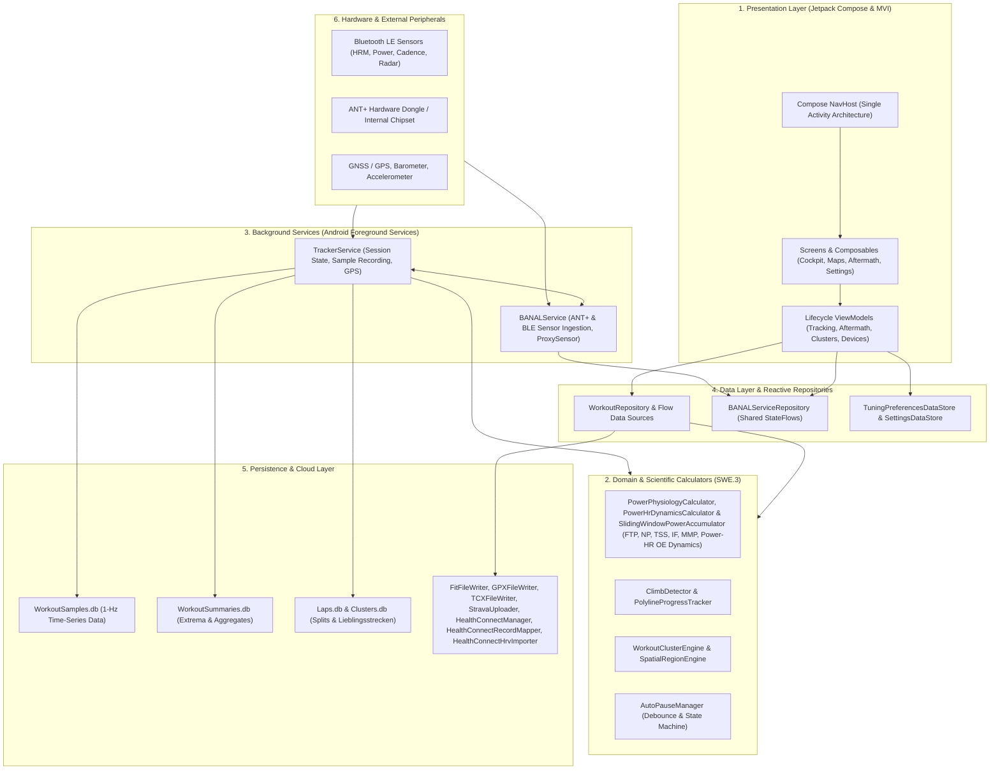
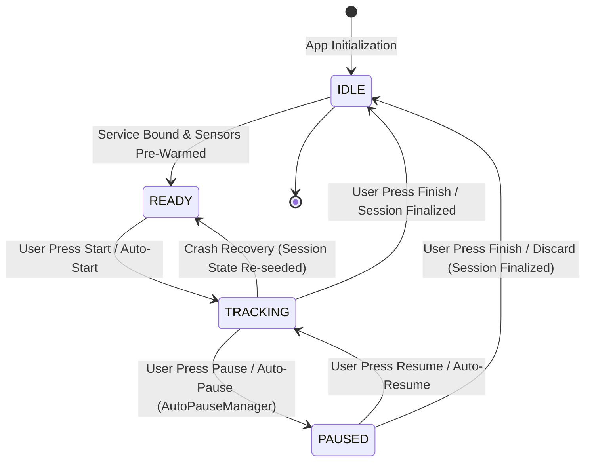
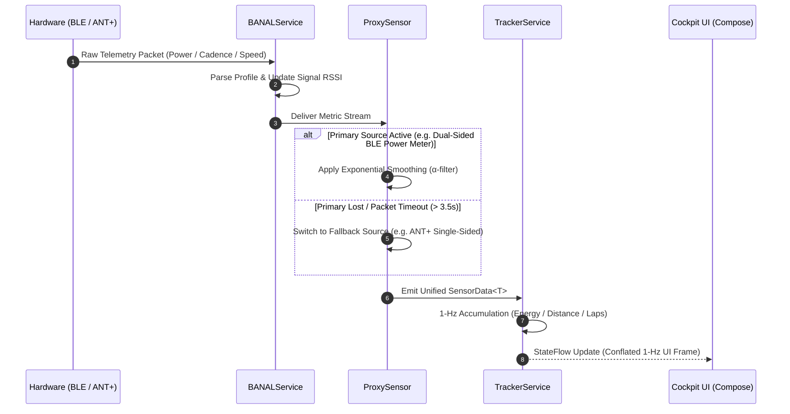
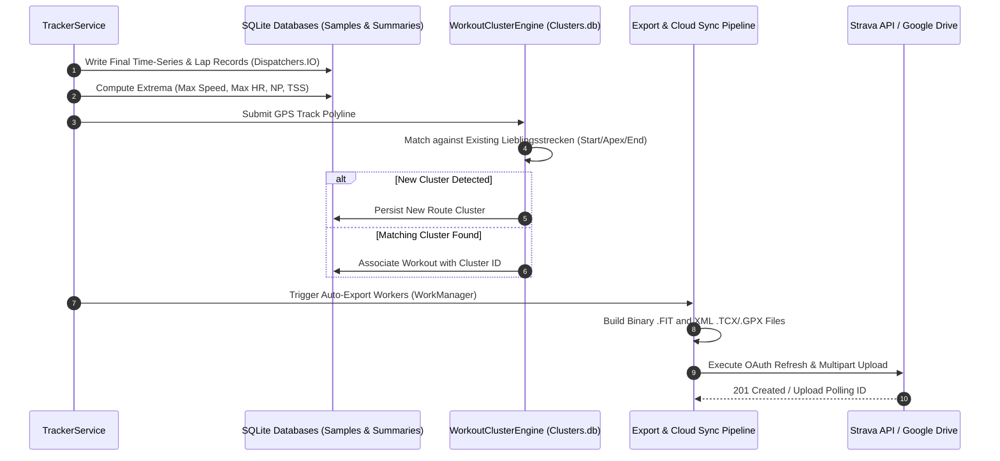
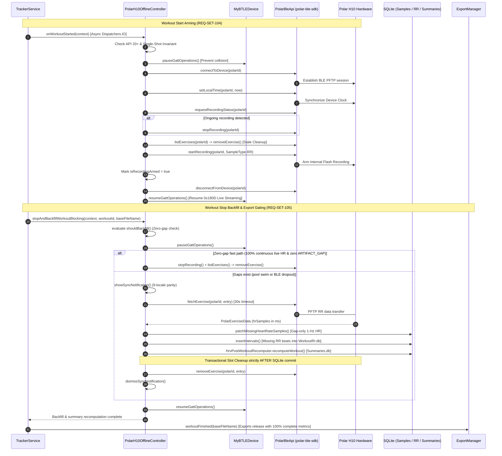

# Software Architecture: aTrainingTracker (ASPICE 4.0 SWE.2)

**Document ID**: `DOC-ARC-MAIN`  
**Version**: 1.0.32  
**Status**: Reviewed  
**Approver**: Pending PO Sign-Off  

This document establishes the comprehensive software architectural design and component interfaces of **aTrainingTracker**, fulfilling the **Automotive SPICE (ASPICE v4.0) SWE.2** standard across Base Practices `BP1` through `BP5`.

---

## 1. Architectural Overview & Component Model (SWE.2.BP1)

aTrainingTracker is engineered as an offline-first, reactive Android fitness tracking platform combining real-time hardware telemetry ingestion (ANT+ and Bluetooth Low Energy) with high-performance Jetpack Compose user interfaces, multi-layer SQLite persistence, and mathematical domain engines.

### 1.1 Architectural Layers & Subsystems
1. **Presentation Layer (Compose MVI)**: Single-activity architecture (`MainActivityWithNavigation`) hosting a declarative Compose `NavHost`. UI components observe unidirectional `StateFlow` streams from ViewModels with zero direct Android framework service binding.
2. **Domain & Scientific Engine Layer**: Pure JVM mathematical models executing signal filtering (α-exponential smoothing, moving averages), physiological modeling (Normalized Power, Training Stress Score, Intensity Factor, Zone distributions), spatial clustering (Lieblingsstrecken / DBSCAN line clustering), and climb categorization (`ClimbDetector`).
3. **Service Layer**: Two specialized Android foreground services (`location|health` foreground service types):
   - `BANALService`: Manages ANT+ and BLE peripheral lifecycles, connection arbitration, and sensor failover.
   - `TrackerService`: Coordinates session recording, active/pause timers, 1-Hz high-precision database serialization, and crash recovery.
4. **Data & Repository Layer**: Exposes conflated reactive flows, in-memory caching, and asynchronous mutation channels. Decouples UI controllers from SQLite storage.
5. **Persistence & Serialization Layer**: Specialized SQLite database managers utilizing WAL mode and serialized dispatchers, complemented by streaming binary FIT, XML GPX, and TCX exporters and background cloud upload workers.

---

## 2. Requirement Allocation to Architecture (SWE.2.BP1, BP4)

All system requirements across the 9 living domains (sharded `<= 4,000` lines per `REQ-PRO-093.3`, `REQ-PRO-127.3`) are allocated directly to corresponding architectural subsystems:

| Domain Shard | Requirement Prefix Families | Allocated Architectural Components | Primary Responsibilities |
| :--- | :--- | :--- | :--- |
| **Tracking & Live Sensor Cockpit** | `CON`, `FIL`, `FUSION`, `SEN`, `TRK`, `WEA` | `BANALService`, `TrackerService`, `PostWorkoutFinalizer`, `LapTelemetryExtractor`, `WorkoutPostProcessingCoordinator`, `WorkoutPostProcessingService`, `WorkoutPostProcessingNotificationManager`, `LiveWorkoutBroadcastTracker`, `ProxySensor`, `MySensorManager`, `AutoPauseManager`, `CyclingPowerMetricsDevice`, `SlidingWindowPowerAccumulator`, `LiveMmpCurveChart`, `HRVMetricsDevice`, `RrArtifactFilter`, `DfaCalculator`, `HrvSignalQualityAnalyzer`, `QuaternionGyroProjector`, `WheelCircumferenceCalibrator`, `UnicycleOdometryEkf`, `PhoneCarriageMode`, `PhoneCarriageClassifier`, `PhoneCarriageModeFormatter`, `ImuCadenceDsp`, `SmartphoneImuCadenceEstimator`, `KinematicSportTypeDiscriminator`, `MovingSpeedHistogram`, `MultisportTransitionDetector`, `MultisportTransitionBridge`, `MultisportLapCoordinator`, `BarometricAltitudeFilter`, `BarometricBucketDispersion`, `AttFusedTimestampNormalizer`, `SpeedAndLocationDevice_ATTFused`, `AttFusedPreferences`, `KinematicAltitudeSlopeEkf`, `AltitudeAndSlopeDevice_ATTFused`, `AttFusedAltitudePreferences`, `ExtendedRtsOdometrySmoother`, `ExtendedRtsAltitudeSlopeSmoother`, `RadarStateRepository`, `RadarLightController`, `RadarLightDeviceClient`, `SmartRadarLightEngine`, `SmartBrakeLightDetector`, `IndirectTpmsEstimator`, `DualWheelTpmsEstimator` | ANT+/BLE telemetry ingestion, type-safe finite-guarded lap extraction (`LapTelemetryExtractor`), stateless 7-stage post-workout finalization (`PostWorkoutFinalizer`, `REQ-TRK-094`), sensor fusion, auto-pause debounce, 1-Hz sample recording with discrete-lifecycle `WORKOUT_UPDATED_INTENT` edge dispatch (`LiveWorkoutBroadcastTracker`, `REQ-STB-020`), live MMP curve & duration benchmarks, real-time HRV metric calculation, artifact filtering & firmware smoothing/synthetic signal quality analysis, 50-Hz IMU/barometer/step activity & phone carriage mode classification (`SensorType.ACTIVITY_AND_CARRIAGE_MODE`), carriage-classified smartphone IMU cycling crank cadence (`BIKE_FRONT_POCKET`, `BIKE_JERSEY_BACK`, strict `BIKE_HANDLEBAR` suppression) and running stride cadence/`STRIDES` estimation (`RUN_WAIST_HIP`, `RUN_BICEP_ARM`, `RUN_HANDHELD` w/ wrist-glance blanking & `TYPE_STEP_DETECTOR` fusion) sharing `ImuCadenceDsp`, quaternion-projected gyro yaw-rate & dead-reckoning odometry EKF sensor fusion, online wheel circumference auto-calibration, pairable ATT Fused virtual sensor device routing and hardware/pairing guards, adaptive kinematic altitude and slope EKF fusion with standstill drift clamping, Extended RTS backward odometry/altitude smoothing engines with 1-Hz carriage ingestion & kinematic fallback, multi-source radar arbitration and Garmin Varia smart tail/brake light control, and indirect single/dual-wheel TPMS deflation/puncture estimation. |
| **Post-Workout Analytics & Periods** | `HRV`, `PER`, `PERF`, `RAD`, `SPT`, `WKO` | `WorkoutRepository`, `WorkoutMultiSourceSampleDiscovery`, `ActivityCarriageTimelineCalculator`, `ActivityCarriageTimelineCard`, `PowerPhysiologyCalculator`, `ZoneDistributionCalculator`, `PeriodsRepository`, `PeriodMapUtils`, `ClusterWorkoutDataPort`, `WorkoutClusterEngine`, `WorkoutClusterRepository`, `HrvReadinessRepository`, `HrvReadinessDatabaseManager`, `HrvReadinessCalculator`, `HrvRmssdCalculator`, `HealthConnectHrvImporter`, `MorningHrvCheckViewModel`, `HrvReadinessTrendMath`, `HrvReadinessTrendCard`, `HrvReadinessTrendChart`, `WorkoutRrRepository`, `WorkoutRrDatabaseManager`, `HrvPostWorkoutRecomputer`, `ErtsPostWorkoutRecomputer`, `PowerHrDynamicsCalculator`, `PowerHrDynamicsInfoDialog`, `SwimWorkoutAdjustCard` | Physiological computation (NP, TSS), 5/7 power zone distributions, period statistics & trend filters, pool-swim length/distance recalculation (`WorkoutRepository#recalculateSwimWorkout`), favorite-route spatial clustering & persistence (`ClusterWorkoutDataPort`), multi-source track & telemetry column discovery (`WorkoutMultiSourceSampleDiscovery`), post-workout 1-Hz activity and phone carriage timeline coalescing and phase breakdown (`REQ-PER-045`), morning HRV readiness persistence & per-posture SWC baseline analytics, canonical rMSSD utility (`HrvRmssdCalculator`, `REQ-MIG-061.2`), nocturnal Health Connect HRV ingestion, guided morning resting HRV protocol, longitudinal HRV readiness trend charts in Periods screen, lossless workout RR intervals persistence and centered post-workout HRV recomputation, non-causal bidirectional Extended RTS trajectory and altitude profile recomputation with strict canonical column invariant, 1st-order dynamical Power-HR system identification & explanation sheet. |
| **Maps, Polylines & Navigation** | `CLM`, `GEO`, `MAP`, `NAV`, `RAD`, `ROU` | `GeoMath`, `PolylineProgressTracker`, `ClimbDetector`, `ClimbDeduplicator`, `LiveClimbsRepository`, `WorkoutClimbIngestionCoordinator`, `MapFragmentWithTrackViewModel`, `ATrainingTrackerMap` | Web Mercator tile rendering, pure-JVM equirectangular $\cos(\phi)$ polyline/segment projection & unified route elevation-gain hysteresis (`GeoMath`, `REQ-GEO-003`), polyline compression, climb categorization & lazy metadata `Climbs.db` deduplication with ellipse bounding-box slack (`REQ-STB-021.1`), `Mutex`-serialized `LiveClimbsRepository` list sharing (`REQ-STB-021.2`), batch-deferred workout climb ingestion outside UI/Database layers (`WorkoutClimbIngestionCoordinator`, `REQ-STB-021.3`), and live segment gate matching. |
| **Persistence, Migration & Cloud Export** | `DAT`, `EXP`, `EXT`, `MIG`, `RAD` | `BaseDatabaseManager`, `SqliteSchemaUtils`, `DatabaseExtensions.kt`, `StreamSummaryCalculator`, `WorkoutSamplesDatabaseManager`, `WorkoutSummariesDatabaseManager`, `ClimbsDatabaseManager`, `WorkoutRrDatabaseManager`, `HrvReadinessDatabaseManager`, `ExportStatusDatabaseManager`, `ExportStatusRepository`, `BatchMetadataLoader`, `WorkoutParser`, `CloudWorkoutSourceScanner`, `BackupOrchestrator`, `SecureZipExtractor`, `LegacyImportEngine`, `StravaBulkExportImporter`, `AutoImportManager`, `ImportEngine`, `BulkImportBatchContext`, `FitFileWriter`, `GPXFileWriter`, `TCXFileWriter`, `RawSensorFileExporter`, `RawSensorSidecarFiles`, `SensorDiagnosticBundlePackager`, `SensorDiagnosticShareSheet`, `StravaUploader`, `StravaSyncScheduler`, `GoogleDriveBackupManager` | Shared `volatile` DCL / `ATT-289` reopen lifecycle (`BaseDatabaseManager`), centralized `PRAGMA table_info` schema introspection (`SqliteSchemaUtils`), functional cursor/transaction combinators (`DatabaseExtensions.kt`), parameterized bounding-box/polyline/stream/ascent calculation (`StreamSummaryCalculator`, `REQ-DAT-047`), time-series SQLite storage, workout RR intervals storage, morning HRV readiness SQLite storage, schema migration, zero-split climb polyline parsing (`ClimbsDatabaseManager`), shared O(1) batch workout metadata & athlete metrics preloading (`BatchMetadataLoader`, `REQ-DAT-045`) + chunked export-status batch queries (`ExportStatusDatabaseManager.getExportRowsForWorkouts`), unified streaming `WorkoutParser` ingestion (`REQ-MIG-061.1`), shared Zip-Slip-hardened cloud/ZIP discovery (`CloudWorkoutSourceScanner`, `SecureZipExtractor`), shared backup orchestration (`BackupOrchestrator`) and single-unzip `.attbackup` staging reuse (`ImportEngine`), coroutine-scoped bulk-import reload deferral with single post-batch reconciliation (`BulkImportBatchContext`, `REQ-STB-021.3`), Strava OAuth/upload retry, FIT/TCX/GPX serialization with native Garmin FIT HrvMesg export/import, raw Polar sensor telemetry sidecar export across Local/Dropbox/Google Drive, and 1-tap Aftermath diagnostic ZIP bundle packaging with privacy-preserving GPS stripping (`REQ-EXP-044`, `ATT-8020`). |
| **Settings, Profiles & Localization** | `LOC`, `MON`, `PRI`, `SET` | `TuningPreferencesDataStore`, `SwimmingSection`, `EquipmentDbHelper`, `EquipmentRepository`, `ProFeatureManager`, `SupporterTier`, `GarageLeagueDetector`, `HealthConnectManager`, `HealthConnectRecordMapper`, `SensorQuotaReconciliationManager`, `DevicesDatabaseManager`, `LastActiveDateFormatter`, `PolarOfflineGattCoordinator`, `PolarOfflineCapabilityStore`, `PolarH10OfflineController`, `PolarVeritySenseOfflineController`, `PolarRetrySyncCoordinator`, `PolarOnlineStreamingBridge`, `PolarLiveRunningCadenceEstimator`, `PolarH10RunningDynamicsEstimator`, `PolarRawTelemetryRecorder`, `PolarRawSidecarRecovery`, `PolarRawTelemetryReader`, `PolarRawTelemetryPruner`, `SmartphoneRawTelemetryRecorder`, `SmartphoneRawSensorCapture`, `PhoneRawSidecarRecovery`, `PhoneRawTelemetryReader`, `RawSensorRetentionPolicy` | DataStore persistence, pool-swim tuning preferences (`SwimmingSection`), 9-locale string parity, sensor quotas, monetization, vehicle equipment, Health Connect sync & record mapping, `ThreadLocal` locale/timezone-keyed device timestamp caching (`LastActiveDateFormatter`, `REQ-STB-021.4`), Devices.db v14 offline recording & live IMU toggle persistence, Polar H10 (RR) / Verity Sense (optical HR) offline PFTP recording control & lifecycle-safe Aftermath retry coordination, persistent single-GATT Polar PMD live HR/RR + ACC/GYRO streaming with shared GATT arbitration, Verity ACC mutual exclusion, BSportType.RUN-gated cadence priority, pure-Kotlin H10 ACC / Verity GYRO+ACC running cadence & stride estimation, 200 Hz H10 sternum Running Dynamics (`VERTICAL_OSCILLATION` cm, `GROUND_CONTACT_TIME` ms) with FIT `mm`/`ms` export, and streaming compressed raw Polar telemetry sidecars (`.polar_raw.csv.gz`) with rolling retention policy (30d default, 7d, Keep all, Off) outside SQLite WorkoutSamples.db. |
| **UI Components & Design System** | `UI`, `UNT` | Jetpack Compose theme (`ATrainingTrackerTheme`), `MetricItem`, `ElevationProfile`, `ElevationProfileOverlayComponents`, `TelemetryMetricGraph`, `TelemetryOverlayComponents`, `TelemetryChartStack`, `AppModalBottomSheet`, `WorkoutPhotoStrip`, `WorkoutTimePhotoPickerSheet`, `MorningHrvCheckScreen` | High-contrast AMOLED theming, responsive landscape layouts, chart scrubbing, multi-source overlay curves & persisted per-chart visibility (`TelemetryChartStack`), reusable Compose components, chronological workout photo selection, guided morning resting HRV acquisition. |
| **Engineering Process & Stability** | `ARC`, `BLD`, `BUG`, `INT`, `LIV`, `LOG`, `MAN`, `NFR`, `PRO`, `REG`, `SEC`, `STB`, `STR`, `TOOL`, `TST` | ASPICE Dual-Agent Quality Gates, `jira_util.py`, `verify_requirement_governance.py`, `DebugHeapWatchdog`, ProGuard rules, [ADR-001](architecture/adr_001_java_core_services_migration.md), `JavaCoreMigrationStrategyContractTest` | CI/CD build hygiene, Chesterton's fence archaeology, crash resilience, headless `BuildConfig.DEBUG`-only heap telemetry & one-shot HPROF watchdog (`DebugHeapWatchdog`, `REQ-STB-022`), 1-Hz live-tracking heap-churn elimination & `!finished` Aftermath consumer guards (`REQ-STB-020`), process kill simulation, Java core services migration governance (`REQ-ARC-005`). |
| **Jubilee Milestones & App Reviews** | `REV` | `MilestoneAutoNamingManager`, `FirstJubileeCelebrationDialog`, `FirstJubileeActionHelper` | Milestone counting, achievement celebration, Google Play in-app review prompting. |
| **Store Presence** | `STP` | `PlayStoreListingContractTest`, Google Play assets, screenshots | Google Play store presence parity, localized descriptions, automated metadata validation. |

---

## 3. Dynamic Behavior & State Machines (SWE.2.BP2)

### 3.1 Workout Tracking Lifecycle & Crash Recovery
The recording state machine transitions deterministically across top-level `TrackingMode` states: `IDLE`, `READY`, `TRACKING`, and `PAUSED`. Internal pause sub-states are delegated to `AutoPauseManager` / `AutoPauseState` (`TRACKING`, `PAUSE_DEBOUNCE_PENDING`, `AUTO_PAUSED`, `MANUAL_PAUSED`, `SENSOR_LOST`). Persistent database state enables active session recovery upon unexpected process termination.

### 3.2 Dual-Protocol Sensor Arbitration & Failover
`ProxySensor` dynamically resolves the highest-accuracy telemetry source among competing physical interfaces (ANT+, Bluetooth Low Energy, Smartphone Internal Sensors, and DEM lookup).

### 3.3 Post-Workout Persistence, Route Clustering & Cloud Export
Upon session completion, the recording pipeline persists all time-series samples and metadata asynchronously, triggers route clustering, and queues background cloud synchronization.

### 3.4 Polar H10 & Verity Sense Offline Recording, Live IMU Bridge & Export Gating Lifecycle (REQ-SET-104, REQ-SET-105, REQ-SET-108, REQ-SET-109, REQ-SET-112, REQ-SET-114, REQ-SET-116, REQ-SET-119)
When a paired Polar H10 or Polar Verity Sense has live IMU opted in (`Devices.db` v14 `polarLiveImuEnabled = 1`, `@RequiresApi(33)`), `DeviceManager.createNewBluetoothLEDevice()` instantiates `PolarOnlineStreamingBridge` instead of `BTLEHeartRateDevice`, maintaining one persistent `PolarBleApi` session (`setAutomaticReconnection(true)`) delivering `HR`/`RR` (`RrBeatSource` -> `HRVMetricsDevice`) alongside `ACC` (200 Hz on H10 `BSportType.RUN`, fallback 100/50 Hz; 52 Hz on Verity) and `GYRO` (52 Hz on Verity Blue Sensor Mode). `PolarOnlineStreamingBridge` registers its active `PolarBleApi` in `PolarOfflineGattCoordinator` so offline PFTP arming/backfill reuses the single GATT link, enforces per-channel `ACC` mutual exclusion against `PolarVeritySenseOfflineController`, delegates live `ACC`/`GYRO` samples to pure-Kotlin `PolarLiveRunningCadenceEstimator` (H10 `1.2–4.0 Hz` chest bandpass + `5 s` autocorrelation; Verity `0.6–2.0 Hz` `GYRO+ACC` arm-swing fusion; canonical `strides/min` with `1 Hz` updates, `<= 3 s` standstill zeroing, and `accumulate(0)` stride seeding) plus `PolarH10RunningDynamicsEstimator` (`200 Hz` `~0.25 Hz` gravity alignment, detrended double-integration `VERTICAL_OSCILLATION` in `5.0..13.0 cm`, `5 ms` `GROUND_CONTACT_TIME` in `140..400 ms` with `< 130 spm` walking suppression, exported via `FitFileWriter` in FIT SDK `mm = cm * 10f` and `ms`), and gates IMU-derived `CADENCE`/`STRIDES` strictly on `BSportType.RUN` (including `TTSportType.WALK`) in `MySensorManager.CADENCE_PRIORITY` (`RUN_SPEED > BIKE_CADENCE > BIKE_SPEED_AND_CADENCE > BIKE_POWER > HRM > SPEED_AND_LOCATION_ATT_FUSED`) and `STRIDES_PRIORITY` (`RUN_SPEED > HRM > SPEED_AND_LOCATION_ATT_FUSED`) behind dedicated footpods/cycling sensors and ahead of smartphone IMU cadence (`ImuCadenceDsp`, `SmartphoneImuCadenceEstimator`).

When live IMU is disabled (`DEFAULT 0`) or API < 33, `BTLEHeartRateDevice` remains unchanged and `TrackerService` triggers non-blocking single-shot arming (`PolarH10OfflineController` or `PolarVeritySenseOfflineController`) at workout start. Both controllers coordinate GATT yield via `PolarOfflineGattCoordinator` (`MyBTLEDevice.pauseGattOperations()` / `resumeGattOperations()`), enforce `isArmed` mid-workout fringe-flap invariance, handle `SYSTEM_BUSY` gracefully, and for optical sensors persist PFTP capability in `PolarOfflineCapabilityStore` while arming `PolarDeviceDataType.HR` via `PolarOfflineRecordingApi`.

Upon workout completion (`TrackerService.endWorkout()`), `PolarH10OfflineController.stopAndBackfillWorkoutBlocking()` and `PolarVeritySenseOfflineController.stopAndBackfillWorkoutBlocking()` gate downstream `ExportManager.workoutFinished()` exports; when `DeviceManager` confirms the sensor disconnected at stop (`PolarOfflineGattCoordinator.isTargetConfirmedDisconnected()`), both controllers fast-fail without stalling on `waitForConnection` (`REQ-SET-119.3`, bounding any fallback connection attempt at `STOP_CONNECTION_TIMEOUT_MS = 5_000L` while persisting `polarSyncPending` when `needsBackfill == true`). H10 evaluates live continuity across `WorkoutSamples.db` and `WorkoutRr.db`, patching HR + RR intervals and invoking `HrvPostWorkoutRecomputer`. Conversely, `PolarVeritySenseOfflineController` (`REQ-SET-109`) evaluates `WorkoutSamplesDatabaseManager.hasMissingHeartRateSamples()` only (zero-gap fast path skips `getOfflineRecord` download while stopping HR and deleting only the matched entry), aligns `HrOfflineRecording.startTime` + 1-Hz samples into missing `SensorType.HR` rows, recomputes `SensorType.HR` extrema (`MIN`, `MAX`, `AVG`) into `WorkoutSummaries.db` + refreshes `WorkoutRepository` (strictly NEVER writing `WorkoutRr.db` or invoking `HrvPostWorkoutRecomputer`), and deletes ONLY the matched `PolarOfflineRecordingEntry` post-commit. When Verity Sense is unreachable at stop, `setPolarSyncPending()` tags `polarExerciseId` with `"verity:"` and `PolarH10RetrySyncBanner` (`PolarPendingRetrySyncSection`) renders localized Blue Sensor Mode wake instructions across 9 locales dispatching *Sync Now* onto `PolarRetrySyncCoordinator`'s non-composition `SupervisorJob() + Dispatchers.IO` scope (`REQ-SET-119.1`), emitting completion events so `WorkoutSummariesTabbedScreen` reloads `TrackOnMapAftermathViewModel` HR telemetry (`REQ-SET-119.2`).

### 3.3.3 Polar Raw Telemetry GZIP Sidecars & Rolling Retention (REQ-SET-117, ATT-8019)
High-frequency Polar PMD streaming (50–200 Hz `ACC`, 26–52 Hz `GYRO`, `HR`, `RR`) and offline exercise sync generate up to 720,000 frames/hour. Inserting high-frequency samples into `WorkoutSamples.db` would bloat the 1-Hz database by tens of megabytes and degrade query performance. To maintain zero SQLite bloat while capturing lossless raw streams:
1. **Asynchronous Bounded Buffering**: `PolarRawTelemetryRecorder` ingests multi-channel sensor frames into a non-blocking `Channel<RawTelemetryRow>(capacity = 8192, onBufferOverflow = BufferOverflow.DROP_OLDEST)` with `onUndeliveredElement` dropped-frame accounting (`getDroppedFrameCount()`), drained on `Dispatchers.IO` via a reusable `StringBuilder` (`RawTelemetryRow.appendCsvLine`) directly into a GZIP-compressed CSV file (`files/raw_sensor/<fileBaseName>.polar_raw.csv.gz`), cancelling its private `CoroutineScope` in `stop()` (`REQ-STB-023.3`, `.4`). `PolarOfflineGattCoordinator.acquirePolarApi()` clears Polar SDK's default `BleLogger.setLoggerInterface(null)` to eliminate Binder-thread hex allocation churn, and `PolarPmdStreamCoordinator` buffers Polar BLE stream flows with `PMD_STREAM_BUFFER_CAPACITY = 64` (`BufferOverflow.DROP_OLDEST`, `REQ-STB-023.2`, `.3`). Writes never stall BLE GATT or PMD callback loops.
2. **Self-Describing Metadata, Crash-Recovery Salvage & Replay Parser**: Sidecar files prepend `# metadata: {"schemaVersion":1,"appVersion":"...","sensorModel":"...","streamMode":"LIVE|OFFLINE","accRateHz":...,"gyroRateHz":...,"sportId":...}` followed by canonical column headers. On mid-workout crash recovery or user resume, `PolarRawTelemetryRecorder.resumeOrStartActiveSession()` delegates to `PolarRawSidecarRecovery` to atomically stage truncated `.tmp` archives via `.salvage`, decompress complete blocks via `GZIPInputStream`, drop partial trailing lines (`RawTelemetryRow.fromCsvLine`), and continue streaming seamlessly (with export-time recovery fallback in `RawSensorFileExporter`, `REQ-STB-025.2`). A pure-Kotlin parser `PolarRawTelemetryReader` validates metadata integrity and replays channels with graceful recovery for truncated archives.
3. **Cascade Deletion & Rolling Retention**: Deleting a workout in `WorkoutSummariesDatabaseManager.deleteWorkout()` or `WorkoutRepository.deleteWorkoutCascade()` purges its matching `.polar_raw.csv.gz` file (`REQ-DAT-042`). Background pruner `PolarRawTelemetryPruner` runs off the main thread to enforce user-configured rolling retention (`RawSensorRetentionPolicy`: `DAYS_30` [default], `KEEP_ALL`, `DAYS_7`, `OFF`) without deleting associated workout summary records.

### 3.3.4 Multi-Destination Raw Sidecar Export & Aftermath Diagnostic Sharing (REQ-EXP-044, ATT-8020)
To support forensic telemetry diagnostics without impacting standard workout exports:
1. **Multi-Destination Export & Graceful Skip**: `FileFormat.RAW_SENSOR` (`application/gzip`) exports all existing sidecars (`.polar_raw.csv.gz` and opt-in `.phone_raw.csv.gz`, resolved & salvaged via `RawSensorSidecarFiles.resolveExportableSidecars()`) through `RawSensorFileExporter`, `DropboxUploader`, and `GoogleDriveUploader`, while `SmartphoneRawTelemetryRecorder` / `PhoneRawSidecarRecovery` / `PhoneRawTelemetryReader` mirror `PolarRawTelemetryRecorder`'s bounded `Channel(8192, DROP_OLDEST)` + zero-`String.format` + periodic `GZIPOutputStream(syncFlush=true)` + `.tmp -> .salvage` crash-recovery contract across all 9 smartphone channels (`ACC`, `GYRO`, `ROTVEC`, `BARO`, `STEP`, `GNSS` [raw GPS], `GNSS_FUSED` [Google Fused], `WHEEL`, `STATE`) with instance-scoped zero-allocation per-channel GNSS deduplication for downstream pure-JVM replay (`REQ-EXP-044.1`, `REQ-EXP-045`, `REQ-EXP-047`). When a workout lacks any raw sensor sidecar, the export completes with a graceful skip and never fails standard export queues. `full_backup_content.xml` and `data_extraction_rules.xml` exclude `raw_sensor` from Android Auto Backup, and `SensorDiagnosticBundlePackager` gates `.phone_raw.csv.gz` strictly behind `includeGps == true`.
2. **1-Tap Diagnostic ZIP Packaging**: When viewing a workout with a raw sidecar, Aftermath exposes a "Report Raw Sensor Data" action in the header menu. `SensorDiagnosticBundlePackager` operates on `Dispatchers.IO` to assemble `cache/diagnostics/sensor_diagnostic_<fileBaseName>.zip` containing the raw sidecar, `workout_summary.json`, `laps.json`, `samples_1hz.csv`, and `diagnostic_metadata.json` with user symptom notes (`REQ-EXP-044.2`).
3. **Privacy-Preserving GPS Stripping**: When "Include GPS Location" is unchecked in `SensorDiagnosticShareSheet`, latitude and longitude columns are omitted from `samples_1hz.csv` and GPS map polylines are cleared from `workout_summary.json` (`REQ-EXP-044.3`).
4. **Secure Sharing & Localization Parity**: The bundle is shared via `Intent.ACTION_SEND` using Android `FileProvider` (`<cache-path name="diagnostics" path="diagnostics/" />`). All user-facing strings across all 9 supported locales are verified in `strings_export.xml` without emojis (`REQ-EXP-044.4`, `Rule 38`).
5. **Pure-JVM Offline Telemetry Replay Harness (`REQ-EXP-046`, `ATT-9349`)**: Both `PhoneRawTelemetryReader` and `PolarRawTelemetryReader` / `PolarRawMetadata` execute on pure JVM with zero Android or `org.json` dependencies. A test-scoped offline replay harness (`:app:replayRawTelemetry`, zero release APK impact) merges recorded `.phone_raw.csv.gz` and `.polar_raw.csv.gz` sidecars chronologically and drives the exact production estimators (`PhoneCarriageClassifier`, `SmartphoneImuCadenceEstimator`, `QuaternionGyroProjector`, `KinematicSportTypeDiscriminator`, `UnicycleOdometryEkf`, `KinematicAltitudeSlopeEkf`, `ExtendedRtsOdometrySmoother`, `ExtendedRtsAltitudeSlopeSmoother`, `PolarLiveRunningCadenceEstimator`, `PolarH10RunningDynamicsEstimator`) to emit deterministic scorecards, A/B candidate diffs, 1-Hz CSV trajectories, JSON reports, and ground-truth pass/fail exit codes.

### 3.5 Unit-Level Living Detailed Design & State Machine Models (ASPICE SWE.3, `REQ-PRO-114`)
Unit-level dynamic state machine models, event/guard/transition tables, `IF-SWE-*` interface mappings, threading contracts, error-handling mechanisms, and `ATT-7902` characterisation-test traceability for the four core service, peripheral, and repository units are maintained under `docs/architecture/detailed_design/`:
- **Tracking Foreground Service**: [`docs/architecture/detailed_design/tracker_service.md`](architecture/detailed_design/tracker_service.md) (`TrackerService`, `LiveWorkoutBroadcastTracker`, `TrackingMode`, `AutoPauseState`, `StartType`, `mScheduler`, `mDbExecutor`, `mRrFlushExecutor`)
- **Sensor Ingestion & Search Orchestration**: [`docs/architecture/detailed_design/banal_service.md`](architecture/detailed_design/banal_service.md) (`BANALService`, `DeviceManager`, `MyRemoteDevice`, `MySensorManager`, `ProxySensor`)
- **Bluetooth LE Peripheral State Machine & GATT Queue**: [`docs/architecture/detailed_design/my_btle_device.md`](architecture/detailed_design/my_btle_device.md) (`MyBTLEDevice`, `MyBTLEDevice.State`, `mGattQueue`, `mGattLock`)
- **Workout Repository & Reactive History Store**: [`docs/architecture/detailed_design/workout_repository.md`](architecture/detailed_design/workout_repository.md) (`WorkoutRepository`, `allWorkouts`, `isListLoading`, `activeReloadWorkoutIds`, `dirtyReloadWorkoutIds`, `deletedDuringLoadIds`, `cropMutex`)

Code-to-documentation parity is continuously enforced by [`DetailedDesignParityContractTest`](../app/src/test/java/com/atrainingtracker/trainingtracker/build/DetailedDesignParityContractTest.kt).

---

## 4. Concurrency, Threading & Resource Invariants (SWE.2.BP3)

### 4.1 Coroutine Dispatcher Separation
To prevent UI jank, thread contention, and Android SQLite database lock errors, execution threads are strictly partitioned:
- **`Dispatchers.Main`**: Exclusively dedicated to Jetpack Compose rendering, UI animations, and immediate state consumption. Strictly zero file I/O or SQLite database operations.
- **`Dispatchers.IO`**: Network operations (Strava API, Google Drive, TCX downloads), filesystem exports, JSON file parsing, and general SQLite database operations across `WorkoutRepository`, `WorkoutSamplesDatabaseManager`, `WorkoutSummariesDatabaseManager`, and `ClimbsDatabaseManager` leveraging SQLite WAL (Write-Ahead Logging) and transaction locks.
- **`dbDispatcher` (`Executors.newSingleThreadExecutor().asCoroutineDispatcher()`)**: Dedicated single-threaded dispatcher utilized in `KnownLocationsRepository` to serialize location database mutations and prevent SQLite lock contention.

### 4.2 Foreground Service & Permission Governance
- `TrackerService` and `BANALService` run as explicit Android Foreground Services with `location|health` foreground service types declared in `AndroidManifest.xml`.
- Runtime permissions (`ACCESS_FINE_LOCATION`, `BLUETOOTH_SCAN`, `BLUETOOTH_CONNECT`, `BODY_SENSORS`) are guarded defensibly on startup; missing permissions gracefully degrade telemetry without crash loops or unhandled exceptions (`REQ-STB-008`).

### 4.3 SQLite Schema Migration & Data Integrity Invariants
- All 10 legacy Java `*DatabaseManager` singletons extend `BaseDatabaseManager` (`com.atrainingtracker.database`), enforcing `volatile` double-checked locking, `ATT-289` transparent closed-DB reopen after backup quiescence (`DatabaseConnectionManager.getActiveDatabases`), and clean `@VisibleForTesting` injection (`REQ-DAT-047.1`).
- All SQLite databases employ an idempotent schema upgrade architecture (`onUpgrade` parity).
- Schema alterations execute non-destructive `ALTER TABLE ADD COLUMN` operations via centralized `SqliteSchemaUtils` (`PRAGMA table_info` with `ATT-4968` quoted-table safety and deterministic `.use` cursor closure, `REQ-DAT-047.2`), while Kotlin DB transactions and cursor mapping reuse `DatabaseExtensions.kt` (`inTransaction`, `mapRows`, `REQ-DAT-047.3`) and shared stream/bounding-box/ascent calculations route through `StreamSummaryCalculator` (`REQ-DAT-047.4`).
- Under no circumstances does schema migration drop user tables or purge historical telemetry records.

### 4.4 Status Bar Notification Architecture & Monolithic Density Packaging (`REQ-UI-452`)
- **Monochrome Status Bar Silhouette**: All foreground service and application status bar notifications (`TrackerService`, `TrainingApplication`, `WorkoutDeletionNotificationManager`, `ExportNotificationManager`, `SensorBatteryNotificationManager`) route through dedicated density-independent vector asset `ic_stat_notify_logo.xml` (24x24dp, `#FFFFFF` with alpha channel). Colored multi-density raster PNGs are prohibited in `.setSmallIcon(...)` to prevent `SystemUI` Binder IPC `RemoteServiceException` / `BadForegroundServiceNotificationException` crashes.
- **Monolithic Density App Bundle Packaging**: In `app/build.gradle`, `bundle { density { enableSplit = false } }` is enforced to ensure all drawable resources remain packaged inside `base.apk`, preventing Split-APK resource desynchronization across Android devices.

### 4.5 Paired Bluetooth LE Address Resolution, Scan-Assisted Connection & Search Lifecycle (`REQ-CON-023`)
- **Random Static MAC Classification & Address Type**: Unbonded BLE fitness peripherals commonly utilize Random Static MAC addresses (identifiable by bits 47..46 = `11b`, i.e. `(firstOctet & 0xC0) == 0xC0`). When Android's `BluetoothRemoteDevices` cache is empty (e.g. after phone reboot or Bluetooth toggle), calling `getRemoteDevice(mAddress)` defaults to `ADDRESS_TYPE_PUBLIC`, causing peripherals to ignore `CONNECT_IND`. On API 33+, `MyBTLEDevice` explicitly invokes `BluetoothAdapter.getRemoteLeDevice(mAddress, ADDRESS_TYPE_RANDOM)`.
- **Active Scan-Assisted Cache Warming**: `MyBTLEDevice` executes a lightweight, address-filtered `BluetoothLeScanner` scan during `startSearching()` (permission-gated by `BLUETOOTH_SCAN` on API 31+ or `BLUETOOTH_ADMIN` / `ACCESS_FINE_LOCATION` on API < 31). The scan is unconditionally stopped on GATT connection (`STATE_CONNECTED`), timeout, manual disconnect, or device shutdown.
- **Configurable Search Duration & Extended Periodic Re-Search**: Sequential search in `DeviceManager` honors `TrainingApplication.getBtleSearchPeriodMs()` (range $3\text{--}15$s, default 5s) instead of legacy hardcoded 10s intervals, preventing head-of-line blocking when paired sensors are offline. `SensorReconnectBackoffPolicy`, `DeviceSearchPeriodicRetryCoordinator`, and `PolarOnlineStreamingBridge` continue disconnected/exhausted sensor retries along `1s -> 2s -> 4s -> 8s -> 16s -> 32s -> 64s -> 128s -> finalPeriodMs` (configurable `1m..10m`, default `5 min`, toggleable via `SensorSearchSettings`) while preserving `MyBTLEDevice.MAX_RECONNECT_DELAY_MS = 16000L` (`SYSREQ-TRK-002`, `REQ-CON-052`).

### 4.6 Chronological MediaStore Querying & Workout Photo Picker Permissions (`REQ-UI-455`)
- **Temporal Window Querying**: Runtime media read permissions (`READ_MEDIA_IMAGES` on API 33+, `READ_MEDIA_VISUAL_USER_SELECTED` on API 34+, and `READ_EXTERNAL_STORAGE` on API <= 32) enable `WorkoutPhotoManager` to pre-filter local photos matching the workout time window `[startTimeMs - 5m .. endTimeMs + 5m]` via `MediaStore.Images.Media.EXTERNAL_CONTENT_URI` using `DATE_TAKEN` with fallback to `DATE_ADDED * 1000L`.
- **Zero-Dead-End Fallback Architecture**: In compliance with Android privacy invariants, permission denial or zero matching images seamlessly and automatically triggers fallback to `ActivityResultContracts.PickMultipleVisualMedia()`, ensuring zero dead-ends and allowing athletes to browse their full gallery without permissions.
- **Rule 73 Stacked Button Ergonomics**: `WorkoutTimePhotoPickerSheet` is presented via `AppModalBottomSheet(scrollable = false)` hosting a 3-column `LazyVerticalGrid` and vertically stacked full-width CTAs ("Hinzufügen (<count>)" and "Alle Bilder anzeigen"), eliminating horizontal button starvation in German and other localized viewports.

### 4.7 Subscription Downgrade Sensor Quota Reconciliation (`REQ-SET-084.2`, `REQ-SET-084.5`, `REQ-SET-084.7`)
- **Centralized Reconciliation Management**: `SensorQuotaReconciliationManager` governs sensor pairing quotas across the application, decoupling reconciliation logic from `DeviceListViewModel`.
- **Global Lifecycle Triggers & Presentation**: Evaluates paired sensor count against `MAX_FREE_PAIRED_DEVICES = 2` upon application start/resume (`MainActivityWithNavigation.onResume`), tracking cockpit entry (`TrackingTabsScreen`), reactive transitions to Free tier (`!isProActive()`), and pre-tracking actions in `ControlTrackingViewModel`. Presents `KeepTwoSensorsBottomSheet` globally within `ATrainingTrackerApp`.
- **Heuristic Default Preselection & Unpair Recommendation (`ATT-5490`)**:
  - `determineDefaultKeepDeviceIds` preselects `SPEED_AND_LOCATION_GOOGLE_FUSED` over `SPEED_AND_LOCATION_GPS` in Slot 1 when both location sensors are paired (preserving whichever single location sensor is paired if only one exists). Slot 2 prioritizes the most recently active external remote sensor (`protocol != Protocol.SMARTPHONE`), evaluating `isConnected == true` first and raw epoch millisecond `lastSeen` timestamps second. Only when no external remote sensors exist does the heuristic fall back to `ALTITUDE_FROM_PRESSURE` (Barometer) and remaining smartphone devices.
  - `determineRecommendedUnpairDeviceId` recommends unpairing `ALTITUDE_FROM_PRESSURE` first; if both Google Fused and GPS are paired, it recommends unpairing `SPEED_AND_LOCATION_GPS` next, ensuring the athlete's preferred Google Fused location source is retained.
- **In-Ride Suppression & Non-Destructive Pruning**: Reconciliation is strictly suppressed during active workout recording (`!isTracking()`). Unselected sensors are marked `PAIRED = 0` in persistence while custom names, calibration factors, wheel circumferences, and equipment links remain 100% intact.
- **Service-Level Hardware Connection Clamping**: As defense-in-depth, `DeviceManager.startSearchForPairedDevices()` clamps remote device creation to `MAX_FREE_PAIRED_DEVICES = 2` on Free tier to prevent connecting excess hardware prior to UI reconciliation.

### 4.8 Location Sensor Priority & Fresh-Installation Default Pairing (`REQ-TRK-024`)
- **Google Fused Priority Over GPS**: In `MySensorManager`, `DeviceType.SPEED_AND_LOCATION_GOOGLE_FUSED` strictly precedes `DeviceType.SPEED_AND_LOCATION_GPS` across `SPEED_PRIORITY`, `ALTITUDE_PRIORITY`, and `LOCATION_PRIORITY`. While dedicated physical wheel/footpod sensors (`RUN_SPEED`, `BIKE_SPEED`, `BIKE_POWER`) and barometric pressure sensors (`ALTITUDE_FROM_PRESSURE`) retain absolute precedence, Google Fused Location Provider delivers faster time-to-first-fix and greater trajectory stability than raw GPS when location-derived speed, distance, altitude, or coordinates are utilized.
- **Fresh Installation Default Pairing & De-Googled Fallback**: On fresh database initialization (`DevicesDatabaseManager.DevicesDbHelper.addLocationDevicesToDb`), Google Play Services availability is evaluated via `GooglePlayServicesUtil.isGooglePlayServicesAvailable(mContext) == ConnectionResult.SUCCESS`. If available, `SPEED_AND_LOCATION_GOOGLE_FUSED` is paired by default (`PAIRED = true`) and raw GPS is left unpaired (`PAIRED = false`). On de-Googled environments where Play Services is absent or unresolvable, the system deterministically falls back to pairing raw GPS (`PAIRED = true`). Existing installations and database upgrades preserve the athlete's persisted sensor pairing configuration without modification.

### 4.9 Resource and Timing Budgets (SWE.2.BP3, BP4, `REQ-PRO-052`, `REQ-NFR-003`..`REQ-NFR-014`)
In accordance with **ASPICE 4.0 SWE.2 Base Practice 3 (Analyze software architecture — resource and timing budgets)** and **Base Practice 4 (Ensure consistency and establish bidirectional traceability)**, the system establishes quantified resource consumption limits and latency budgets across runtime-critical subsystems to guarantee responsiveness, prevent thread starvation, and ensure all-day battery efficiency during multi-hour endurance sessions:

| Subsystem Domain | Critical Component | Resource / Timing Metric | Budget Ceiling | Allocation Rationale & Non-Functional Trace (REQ-NFR-*, ATT-6139) |
| :--- | :--- | :--- | :--- | :--- |
| **Tracking Core** | `TrackerService` | Periodic Tick Execution Latency | < 50 ms | `REQ-NFR-003`: 1000 ms periodic cycle (`scheduleAtFixedRate`) on background thread; guarantees 950 ms idle headroom. |
| **Tracking Core** | `TrackerService` | CPU Consumption | < 5% single-core | `REQ-NFR-004`: Mid-tier reference device; prevents CPU throttle and heat buildup. |
| **Tracking Core** | `TrackerService` | Dedicated Heap Footprint | < 40 MB | `REQ-NFR-005`: Prevents GC churn and OutOfMemoryError during 12+ hour recordings. |
| **Tracking Core** | `TrackerService` | Battery Consumption | < 5%/h (screen-off) / <= 8.0%/h (mixed) / <= 12.0%/h (screen-on) | `REQ-NFR-006`: Background recording with screen off, active GPS, and BLE/ANT+ sensors (`< 5.0%/h`), mixed endurance `E5` (`<= 8.0%/h` per `sys_verification_protocol.md`), and continuous screen-on cockpit (`<= 12.0%/h`). |
| **Sensor Layer** | `BANALService` / `ProxySensor` | Sensor Dispatch Latency | < 25 ms | `REQ-NFR-007`: Time from hardware event ingestion to listener notification across registered sensors. |
| **Sensor Layer** | `BANALService` / `ProxySensor` | Connection Failover Window | 3.5 s | `REQ-NFR-008`: Maximum timeout before initiating automatic failover or sensor reconnection. |
| **Tracking Core** | `TrackerService` | Power Management (WakeLock) | Bound to Tracking | `REQ-NFR-009`, `REQ-TRK-003`: `PARTIAL_WAKE_LOCK` (`aTrainingTracker:TrackingLock`) strictly acquired only during `TRACKING` via `TrackerService#acquireWakeLock` and released immediately on `STOP` via `TrackerService#releaseWakeLock`. |
| **Persistence** | `WorkoutSamplesDatabaseManager` | SQLite Sample Write Latency | < 30 ms | `REQ-NFR-010`: Live 1-Hz sample insertion; strictly executed off main thread via `TrackerService`'s `mScheduler` / `mDbExecutor` (`Dispatchers.IO` for repository/import writes; `dbDispatcher` strictly for `KnownLocationsRepository`). |
| **Persistence** | `WorkoutSamplesDatabaseManager` | Storage Growth Rate | ~360 KB/h | `REQ-NFR-011`: At 1-Hz telemetry recording (~100 bytes/sample); ~3.6 MB for a 10-hour endurance activity. |
| **Cockpit & UI** | `SensorGridScreen` | UI Frame Rendering Time | < 16.6 ms (60 FPS) | `REQ-NFR-012`: Compose telemetry grid recomposition bound to 16.6 ms budget without dropped frames. |
| **Cockpit & UI** | `ATrainingTrackerMap` | Map Polyline Update Latency | < 30 ms | `REQ-NFR-013`: Latency to update path geometry on live map canvas upon receiving location updates. |
| **Cockpit & UI** | `TrackingTabsViewModel` | Telemetry StateFlow Emission | 1 Hz (conflated) | `REQ-NFR-014`: Prevents recomposition churn on live cockpit tabs during high-frequency sensor updates. |
| **Singleton Repository** | `WorkoutRepository` | In-Memory List, Overlay & HRV Cache | Lazy tracks + `MAX_OVERLAY_POINTS = 800` + `LruCache(64)` | `REQ-PRO-130.1`: `_allWorkouts` retains encoded polylines/scalars only (lazy track loading, zero eager `LatLng` lists); multi-source overlays decimated to `800` points; `recentHrvThresholdsCache` capped via `LruCache<Long, HrvSessionThreshold>(64)` (`HRV_THRESHOLD_CACHE_SIZE = 64`), evicted on `refreshWorkout()`, `deleteWorkout*()`, and `resetForTesting()`. |
| **Singleton Repository** | `PeriodsRepository` / `PeriodMapUtils` | Reactive In-Memory Projection & Thumbnail Cache | `8` tracks / `<= 5` anchors / `LruCache(64)` / `2,000`–`8,000` vertices | `REQ-PRO-130.1`, `REQ-PER-056`: Stateless reactive projection on `Dispatchers.Default` from `WorkoutRepository.allWorkouts` (`PeriodSummaries.db` decommissioned, `ATT-8131`); `MAX_SUMMARY_THUMBNAIL_TRACKS = 8`; `workoutIdToPolylineMap` scoped to `<= 5` spatial anchors; `periodCardMapStateCache = LruCache(64)`; Douglas-Peucker adaptive caps `MAX_CARD_MINI_MAP_VERTICES = 2_000` and `MAX_DETAILED_MAP_VERTICES = 8_000`; `workoutIdToPathMap` & `workoutIdToAllPolylinesMap` nullified (`emptyMap()`) to avoid `507 MB` OOM heap bloat (`ATT-7666`). |
| **Singleton Repository** | `RadarStateRepository` | 3 Orthogonal StateFlows & Active Source Map Ceiling | `<= 4` `RadarSource` entries, `0` 1-Hz background snooze ticks | `REQ-PRO-130.1`, `REQ-CON-056.3`: Split into `threatState` (`sourceStates` `ConcurrentHashMap` strictly bounded by `4` `RadarSource` enum values `NONE`, `SIMULATOR`, `ANT_PLUS`, `BLE`), `lightState`, and `snoozeState` (monotonic `snoozeUntilElapsedRealtimeMs` with one-shot expiry timer); UI combines on demand via `observeCombinedState()`; `RadarLightController` <-> `SmartBrakeLightDetector` lock-cycle-free (`REQ-CON-056.4`); canonical 2-key radar-light DataStore model (`REQ-CON-056.1`). |
| **Singleton Repository** | `WorkoutClusterRepository` | Mutation Event Replay/Buffer | `extraBufferCapacity = 16` | `REQ-PRO-130.1`: `_clusterMutationEvents` `MutableSharedFlow` bounded to `replay = 0`, `extraBufferCapacity = 16` to prevent unbounded event accumulation. |
| **Map Rendering** | `GoogleMap` (`liteMode` vs GL) | Concurrent OpenGL / Map Surface Count | `liteMode(true)` thumbnails + `beyondViewportPageCount = 0` | `REQ-PRO-130.1`: List/preview cards (`PeriodSummaryCard` when `!hasHeatmap`, `WorkoutClusterComponents`, `KnownLocationsScreen`, `PathPreviewMap`) use static `GoogleMapOptions().liteMode(true)` bitmaps; `TrackingTabsScreen` isolates `ATrainingTrackerMap` OpenGL surfaces via `beyondViewportPageCount = 0`, alongside on-demand interactive modal/detail maps (`EditKnownLocationDialog`, `ManualClusterScreen`, `LapEditBottomSheet`, `ImportBackupTabsScreen`). |
| **Sensor Fusion & Polar Live IMU** | `SpeedAndLocationDevice_ATTFused` / `UnicycleOdometryEkf` / `PolarPmdStreamCoordinator` / `PolarRawTelemetryRecorder` | Live EKF Snapshot Retention & Dual-IMU Stream Buffers | `0` live EKF snapshots (`MAX_SNAPSHOTS = 4096`), `64`-frame PMD / `8192`-row sidecar `DROP_OLDEST` | `REQ-STB-023`: Live `SpeedAndLocationDevice_ATTFused` disables EKF snapshot capture (`recordSnapshots = false`) and throttles `setLastActive()` DB updates (`>= 5,000 ms`), `UnicycleOdometryEkf` bounds snapshot capture via `MAX_SNAPSHOTS = 4096` ring, `PolarOfflineGattCoordinator` clears Polar SDK `BleLogger.setLoggerInterface(null)` to stop Binder-thread hex churn, and `PolarPmdStreamCoordinator` / `PolarRawTelemetryRecorder` enforce bounded `BufferOverflow.DROP_OLDEST` queues. |

---

## 5. Software Interface Specifications (SWE.2.BP1)

In accordance with **ASPICE 4.0 SWE.2 Base Practice 1 (Specify static aspects of the software architecture — interfaces of software elements)**, all boundaries between presentation, domain, service, repository, persistence, and external layers are formally specified in [`docs/architecture/interfaces.md`](architecture/interfaces.md).

### 5.1 Software Interface Summary Matrix

| Interface ID | Boundary | Provider Element | Consumer Element | Protocol / Mechanism | Threading Contract |
| :--- | :--- | :--- | :--- | :--- | :--- |
| `IF-SWE-01` | UI $\to$ ViewModel | ViewModels (`TrackingViewModel`, `TrackOnMapAftermathViewModel`) | Jetpack Compose Composables | Unidirectional MVI / `StateFlow` | `Dispatchers.Main` |
| `IF-SWE-02` | ViewModel $\to$ Repository | Repositories (`WorkoutRepository`, `BANALServiceRepository`) | ViewModels | Asynchronous Coroutines (`suspend fun`) | `Dispatchers.IO` |
| `IF-SWE-03` | Inter-Service Ingestion | `BANALServiceComm` (Local Binder on `BANALService`), `RadarLightController`, `IndirectTpmsEstimator`, `DualWheelTpmsEstimator` | `TrackerService`, `BANALService` | Android Local Binder IPC, Broadcasts & Sensor Estimators | Service Thread / Binder Pool |
| `IF-SWE-04` | Hardware $\to$ Services | Hardware HAL (BLE Gatt, ANT+ Plugin, Location Provider, Polar PFTP/PMD via `PolarOfflineGattCoordinator`) | `BANALService`, `TrackerService`, `PolarH10OfflineController`, `PolarVeritySenseOfflineController`, `PolarOnlineStreamingBridge` | System Callbacks (`onCharacteristicChanged`) & Polar BleApi | Hardware Callback Thread / `Dispatchers.IO` |
| `IF-SWE-05` | Service/Repo $\to$ Domain & Clustering | Pure JVM Calculators (`AutoPauseManager`, `PowerPhysiologyCalculator`, `PowerHrDynamicsCalculator`, `ClimbDetector`) + SQLite/Context Spatial Engine (`WorkoutClusterEngine` via `ClusterWorkoutDataPort`) | Services, Repositories & `ClusterWorkoutDataPort` | Pure JVM Synchronous Methods (Calculators) & Synchronized Port/SQLite (`clusterLock`) | Caller Thread (`Dispatchers.IO` for Clustering/DB) |
| `IF-SWE-06` | Service/Repo $\to$ SQLite | Database Managers (`WorkoutSamplesDatabaseManager`) | `TrackerService`, Repositories | SQLite WAL Mode & Synchronized Transactions | `dbDispatcher` / `Dispatchers.IO` |
| `IF-SWE-07` | Repository $\to$ Exporters | Exporters (`FitFileWriter`, `GPXFileWriter`, `TCXFileWriter`) | `ExportManager`, `WorkoutRepository` | Streaming File Writers & Serializers | `Dispatchers.IO` (WorkManager) |
| `IF-SWE-08` | Repository $\to$ Cloud APIs | Cloud Endpoints (`StravaUploader`, `HealthConnectManager`, `HealthConnectHrvImporter`) | `ExportManager`, UI Controllers, `HrvReadinessRepository` | REST (OkHttp) & HealthConnectClient | `Dispatchers.IO` (WorkManager) |

For comprehensive operation signatures, payload schemas, concurrency rules, and fault-tolerance protocols, see the authoritative specification in [`docs/architecture/interfaces.md`](architecture/interfaces.md).

### 5.2 Java-to-Kotlin Language Interoperability Boundaries (`REQ-ARC-005`)
To mitigate ASPICE evaluation finding F9, boundaries between legacy Java core services and Kotlin presentation/domain layers are fortified against platform type (`T!`) nullability hazards. All public Java methods consumed by Kotlin callers enforce explicit `@NonNull` / `@Nullable` annotations (`androidx.annotation.*`), and all Java callers consuming Kotlin declarations interface via `@JvmStatic` / `@JvmOverloads` conventions.

### 5.3 Java Core Services Migration Strategy (ADR-001)
In accordance with **ADR-001** ([`docs/architecture/adr_001_java_core_services_migration.md`](architecture/adr_001_java_core_services_migration.md)), the 149-class baseline across 12 architectural subsystems (**120 remaining `.java` classes + 29 migrated `.kt` classes**) is governed by a bounded migration strategy under Epic `ATT-431` (*Clean Code*). Per Product Owner architecture decision (2026-11-14, ATT-8115), active Kotlin migration was strictly bounded to and completed across leaf sensor formatters (`ATT-7903`, 15 classes), pure signal filters (`ATT-7905`, 11 classes), and streaming file writers (`ATT-7906`, 3 classes: `FitFileWriter.kt`, `TCXFileWriter.kt`, `BaseFileWriter.kt`). Remaining subsystems (`TrackerService`, `BANALService`, BLE/ANT+ peripheral drivers, SQLite database managers) deliberately remain in Java (`Keep`) or encapsulated behind clean Kotlin repositories (`WorkoutRepository`, `REQ-ARC-004`/`REQ-ARC-009`) to safeguard runtime telemetry and endurance tracking stability (legacy Pebble smartwatch subsystem decommissioned in `ATT-8130`). Migration is bounded by mandatory quality safeguards: pre-existing characterisation test harnesses, strict refactoring invariance (zero functional changes), nullability shielding, and atomic child tickets ($\le 3$ Story Points).

### 5.4 Canonical SensorType Storage, Display & Export Unit Data Dictionary (`REQ-TRK-083`)
All 68 telemetry metrics declared in `SensorType` (`SensorType.java`) follow a strict separation between internal SQLite/sensor-bus storage units (`SensorType.getInternalUnit()`), UI display formatting (`MyFormatter`, `MyHelper.getUnitsId()`), and file export conversions (`FitFileWriter`, `TCXFileWriter`, `GPXFileWriter`, `CSVFileWriter`, `GCFileWriter`). The authoritative 68-entry unit, sentinel, and export data dictionary is maintained in [`docs/architecture/sensor_units.md`](architecture/sensor_units.md) and enforced by JVM contract test `SensorTypeUnitsContractTest`.

### 5.5 Architecture Decision Records Registry (SWE.2.BP3, BP5, `REQ-ARC-005`, `REQ-PRO-116`)
Foundational architectural choices, evaluated alternatives, and Chesterton's Fence invariants are recorded under `docs/architecture/` and enforced by `JavaCoreMigrationStrategyContractTest` (`ADR-001`) and `AdrCompletenessContractTest` (`ADR-002`..`ADR-007`):

| ADR ID | Decision Title | Status | Document |
| :--- | :--- | :--- | :--- |
| `ADR-001` | Java Core Services Prioritized Migration Strategy | Reviewed (Pending PO Sign-Off) | [`adr_001_java_core_services_migration.md`](architecture/adr_001_java_core_services_migration.md) |
| `ADR-002` | Foreground Tracking Service Architecture (`TrackerService`) | Retrospective (Pending PO Sign-Off) | [`adr_002_foreground_tracking_service.md`](architecture/adr_002_foreground_tracking_service.md) |
| `ADR-003` | Sensor Ingestion Bus (`BANALService` & `BANALServiceRepository`) | Retrospective (Pending PO Sign-Off) | [`adr_003_banal_sensor_bus.md`](architecture/adr_003_banal_sensor_bus.md) |
| `ADR-004` | SQLite Database Managers vs Room ORM | Retrospective (Pending PO Sign-Off) | [`adr_004_sqlite_managers_vs_room.md`](architecture/adr_004_sqlite_managers_vs_room.md) |
| `ADR-005` | Hybrid Preferences (`SharedPreferences` + Jetpack `DataStore`) | Retrospective (Pending PO Sign-Off) | [`adr_005_hybrid_preferences_datastore.md`](architecture/adr_005_hybrid_preferences_datastore.md) |
| `ADR-006` | Incremental Single-Activity Compose Navigation (`MainActivityWithNavigation`) | Retrospective (Pending PO Sign-Off) | [`adr_006_incremental_compose_navigation.md`](architecture/adr_006_incremental_compose_navigation.md) |
| `ADR-007` | Unified BLE & ANT+ Hardware Sensor Abstraction (`MyDevice` / `MyRemoteDevice`) | Retrospective (Pending PO Sign-Off) | [`adr_007_ble_ant_sensor_abstraction.md`](architecture/adr_007_ble_ant_sensor_abstraction.md) |

---

## 6. Software Integration and Verification Strategy (SWE.5.BP1)

In accordance with **Automotive SPICE (ASPICE v4.0) SWE.5 Base Practice 1 (Develop software integration strategy and software verification strategy)**, the complete software integration sequence across architectural interfaces (`IF-SWE-01` through `IF-SWE-08`), three hierarchical verification levels (Level 1 JVM/Robolectric, Level 2 Instrumented/Emulator, Level 3 Physical Hardware & Simulators), entry/exit criteria, and two-tier regression selection are formally specified in [`docs/architecture/integration_strategy.md`](architecture/integration_strategy.md).

### 6.1 Integration Sequence & Boundary Allocation

Software components are integrated bottom-up to validate database persistence and hardware ingestion layers prior to domain calculations and presentation bindings:

| Sequence Step | Integration Step ID | Architectural Interface | Subsystems Integrated | Verification Level | Mocked vs. Real Boundary |
| :--- | :--- | :--- | :--- | :--- | :--- |
| Step 1 | `INT-SWE-06` | `IF-SWE-06` | Persistence & SQLite Managers | Level 1 & 2 | Real SQLite with temp/in-memory DB; WAL serialized via `dbDispatcher` (`KnownLocationsRepository`) / single-thread executor |
| Step 2 | `INT-SWE-04` | `IF-SWE-04` | Hardware HAL to Services | Level 1 & 3 | Mocked hardware via fake GPS & BLE simulators; real service listeners |
| Step 3 | `INT-SWE-03` | `IF-SWE-03` | TrackerService $\leftrightarrow$ BANALService | Level 1 & 2 | Real Android Binder IPC test harness; stubbed sensor streams |
| Step 4 | `INT-SWE-05` | `IF-SWE-05` | Domain Calculators & Engines | Level 1 | Pure JVM mathematical models with synthetic time-series fixtures |
| Step 5 | `INT-SWE-02` | `IF-SWE-02` | ViewModel to Repository Layer | Level 1 | Real repositories with test SQLite / fake DataStore; real coroutine scopes |
| Step 6 | `INT-SWE-07` | `IF-SWE-07` | Repositories to File Exporters | Level 1 | Real streaming binary/XML writers; mock storage volume |
| Step 7 | `INT-SWE-08` | `IF-SWE-08` | Repositories to Cloud & Health Connect | Level 1 | Authentic test doubles and repository fakes for REST endpoints; test doubles for HealthConnectClient |
| Step 8 | `INT-SWE-01` | `IF-SWE-01` | UI Composables to ViewModels | Level 1 & 2 | Jetpack Compose MVI with Robolectric Compose test rule |

For complete verification level definitions, entry/exit criteria, two-tier regression selection, and defect bisection workflows, see [`docs/architecture/integration_strategy.md`](architecture/integration_strategy.md).

### 6.2 Developer Sensor Simulator Self-Tests & Verification Boundary (`REQ-PRO-068`, `TST-PRO-068`, `REQ-PRO-112`)

External hardware interfaces (`SYS-IF-01` BLE GATT `0x180D` / `0x1818` / `6a4e3200`, `SYS-IF-02` ANT+ IPC, `SYS-IF-03` GNSS, and `SYS-IF-05` Cloud REST APIs) are documented alongside simulator tooling in [`docs/system/sys_integration_tests.md`](system/sys_integration_tests.md):
* **Developer Simulator Self-Tests (Non-Gating)**: `python3 tools/run_simulator_self_tests.py` exercises Python developer tools (`tools/ble_hr_simulator.py`, `tools/ble_power_simulator.py`, `tools/ble_radar_simulator.py`, `tools/fake_gps.py`, `tools/replay_workout.py`) ONLY. These self-tests do **not** execute the Android APK, emulator, or physical sensors and are **not** a blocking release gate (`REQ-PRO-112`).
* **Automated App Verification Gap & Coverage**: Automated software-boundary integration across Android components runs via Robolectric Level 1 (`INT-SWE-01..08`) and connected CI smoke tests (`AppSmokeAndroidTest.kt`). End-to-end physical RF/sensor integration remains manual hardware-in-the-loop under **ASPICE SYS.5** (§6.3).

### 6.3 System Verification Protocol on Real Hardware & Sensors (ASPICE SYS.5, `REQ-PRO-069`, `TST-PRO-069`)

In accordance with **ASPICE SYS.5 (System Verification)**, end-to-end qualification of integrated software releases against system requirements (`SYSREQ-TRK-*`, `SYSREQ-DEX-*`) on physical hardware in target operational endurance environments is formally specified in [`docs/system/sys_verification_protocol.md`](system/sys_verification_protocol.md):
* **Hardware Reference Matrix**: Google Pixel reference devices (Android 14/15), BLE Heart Rate monitors (Polar H10, Garmin HRM-Pro), BLE/ANT+ cycling power meters (Favero Assioma Duo, Stages, Wahoo KICKR), Garmin Varia cycling radar (RTL515), and barometric/GNSS hardware.
* **Environmental Operating Conditions**: 5 quantified operational endurance environments: (E1) Urban Canyon, (E2) Rural Road / High Speed, (E3) Alpine Climb & Barometric Variation, (E4) Indoor Smart Trainer, and (E5) Extended Endurance Battery Longevity.
* **Release Qualification**: Formal test cases (`SYS-VRF-001` through `SYS-VRF-010`), objective pass/fail criteria (sample loss $\le 1\%$, mixed endurance battery drain $\le 8\%$/hr reconciled with `< 5.0%/h` screen-off and `<= 12.0%/h` screen-on in `REQ-NFR-006`, RF reconnection within backoff window, FIT/TCX schema validity), and release sign-off record generation under `docs/releases/<tag>/sys_verification_record.md`.

### 6.4 Release Process Gating & System Verification Evidence (ASPICE SUP.8, SWE.6, SYS.5, `REQ-PRO-072`, `TST-PRO-072`, `REQ-PRO-112`)

In accordance with **ASPICE SUP.8 (Configuration and Release Management)**, **SWE.6**, and **SYS.5**, release qualification enforces verified unit/software-integration evidence (`INT-SWE-01..08`, `AppSmokeAndroidTest.kt`) and hardware-in-the-loop SYS.5 verification records in the release lifecycle governed by [`.agents/skills/release-manager/SKILL.md`](../.agents/skills/release-manager/SKILL.md) and [`docs/releases/`](releases/):
* **Release Evidence Dossier Structure**: Every release candidate tag (`<tag>`) requires an evidence directory `docs/releases/<tag>/` containing hardware-in-the-loop SYS.5 verification protocol records (`sys_verification_record.md`) and consolidated release summary (`verification_summary.md`), templated in [`docs/releases/TEMPLATE.md`](releases/TEMPLATE.md) and documented in [`docs/releases/README.md`](releases/README.md). Python simulator artifacts (`system_integration_results.json`) are **retired as a blocking release gate**.
* **Blocking Tag Creation Gate**: Creating release candidate tags (`V<versionName>__<versionCode>`), finishing GitFlow releases, or uploading artifacts to Google Play tracks is strictly blocked if unit/integration tests fail, `sys_verification_record.md` is missing/unsigned, or `verification_summary.md` reports unapproved deviations.

---

## Change History

| Version | Date | Author | Ticket | Summary of Changes |
| :--- | :--- | :--- | :--- | :--- |
| `1.0.0` | 2026-11-17 | AI Agent (`ATT-8164`) | `ATT-8164` | Added standardized `DOC-ARC-MAIN` work-product control header and Change History. |
| `1.0.1` | 2026-11-18 | AI Agent (`ATT-8206`) | `ATT-8206` | Aligned Section 2 domain-shard wording with `<= 4,000`-line sub-shard splitting (`REQ-PRO-093.3`, `REQ-PRO-127.3`). |
| `1.0.2` | 2026-11-18 | AI Agent (`ATT-8203`) | `ATT-8203` | Registered `docs/architecture/detailed_design/workout_repository.md` in §3.5 (`4` SWE.3 units), reconciled §5.3 (`120` remaining `.java` + `29` migrated `.kt`), and aligned §5.5 `ADR-001` status (`Reviewed (Pending PO Sign-Off)`) (`REQ-PRO-129.1`, `REQ-PRO-129.2`). |
| `1.0.3` | 2026-11-18 | AI Agent (`ATT-8202`) | `ATT-8202` | Quantified §4.9 repository/cache/vertex/`GoogleMap` budgets (`WorkoutRepository`, `PeriodsRepository`, `PeriodMapUtils`, `RadarStateRepository`, `WorkoutClusterRepository`), added Swim/RadarLight/TPMS/Polar PFTP & `ClusterWorkoutDataPort` in §2, and aligned `IF-SWE-03`..`05` in §5.1 (`REQ-PRO-130.1`, `REQ-PRO-130.2`). |
| `1.0.4` | 2026-11-18 | AI Agent (`ATT-8201`) | `ATT-8201` | Reconciled §4.9 `REQ-NFR-006` battery budgets (`< 5%/h` screen-off / `<= 8.0%/h` mixed / `<= 12.0%/h` screen-on) and §6.3 `SYS-VRF-001`..`010` with `docs/system/sys_verification_protocol.md` (`REQ-PRO-131.3`). |
| `1.0.5` | 2026-11-18 | AI Agent (`ATT-8080`) | `ATT-8080` | Added modular helper allocations (`WorkoutMultiSourceSampleDiscovery`, `TelemetryOverlayComponents`, `ElevationProfileOverlayComponents`, `TelemetryChartStack`) in §2 (`REQ-PER-044`). |
| `1.0.6` | 2026-11-18 | AI Agent (`ATT-8890`, `--as agent1`) | `ATT-8890` | Added `PhoneCarriageMode`, `PhoneCarriageClassifier`, `PhoneCarriageModeFormatter`, and `BarometricAltitudeFilter` to §2 and bumped `SensorType` dictionary references in §5.4 from `67` to `68` (`ACTIVITY_AND_CARRIAGE_MODE`, `REQ-FIL-028`). |
| `1.0.7` | 2026-11-18 | AI Agent (`ATT-8916`, `--as agent1`) | `ATT-8916` | Added `ActivityCarriageTimelineCalculator` and `ActivityCarriageTimelineCard` in §2 for post-workout segmented activity and carriage timeline visualization (`REQ-PER-045`). |
| `1.0.8` | 2026-11-18 | AI Agent (`ATT-8999`, `--as agent1`) | `ATT-8999` | Added `LiveWorkoutBroadcastTracker` in §2 & §3.5 and documented 1-Hz live-tracking heap-churn elimination / discrete-edge `WORKOUT_UPDATED_INTENT` dispatch & `!finished` Aftermath consumer isolation (`REQ-STB-020`). |
| `1.0.9` | 2026-11-19 | AI Agent (`ATT-8969`, `--as agent1`) | `ATT-8969` | Added `PolarRetrySyncCoordinator` in §2 & §3.4 and documented lifecycle-safe Aftermath retry sync, HR telemetry refresh, and disconnected stop-time fast-fail / 5s connection bound (`REQ-SET-119`). |
| `1.0.10` | 2026-11-19 | AI Agent (`ATT-9018`, `--as agent1`) | `ATT-9018` | Added `WorkoutClimbIngestionCoordinator`, `BulkImportBatchContext`, `LastActiveDateFormatter`, `ClimbDeduplicator`, `LiveClimbsRepository`, and `ClimbsDatabaseManager` to §2 for bulk-import OOM prevention via zero-split lazy deduplication, deferred post-batch reconciliation, and thread-local cached `DateFormat` (`REQ-STB-021`). |
| `1.0.11` | 2026-11-19 | AI Agent (`ATT-8895`, `--as agent1`) | `ATT-8895` | Added `ImuCadenceDsp` and `SmartphoneImuCadenceEstimator` to §2 and synchronized `CADENCE_PRIORITY`/`STRIDES_PRIORITY` tail arbitration in §3.4 (`REQ-FIL-029`). |
| `1.0.12` | 2026-11-19 | AI Agent (`ATT-8965`, `--as agent1`) | `ATT-8965` | Documented `SensorReconnectBackoffPolicy`, `DeviceSearchPeriodicRetryCoordinator`, and `SensorSearchSettings` in §4.5 for extended sensor reconnect/re-search backoff and configurable steady-state intervals while preserving `MyBTLEDevice.MAX_RECONNECT_DELAY_MS = 16000L` (`REQ-CON-052`). |
| `1.0.13` | 2026-11-19 | AI Agent (`ATT-8891`, `--as agent1`) | `ATT-8891` | Added `KinematicSportTypeDiscriminator` and `MovingSpeedHistogram` to §2 Tracking & Live Sensor Cockpit component table (`REQ-FIL-030`). |
| `1.0.14` | 2026-11-19 | AI Agent (`ATT-8917`, `--as agent1`) | `ATT-8917` | Added `MultisportTransitionDetector`, `MultisportTransitionBridge`, and `MultisportLapCoordinator` to §2 Tracking & Live Sensor Cockpit component table (`REQ-FIL-031`). |
| `1.0.15` | 2026-11-20 | Lane A Author (`ATT-9154`, `--as agent1`) | `ATT-9154` | Added `WorkoutPostProcessingCoordinator`, `WorkoutPostProcessingService` (`shortService`), and `WorkoutPostProcessingNotificationManager` (`ID 8047`) to §2 Tracking & Live Sensor Cockpit component table (`REQ-TRK-091`). |
| `1.0.16` | 2026-11-21 | Lane C Flash (`ATT-9352`, `--as agent1`) | `ATT-9352` | Added `DebugHeapWatchdog` (`BuildConfig.DEBUG`-only headless periodic CSV & one-shot HPROF watchdog) to §2 Engineering Process & Stability (`REQ-STB-022`). |
| `1.0.17` | 2026-11-21 | Lane A Neon (`ATT-9343`, `--as agent1`) | `ATT-9343` | Updated §3.3.3 & §4.9 with live `SpeedAndLocationDevice_ATTFused` `recordSnapshots = false` / `MAX_SNAPSHOTS = 4096` EKF bound, `PolarOfflineGattCoordinator` `BleLogger.setLoggerInterface(null)`, and `DROP_OLDEST` backpressure for `PolarPmdStreamCoordinator` (`64`) & `PolarRawTelemetryRecorder` (`8192` + `onUndeliveredElement` + `scope.cancel()`) (`REQ-STB-023`). |
| `1.0.18` | 2026-11-21 | Lane A Neon (`ATT-9344`, `--as agent1`) | `ATT-9344` | Registered `PolarRawSidecarRecovery` in §2.3 & documented crash-recovery `.polar_raw.csv.gz.tmp` salvage/resume and `RawSensorFileExporter` fallback in §3.3.3 (`REQ-STB-025.2`). |
| `1.0.19` | 2026-11-21 | Lane C Author (`ATT-6038`, `--as agent1`) | `ATT-6038` | Registered `BatchMetadataLoader`, `ExportStatusDatabaseManager`, and `ExportStatusRepository` in §2 (`Persistence, Migration & Cloud Export`) for O(1) batch workout metadata preloading and chunked export-status queries (`REQ-DAT-045`). |
| `1.0.20` | 2026-11-21 | Lane B Author (`ATT-9348`, `--as agent1`) | `ATT-9348` | Registered `SmartphoneRawTelemetryRecorder`, `SmartphoneRawSensorCapture`, `PhoneRawSidecarRecovery`, `PhoneRawTelemetryReader`, and `RawSensorSidecarFiles` in §2.3 & §3.3.4 for opt-in bounded crash-safe smartphone raw sidecar recording, multi-file `RAW_SENSOR` export, `includeGps` privacy gating, and `raw_sensor` Auto Backup exclusion (`REQ-EXP-045`). |
| `1.0.21` | 2026-11-21 | Lane B Author (`ATT-9349`, `--as agent1`) | `ATT-9349` | Documented pure-JVM `PolarRawMetadata` / `PolarRawTelemetryReader` and test-scoped `:app:replayRawTelemetry` offline simulation replay harness in §3.3.4 (`REQ-EXP-046`). |
| `1.0.22` | 2026-11-22 | Lane 1 Author (`ATT-6036`, `--as agent1`) | `ATT-6036` | Registered `BaseDatabaseManager`, `SqliteSchemaUtils`, `DatabaseExtensions.kt`, and `StreamSummaryCalculator` in §2 & §4.3 for consolidated Java DB lifecycle, `PRAGMA table_info` schema introspection, functional DB combinators, and parameterized stream/bounds calculation (`REQ-DAT-047`). |
| `1.0.23` | 2026-11-22 | Lane 1 Author (`ATT-6034`, `--as agent1`) | `ATT-6034` | Registered `PostWorkoutFinalizer`, `LapTelemetryExtractor`, and `StravaSyncScheduler` in §2 for deduplicated `TrackerService`/`TrainingApplication` shutdown sequences, type-safe lap extraction, extracted 7-stage post-workout finalization, and shared periodic Strava sync scheduling (`REQ-TRK-094`). |
| `1.0.24` | 2026-11-22 | Lane 1 Author (`ATT-8129`, `--as agent1`) | `ATT-8129` | Removed excised `WorkoutSummariesListFragment` reference in §3.4 after legacy UI Fragment decommissioning (`REQ-UI-2801`). |
| `1.0.25` | 2026-11-22 | Lane 2 Author (`ATT-9604`, `--as agent1`) | `ATT-9604` | Updated §3.3.4 smartphone raw sidecar channel specification to 9 channels (`GNSS` raw GPS + `GNSS_FUSED` Google Fused) with instance-scoped per-channel GNSS deduplication (`REQ-EXP-047`). |
| `1.0.26` | 2026-11-22 | Lane 1 Author (`ATT-8130`, `--as agent1`) | `ATT-8130` | Replaced removed `DynamicalPowerHrEngine` alias with `PowerHrDynamicsCalculator` in §1 and noted Pebble subsystem decommissioning in §5.3 (`REQ-UI-2802`). |
| `1.0.27` | 2026-11-23 | Lane 2 Author (`ATT-9602`, `--as agent1`) | `ATT-9602` | Registered `BarometricBucketDispersion` in §2 for intra-bucket barometer pocket-compression dispersion & anti-aliasing, corrupted-baro DEM step-gate trust guard in `KinematicAltitudeSlopeEkf`, 3-state startup reference grace in `AltitudeAndSlopeDevice_ATTFused`, and low-speed braking stability in `ExtendedRtsAltitudeSlopeSmoother` (`REQ-FIL-040`). |
| `1.0.28` | 2026-11-23 | Lane 1 Author (`ATT-8131`, `--as agent1`) | `ATT-8131` | Updated §4.9 `PeriodsRepository` entry to document stateless reactive in-memory projection on `Dispatchers.Default`, `PeriodSummaries.db` decommissioning, and removal of `recentlyFinishedWorkoutIds` (`REQ-PER-056`). |
| `1.0.29` | 2026-11-23 | Lane 2 Author (`ATT-9600`, `--as agent1`) | `ATT-9600` | Registered `AttFusedTimestampNormalizer` in §2 for unified monotonic `elapsedRealtime` GNSS/IMU/wheel timestamp normalization, OEM `> 5 s` `uptimeMillis`/epoch-ns re-anchoring, and NTP-immune UTC anchor preservation in `SpeedAndLocationDevice_ATTFused` (`REQ-FIL-042`). |
| `1.0.30` | 2026-11-23 | Lane 1 Author (`ATT-8132`, `--as agent1`) | `ATT-8132` | Updated §4.9 `RadarStateRepository` entry to document the 3 orthogonal `StateFlow`s (`threatState`, `lightState`, `snoozeState` with monotonic `snoozeUntilElapsedRealtimeMs`), canonical 2-key radar-light DataStore model, and AB-BA deadlock-free `RadarLightController` <-> `SmartBrakeLightDetector` boundary (`REQ-CON-056`). |
| `1.0.32` | 2026-11-23 | Lane 1 Author (`ATT-8135`, `--as agent1`) | `ATT-8135` | Registered `WorkoutParser`, `CloudWorkoutSourceScanner`, `BackupOrchestrator`, `SecureZipExtractor`, `ImportEngine`, and `HrvRmssdCalculator` in §2 for single-pass streaming TCX/GPX ingestion, Zip-Slip-hardened shared AutoImport/cloud-recovery pipelines, canonical HRV rMSSD calculation, and single-unzip `.attbackup` staging reuse (`REQ-MIG-061`). |
