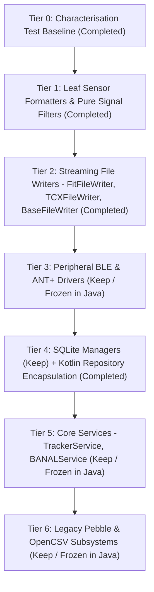

# ADR-001: Java Core Services Architecture Decision Record & Prioritized Migration Strategy

- **Document ID**: `DOC-ARC-ADR001`
- **Version**: 1.2.0
- **Status**: Approved
- **Approver**: Rainer Blind (PO)
- **Deciders**: Architecture Board, Dual-Agent Pair (Implementer / Reviewer)
- **Date**: 2026-11-18
- **Target Release**: `V5.0.0` (Active Sprint: `2026-11-18_01_Früh`)
- **Parent Epic**: [ATT-431](https://issue-tracker/ATT-431) (*Clean Code*)
- **Ticket**: [ATT-7566](https://issue-tracker/ATT-7566)
- **Requirement Mapping**: `REQ-ARC-005` (`REQ-ARC-005.1` - `REQ-ARC-005.6`), `REQ-PRO-129.1`
- **Test Mapping**: `TST-ARC-005` (`TST-ARC-005.1` - `TST-ARC-005.4`), `TST-PRO-129.1`

---

## 1. Context & Problem Statement

ASPICE evaluation finding F9 highlighted that while the application presentation, view models, mathematical domain models, and repositories transitioned to idiomatic Kotlin, a substantial portion of the safety- and robustness-critical core of `aTrainingTracker` remains implemented in legacy Java (**120 remaining `.java` files** out of the initial 149-class baseline after migrating **29 leaf/serializer classes** to Kotlin under `ATT-7903`, `ATT-7905`, and `ATT-7906`). This Java core encompasses:
- Background tracking services and session state machines (`TrackerService.java`, `TrainingApplication.java`).
- ANT+ and Bluetooth Low Energy sensor ingestion and protocol arbitration (`BANALService.java`, `DeviceManager.java`).
- Hardware device decoders and virtual sensors (`BTLERadarDevice.java`, `CyclingPowerMetricsDevice.java`).
- Multi-layer SQLite database managers and persistence helpers (`WorkoutSummariesDatabaseManager.java`, `WorkoutSamplesDatabaseManager.java`, `DevicesDatabaseManager.java`).
- Remaining legacy file exporters and upload orchestrators (`ExportManager.java`, `GPXFileWriter.java`, `GCFileWriter.java`, `CSVFileWriter.java`), alongside the migrated Kotlin streaming writers (`FitFileWriter.kt`, `TCXFileWriter.kt`, `BaseFileWriter.kt`).

### 1.1 Technical Liabilities of Mixed Java/Kotlin Architecture
1. **Platform Types (`T!`) & Nullability Hazards (SWE.3)**:
   Kotlin treats unannotated Java return types and fields as platform types (`T!`), effectively bypassing Kotlin's compile-time null safety. In live tracking, unanticipated null values from hardware disconnects or missing fields trigger runtime `NullPointerException` crashes.
2. **Divergent Concurrency & Threading Models**:
   Java services rely on synchronized blocks, `Handler`, and `ScheduledExecutorService` primitives, whereas newer Kotlin subsystems utilize Kotlin Coroutines, `StateFlow`, `SharedFlow`, and structured concurrency. Interfacing between the two models introduces risk of deadlock, lock-order inversion, and race conditions.
3. **Dual Static Analysis Overhead**:
   Kotlin-specific static analysis tools (Detekt, KtLint) cannot inspect the Java core, leaving safety-critical components dependent on coarse Java linting.
4. **Maintenance & Cognitive Friction**:
   Context switching between Java verbosity (getters/setters, manual builder patterns, boilerplate listeners) and concise Kotlin idioms slows velocity and complicates onboarding.

---

## 2. Decision Drivers & Evaluated Alternatives

The Architecture Board evaluated three potential strategies, reconciled with the authoritative Product Owner architecture decision (`2026-11-14`, `ATT-8115`):

### Alternative 1: Big-Bang Complete Core Rewrite
- **Description**: Migrate all 149 baseline Java classes simultaneously in a single monolithic effort.
- **Evaluation**: **Rejected**. A big-bang rewrite carries prohibitive risk. `TrackerService` and `BANALService` contain years of subtle timing workarounds, hardware quirk mitigations, and GPS edge cases. Rewriting the entire core at once would violate Chesterton's Fence, halt active sprint delivery, and induce catastrophic telemetry regressions.

### Alternative 2: Permanent Status Quo (Never Migrate Any Leaf Utilities)
- **Description**: Leave all 149 baseline Java classes untouched, including pure leaf formatters, mathematical filters, and file writers.
- **Evaluation**: **Rejected**. Leaving zero-dependency pure leaf utilities and streaming serializers in Java unnecessarily preserves platform-type (`T!`) exposure at UI/domain boundaries where Golden Master tests make Kotlin conversion low-risk. Conversely, **retaining** the complex core services, RF peripheral drivers, and SQLite managers in Java (`Keep`) eliminates endurance tracking and RF protocol regression risks (`ATT-8115`).

### Alternative 3: Phased, Risk-Tiered Bottom-Up Migration (Bounded Leaf Tiers 1–2, Core Services Kept in Java) (Selected)
- **Description**: Execute incremental, Golden-Master-gated Kotlin migration strictly for low-risk leaf tiers — Tier 1 (15 leaf sensor formatters via `ATT-7903` and 11 pure mathematical signal filters via `ATT-7905`) and Tier 2 (3 streaming file writers `FitFileWriter.kt`, `TCXFileWriter.kt`, `BaseFileWriter.kt` via `ATT-7906`) — while **retaining (`Keep`)** Tiers 3–6 (`TrackerService`, `BANALService`, `TrainingApplication`, BLE/ANT+ drivers, legacy Pebble, and SQLite database managers encapsulated behind Kotlin repositories such as `WorkoutRepository`) in Java per Product Owner decision (`ATT-8115`).
- **Evaluation**: **Selected**. Eliminates platform types at high-fanout leaf boundaries (`29` migrated classes, all `Completed`) while preserving zero runtime disruption in endurance tracking and RF sensor ingestion (`120` `.java` classes retained under `Keep` and guarded by Tier 0 characterisation tests).

---

## 3. Decision Outcome & Strategy Matrix

### 3.1 Subsystem Decision Matrix
The 149 baseline classes across 12 architectural subsystems (**120 remaining `.java` classes + 29 migrated `.kt` classes**) are categorized with unambiguous determinations aligned with the Product Owner decision (2026-11-14, `ATT-8115`):

| Subsystem Domain | Total Classes | Total LOC | Strategy Decision | Rationale |
| :--- | :--- | :--- | :--- | :--- |
| **1. Background Tracking Core & Lifecycle** | 10 | 6,766 | **Keep** | Core session state machine (`TrackerService`, `TrainingApplication`). Retained in Java per PO decision to eliminate endurance tracking regression risks. |
| **2. BLE & Sensor Ingestion Core** | 22 | 5,567 | **Keep** | Peripheral coordination (`BANALService`, `DeviceManager`, `ProxySensor`). Retained in Java per PO decision to safeguard high-frequency sensor arbitration. |
| **3. BLE Peripheral Drivers** | 11 | 4,414 | **Keep** | Bluetooth Low Energy device decoders (`BTLEBikePowerDevice`, `BTLERadarDevice`, `MyBTLEDevice`). Retained in Java per PO decision (`ATT-7908` cancelled). |
| **4. ANT+ Peripheral Drivers & Search** | 17 | 2,803 | **Keep** | ANT+ device decoders (`ANTBikeCadenceDevice`, `ANTHeartRateDevice`). Retained in Java per PO decision (`ATT-7907` cancelled). |
| **5. Common Peripheral Devices & Virtual Sensors** | 16 | 6,209 | **Keep** | Virtual sensors and device wrappers (`CyclingPowerMetricsDevice`, `HRVMetricsDevice`). Retained in Java per PO decision. |
| **6. Leaf Sensor Formatters** | 15 | 777 | **Migrate (Completed)** | Pure leaf mappers (`AltitudeFormatter`, `DistanceFormatter`). Migrated 15/15 to Kotlin (`ATT-7903`, `Completed`). |
| **7. Pure Mathematical Signal Filters** | 11 | 1,049 | **Migrate (Completed)** | Pure mathematical algorithms (`ExponentialSmoothingFilter`, `MovingAverageFilter`). Migrated 11/11 to pure Kotlin JVM models (`ATT-7905`, `Completed`). |
| **8. SQLite Database Managers & Persistence** | 12 | 8,899 | **Keep / Modernize via Repository** | Complex SQLite database managers (`WorkoutSummariesDatabaseManager`, `WorkoutSamplesDatabaseManager`). Retain underlying SQLite schema and Java managers (`Keep`); modernize and encapsulate behind clean Kotlin repository interfaces (`WorkoutRepository`, `ATT-7909` / `REQ-ARC-009`). |
| **9. File Exporters & Serializers** | 16 | 4,470 | **Migrate (Partial — Writers Completed) / Keep** | Streaming binary FIT and TCX writers (`FitFileWriter.kt`, `TCXFileWriter.kt`, `BaseFileWriter.kt`) migrated to Kotlin (`ATT-7906`, `Completed`); remaining legacy exporters and uploaders (`ExportManager`, `ExportStatusDatabaseManager`, `GPXFileWriter`, `GCFileWriter`, `CSVFileWriter`) retained in Java (`Keep`). |
| **10. Segments & Live Navigation** | 2 | 868 | **Keep** | Live segment matching logic (`SegmentsDatabaseManager`, `SegmentHelper`). Retained in Java per PO decision. |
| **11. Legacy UI Views, Fragments & Dialogs** | 7 | 1,120 | **Keep / Modernize** | Legacy XML-bound views and dialogs. Retained in Java or superseded by modern Jetpack Compose equivalents. |
| **12. Obsolete Smartwatch & 3rd-Party Subsystems** | 10 | 2,232 | **Keep / Sunset** | Pebble smartwatch integration (7 classes, 1,739 LOC) retained for potential revival (`ATT-40`, `ATT-7910` cancelled). Embedded `au.com.bytecode.opencsv` (3 classes, 493 LOC) retained in Java (`Keep`). |

### 3.2 Top 10 Java Anchors Decision Table
The top 10 largest and most churned baseline Java classes in the codebase are accounted for below:

| Class Name | Subsystem | LOC | Commits | Decision | Technical Rationale |
| :--- | :--- | :--- | :--- | :--- | :--- |
| `TrackerService` | Background Tracking Core | 3,307 | 128 | **Keep** | High defect churn; retained in Java per PO decision to preserve endurance stability. |
| `WorkoutSummariesDatabaseManager` | SQLite Database Managers | 2,945 | 108 | **Keep / Modernize via Repository** | Mission-critical summary persistence; keep SQLite schema, encapsulate behind `WorkoutRepository`. |
| `TrackingViewsDatabaseManager` | SQLite Database Managers | 2,421 | 67 | **Keep / Modernize via Repository** | Retain schema; wrap with `TrackingViewsRepository` domain mappers. |
| `TrainingApplication` | Background Tracking Core | 2,125 | 174 | **Keep** | Global application context; retained in Java per PO decision. |
| `DevicesDatabaseManager` | SQLite Database Managers | 1,522 | 39 | **Keep / Modernize via Repository** | Encapsulate raw Cursor operations behind `DeviceDataRepository`. |
| `DeviceManager` | BLE & Sensor Ingestion Core | 1,352 | 53 | **Keep** | Peripheral connection orchestrator; retained in Java per PO decision. |
| `BTLERadarDevice` | BLE Peripheral Drivers | 1,224 | 20 | **Keep** | Garmin Varia radar parser; high safety impact, retained in Java per PO decision. |
| `MyBTLEDevice` | BLE Peripheral Drivers | 1,130 | 24 | **Keep** | Base Bluetooth LE GATT wrapper; retained in Java per PO decision. |
| `WorkoutSamplesDatabaseManager` | SQLite Database Managers | 954 | 31 | **Keep / Modernize via Repository** | 1-Hz high-frequency time-series persistence; modernize with batch insertion mappers. |
| `FitFileWriter` | File Exporters & Serializers | 822 | 22 | **Migrated (Completed)** | Binary Garmin FIT serializer; migrated to Kotlin (`FitFileWriter.kt`, `ATT-7906`) with byte-for-byte regression fixtures. |

---

## 4. Quantitative Java Inventory (120 Remaining Java Classes + 29 Migrated Kotlin Classes Across 12 Subsystems)

The table below catalogs the 149-class baseline in `app/src/main/java` (`120` currently remaining `.java` classes + `29` completed Kotlin migrations under `ATT-7903`, `ATT-7905`, and `ATT-7906`):

| Class Name | Subsystem | File Path | LOC | Churn | Test Status | Decision |
| :--- | :--- | :--- | :--- | :--- | :--- | :--- |
| `TrackerService` | 1. Background Tracking Core & Lifecycle | `com/atrainingtracker/trainingtracker/tracker/TrackerService.java` | 3307 | 128 | Untested | Keep |
| `TrainingApplication` | 1. Background Tracking Core & Lifecycle | `com/atrainingtracker/trainingtracker/TrainingApplication.java` | 2125 | 174 | Untested | Keep |
| `LiveWorkoutSession` | 1. Background Tracking Core & Lifecycle | `com/atrainingtracker/trainingtracker/tracker/LiveWorkoutSession.java` | 542 | 14 | Tested | Keep |
| `StravaEquipmentSynchronizeThread` | 1. Background Tracking Core & Lifecycle | `com/atrainingtracker/trainingtracker/onlinecommunities/strava/StravaEquipmentSynchronizeThread.java` | 270 | 15 | Untested | Keep |
| `MyHelper` | 1. Background Tracking Core & Lifecycle | `com/atrainingtracker/trainingtracker/MyHelper.java` | 187 | 14 | Untested | Keep |
| `CursorUtils` | 1. Background Tracking Core & Lifecycle | `com/atrainingtracker/util/CursorUtils.java` | 156 | 1 | Tested | Keep |
| `StravaDeauthorizationThread` | 1. Background Tracking Core & Lifecycle | `com/atrainingtracker/trainingtracker/onlinecommunities/strava/StravaDeauthorizationThread.java` | 62 | 4 | Untested | Keep |
| `MyUnits` | 1. Background Tracking Core & Lifecycle | `com/atrainingtracker/trainingtracker/MyUnits.java` | 44 | 5 | Untested | Keep |
| `StreamType` | 1. Background Tracking Core & Lifecycle | `com/atrainingtracker/trainingtracker/onlinecommunities/strava/StreamType.java` | 42 | 5 | Untested | Keep |
| `StartOrResumeInterface` | 1. Background Tracking Core & Lifecycle | `com/atrainingtracker/trainingtracker/interfaces/StartOrResumeInterface.java` | 31 | 3 | Untested | Keep |
| `SegmentsDatabaseManager` | 10. Segments & Live Navigation | `com/atrainingtracker/trainingtracker/segments/SegmentsDatabaseManager.java` | 806 | 35 | Untested | Keep |
| `SegmentHelper` | 10. Segments & Live Navigation | `com/atrainingtracker/trainingtracker/segments/SegmentHelper.java` | 62 | 5 | Untested | Keep |
| `ConfigViewsFragment` | 11. Legacy UI Views, Fragments & Dialogs | `com/atrainingtracker/trainingtracker/fragments/ConfigViewsFragment.java` | 405 | 16 | Untested | Keep |
| `TrackOnMapHelper` | 11. Legacy UI Views, Fragments & Dialogs | `com/atrainingtracker/trainingtracker/fragments/mapFragments/TrackOnMapHelper.java` | 309 | 19 | Untested | Keep |
| `ConfigViewsActivityClassic` | 11. Legacy UI Views, Fragments & Dialogs | `com/atrainingtracker/trainingtracker/activities/ConfigViewsActivityClassic.java` | 170 | 4 | Untested | Keep |
| `SensorArrayAdapter` | 11. Legacy UI Views, Fragments & Dialogs | `com/atrainingtracker/trainingtracker/views/SensorArrayAdapter.java` | 84 | 4 | Untested | Keep |
| `GPSDisabledDialog` | 11. Legacy UI Views, Fragments & Dialogs | `com/atrainingtracker/trainingtracker/dialogs/GPSDisabledDialog.java` | 61 | 7 | Untested | Keep |
| `ConfigViewFragment` | 11. Legacy UI Views, Fragments & Dialogs | `com/atrainingtracker/trainingtracker/fragments/ConfigViewFragment.java` | 56 | 9 | Untested | Keep |
| `Roughness` | 11. Legacy UI Views, Fragments & Dialogs | `com/atrainingtracker/trainingtracker/fragments/mapFragments/Roughness.java` | 35 | 4 | Untested | Keep |
| `PebbleService` | 12. Obsolete Smartwatch & 3rd-Party Subsystems | `com/atrainingtracker/trainingtracker/smartwatch/pebble/PebbleService.java` | 559 | 19 | Untested | Retire / Freeze |
| `PebbleDatabaseManager` | 12. Obsolete Smartwatch & 3rd-Party Subsystems | `com/atrainingtracker/trainingtracker/smartwatch/pebble/PebbleDatabaseManager.java` | 544 | 15 | Untested | Retire / Freeze |
| `CSVWriter` | 12. Obsolete Smartwatch & 3rd-Party Subsystems | `au/com/bytecode/opencsv/CSVWriter.java` | 274 | 3 | Untested | Keep / Replace with Standard Library |
| `ConfigPebbleViewFragment` | 12. Obsolete Smartwatch & 3rd-Party Subsystems | `com/atrainingtracker/trainingtracker/smartwatch/pebble/ConfigPebbleViewFragment.java` | 242 | 14 | Untested | Retire / Freeze |
| `PebbleServiceBuildIn` | 12. Obsolete Smartwatch & 3rd-Party Subsystems | `com/atrainingtracker/trainingtracker/smartwatch/pebble/PebbleServiceBuildIn.java` | 222 | 10 | Untested | Retire / Freeze |
| `ResultSetHelperService` | 12. Obsolete Smartwatch & 3rd-Party Subsystems | `au/com/bytecode/opencsv/ResultSetHelperService.java` | 187 | 3 | Untested | Keep / Replace with Standard Library |
| `ConfigPebbleViewsFragment` | 12. Obsolete Smartwatch & 3rd-Party Subsystems | `com/atrainingtracker/trainingtracker/smartwatch/pebble/ConfigPebbleViewsFragment.java` | 89 | 11 | Untested | Retire / Freeze |
| `ConfigPebbleViewsActivity` | 12. Obsolete Smartwatch & 3rd-Party Subsystems | `com/atrainingtracker/trainingtracker/smartwatch/pebble/ConfigPebbleViewsActivity.java` | 46 | 9 | Untested | Retire / Freeze |
| `Watchapp` | 12. Obsolete Smartwatch & 3rd-Party Subsystems | `com/atrainingtracker/trainingtracker/smartwatch/pebble/Watchapp.java` | 37 | 5 | Untested | Retire / Freeze |
| `ResultSetHelper` | 12. Obsolete Smartwatch & 3rd-Party Subsystems | `au/com/bytecode/opencsv/ResultSetHelper.java` | 32 | 2 | Untested | Keep / Replace with Standard Library |
| `DevicesDatabaseManager` | 2. BLE & Sensor Ingestion Core | `com/atrainingtracker/banalservice/database/DevicesDatabaseManager.java` | 1522 | 39 | Tested | Keep / Modernize via Repository |
| `SportTypeDatabaseManager` | 2. BLE & Sensor Ingestion Core | `com/atrainingtracker/banalservice/database/SportTypeDatabaseManager.java` | 876 | 32 | Untested | Keep / Modernize via Repository |
| `BANALService` | 2. BLE & Sensor Ingestion Core | `com/atrainingtracker/banalservice/BANALService.java` | 864 | 54 | Untested | Keep |
| `MySensorManager` | 2. BLE & Sensor Ingestion Core | `com/atrainingtracker/banalservice/sensor/MySensorManager.java` | 517 | 19 | Untested | Keep |
| `SensorType` | 2. BLE & Sensor Ingestion Core | `com/atrainingtracker/banalservice/sensor/SensorType.java` | 260 | 34 | Untested | Keep |
| `ActivityType` | 2. BLE & Sensor Ingestion Core | `com/atrainingtracker/banalservice/ActivityType.java` | 247 | 27 | Tested | Keep |
| `UIHelper` | 2. BLE & Sensor Ingestion Core | `com/atrainingtracker/banalservice/helpers/UIHelper.java` | 202 | 10 | Untested | Keep |
| `ProxySensor` | 2. BLE & Sensor Ingestion Core | `com/atrainingtracker/banalservice/sensor/ProxySensor.java` | 146 | 8 | Untested | Keep |
| `MySensor` | 2. BLE & Sensor Ingestion Core | `com/atrainingtracker/banalservice/sensor/MySensor.java` | 138 | 9 | Untested | Keep |
| `MyAccumulatorSensor` | 2. BLE & Sensor Ingestion Core | `com/atrainingtracker/banalservice/sensor/MyAccumulatorSensor.java` | 134 | 10 | Untested | Keep |
| `SensorCategory` | 2. BLE & Sensor Ingestion Core | `com/atrainingtracker/banalservice/sensor/SensorCategory.java` | 93 | 2 | Untested | Keep |
| `BatteryStatusHelper` | 2. BLE & Sensor Ingestion Core | `com/atrainingtracker/banalservice/helpers/BatteryStatusHelper.java` | 76 | 5 | Untested | Keep |
| `MyBanalDebugHelper` | 2. BLE & Sensor Ingestion Core | `com/atrainingtracker/banalservice/MyBanalDebugHelper.java` | 68 | 5 | Untested | Keep |
| `SensorData` | 2. BLE & Sensor Ingestion Core | `com/atrainingtracker/banalservice/sensor/SensorData.java` | 67 | 6 | Untested | Keep |
| `SensorSubCategory` | 2. BLE & Sensor Ingestion Core | `com/atrainingtracker/banalservice/sensor/SensorSubCategory.java` | 65 | 1 | Untested | Keep |
| `BSportType` | 2. BLE & Sensor Ingestion Core | `com/atrainingtracker/banalservice/BSportType.java` | 59 | 5 | Untested | Keep |
| `ThresholdSensor` | 2. BLE & Sensor Ingestion Core | `com/atrainingtracker/banalservice/sensor/ThresholdSensor.java` | 50 | 3 | Untested | Keep |
| `MyIntegerAccumulatorSensor` | 2. BLE & Sensor Ingestion Core | `com/atrainingtracker/banalservice/sensor/MyIntegerAccumulatorSensor.java` | 47 | 5 | Untested | Keep |
| `Protocol` | 2. BLE & Sensor Ingestion Core | `com/atrainingtracker/banalservice/Protocol.java` | 41 | 3 | Untested | Keep |
| `MyDoubleAccumulatorSensor` | 2. BLE & Sensor Ingestion Core | `com/atrainingtracker/banalservice/sensor/MyDoubleAccumulatorSensor.java` | 41 | 4 | Untested | Keep |
| `HavePressureSensor` | 2. BLE & Sensor Ingestion Core | `com/atrainingtracker/banalservice/helpers/HavePressureSensor.java` | 29 | 3 | Untested | Keep |
| `SensorValueType` | 2. BLE & Sensor Ingestion Core | `com/atrainingtracker/banalservice/sensor/SensorValueType.java` | 25 | 2 | Untested | Keep |
| `BTLERadarDevice` | 3. BLE Peripheral Drivers | `com/atrainingtracker/banalservice/devices/bluetooth_le/BTLERadarDevice.java` | 1224 | 20 | Tested | Keep |
| `MyBTLEDevice` | 3. BLE Peripheral Drivers | `com/atrainingtracker/banalservice/devices/bluetooth_le/MyBTLEDevice.java` | 1130 | 24 | Untested | Keep |
| `BTSearchForNewDevicesEngine` | 3. BLE Peripheral Drivers | `com/atrainingtracker/banalservice/devices/bluetooth_le/search_new/BTSearchForNewDevicesEngine.java` | 539 | 16 | Tested | Keep |
| `BTLEBikePowerDevice` | 3. BLE Peripheral Drivers | `com/atrainingtracker/banalservice/devices/bluetooth_le/BTLEBikePowerDevice.java` | 482 | 12 | Untested | Keep |
| `BTLEHeartRateDevice` | 3. BLE Peripheral Drivers | `com/atrainingtracker/banalservice/devices/bluetooth_le/BTLEHeartRateDevice.java` | 311 | 10 | Tested | Keep |
| `BTLERunSpeedDevice` | 3. BLE Peripheral Drivers | `com/atrainingtracker/banalservice/devices/bluetooth_le/BTLERunSpeedDevice.java` | 252 | 10 | Tested | Keep |
| `BTLEBikeDevice` | 3. BLE Peripheral Drivers | `com/atrainingtracker/banalservice/devices/bluetooth_le/BTLEBikeDevice.java` | 232 | 12 | Untested | Keep |
| `BluetoothConstants` | 3. BLE Peripheral Drivers | `com/atrainingtracker/banalservice/devices/bluetooth_le/BluetoothConstants.java` | 102 | 9 | Untested | Keep |
| `BTLEBikeSpeedAndCadenceDevice` | 3. BLE Peripheral Drivers | `com/atrainingtracker/banalservice/devices/bluetooth_le/BTLEBikeSpeedAndCadenceDevice.java` | 48 | 3 | Untested | Keep |
| `BTLEBikeCadenceDevice` | 3. BLE Peripheral Drivers | `com/atrainingtracker/banalservice/devices/bluetooth_le/BTLEBikeCadenceDevice.java` | 47 | 3 | Untested | Keep |
| `BTLEBikeSpeedDevice` | 3. BLE Peripheral Drivers | `com/atrainingtracker/banalservice/devices/bluetooth_le/BTLEBikeSpeedDevice.java` | 47 | 3 | Untested | Keep |
| `MyANTDevice` | 4. ANT+ Peripheral Drivers & Search | `com/atrainingtracker/banalservice/devices/ant_plus/MyANTDevice.java` | 458 | 10 | Untested | Keep |
| `ANTBikePowerDevice` | 4. ANT+ Peripheral Drivers & Search | `com/atrainingtracker/banalservice/devices/ant_plus/ANTBikePowerDevice.java` | 395 | 9 | Tested | Keep |
| `ANTSearchForNewDevicesEngineMultiDeviceSearch` | 4. ANT+ Peripheral Drivers & Search | `com/atrainingtracker/banalservice/devices/ant_plus/search_new/ANTSearchForNewDevicesEngineMultiDeviceSearch.java` | 333 | 11 | Tested | Keep |
| `ANTHeartRateDevice` | 4. ANT+ Peripheral Drivers & Search | `com/atrainingtracker/banalservice/devices/ant_plus/ANTHeartRateDevice.java` | 317 | 7 | Tested | Keep |
| `ANTBikeSpeedAndCadenceDevice` | 4. ANT+ Peripheral Drivers & Search | `com/atrainingtracker/banalservice/devices/ant_plus/ANTBikeSpeedAndCadenceDevice.java` | 246 | 9 | Tested | Keep |
| `MyANTAsyncSearchDevice` | 4. ANT+ Peripheral Drivers & Search | `com/atrainingtracker/banalservice/devices/ant_plus/search_new/MyANTAsyncSearchDevice.java` | 211 | 4 | Untested | Keep |
| `ANTRunSpeedDevice` | 4. ANT+ Peripheral Drivers & Search | `com/atrainingtracker/banalservice/devices/ant_plus/ANTRunSpeedDevice.java` | 163 | 6 | Untested | Keep |
| `ANTBikeSpeedDevice` | 4. ANT+ Peripheral Drivers & Search | `com/atrainingtracker/banalservice/devices/ant_plus/ANTBikeSpeedDevice.java` | 141 | 6 | Untested | Keep |
| `ANTEnvironmentDevice` | 4. ANT+ Peripheral Drivers & Search | `com/atrainingtracker/banalservice/devices/ant_plus/ANTEnvironmentDevice.java` | 107 | 3 | Untested | Keep |
| `ANTBikeCadenceDevice` | 4. ANT+ Peripheral Drivers & Search | `com/atrainingtracker/banalservice/devices/ant_plus/ANTBikeCadenceDevice.java` | 99 | 4 | Untested | Keep |
| `ANTHeartRateAsyncSearchDevice` | 4. ANT+ Peripheral Drivers & Search | `com/atrainingtracker/banalservice/devices/ant_plus/search_new/ANTHeartRateAsyncSearchDevice.java` | 57 | 3 | Untested | Keep |
| `ANTBikeCadenceAsyncSearchDevice` | 4. ANT+ Peripheral Drivers & Search | `com/atrainingtracker/banalservice/devices/ant_plus/search_new/ANTBikeCadenceAsyncSearchDevice.java` | 46 | 2 | Untested | Keep |
| `ANTBikePowerAsyncSearchDevice` | 4. ANT+ Peripheral Drivers & Search | `com/atrainingtracker/banalservice/devices/ant_plus/search_new/ANTBikePowerAsyncSearchDevice.java` | 46 | 2 | Untested | Keep |
| `ANTBikeSpeedAndCadenceAsyncSearchDevice` | 4. ANT+ Peripheral Drivers & Search | `com/atrainingtracker/banalservice/devices/ant_plus/search_new/ANTBikeSpeedAndCadenceAsyncSearchDevice.java` | 46 | 2 | Untested | Keep |
| `ANTBikeSpeedAsyncSearchDevice` | 4. ANT+ Peripheral Drivers & Search | `com/atrainingtracker/banalservice/devices/ant_plus/search_new/ANTBikeSpeedAsyncSearchDevice.java` | 46 | 2 | Untested | Keep |
| `ANTEnvironmentAsyncSearchDevice` | 4. ANT+ Peripheral Drivers & Search | `com/atrainingtracker/banalservice/devices/ant_plus/search_new/ANTEnvironmentAsyncSearchDevice.java` | 46 | 2 | Untested | Keep |
| `ANTRunSpeedAsyncSearchDevice` | 4. ANT+ Peripheral Drivers & Search | `com/atrainingtracker/banalservice/devices/ant_plus/search_new/ANTRunSpeedAsyncSearchDevice.java` | 46 | 2 | Untested | Keep |
| `DeviceManager` | 5. Common Peripheral Devices & Virtual Sensors | `com/atrainingtracker/banalservice/devices/DeviceManager.java` | 1352 | 53 | Untested | Keep |
| `CyclingPowerMetricsDevice` | 5. Common Peripheral Devices & Virtual Sensors | `com/atrainingtracker/banalservice/devices/CyclingPowerMetricsDevice.java` | 953 | 16 | Tested | Keep |
| `SpeedAndLocationDevice` | 5. Common Peripheral Devices & Virtual Sensors | `com/atrainingtracker/banalservice/devices/SpeedAndLocationDevice.java` | 544 | 19 | Untested | Keep |
| `VerticalSpeedAndSlopeDevice` | 5. Common Peripheral Devices & Virtual Sensors | `com/atrainingtracker/banalservice/devices/VerticalSpeedAndSlopeDevice.java` | 431 | 21 | Tested | Keep |
| `AltitudeFromPressureDevice` | 5. Common Peripheral Devices & Virtual Sensors | `com/atrainingtracker/banalservice/devices/AltitudeFromPressureDevice.java` | 412 | 29 | Tested | Keep |
| `Manufacturer` | 5. Common Peripheral Devices & Virtual Sensors | `com/atrainingtracker/banalservice/devices/Manufacturer.java` | 394 | 5 | Untested | Keep |
| `BatteryDevice` | 5. Common Peripheral Devices & Virtual Sensors | `com/atrainingtracker/banalservice/devices/BatteryDevice.java` | 354 | 3 | Tested | Keep |
| `MyDevice` | 5. Common Peripheral Devices & Virtual Sensors | `com/atrainingtracker/banalservice/devices/MyDevice.java` | 287 | 19 | Untested | Keep |
| `AltitudeFromPositionDevice` | 5. Common Peripheral Devices & Virtual Sensors | `com/atrainingtracker/banalservice/devices/AltitudeFromPositionDevice.java` | 284 | 3 | Tested | Keep |
| `ClockDevice` | 5. Common Peripheral Devices & Virtual Sensors | `com/atrainingtracker/banalservice/devices/ClockDevice.java` | 274 | 12 | Untested | Keep |
| `DeviceType` | 5. Common Peripheral Devices & Virtual Sensors | `com/atrainingtracker/banalservice/devices/DeviceType.java` | 257 | 17 | Untested | Keep |
| `SpeedAndLocationDevice_GoogleFused` | 5. Common Peripheral Devices & Virtual Sensors | `com/atrainingtracker/banalservice/devices/SpeedAndLocationDevice_GoogleFused.java` | 177 | 11 | Untested | Keep |
| `SpeedAndLocationDevice_GPS` | 5. Common Peripheral Devices & Virtual Sensors | `com/atrainingtracker/banalservice/devices/SpeedAndLocationDevice_GPS.java` | 172 | 10 | Untested | Keep |
| `BikePowerSensorsHelper` | 5. Common Peripheral Devices & Virtual Sensors | `com/atrainingtracker/banalservice/devices/BikePowerSensorsHelper.java` | 153 | 3 | Untested | Keep |
| `MyRemoteDevice` | 5. Common Peripheral Devices & Virtual Sensors | `com/atrainingtracker/banalservice/devices/MyRemoteDevice.java` | 139 | 15 | Untested | Keep |
| `SearchForNewDevicesInterface` | 5. Common Peripheral Devices & Virtual Sensors | `com/atrainingtracker/banalservice/devices/SearchForNewDevicesInterface.java` | 26 | 2 | Untested | Keep |
| `DistanceFormatter` | 6. Leaf Sensor Formatters | `com/atrainingtracker/banalservice/sensor/formater/DistanceFormatter.kt` | 104 | 6 | Tested | Migrated (ATT-7903) |
| `AltitudeFormatter` | 6. Leaf Sensor Formatters | `com/atrainingtracker/banalservice/sensor/formater/AltitudeFormatter.kt` | 88 | 3 | Tested | Migrated (ATT-7903) |
| `PaceFormatter` | 6. Leaf Sensor Formatters | `com/atrainingtracker/banalservice/sensor/formater/PaceFormatter.kt` | 67 | 3 | Tested | Migrated (ATT-7903) |
| `BatteryRemainingTimeFormatter` | 6. Leaf Sensor Formatters | `com/atrainingtracker/banalservice/sensor/formater/BatteryRemainingTimeFormatter.kt` | 62 | 1 | Tested | Migrated (ATT-7903) |
| `TimeFormatter` | 6. Leaf Sensor Formatters | `com/atrainingtracker/banalservice/sensor/formater/TimeFormatter.kt` | 62 | 6 | Tested | Migrated (ATT-7903) |
| `SpeedFormatter` | 6. Leaf Sensor Formatters | `com/atrainingtracker/banalservice/sensor/formater/SpeedFormatter.kt` | 53 | 5 | Tested | Migrated (ATT-7903) |
| `DfaA1Formatter` | 6. Leaf Sensor Formatters | `com/atrainingtracker/banalservice/sensor/formater/DfaA1Formatter.kt` | 49 | 1 | Tested | Migrated (ATT-7903) |
| `PowerToWeightFormatter` | 6. Leaf Sensor Formatters | `com/atrainingtracker/banalservice/sensor/formater/PowerToWeightFormatter.kt` | 47 | 1 | Tested | Migrated (ATT-7903) |
| `IntensityFactorFormatter` | 6. Leaf Sensor Formatters | `com/atrainingtracker/banalservice/sensor/formater/IntensityFactorFormatter.kt` | 44 | 1 | Tested | Migrated (ATT-7903) |
| `SignedIntegerFormatter` | 6. Leaf Sensor Formatters | `com/atrainingtracker/banalservice/sensor/formater/SignedIntegerFormatter.kt` | 44 | 1 | Tested | Migrated (ATT-7903) |
| `DefaultNumberFormatter` | 6. Leaf Sensor Formatters | `com/atrainingtracker/banalservice/sensor/formater/DefaultNumberFormatter.kt` | 39 | 2 | Tested | Migrated (ATT-7903) |
| `IntegerFormatter` | 6. Leaf Sensor Formatters | `com/atrainingtracker/banalservice/sensor/formater/IntegerFormatter.kt` | 34 | 3 | Tested | Migrated (ATT-7903) |
| `DefaultStringFormatter` | 6. Leaf Sensor Formatters | `com/atrainingtracker/banalservice/sensor/formater/DefaultStringFormatter.kt` | 29 | 3 | Tested | Migrated (ATT-7903) |
| `CadenceFormatter` | 6. Leaf Sensor Formatters | `com/atrainingtracker/banalservice/sensor/formater/CadenceFormatter.kt` | 28 | 3 | Tested | Migrated (ATT-7903) |
| `MyFormatter` | 6. Leaf Sensor Formatters | `com/atrainingtracker/banalservice/sensor/formater/MyFormatter.kt` | 27 | 3 | Tested | Migrated (ATT-7903) |
| `FilterManager` | 7. Pure Mathematical Signal Filters | `com/atrainingtracker/banalservice/filters/FilterManager.kt` | 319 | 19 | Tested | Migrated (ATT-7905) |
| `TimedMovingAverageFilter` | 7. Pure Mathematical Signal Filters | `com/atrainingtracker/banalservice/filters/TimedMovingAverageFilter.kt` | 170 | 11 | Tested | Migrated (ATT-7905) |
| `NumberedMovingAverageFilter` | 7. Pure Mathematical Signal Filters | `com/atrainingtracker/banalservice/filters/NumberedMovingAverageFilter.kt` | 86 | 8 | Tested | Migrated (ATT-7905) |
| `ExponentialSmoothingFilter` | 7. Pure Mathematical Signal Filters | `com/atrainingtracker/banalservice/filters/ExponentialSmoothingFilter.kt` | 83 | 9 | Tested | Migrated (ATT-7905) |
| `MaxValueFilter` | 7. Pure Mathematical Signal Filters | `com/atrainingtracker/banalservice/filters/MaxValueFilter.kt` | 78 | 7 | Tested | Migrated (ATT-7905) |
| `MyFilter` | 7. Pure Mathematical Signal Filters | `com/atrainingtracker/banalservice/filters/MyFilter.kt` | 78 | 6 | Tested | Migrated (ATT-7905) |
| `AverageFilter` | 7. Pure Mathematical Signal Filters | `com/atrainingtracker/banalservice/filters/AverageFilter.kt` | 64 | 7 | Tested | Migrated (ATT-7905) |
| `InstantaneousFilter` | 7. Pure Mathematical Signal Filters | `com/atrainingtracker/banalservice/filters/InstantaneousFilter.kt` | 54 | 5 | Tested | Migrated (ATT-7905) |
| `FilteredSensorData` | 7. Pure Mathematical Signal Filters | `com/atrainingtracker/banalservice/filters/FilteredSensorData.kt` | 48 | 4 | Tested | Migrated (ATT-7905) |
| `FilterData` | 7. Pure Mathematical Signal Filters | `com/atrainingtracker/banalservice/filters/FilterData.kt` | 40 | 4 | Tested | Migrated (ATT-7905) |
| `MovingAverageFilter` | 7. Pure Mathematical Signal Filters | `com/atrainingtracker/banalservice/filters/MovingAverageFilter.kt` | 29 | 4 | Tested | Migrated (ATT-7905) |
| `WorkoutSummariesDatabaseManager` | 8. SQLite Database Managers & Persistence | `com/atrainingtracker/trainingtracker/database/WorkoutSummariesDatabaseManager.java` | 2945 | 108 | Tested | Keep / Modernize via Repository |
| `TrackingViewsDatabaseManager` | 8. SQLite Database Managers & Persistence | `com/atrainingtracker/trainingtracker/database/TrackingViewsDatabaseManager.java` | 2421 | 67 | Tested | Keep / Modernize via Repository |
| `WorkoutSamplesDatabaseManager` | 8. SQLite Database Managers & Persistence | `com/atrainingtracker/trainingtracker/database/WorkoutSamplesDatabaseManager.java` | 954 | 31 | Tested | Keep / Modernize via Repository |
| `KnownLocationsDatabaseManager` | 8. SQLite Database Managers & Persistence | `com/atrainingtracker/trainingtracker/database/KnownLocationsDatabaseManager.java` | 880 | 30 | Tested | Keep / Modernize via Repository |
| `EquipmentDbHelper` | 8. SQLite Database Managers & Persistence | `com/atrainingtracker/trainingtracker/database/EquipmentDbHelper.java` | 811 | 32 | Untested | Keep / Modernize via Repository |
| `LapsDatabaseManager` | 8. SQLite Database Managers & Persistence | `com/atrainingtracker/trainingtracker/database/LapsDatabaseManager.java` | 489 | 13 | Tested | Keep / Modernize via Repository |
| `ActiveDevicesDbHelper` | 8. SQLite Database Managers & Persistence | `com/atrainingtracker/trainingtracker/database/ActiveDevicesDbHelper.java` | 170 | 13 | Tested | Keep / Modernize via Repository |
| `WorkoutDeletionHelper` | 8. SQLite Database Managers & Persistence | `com/atrainingtracker/trainingtracker/database/WorkoutDeletionHelper.java` | 100 | 14 | Tested | Keep / Modernize via Repository |
| `ExtremaType` | 8. SQLite Database Managers & Persistence | `com/atrainingtracker/trainingtracker/database/ExtremaType.java` | 51 | 6 | Untested | Keep / Modernize via Repository |
| `SuppressCursorAudit` | 8. SQLite Database Managers & Persistence | `com/atrainingtracker/database/SuppressCursorAudit.java` | 34 | 1 | Untested | Keep / Modernize via Repository |
| `CursorProvider` | 8. SQLite Database Managers & Persistence | `com/atrainingtracker/database/CursorProvider.java` | 27 | 1 | Untested | Keep / Modernize via Repository |
| `DatabaseConstants` | 8. SQLite Database Managers & Persistence | `com/atrainingtracker/database/DatabaseConstants.java` | 17 | 1 | Untested | Keep / Modernize via Repository |
| `FitFileWriter` | 9. File Exporters & Serializers | `com/atrainingtracker/trainingtracker/exporter/writer/FitFileWriter.kt` | 843 | 12 | Tested | Migrated (ATT-7906) |
| `ExportStatusDatabaseManager` | 9. File Exporters & Serializers | `com/atrainingtracker/trainingtracker/exporter/db/ExportStatusDatabaseManager.java` | 793 | 11 | Tested | Keep |
| `ExportManager` | 9. File Exporters & Serializers | `com/atrainingtracker/trainingtracker/exporter/ExportManager.java` | 509 | 50 | Tested | Keep |
| `TCXFileWriter` | 9. File Exporters & Serializers | `com/atrainingtracker/trainingtracker/exporter/writer/TCXFileWriter.kt` | 436 | 15 | Tested | Migrated (ATT-7906) |
| `StravaUploadDbHelper` | 9. File Exporters & Serializers | `com/atrainingtracker/trainingtracker/exporter/db/StravaUploadDbHelper.java` | 365 | 12 | Tested | Keep |
| `BaseExporter` | 9. File Exporters & Serializers | `com/atrainingtracker/trainingtracker/exporter/BaseExporter.java` | 357 | 27 | Tested | Keep |
| `GCFileWriter` | 9. File Exporters & Serializers | `com/atrainingtracker/trainingtracker/exporter/writer/GCFileWriter.java` | 279 | 8 | Tested | Keep |
| `GPXFileWriter` | 9. File Exporters & Serializers | `com/atrainingtracker/trainingtracker/exporter/writer/GPXFileWriter.java` | 215 | 9 | Tested | Keep |
| `CSVFileWriter` | 9. File Exporters & Serializers | `com/atrainingtracker/trainingtracker/exporter/writer/CSVFileWriter.java` | 168 | 6 | Tested | Keep |
| `BaseFileWriter` | 9. File Exporters & Serializers | `com/atrainingtracker/trainingtracker/exporter/writer/BaseFileWriter.kt` | 148 | 13 | Tested | Migrated (ATT-7906) |
| `FileFormat` | 9. File Exporters & Serializers | `com/atrainingtracker/trainingtracker/exporter/FileFormat.java` | 92 | 11 | Untested | Keep |
| `DropboxUploader` | 9. File Exporters & Serializers | `com/atrainingtracker/trainingtracker/exporter/uploader/DropboxUploader.java` | 90 | 5 | Tested | Keep |
| `ExportType` | 9. File Exporters & Serializers | `com/atrainingtracker/trainingtracker/exporter/ExportType.java` | 56 | 15 | Untested | Keep |
| `ExportStatus` | 9. File Exporters & Serializers | `com/atrainingtracker/trainingtracker/exporter/ExportStatus.java` | 43 | 6 | Untested | Keep |
| `ExportStatusChangedBroadcaster` | 9. File Exporters & Serializers | `com/atrainingtracker/trainingtracker/exporter/ExportStatusChangedBroadcaster.java` | 39 | 3 | Untested | Keep |
| `NotYetImplementedExporter` | 9. File Exporters & Serializers | `com/atrainingtracker/trainingtracker/exporter/NotYetImplementedExporter.java` | 37 | 7 | Untested | Keep |

---

## 5. Phased Bottom-Up Migration Sequencing (Tiers 0–6)

Migration proceeds bottom-up along ASPICE SWE.5 integration seams to guarantee that dependencies are always migrated and tested before their consumers:

### Tier 0: Characterisation Test Baseline & Harness Scaffolding
- **Objective**: Establish automated Golden Master regression harnesses for `TrackerService` and `BANALService` state transitions and telemetry dispatching.
- **Status (Completed, `ATT-7902`)**: Automated characterisation suites guard core service state transitions and telemetry dispatching.

### Tier 1: Leaf Sensor Formatters & Pure Signal Filters
- **Scope**: `banalservice/sensor/formater/` (15 classes, 777 LOC) and `banalservice/filters/` (11 classes, 1,049 LOC).
- **Status (Completed, `ATT-7903`, `ATT-7905`)**: All 26 classes migrated to pure JVM Kotlin models and string formatters, eliminating platform types (`T!`) across UI metric displays and smoothing filters.

### Tier 2: File Exporters & Serializers
- **Scope**: `trainingtracker/exporter/writer/` (`FitFileWriter.kt`, `TCXFileWriter.kt`, `BaseFileWriter.kt` migrated; `GPXFileWriter.java`, `GCFileWriter.java`, `CSVFileWriter.java` retained as `Keep`).
- **Status (Completed, `ATT-7906`)**: Streaming FIT and TCX writers migrated to Kotlin `.use {}` resource management with byte-for-byte regression fixtures.

### Tier 3: Peripheral BLE & ANT+ Leaf Device Drivers
- **Scope**: `banalservice/devices/bluetooth_le/` and `banalservice/devices/ant_plus/` (28 classes, 7,217 LOC).
- **Status (PO Decision 2026-11-14, ATT-8115)**: Retained in Java (`Keep`); active Kotlin migration cancelled (`ATT-7907`, `ATT-7908`) to eliminate RF radio packet regression risks during BLE GATT and ANT+ broadcast decoding.

### Tier 4: SQLite Database Managers & Repository Encapsulation
- **Scope**: `trainingtracker/database/` and `banalservice/database/` (12 classes, 8,899 LOC).
- **Status (PO Decision 2026-11-14, ATT-8115)**: Modernized via clean Kotlin repositories (`WorkoutRepository`, `DeviceDataRepository`, `REQ-ARC-009` / `ATT-7909`) while retaining underlying SQLite database manager implementations in Java (`Keep`).

### Tier 5: Background Core Services & Session State Machines
- **Scope**: `TrackerService.java`, `BANALService.java`, and `TrainingApplication.java`.
- **Status (PO Decision 2026-11-14, ATT-8115)**: Retained in Java (`Keep`) with Tier 0 characterisation test harnesses (`ATT-7902`) to safeguard endurance tracking stability and eliminate lifecycle regression risks.

### Tier 6: Legacy Subsystem Deprecation & Sunsetting
- **Scope**: `trainingtracker/smartwatch/pebble/` (7 classes, 1,739 LOC) and `au/com/bytecode/opencsv/` (3 classes, 493 LOC).
- **Status (PO Decision 2026-11-14, ATT-8115)**: Retained in Java (`Keep`); Pebble smartwatch integration preserved for future revival (`ATT-40`, `ATT-7910` cancelled).

---

## 6. Mandatory Migration Quality Safeguards

Every future child ticket executing a migration step SHALL adhere to the following strict engineering tripwires:

1. **Characterisation Tests First (Golden Master Principle)**:
   Before any Java source file is converted to Kotlin, an automated test harness capturing existing runtime behavior, edge cases (zero, negative, null, NaN inputs), and boundary conditions must be authored and verified passing.
2. **Strict Refactoring Invariance (Zero Functional / UI Changes)**:
   Migration tickets must strictly be pure refactorings. Bug fixes, new features, or UI redesigns are strictly forbidden in migration commits to preserve Chesterton's Fence.
3. **Platform Type Nullability Shielding**:
   Any remaining Java boundaries interfacing with newly migrated Kotlin code must be annotated with explicit `@NonNull` and `@Nullable` annotations (from `androidx.annotation.*`).
4. **Clean-Room Test Pass Rate**:
   Every migration ticket must achieve 100% test pass rate across targeted unit tests and full suite clean-room regression (`./gradlew testDebugUnitTest`).
5. **Atomic Ticket Sizing (<= 3 Story Points)**:
   Monolithic multi-thousand LOC migration tickets are strictly prohibited. All tasks must be decomposed into bite-sized units of 1 to 3 Story Points.

---

## 7. Atomic Backlog Child Tickets (Registered Under Epic ATT-431)

In compliance with `REQ-ARC-005.5`, ASPICE SWE.1 / SWE.2 decomposition, and the authoritative Product Owner decision (2026-11-14, ATT-8115), active Java Core Services Kotlin migration under Epic [ATT-431](https://issue-tracker/ATT-431) (*Clean Code*) is strictly bounded to 3 atomic backlog child tickets sized between 2 and 3 Story Points (`29` migrated classes total):

| Jira Key | Summary | Story Points | Migration Tier | Target Subsystem | Status |
| :--- | :--- | :--- | :--- | :--- | :--- |
| **[ATT-7903](https://issue-tracker/ATT-7903)** | Java Core Migration: Migrate leaf sensor formatters to Kotlin | 2 SP | Tier 1 | Leaf Sensor Formatters (15 classes) | Completed |
| **[ATT-7905](https://issue-tracker/ATT-7905)** | Java Core Migration: Migrate pure signal filters to Kotlin | 2 SP | Tier 1 | Pure Mathematical Signal Filters (11 classes) | Completed |
| **[ATT-7906](https://issue-tracker/ATT-7906)** | Java Core Migration: Migrate streaming file writers (FitFileWriter, TCXFileWriter) to Kotlin | 3 SP | Tier 2 | File Exporters & Serializers (3 writer classes) | Completed |

### 7.1 Status of Remaining Child Tickets (PO Decision 2026-11-14)
Per Product Owner decision recorded on 2026-11-14 (see comments in `ATT-7566`, `ATT-7907`, `ATT-7908`, `ATT-7910` and retrospective `ATT-7749`), all remaining subsystems (`120` `.java` classes) deliberately remain in Java (`Keep`) to safeguard runtime endurance stability and eliminate regression risks in high-frequency sensor ingestion:
- **`ATT-7902`** (3 SP, Tier 0): Characterisation test scaffolding completed (zero production code changes; establishes automated safety harnesses).
- **`ATT-7907`** (2 SP, Tier 3 - ANT+ Drivers): Cancelled / Obsolete ("Wird nicht umgesetzt").
- **`ATT-7908`** (3 SP, Tier 3 - BLE Drivers): Cancelled / Obsolete ("Wird nicht umgesetzt").
- **`ATT-7909`** (3 SP, Tier 4 - SQLite Managers): Completed under `REQ-ARC-009` as pure Kotlin repository encapsulation (`DeviceDataRepository`, `WorkoutRepository`), keeping underlying SQLite database managers in Java (`Keep`).
- **`ATT-7910`** (1 SP, Tier 6 - Pebble Smartwatch): Cancelled / Obsolete ("Wird nicht umgesetzt, da wir irgendwann den Pebble support wieder beleben wollen ATT-40").

---

## 8. Architectural Consequences & Trade-offs

### Positive Consequences
- **Compile-Time Null Safety at Leaf & Repository Boundaries**: Eliminating platform types (`T!`) in the 29 migrated Kotlin leaf/writer classes plus `@NonNull`/`@Nullable` contracts on remaining Java core interfaces reduces runtime `NullPointerException` risk.
- **Repository-Isolated Reactive Concurrency**: Presentation and ViewModel layers consume Kotlin Coroutines and `StateFlow` streams from repositories (`WorkoutRepository`, `BANALServiceRepository`) while background Java services (`TrackerService`, `BANALService`) remain undisturbed (`Keep`) behind `IF-SWE-03` and Tier 0 characterisation suites.
- **Unified Static Analysis on Migrated & Kotlin Code**: Migrated Kotlin files are checked by Detekt/KtLint while Java core services are guarded by Golden Master regression suites.
- **Zero Disruption**: Phased bottom-up sequencing with bounded `<= 3 SP` tickets kept the application stable and deployable at every step.

### Negative / Mitigated Consequences
- **Permanent Mixed-Language Interoperability**: Keeping `120` core `.java` classes requires ongoing `@NonNull` / `@Nullable` and `@JvmStatic` / `@JvmOverloads` boundary discipline, mitigated by `JavaCoreMigrationStrategyContractTest` and `ArchitectureConformanceContractTest`.
- **Migration Effort**: Disciplined characterisation test authoring before leaf conversions, mitigated by bounding migration tickets to 1–3 SP and freezing core services as `Keep`.

---

## Change History

| Version | Date | Author | Ticket | Summary of Changes |
| :--- | :--- | :--- | :--- | :--- |
| `1.0.0` | 2026-11-14 | AI Agent (`ATT-7566`) | `ATT-7566`, `ATT-8115` | Initial Java core services migration strategy ADR. |
| `1.1.0` | 2026-11-17 | AI Agent (`ATT-8164`) | `ATT-8164` | Added `DOC-ARC-ADR001` header, reset self-declared `Approved` to `Reviewed` (`Pending PO Sign-Off`), and added Change History. |
| `1.2.0` | 2026-11-18 | AI Agent (`ATT-8203`) | `ATT-8203` | Reconciled residual `Keep`-vs-`Migrate` contradictions (§§1–8, Alt 2/3, Mermaid, §8 consequences), updated live Java inventory (`120` remaining `.java` + `29` migrated `.kt`), marked `ATT-7903` `Completed`, and set `Target Release` to `V5.0.0` (`REQ-PRO-129.1`). |
