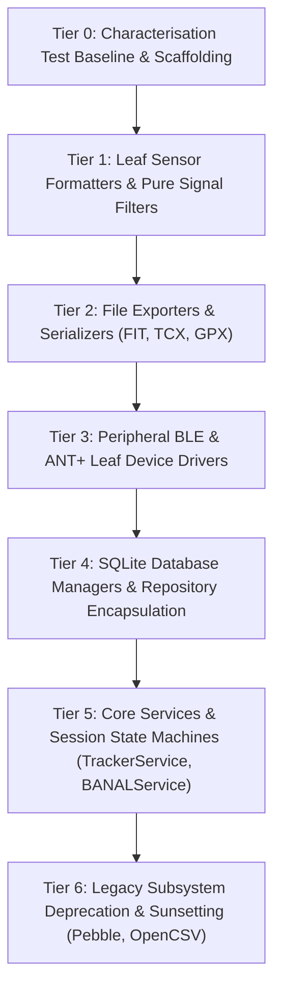

# ADR-001: Java Core Services Architecture Decision Record & Prioritized Migration Strategy

- **Status**: Approved
- **Deciders**: Architecture Board, Dual-Agent Pair (Implementer / Reviewer)
- **Date**: 2026-11-14
- **Target Release**: `5.1.0` (Active Sprint: `2026-46.6`)
- **Parent Epic**: [ATT-431](https://issue-tracker/ATT-431) (*Clean Code*)
- **Ticket**: [ATT-7566](https://issue-tracker/ATT-7566)
- **Requirement Mapping**: `REQ-ARC-005` (`REQ-ARC-005.1` - `REQ-ARC-005.6`)
- **Test Mapping**: `TST-ARC-005` (`TST-ARC-005.1` - `TST-ARC-005.4`)

---

## 1. Context & Problem Statement

ASPICE evaluation finding F9 highlighted that while the application presentation, view models, mathematical domain models, and repositories have transitioned 100% to idiomatic Kotlin (654 Kotlin files in `app/src/main/java`), the safety- and robustness-critical core of `aTrainingTracker` remains implemented in legacy Java (149 files, 45,174 LOC). This core encompasses:
- Background tracking services and session state machines (`TrackerService.java`, `TrainingApplication.java`).
- ANT+ and Bluetooth Low Energy sensor ingestion and protocol arbitration (`BANALService.java`, `DeviceManager.java`).
- High-frequency sensor formatters, digital filters, and hardware device decoders (`BTLERadarDevice.java`, `CyclingPowerMetricsDevice.java`).
- Multi-layer SQLite database managers and persistence helpers (`WorkoutSummariesDatabaseManager.java`, `WorkoutSamplesDatabaseManager.java`, `DevicesDatabaseManager.java`).
- Binary and XML workout file exporters (`FitFileWriter.java`, `TCXFileWriter.java`).

### 1.1 Technical Liabilities of Mixed Java/Kotlin Architecture
1. **Platform Types (`T!`) & Nullability Hazards (SWE.3)**:
   Kotlin treats unannotated Java return types and fields as platform types (`T!`), effectively bypassing Kotlin's compile-time null safety. In live tracking, unanticipated null values from hardware disconnects or missing fields trigger runtime `NullPointerException` crashes.
2. **Divergent Concurrency & Threading Models**:
   Java services rely on synchronized blocks, `Handler`, and `ScheduledExecutorService` primitives, whereas newer Kotlin subsystems utilize Kotlin Coroutines, `StateFlow`, `SharedFlow`, and structured concurrency. Interfacing between the two models introduces risk of deadlock, lock-order inversion, and race conditions.
3. **Dual Static Analysis Overhead**:
   Kotlin-specific static analysis tools (Detekt, KtLint) cannot inspect the Java core, leaving safety-critical components dependent on coarse Java linting.
4. **Maintenance & Cognitive Friction**:
   Context switching between Java verbosity (getters/setters, manual builder patterns, boilerplate listeners) and concise Kotlin idioms slows velocity and complicates onboarding.

---

## 2. Decision Drivers & Evaluated Alternatives

The Architecture Board evaluated three potential strategies:

### Alternative 1: Big-Bang Complete Core Rewrite
- **Description**: Migrate all 149 Java classes (45,174 LOC) simultaneously in a single monolithic effort.
- **Evaluation**: **Rejected**. A big-bang rewrite carries prohibitive risk. `TrackerService` and `BANALService` contain years of subtle timing workarounds, hardware quirk mitigations, and GPS edge cases. Rewriting the entire core at once would violate Chesterton's Fence, halt active sprint delivery, and induce catastrophic telemetry regressions.

### Alternative 2: Permanent Status Quo (Never Migrate Java Core)
- **Description**: Keep the Java core permanently frozen in Java and only write new features in Kotlin.
- **Evaluation**: **Rejected**. Leaving 45,174 LOC in Java permanently exposes the codebase to platform type nullability bugs, prevents modernizing background services with coroutine `StateFlow` primitives, and incurs lasting maintenance debt.

### Alternative 3: Phased, Risk-Tiered Bottom-Up Migration with Mandatory Characterisation Gates (Selected)
- **Description**: Adopt an incremental, bottom-up 7-tier migration strategy (Tiers 0–6). Migrate leaf utilities and pure formatters first, followed by file exporters and device drivers, and finally encapsulate database managers and background services. Enforce mandatory Golden Master characterisation tests before touching any core service.
- **Evaluation**: **Selected**. Provides zero runtime disruption, maintains a 100% clean-room test pass rate at every stage, keeps ticket sizes bounded between 1 and 3 Story Points, and systematically eliminates platform types.

---

## 3. Decision Outcome & Strategy Matrix

### 3.1 Subsystem Decision Matrix
The 149 Java classes across 12 architectural subsystems are categorized with clear determinations:

| Subsystem Domain | Total Classes | Total LOC | Strategy Decision | Rationale |
| :--- | :--- | :--- | :--- | :--- |
| **1. Background Tracking Core & Lifecycle** | 10 | 6,766 | **Migrate** | Core session state machine (`TrackerService`, `TrainingApplication`). Migrate to Kotlin with coroutines after Tier 0 characterisation tests. |
| **2. BLE & Sensor Ingestion Core** | 22 | 5,567 | **Migrate** | Peripheral coordination (`BANALService`, `DeviceManager`, `ProxySensor`). Migrate to Kotlin Flow-based reactive telemetry pipelines. |
| **3. BLE Peripheral Drivers** | 11 | 4,414 | **Migrate** | Bluetooth Low Energy device decoders (`BTLEBikePowerDevice`, `BTLERadarDevice`, `MyBTLEDevice`). Migrate to Kotlin data classes and bitwise decoders. |
| **4. ANT+ Peripheral Drivers & Search** | 17 | 2,803 | **Migrate** | ANT+ device decoders (`ANTBikeCadenceDevice`, `ANTHeartRateDevice`). Migrate to Kotlin data classes with null-safe broadcast receivers. |
| **5. Common Peripheral Devices & Virtual Sensors** | 16 | 6,209 | **Migrate** | Virtual sensors and device wrappers (`CyclingPowerMetricsDevice`, `HRVMetricsDevice`). Migrate to Kotlin domain models. |
| **6. Leaf Sensor Formatters** | 15 | 777 | **Migrate** | Pure leaf mappers (`FormaterAltitude`, `FormaterPower`). Pure functional logic with zero dependencies; prime early migration candidate. |
| **7. Pure Mathematical Signal Filters** | 11 | 1,049 | **Migrate** | Pure mathematical algorithms (`AlphaFilter`, `MovingAverageFilter`). Migrate to pure Kotlin JVM models. |
| **8. SQLite Database Managers & Persistence** | 12 | 8,899 | **Keep / Modernize via Repository** | Complex SQLite database managers (`WorkoutSummariesDatabaseManager`, `WorkoutSamplesDatabaseManager`). Retain underlying SQLite schema; modernize and encapsulate behind clean Kotlin repository interfaces. |
| **9. File Exporters & Serializers** | 16 | 4,470 | **Migrate** | Binary FIT and XML writers (`FitFileWriter`, `TCXFileWriter`). Migrate to Kotlin `.use {}` resource management and streaming I/O. |
| **10. Segments & Live Navigation** | 2 | 868 | **Migrate** | Live segment matching logic (`SegmentMatcher`). Migrate to Kotlin coroutine background workers. |
| **11. Legacy UI Views, Fragments & Dialogs** | 7 | 1,120 | **Migrate / Modernize** | Legacy XML-bound views and dialogs. Migrate or replace with modern Jetpack Compose equivalents. |
| **12. Obsolete Smartwatch & 3rd-Party Subsystems** | 10 | 2,232 | **Retire / Freeze / Replace** | Pebble smartwatch integration (7 classes, 1,739 LOC) is frozen and deprecated for sunset. Embedded `au.com.bytecode.opencsv` (3 classes, 493 LOC) to be replaced by standard libraries. |

### 3.2 Top 10 Java Anchors Decision Table
The top 10 largest and most churned Java classes in the codebase are accounted for below:

| Class Name | Subsystem | LOC | Commits | Decision | Technical Rationale |
| :--- | :--- | :--- | :--- | :--- | :--- |
| `TrackerService` | Background Tracking Core | 3,307 | 128 | **Migrate** | High defect churn; requires Golden Master characterisation test prior to coroutine migration. |
| `WorkoutSummariesDatabaseManager` | SQLite Database Managers | 2,945 | 108 | **Keep / Modernize via Repository** | Mission-critical summary persistence; keep SQLite schema, encapsulate behind `WorkoutRepository`. |
| `TrackingViewsDatabaseManager` | SQLite Database Managers | 2,421 | 67 | **Keep / Modernize via Repository** | Retain schema; wrap with `TrackingViewsRepository` domain mappers. |
| `TrainingApplication` | Background Tracking Core | 2,125 | 174 | **Migrate** | Global application context; migrate incrementally with explicit `@JvmStatic` interop hooks. |
| `DevicesDatabaseManager` | SQLite Database Managers | 1,522 | 39 | **Keep / Modernize via Repository** | Encapsulate raw Cursor operations behind `DeviceDataRepository`. |
| `DeviceManager` | BLE & Sensor Ingestion Core | 1,352 | 53 | **Migrate** | Peripheral connection orchestrator; migrate to Kotlin structured concurrency. |
| `BTLERadarDevice` | BLE Peripheral Drivers | 1,224 | 20 | **Migrate** | Garmin Varia radar parser; high safety impact, migrate with byte-level unit test harness. |
| `MyBTLEDevice` | BLE Peripheral Drivers | 1,130 | 24 | **Migrate** | Base Bluetooth LE GATT wrapper; migrate to eliminate platform types on connection callbacks. |
| `WorkoutSamplesDatabaseManager` | SQLite Database Managers | 954 | 31 | **Keep / Modernize via Repository** | 1-Hz high-frequency time-series persistence; modernize with batch insertion mappers. |
| `FitFileWriter` | File Exporters & Serializers | 822 | 22 | **Migrate** | Binary Garmin FIT serializer; migrate with byte-for-byte regression fixtures. |

---

## 4. Quantitative Java Inventory (Complete 149 Classes Across 12 Subsystems)

The table below catalogs every single Java class currently residing in `app/src/main/java`:

| Class Name | Subsystem | File Path | LOC | Churn | Test Status | Decision |
| :--- | :--- | :--- | :--- | :--- | :--- | :--- |
| `TrackerService` | 1. Background Tracking Core & Lifecycle | `com/atrainingtracker/trainingtracker/tracker/TrackerService.java` | 3307 | 128 | Untested | Migrate |
| `TrainingApplication` | 1. Background Tracking Core & Lifecycle | `com/atrainingtracker/trainingtracker/TrainingApplication.java` | 2125 | 174 | Untested | Migrate |
| `LiveWorkoutSession` | 1. Background Tracking Core & Lifecycle | `com/atrainingtracker/trainingtracker/tracker/LiveWorkoutSession.java` | 542 | 14 | Tested | Migrate |
| `StravaEquipmentSynchronizeThread` | 1. Background Tracking Core & Lifecycle | `com/atrainingtracker/trainingtracker/onlinecommunities/strava/StravaEquipmentSynchronizeThread.java` | 270 | 15 | Untested | Migrate |
| `MyHelper` | 1. Background Tracking Core & Lifecycle | `com/atrainingtracker/trainingtracker/MyHelper.java` | 187 | 14 | Untested | Migrate |
| `CursorUtils` | 1. Background Tracking Core & Lifecycle | `com/atrainingtracker/util/CursorUtils.java` | 156 | 1 | Tested | Migrate |
| `StravaDeauthorizationThread` | 1. Background Tracking Core & Lifecycle | `com/atrainingtracker/trainingtracker/onlinecommunities/strava/StravaDeauthorizationThread.java` | 62 | 4 | Untested | Migrate |
| `MyUnits` | 1. Background Tracking Core & Lifecycle | `com/atrainingtracker/trainingtracker/MyUnits.java` | 44 | 5 | Untested | Migrate |
| `StreamType` | 1. Background Tracking Core & Lifecycle | `com/atrainingtracker/trainingtracker/onlinecommunities/strava/StreamType.java` | 42 | 5 | Untested | Migrate |
| `StartOrResumeInterface` | 1. Background Tracking Core & Lifecycle | `com/atrainingtracker/trainingtracker/interfaces/StartOrResumeInterface.java` | 31 | 3 | Untested | Migrate |
| `SegmentsDatabaseManager` | 10. Segments & Live Navigation | `com/atrainingtracker/trainingtracker/segments/SegmentsDatabaseManager.java` | 806 | 35 | Untested | Migrate |
| `SegmentHelper` | 10. Segments & Live Navigation | `com/atrainingtracker/trainingtracker/segments/SegmentHelper.java` | 62 | 5 | Untested | Migrate |
| `ConfigViewsFragment` | 11. Legacy UI Views, Fragments & Dialogs | `com/atrainingtracker/trainingtracker/fragments/ConfigViewsFragment.java` | 405 | 16 | Untested | Migrate |
| `TrackOnMapHelper` | 11. Legacy UI Views, Fragments & Dialogs | `com/atrainingtracker/trainingtracker/fragments/mapFragments/TrackOnMapHelper.java` | 309 | 19 | Untested | Migrate |
| `ConfigViewsActivityClassic` | 11. Legacy UI Views, Fragments & Dialogs | `com/atrainingtracker/trainingtracker/activities/ConfigViewsActivityClassic.java` | 170 | 4 | Untested | Migrate |
| `SensorArrayAdapter` | 11. Legacy UI Views, Fragments & Dialogs | `com/atrainingtracker/trainingtracker/views/SensorArrayAdapter.java` | 84 | 4 | Untested | Migrate |
| `GPSDisabledDialog` | 11. Legacy UI Views, Fragments & Dialogs | `com/atrainingtracker/trainingtracker/dialogs/GPSDisabledDialog.java` | 61 | 7 | Untested | Migrate |
| `ConfigViewFragment` | 11. Legacy UI Views, Fragments & Dialogs | `com/atrainingtracker/trainingtracker/fragments/ConfigViewFragment.java` | 56 | 9 | Untested | Migrate |
| `Roughness` | 11. Legacy UI Views, Fragments & Dialogs | `com/atrainingtracker/trainingtracker/fragments/mapFragments/Roughness.java` | 35 | 4 | Untested | Migrate |
| `PebbleService` | 12. Obsolete Smartwatch & 3rd-Party Subsystems | `com/atrainingtracker/trainingtracker/smartwatch/pebble/PebbleService.java` | 559 | 19 | Untested | Retire / Freeze |
| `PebbleDatabaseManager` | 12. Obsolete Smartwatch & 3rd-Party Subsystems | `com/atrainingtracker/trainingtracker/smartwatch/pebble/PebbleDatabaseManager.java` | 544 | 15 | Untested | Retire / Freeze |
| `CSVWriter` | 12. Obsolete Smartwatch & 3rd-Party Subsystems | `au/com/bytecode/opencsv/CSVWriter.java` | 274 | 3 | Untested | Keep / Replace with Standard Library |
| `ConfigPebbleViewFragment` | 12. Obsolete Smartwatch & 3rd-Party Subsystems | `com/atrainingtracker/trainingtracker/smartwatch/pebble/ConfigPebbleViewFragment.java` | 242 | 14 | Untested | Retire / Freeze |
| `PebbleServiceBuildIn` | 12. Obsolete Smartwatch & 3rd-Party Subsystems | `com/atrainingtracker/trainingtracker/smartwatch/pebble/PebbleServiceBuildIn.java` | 222 | 10 | Untested | Retire / Freeze |
| `ResultSetHelperService` | 12. Obsolete Smartwatch & 3rd-Party Subsystems | `au/com/bytecode/opencsv/ResultSetHelperService.java` | 187 | 3 | Untested | Keep / Replace with Standard Library |
| `ConfigPebbleViewsFragment` | 12. Obsolete Smartwatch & 3rd-Party Subsystems | `com/atrainingtracker/trainingtracker/smartwatch/pebble/ConfigPebbleViewsFragment.java` | 89 | 11 | Untested | Retire / Freeze |
| `ConfigPebbleViewsActivity` | 12. Obsolete Smartwatch & 3rd-Party Subsystems | `com/atrainingtracker/trainingtracker/smartwatch/pebble/ConfigPebbleViewsActivity.java` | 46 | 9 | Untested | Retire / Freeze |
| `Watchapp` | 12. Obsolete Smartwatch & 3rd-Party Subsystems | `com/atrainingtracker/trainingtracker/smartwatch/pebble/Watchapp.java` | 37 | 5 | Untested | Retire / Freeze |
| `ResultSetHelper` | 12. Obsolete Smartwatch & 3rd-Party Subsystems | `au/com/bytecode/opencsv/ResultSetHelper.java` | 32 | 2 | Untested | Keep / Replace with Standard Library |
| `DevicesDatabaseManager` | 2. BLE & Sensor Ingestion Core | `com/atrainingtracker/banalservice/database/DevicesDatabaseManager.java` | 1522 | 39 | Tested | Keep / Modernize via Repository |
| `SportTypeDatabaseManager` | 2. BLE & Sensor Ingestion Core | `com/atrainingtracker/banalservice/database/SportTypeDatabaseManager.java` | 876 | 32 | Untested | Keep / Modernize via Repository |
| `BANALService` | 2. BLE & Sensor Ingestion Core | `com/atrainingtracker/banalservice/BANALService.java` | 864 | 54 | Untested | Migrate |
| `MySensorManager` | 2. BLE & Sensor Ingestion Core | `com/atrainingtracker/banalservice/sensor/MySensorManager.java` | 517 | 19 | Untested | Migrate |
| `SensorType` | 2. BLE & Sensor Ingestion Core | `com/atrainingtracker/banalservice/sensor/SensorType.java` | 260 | 34 | Untested | Migrate |
| `ActivityType` | 2. BLE & Sensor Ingestion Core | `com/atrainingtracker/banalservice/ActivityType.java` | 247 | 27 | Tested | Migrate |
| `UIHelper` | 2. BLE & Sensor Ingestion Core | `com/atrainingtracker/banalservice/helpers/UIHelper.java` | 202 | 10 | Untested | Migrate |
| `ProxySensor` | 2. BLE & Sensor Ingestion Core | `com/atrainingtracker/banalservice/sensor/ProxySensor.java` | 146 | 8 | Untested | Migrate |
| `MySensor` | 2. BLE & Sensor Ingestion Core | `com/atrainingtracker/banalservice/sensor/MySensor.java` | 138 | 9 | Untested | Migrate |
| `MyAccumulatorSensor` | 2. BLE & Sensor Ingestion Core | `com/atrainingtracker/banalservice/sensor/MyAccumulatorSensor.java` | 134 | 10 | Untested | Migrate |
| `SensorCategory` | 2. BLE & Sensor Ingestion Core | `com/atrainingtracker/banalservice/sensor/SensorCategory.java` | 93 | 2 | Untested | Migrate |
| `BatteryStatusHelper` | 2. BLE & Sensor Ingestion Core | `com/atrainingtracker/banalservice/helpers/BatteryStatusHelper.java` | 76 | 5 | Untested | Migrate |
| `MyBanalDebugHelper` | 2. BLE & Sensor Ingestion Core | `com/atrainingtracker/banalservice/MyBanalDebugHelper.java` | 68 | 5 | Untested | Migrate |
| `SensorData` | 2. BLE & Sensor Ingestion Core | `com/atrainingtracker/banalservice/sensor/SensorData.java` | 67 | 6 | Untested | Migrate |
| `SensorSubCategory` | 2. BLE & Sensor Ingestion Core | `com/atrainingtracker/banalservice/sensor/SensorSubCategory.java` | 65 | 1 | Untested | Migrate |
| `BSportType` | 2. BLE & Sensor Ingestion Core | `com/atrainingtracker/banalservice/BSportType.java` | 59 | 5 | Untested | Migrate |
| `ThresholdSensor` | 2. BLE & Sensor Ingestion Core | `com/atrainingtracker/banalservice/sensor/ThresholdSensor.java` | 50 | 3 | Untested | Migrate |
| `MyIntegerAccumulatorSensor` | 2. BLE & Sensor Ingestion Core | `com/atrainingtracker/banalservice/sensor/MyIntegerAccumulatorSensor.java` | 47 | 5 | Untested | Migrate |
| `Protocol` | 2. BLE & Sensor Ingestion Core | `com/atrainingtracker/banalservice/Protocol.java` | 41 | 3 | Untested | Migrate |
| `MyDoubleAccumulatorSensor` | 2. BLE & Sensor Ingestion Core | `com/atrainingtracker/banalservice/sensor/MyDoubleAccumulatorSensor.java` | 41 | 4 | Untested | Migrate |
| `HavePressureSensor` | 2. BLE & Sensor Ingestion Core | `com/atrainingtracker/banalservice/helpers/HavePressureSensor.java` | 29 | 3 | Untested | Migrate |
| `SensorValueType` | 2. BLE & Sensor Ingestion Core | `com/atrainingtracker/banalservice/sensor/SensorValueType.java` | 25 | 2 | Untested | Migrate |
| `BTLERadarDevice` | 3. BLE Peripheral Drivers | `com/atrainingtracker/banalservice/devices/bluetooth_le/BTLERadarDevice.java` | 1224 | 20 | Tested | Migrate |
| `MyBTLEDevice` | 3. BLE Peripheral Drivers | `com/atrainingtracker/banalservice/devices/bluetooth_le/MyBTLEDevice.java` | 1130 | 24 | Untested | Migrate |
| `BTSearchForNewDevicesEngine` | 3. BLE Peripheral Drivers | `com/atrainingtracker/banalservice/devices/bluetooth_le/search_new/BTSearchForNewDevicesEngine.java` | 539 | 16 | Tested | Migrate |
| `BTLEBikePowerDevice` | 3. BLE Peripheral Drivers | `com/atrainingtracker/banalservice/devices/bluetooth_le/BTLEBikePowerDevice.java` | 482 | 12 | Untested | Migrate |
| `BTLEHeartRateDevice` | 3. BLE Peripheral Drivers | `com/atrainingtracker/banalservice/devices/bluetooth_le/BTLEHeartRateDevice.java` | 311 | 10 | Tested | Migrate |
| `BTLERunSpeedDevice` | 3. BLE Peripheral Drivers | `com/atrainingtracker/banalservice/devices/bluetooth_le/BTLERunSpeedDevice.java` | 252 | 10 | Tested | Migrate |
| `BTLEBikeDevice` | 3. BLE Peripheral Drivers | `com/atrainingtracker/banalservice/devices/bluetooth_le/BTLEBikeDevice.java` | 232 | 12 | Untested | Migrate |
| `BluetoothConstants` | 3. BLE Peripheral Drivers | `com/atrainingtracker/banalservice/devices/bluetooth_le/BluetoothConstants.java` | 102 | 9 | Untested | Migrate |
| `BTLEBikeSpeedAndCadenceDevice` | 3. BLE Peripheral Drivers | `com/atrainingtracker/banalservice/devices/bluetooth_le/BTLEBikeSpeedAndCadenceDevice.java` | 48 | 3 | Untested | Migrate |
| `BTLEBikeCadenceDevice` | 3. BLE Peripheral Drivers | `com/atrainingtracker/banalservice/devices/bluetooth_le/BTLEBikeCadenceDevice.java` | 47 | 3 | Untested | Migrate |
| `BTLEBikeSpeedDevice` | 3. BLE Peripheral Drivers | `com/atrainingtracker/banalservice/devices/bluetooth_le/BTLEBikeSpeedDevice.java` | 47 | 3 | Untested | Migrate |
| `MyANTDevice` | 4. ANT+ Peripheral Drivers & Search | `com/atrainingtracker/banalservice/devices/ant_plus/MyANTDevice.java` | 458 | 10 | Untested | Migrate |
| `ANTBikePowerDevice` | 4. ANT+ Peripheral Drivers & Search | `com/atrainingtracker/banalservice/devices/ant_plus/ANTBikePowerDevice.java` | 395 | 9 | Tested | Migrate |
| `ANTSearchForNewDevicesEngineMultiDeviceSearch` | 4. ANT+ Peripheral Drivers & Search | `com/atrainingtracker/banalservice/devices/ant_plus/search_new/ANTSearchForNewDevicesEngineMultiDeviceSearch.java` | 333 | 11 | Tested | Migrate |
| `ANTHeartRateDevice` | 4. ANT+ Peripheral Drivers & Search | `com/atrainingtracker/banalservice/devices/ant_plus/ANTHeartRateDevice.java` | 317 | 7 | Tested | Migrate |
| `ANTBikeSpeedAndCadenceDevice` | 4. ANT+ Peripheral Drivers & Search | `com/atrainingtracker/banalservice/devices/ant_plus/ANTBikeSpeedAndCadenceDevice.java` | 246 | 9 | Tested | Migrate |
| `MyANTAsyncSearchDevice` | 4. ANT+ Peripheral Drivers & Search | `com/atrainingtracker/banalservice/devices/ant_plus/search_new/MyANTAsyncSearchDevice.java` | 211 | 4 | Untested | Migrate |
| `ANTRunSpeedDevice` | 4. ANT+ Peripheral Drivers & Search | `com/atrainingtracker/banalservice/devices/ant_plus/ANTRunSpeedDevice.java` | 163 | 6 | Untested | Migrate |
| `ANTBikeSpeedDevice` | 4. ANT+ Peripheral Drivers & Search | `com/atrainingtracker/banalservice/devices/ant_plus/ANTBikeSpeedDevice.java` | 141 | 6 | Untested | Migrate |
| `ANTEnvironmentDevice` | 4. ANT+ Peripheral Drivers & Search | `com/atrainingtracker/banalservice/devices/ant_plus/ANTEnvironmentDevice.java` | 107 | 3 | Untested | Migrate |
| `ANTBikeCadenceDevice` | 4. ANT+ Peripheral Drivers & Search | `com/atrainingtracker/banalservice/devices/ant_plus/ANTBikeCadenceDevice.java` | 99 | 4 | Untested | Migrate |
| `ANTHeartRateAsyncSearchDevice` | 4. ANT+ Peripheral Drivers & Search | `com/atrainingtracker/banalservice/devices/ant_plus/search_new/ANTHeartRateAsyncSearchDevice.java` | 57 | 3 | Untested | Migrate |
| `ANTBikeCadenceAsyncSearchDevice` | 4. ANT+ Peripheral Drivers & Search | `com/atrainingtracker/banalservice/devices/ant_plus/search_new/ANTBikeCadenceAsyncSearchDevice.java` | 46 | 2 | Untested | Migrate |
| `ANTBikePowerAsyncSearchDevice` | 4. ANT+ Peripheral Drivers & Search | `com/atrainingtracker/banalservice/devices/ant_plus/search_new/ANTBikePowerAsyncSearchDevice.java` | 46 | 2 | Untested | Migrate |
| `ANTBikeSpeedAndCadenceAsyncSearchDevice` | 4. ANT+ Peripheral Drivers & Search | `com/atrainingtracker/banalservice/devices/ant_plus/search_new/ANTBikeSpeedAndCadenceAsyncSearchDevice.java` | 46 | 2 | Untested | Migrate |
| `ANTBikeSpeedAsyncSearchDevice` | 4. ANT+ Peripheral Drivers & Search | `com/atrainingtracker/banalservice/devices/ant_plus/search_new/ANTBikeSpeedAsyncSearchDevice.java` | 46 | 2 | Untested | Migrate |
| `ANTEnvironmentAsyncSearchDevice` | 4. ANT+ Peripheral Drivers & Search | `com/atrainingtracker/banalservice/devices/ant_plus/search_new/ANTEnvironmentAsyncSearchDevice.java` | 46 | 2 | Untested | Migrate |
| `ANTRunSpeedAsyncSearchDevice` | 4. ANT+ Peripheral Drivers & Search | `com/atrainingtracker/banalservice/devices/ant_plus/search_new/ANTRunSpeedAsyncSearchDevice.java` | 46 | 2 | Untested | Migrate |
| `DeviceManager` | 5. Common Peripheral Devices & Virtual Sensors | `com/atrainingtracker/banalservice/devices/DeviceManager.java` | 1352 | 53 | Untested | Migrate |
| `CyclingPowerMetricsDevice` | 5. Common Peripheral Devices & Virtual Sensors | `com/atrainingtracker/banalservice/devices/CyclingPowerMetricsDevice.java` | 953 | 16 | Tested | Migrate |
| `SpeedAndLocationDevice` | 5. Common Peripheral Devices & Virtual Sensors | `com/atrainingtracker/banalservice/devices/SpeedAndLocationDevice.java` | 544 | 19 | Untested | Migrate |
| `VerticalSpeedAndSlopeDevice` | 5. Common Peripheral Devices & Virtual Sensors | `com/atrainingtracker/banalservice/devices/VerticalSpeedAndSlopeDevice.java` | 431 | 21 | Tested | Migrate |
| `AltitudeFromPressureDevice` | 5. Common Peripheral Devices & Virtual Sensors | `com/atrainingtracker/banalservice/devices/AltitudeFromPressureDevice.java` | 412 | 29 | Tested | Migrate |
| `Manufacturer` | 5. Common Peripheral Devices & Virtual Sensors | `com/atrainingtracker/banalservice/devices/Manufacturer.java` | 394 | 5 | Untested | Migrate |
| `BatteryDevice` | 5. Common Peripheral Devices & Virtual Sensors | `com/atrainingtracker/banalservice/devices/BatteryDevice.java` | 354 | 3 | Tested | Migrate |
| `MyDevice` | 5. Common Peripheral Devices & Virtual Sensors | `com/atrainingtracker/banalservice/devices/MyDevice.java` | 287 | 19 | Untested | Migrate |
| `AltitudeFromPositionDevice` | 5. Common Peripheral Devices & Virtual Sensors | `com/atrainingtracker/banalservice/devices/AltitudeFromPositionDevice.java` | 284 | 3 | Tested | Migrate |
| `ClockDevice` | 5. Common Peripheral Devices & Virtual Sensors | `com/atrainingtracker/banalservice/devices/ClockDevice.java` | 274 | 12 | Untested | Migrate |
| `DeviceType` | 5. Common Peripheral Devices & Virtual Sensors | `com/atrainingtracker/banalservice/devices/DeviceType.java` | 257 | 17 | Untested | Migrate |
| `SpeedAndLocationDevice_GoogleFused` | 5. Common Peripheral Devices & Virtual Sensors | `com/atrainingtracker/banalservice/devices/SpeedAndLocationDevice_GoogleFused.java` | 177 | 11 | Untested | Migrate |
| `SpeedAndLocationDevice_GPS` | 5. Common Peripheral Devices & Virtual Sensors | `com/atrainingtracker/banalservice/devices/SpeedAndLocationDevice_GPS.java` | 172 | 10 | Untested | Migrate |
| `BikePowerSensorsHelper` | 5. Common Peripheral Devices & Virtual Sensors | `com/atrainingtracker/banalservice/devices/BikePowerSensorsHelper.java` | 153 | 3 | Untested | Migrate |
| `MyRemoteDevice` | 5. Common Peripheral Devices & Virtual Sensors | `com/atrainingtracker/banalservice/devices/MyRemoteDevice.java` | 139 | 15 | Untested | Migrate |
| `SearchForNewDevicesInterface` | 5. Common Peripheral Devices & Virtual Sensors | `com/atrainingtracker/banalservice/devices/SearchForNewDevicesInterface.java` | 26 | 2 | Untested | Migrate |
| `DistanceFormatter` | 6. Leaf Sensor Formatters | `com/atrainingtracker/banalservice/sensor/formater/DistanceFormatter.java` | 104 | 6 | Untested | Migrate |
| `AltitudeFormatter` | 6. Leaf Sensor Formatters | `com/atrainingtracker/banalservice/sensor/formater/AltitudeFormatter.java` | 88 | 3 | Untested | Migrate |
| `PaceFormatter` | 6. Leaf Sensor Formatters | `com/atrainingtracker/banalservice/sensor/formater/PaceFormatter.java` | 67 | 3 | Untested | Migrate |
| `BatteryRemainingTimeFormatter` | 6. Leaf Sensor Formatters | `com/atrainingtracker/banalservice/sensor/formater/BatteryRemainingTimeFormatter.java` | 62 | 1 | Tested | Migrate |
| `TimeFormatter` | 6. Leaf Sensor Formatters | `com/atrainingtracker/banalservice/sensor/formater/TimeFormatter.java` | 62 | 6 | Tested | Migrate |
| `SpeedFormatter` | 6. Leaf Sensor Formatters | `com/atrainingtracker/banalservice/sensor/formater/SpeedFormatter.java` | 53 | 5 | Untested | Migrate |
| `DfaA1Formatter` | 6. Leaf Sensor Formatters | `com/atrainingtracker/banalservice/sensor/formater/DfaA1Formatter.java` | 49 | 1 | Tested | Migrate |
| `PowerToWeightFormatter` | 6. Leaf Sensor Formatters | `com/atrainingtracker/banalservice/sensor/formater/PowerToWeightFormatter.java` | 47 | 1 | Tested | Migrate |
| `IntensityFactorFormatter` | 6. Leaf Sensor Formatters | `com/atrainingtracker/banalservice/sensor/formater/IntensityFactorFormatter.java` | 44 | 1 | Tested | Migrate |
| `SignedIntegerFormatter` | 6. Leaf Sensor Formatters | `com/atrainingtracker/banalservice/sensor/formater/SignedIntegerFormatter.java` | 44 | 1 | Tested | Migrate |
| `DefaultNumberFormatter` | 6. Leaf Sensor Formatters | `com/atrainingtracker/banalservice/sensor/formater/DefaultNumberFormatter.java` | 39 | 2 | Untested | Migrate |
| `IntegerFormatter` | 6. Leaf Sensor Formatters | `com/atrainingtracker/banalservice/sensor/formater/IntegerFormatter.java` | 34 | 3 | Tested | Migrate |
| `DefaultStringFormatter` | 6. Leaf Sensor Formatters | `com/atrainingtracker/banalservice/sensor/formater/DefaultStringFormatter.java` | 29 | 3 | Untested | Migrate |
| `CadenceFormatter` | 6. Leaf Sensor Formatters | `com/atrainingtracker/banalservice/sensor/formater/CadenceFormatter.java` | 28 | 3 | Tested | Migrate |
| `MyFormatter` | 6. Leaf Sensor Formatters | `com/atrainingtracker/banalservice/sensor/formater/MyFormatter.java` | 27 | 3 | Untested | Migrate |
| `FilterManager` | 7. Pure Mathematical Signal Filters | `com/atrainingtracker/banalservice/filters/FilterManager.java` | 319 | 19 | Untested | Migrate |
| `TimedMovingAverageFilter` | 7. Pure Mathematical Signal Filters | `com/atrainingtracker/banalservice/filters/TimedMovingAverageFilter.java` | 170 | 11 | Untested | Migrate |
| `NumberedMovingAverageFilter` | 7. Pure Mathematical Signal Filters | `com/atrainingtracker/banalservice/filters/NumberedMovingAverageFilter.java` | 86 | 8 | Untested | Migrate |
| `ExponentialSmoothingFilter` | 7. Pure Mathematical Signal Filters | `com/atrainingtracker/banalservice/filters/ExponentialSmoothingFilter.java` | 83 | 9 | Untested | Migrate |
| `MaxValueFilter` | 7. Pure Mathematical Signal Filters | `com/atrainingtracker/banalservice/filters/MaxValueFilter.java` | 78 | 7 | Untested | Migrate |
| `MyFilter` | 7. Pure Mathematical Signal Filters | `com/atrainingtracker/banalservice/filters/MyFilter.java` | 78 | 6 | Untested | Migrate |
| `AverageFilter` | 7. Pure Mathematical Signal Filters | `com/atrainingtracker/banalservice/filters/AverageFilter.java` | 64 | 7 | Untested | Migrate |
| `InstantaneousFilter` | 7. Pure Mathematical Signal Filters | `com/atrainingtracker/banalservice/filters/InstantaneousFilter.java` | 54 | 5 | Untested | Migrate |
| `FilteredSensorData` | 7. Pure Mathematical Signal Filters | `com/atrainingtracker/banalservice/filters/FilteredSensorData.java` | 48 | 4 | Untested | Migrate |
| `FilterData` | 7. Pure Mathematical Signal Filters | `com/atrainingtracker/banalservice/filters/FilterData.java` | 40 | 4 | Untested | Migrate |
| `MovingAverageFilter` | 7. Pure Mathematical Signal Filters | `com/atrainingtracker/banalservice/filters/MovingAverageFilter.java` | 29 | 4 | Untested | Migrate |
| `WorkoutSummariesDatabaseManager` | 8. SQLite Database Managers & Persistence | `com/atrainingtracker/trainingtracker/database/WorkoutSummariesDatabaseManager.java` | 2945 | 108 | Tested | Keep / Modernize via Repository |
| `TrackingViewsDatabaseManager` | 8. SQLite Database Managers & Persistence | `com/atrainingtracker/trainingtracker/database/TrackingViewsDatabaseManager.java` | 2421 | 67 | Tested | Keep / Modernize via Repository |
| `WorkoutSamplesDatabaseManager` | 8. SQLite Database Managers & Persistence | `com/atrainingtracker/trainingtracker/database/WorkoutSamplesDatabaseManager.java` | 954 | 31 | Tested | Keep / Modernize via Repository |
| `KnownLocationsDatabaseManager` | 8. SQLite Database Managers & Persistence | `com/atrainingtracker/trainingtracker/database/KnownLocationsDatabaseManager.java` | 880 | 30 | Tested | Keep / Modernize via Repository |
| `EquipmentDbHelper` | 8. SQLite Database Managers & Persistence | `com/atrainingtracker/trainingtracker/database/EquipmentDbHelper.java` | 811 | 32 | Untested | Keep / Modernize via Repository |
| `LapsDatabaseManager` | 8. SQLite Database Managers & Persistence | `com/atrainingtracker/trainingtracker/database/LapsDatabaseManager.java` | 489 | 13 | Tested | Keep / Modernize via Repository |
| `ActiveDevicesDbHelper` | 8. SQLite Database Managers & Persistence | `com/atrainingtracker/trainingtracker/database/ActiveDevicesDbHelper.java` | 170 | 13 | Tested | Keep / Modernize via Repository |
| `WorkoutDeletionHelper` | 8. SQLite Database Managers & Persistence | `com/atrainingtracker/trainingtracker/database/WorkoutDeletionHelper.java` | 100 | 14 | Tested | Keep / Modernize via Repository |
| `ExtremaType` | 8. SQLite Database Managers & Persistence | `com/atrainingtracker/trainingtracker/database/ExtremaType.java` | 51 | 6 | Untested | Keep / Modernize via Repository |
| `SuppressCursorAudit` | 8. SQLite Database Managers & Persistence | `com/atrainingtracker/database/SuppressCursorAudit.java` | 34 | 1 | Untested | Keep / Modernize via Repository |
| `CursorProvider` | 8. SQLite Database Managers & Persistence | `com/atrainingtracker/database/CursorProvider.java` | 27 | 1 | Untested | Keep / Modernize via Repository |
| `DatabaseConstants` | 8. SQLite Database Managers & Persistence | `com/atrainingtracker/database/DatabaseConstants.java` | 17 | 1 | Untested | Keep / Modernize via Repository |
| `FitFileWriter` | 9. File Exporters & Serializers | `com/atrainingtracker/trainingtracker/exporter/writer/FitFileWriter.java` | 843 | 12 | Tested | Migrate |
| `ExportStatusDatabaseManager` | 9. File Exporters & Serializers | `com/atrainingtracker/trainingtracker/exporter/db/ExportStatusDatabaseManager.java` | 793 | 11 | Tested | Migrate |
| `ExportManager` | 9. File Exporters & Serializers | `com/atrainingtracker/trainingtracker/exporter/ExportManager.java` | 509 | 50 | Tested | Migrate |
| `TCXFileWriter` | 9. File Exporters & Serializers | `com/atrainingtracker/trainingtracker/exporter/writer/TCXFileWriter.java` | 436 | 15 | Untested | Migrate |
| `StravaUploadDbHelper` | 9. File Exporters & Serializers | `com/atrainingtracker/trainingtracker/exporter/db/StravaUploadDbHelper.java` | 365 | 12 | Tested | Migrate |
| `BaseExporter` | 9. File Exporters & Serializers | `com/atrainingtracker/trainingtracker/exporter/BaseExporter.java` | 357 | 27 | Tested | Migrate |
| `GCFileWriter` | 9. File Exporters & Serializers | `com/atrainingtracker/trainingtracker/exporter/writer/GCFileWriter.java` | 279 | 8 | Tested | Migrate |
| `GPXFileWriter` | 9. File Exporters & Serializers | `com/atrainingtracker/trainingtracker/exporter/writer/GPXFileWriter.java` | 215 | 9 | Tested | Migrate |
| `CSVFileWriter` | 9. File Exporters & Serializers | `com/atrainingtracker/trainingtracker/exporter/writer/CSVFileWriter.java` | 168 | 6 | Tested | Migrate |
| `BaseFileWriter` | 9. File Exporters & Serializers | `com/atrainingtracker/trainingtracker/exporter/writer/BaseFileWriter.java` | 148 | 13 | Untested | Migrate |
| `FileFormat` | 9. File Exporters & Serializers | `com/atrainingtracker/trainingtracker/exporter/FileFormat.java` | 92 | 11 | Untested | Migrate |
| `DropboxUploader` | 9. File Exporters & Serializers | `com/atrainingtracker/trainingtracker/exporter/uploader/DropboxUploader.java` | 90 | 5 | Tested | Migrate |
| `ExportType` | 9. File Exporters & Serializers | `com/atrainingtracker/trainingtracker/exporter/ExportType.java` | 56 | 15 | Untested | Migrate |
| `ExportStatus` | 9. File Exporters & Serializers | `com/atrainingtracker/trainingtracker/exporter/ExportStatus.java` | 43 | 6 | Untested | Migrate |
| `ExportStatusChangedBroadcaster` | 9. File Exporters & Serializers | `com/atrainingtracker/trainingtracker/exporter/ExportStatusChangedBroadcaster.java` | 39 | 3 | Untested | Migrate |
| `NotYetImplementedExporter` | 9. File Exporters & Serializers | `com/atrainingtracker/trainingtracker/exporter/NotYetImplementedExporter.java` | 37 | 7 | Untested | Migrate |

---

## 5. Phased Bottom-Up Migration Sequencing (Tiers 0–6)

Migration proceeds bottom-up along ASPICE SWE.5 integration seams to guarantee that dependencies are always migrated and tested before their consumers:

### Tier 0: Characterisation Test Baseline & Harness Scaffolding
- **Objective**: Establish automated Golden Master regression harnesses for `TrackerService` and `BANALService` state transitions and telemetry dispatching.
- **Safety Gate**: Zero code migration in subsequent tiers may begin until Tier 0 characterisation tests pass with 100% coverage of existing public methods.

### Tier 1: Leaf Sensor Formatters & Pure Signal Filters
- **Scope**: `banalservice/sensor/formater/` (15 classes, 777 LOC) and `banalservice/filters/` (11 classes, 1,049 LOC).
- **Objective**: Pure JVM mathematical models and string formatters with zero Android UI/Service dependencies.
- **Benefit**: Immediate elimination of platform types (`T!`) across UI metric display and smoothing filters.

### Tier 2: File Exporters & Serializers
- **Scope**: `trainingtracker/exporter/writer/` (`FitFileWriter`, `TCXFileWriter`, `GPXFileWriter`, `GCFileWriter`, 2,089 LOC).
- **Objective**: Stream serialization with Kotlin `.use {}` resource management, binary FIT byte validation, and XML schema validation.

### Tier 3: Peripheral BLE & ANT+ Leaf Device Drivers
- **Scope**: `banalservice/devices/bluetooth_le/` and `banalservice/devices/ant_plus/` (28 classes, 7,217 LOC).
- **Objective**: Peripheral packet decoders (`BTLEBikePowerDevice`, `BTLERadarDevice`, `ANTHeartRateDevice`). Migrate to Kotlin data classes with explicit bitfield parsing.

### Tier 4: SQLite Database Managers & Repository Encapsulation
- **Scope**: `trainingtracker/database/` and `banalservice/database/` (12 classes, 8,899 LOC).
- **Objective**: Encapsulate legacy SQLite managers (`WorkoutSummariesDatabaseManager`, `WorkoutSamplesDatabaseManager`) behind clean Kotlin repositories (`WorkoutRepository`), eliminating raw Cursor leakage and enforcing `Dispatchers.IO`.

### Tier 5: Background Core Services & Session State Machines
- **Scope**: `TrackerService.java` (3,307 LOC), `BANALService.java` (864 LOC), and `TrainingApplication.java` (2,125 LOC).
- **Objective**: Migrate central tracking and sensor arbitration engines to Kotlin coroutines, `StateFlow`, and structured concurrency.

### Tier 6: Legacy Subsystem Deprecation & Sunsetting
- **Scope**: `trainingtracker/smartwatch/pebble/` (7 classes, 1,739 LOC) and `au/com/bytecode/opencsv/` (3 classes, 493 LOC).
- **Objective**: Formally deprecate and freeze obsolete Pebble smartwatch classes; replace embedded OpenCSV with standard Android or Kotlin parsing utilities.

---

## 6. Mandatory Migration Quality Safeguards

Every future child ticket executing a migration step SHALL adhere to the following strict engineering tripwires:

1. **Characterisation Tests First (Golden Master Principle)**:
   Before any Java source file is converted to Kotlin, an automated test harness capturing existing runtime behavior, edge cases (zero, negative, null, NaN inputs), and boundary conditions must be authored and verified passing.
2. **Strict Refactoring Invariance (Zero Functional / UI Changes)**:
   Migration tickets must strictly be pure refactorings. Bug fixes, new features, or UI redesigns are strictly forbidden in migration commits to preserve Chesterton's Fence.
3. **Platform Type Nullability Shielding**:
   Any remaining Java boundaries interfacing with newly migrated Kotlin code must be annotated with explicit `@NonNull` and `@Nullable` annotations (from `androidx.annotation.*`).
4. **Clean-Room Test Pass Rate**:
   Every migration ticket must achieve 100% test pass rate across targeted unit tests and full suite clean-room regression (`./gradlew testDebugUnitTest`).
5. **Atomic Ticket Sizing (<= 3 Story Points)**:
   Monolithic multi-thousand LOC migration tickets are strictly prohibited. All tasks must be decomposed into bite-sized units of 1 to 3 Story Points.

---

## 7. Atomic Backlog Child Tickets (Registered Under Epic ATT-431)

In compliance with `REQ-ARC-005.5` and ASPICE SWE.1 / SWE.2 decomposition, the Java Core Services Migration Strategy is partitioned into 8 atomic backlog child tickets registered under Epic [ATT-431](https://issue-tracker/ATT-431) (*Clean Code*), each sized between 1 and 3 Story Points:

| Jira Key | Summary | Story Points | Migration Tier | Target Subsystem |
| :--- | :--- | :--- | :--- | :--- |
| **[ATT-7902](https://issue-tracker/ATT-7902)** | Java Core Migration: Characterisation test scaffolding for TrackerService & BANALService state machines | 3 SP | Tier 0 | Background Tracking & Sensor Core |
| **[ATT-7903](https://issue-tracker/ATT-7903)** | Java Core Migration: Migrate leaf sensor formatters to Kotlin | 2 SP | Tier 1 | Leaf Sensor Formatters |
| **[ATT-7905](https://issue-tracker/ATT-7905)** | Java Core Migration: Migrate pure signal filters to Kotlin | 2 SP | Tier 1 | Pure Mathematical Signal Filters |
| **[ATT-7906](https://issue-tracker/ATT-7906)** | Java Core Migration: Migrate streaming file writers (FitFileWriter, TCXFileWriter) to Kotlin | 3 SP | Tier 2 | File Exporters & Serializers |
| **[ATT-7907](https://issue-tracker/ATT-7907)** | Java Core Migration: Migrate peripheral ANT+ leaf device drivers to Kotlin | 2 SP | Tier 3 | ANT+ Peripheral Drivers |
| **[ATT-7908](https://issue-tracker/ATT-7908)** | Java Core Migration: Migrate Bluetooth LE leaf device decoders to Kotlin | 3 SP | Tier 3 | BLE Peripheral Drivers |
| **[ATT-7909](https://issue-tracker/ATT-7909)** | Java Core Migration: Modernize SQLite database managers via repository interfaces | 3 SP | Tier 4 | SQLite Database Persistence |
| **[ATT-7910](https://issue-tracker/ATT-7910)** | Java Core Migration: Formal deprecation and retirement of legacy Pebble smartwatch integration | 1 SP | Tier 6 | Obsolete Smartwatch Subsystems |

---

## 8. Architectural Consequences & Trade-offs

### Positive Consequences
- **Total Compile-Time Null Safety**: Progressive elimination of platform types (`T!`) removes the primary vector for runtime `NullPointerException`s during endurance tracking.
- **Modern Concurrency**: Enables smooth transition of background services from thread synchronization to coroutine `StateFlow` streams.
- **Unified Tooling**: Standardizes codebase under Detekt and KtLint static analysis.
- **Zero Disruption**: Phased bottom-up sequencing ensures the application remains stable and deployable after every atomic ticket.

### Negative / Mitigated Consequences
- **Transient Interoperability Overhead**: Temporary maintenance of `@JvmStatic` / `@JvmOverloads` annotations while Java callers remain. Mitigated by bottom-up tier ordering.
- **Migration Effort**: Requires disciplined test characterisation before code conversion. Mitigated by limiting ticket sizes to <= 3 SP.
