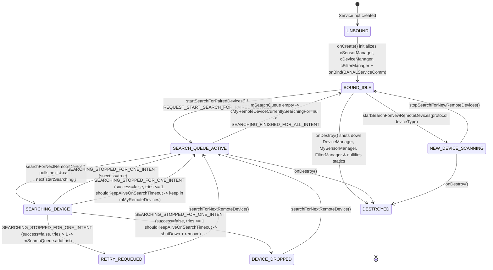

# Detailed Design: BANALService & DeviceManager (ASPICE SWE.3)

**Document ID**: `DOC-ARC-DD-BANAL`  
**Version**: 1.0.11  
**Status**: Reviewed  
**Approver**: Pending PO Sign-Off  

**Units**: `BANALService` (`app/src/main/java/com/atrainingtracker/banalservice/BANALService.java`, 1,074 LOC), `DeviceManager` (`app/src/main/java/com/atrainingtracker/banalservice/devices/DeviceManager.java`, 1,681 LOC), `MyRemoteDevice` (`MyRemoteDevice.java`, 186 LOC), `DeviceSearchPeriodicRetryCoordinator` (`DeviceSearchPeriodicRetryCoordinator.kt`)  
**Collaborators**: `MySensorManager`, `ProxySensor`, `FilterManager`, `SportTypesRepository`, `BANALServiceComm`, `SensorReconnectBackoffPolicy`, `KinematicSportTypeDiscriminator`, `MovingSpeedSummary`, `MultisportTransitionDetector`, `MultisportTransitionBridge`  
**SWE.2 Alignment**: `docs/architecture.md` §3.2, §4.2, §4.7, §4.8, §4.9 (`IF-SWE-03`, `IF-SWE-04`)  
**Requirement Trace**: `REQ-PRO-114.1`, `REQ-ARC-008.2`, `REQ-SEN-021`, `REQ-TRK-024`, `REQ-TRK-055`, `REQ-TRK-077`, `REQ-CON-051`, `REQ-FIL-029`, `REQ-CON-052`, `REQ-FIL-030`, `REQ-CON-054`

---

## 1. Composite State Model
`BANALService` defines **no** standalone `SearchingState` enum. Instead, service lifecycle, sensor arbitration, and peripheral discovery state are partitioned cleanly across:
1. **Service Singleton Lifecycle (`BANALService`)**:
   - Static references (`cServiceContext`, `cServiceInstance`, `cSensorManager`, `cDeviceManager`, `cFilterManager`): populated in `onCreate()` (keeping `cServiceContext = getApplicationContext()` leak-free while `cServiceInstance = this` backs `getActiveBSportType()`), queried statically or via `BANALServiceComm` binder, and explicitly nullified in `onDestroy()`.
   - Sport & Indoor State: `mUserSelectedSportTypeId`, `mUserSelectedBSportType` (volatile cache resolved once in `setUserSelectedSportTypeId()` before publishing `mHaveUserSelectedSportType = true` so 100-Hz IMU reads perform zero SQLite lookups), `mHaveUserSelectedSportType`, volatile Tier 3 `mInferredBSportType` & `mMovingSpeedSummary` (`setInferredSportTelemetry()`, cleared via `mResetAccumulatorsReceiver` on `RESET_ACCUMULATORS_INTENT` without touching user selection, and on `onDestroy()`), `mIsIndoorMode`, `mActivityTypeMax`; `getAuthoritativeBSportType()` / `getAuthoritativeActiveBSportType()` return strictly Tier 1 (`mHaveUserSelectedSportType`) > Tier 2 (`cDeviceManager.getSportType()`) so `PhoneCarriageClassifier` never receives circular kinematic hints, whereas `getBSportType()` / `getActiveBSportType()` / unified `getSportTypeId()` / `getSportTypeId(avgSpd)` enforce full 4-tier precedence (`User > Hardware > Kinematic > UNKNOWN`).
2. **Paired Peripheral Search State Machine (`DeviceManager` + `MyRemoteDevice`)**:
   - `BANALService.isSearching()` delegates directly to `DeviceManager.isSearchingForARemoteDevice()`, which checks `cMyRemoteDeviceCurrentlySearchingFor != null`.
   - Queue & Retry State (`DeviceManager` synchronized on `mSearchQueue`): `mSearchQueue` (`Deque<MyRemoteDevice>`), `cMyRemoteDeviceCurrentlySearchingFor` (`static volatile MyRemoteDevice`), `mMyRemoteDeviceTries` (`Map<MyRemoteDevice, Integer>`), and per-device flag `MyRemoteDevice.mSearching`.
   - New-Device Discovery Engines (`DeviceManager`): `mAntAsyncSearchEngine` and `mBTSearchForNewDevicesEngine` (exposed via `isSearchingForNewRemoteDevices()`, `getNewRemoteDeviceTypeCurrentlySearchingFor()`).

---

## 2. Dynamic State Machine (`stateDiagram-v2`)

### 2.1 Service Lifecycle & Paired Device Search State Machine

---

## 3. Events, Guards & Transitions

| Trigger / Event | Pre-State & Guard | Transition / Side Effect | Target State |
| :--- | :--- | :--- | :--- |
| `onCreate()` | Service starting | Initialize `cServiceContext` (`getApplicationContext()`), `cServiceInstance` (`this`), `cSensorManager`, `cDeviceManager`, `cFilterManager`; apply indoor mode; create virtual devices (`createVerticalSpeedAndSlopeDevice`, `createCyclingPowerMetricsDevice`, `createHrvMetricsDevice`); register `mStartSearchForPairedDevices` and `mNewLapReceiver` | `BOUND_IDLE` |
| `startSearchForPairedDevices()` | `!isSearchingForARemoteDevice()` | Populate paired ANT+/BLE devices into `mSearchQueue` (clamped to `MAX_FREE_PAIRED_DEVICES` on Free tier); seed `mMyRemoteDeviceTries`; broadcast `SEARCHING_STARTED_FOR_ALL_INTENT`; call `searchForNextRemoteDevice()` | `SEARCH_QUEUE_ACTIVE` |
| `searchForNextRemoteDevice()` | `next == null` | Set `cMyRemoteDeviceCurrentlySearchingFor = null`; broadcast `SEARCHING_FINISHED_FOR_ALL_INTENT` | `BOUND_IDLE` |
| `searchForNextRemoteDevice()` | `next != null && !next.isSearching() && !next.isReceivingData()` and sport filter matches | Set `cMyRemoteDeviceCurrentlySearchingFor = next`; call `next.startSearching()` (which invokes `MyRemoteDevice.notifyStartSearching()` -> `SEARCHING_STARTED_FOR_ONE_INTENT` and ends via `notifyStopSearching(success)` -> `SEARCHING_STOPPED_FOR_ONE_INTENT`) | `SEARCHING_DEVICE` |
| `mSearchingStoppedForOneReceiver.onReceive` | `current != null && current.getDeviceId() == deviceID` | Clear `cMyRemoteDeviceCurrentlySearchingFor = null`; delegate to `getPeriodicRetryCoordinator().handleSearchStoppedForCurrentDevice(...)` (on `success=true` reset periodic backoff; on `!success && current.shouldKeepAliveOnSearchTimeout()` remove `deviceTries` without re-enqueueing; on `!success && tries <= 1` give up immediately via `shutDown()` + removal when `!current.hasConnectedInSession()`, or schedule extended `min(32s, cap)->64s->120s` periodic re-search strictly for previously connected MIA sensors when enabled; on `!success && tries > 1` decrement tries & `mSearchQueue.addLast(current)`); call `searchForNextRemoteDevice()` | `SEARCH_QUEUE_ACTIVE` |
| `mTrackingStateChangedReceiver.onReceive` (`TRACKING_STATE_CHANGED`) | Any `TrackingMode` transition | Unconditionally call `getPeriodicRetryCoordinator().onTrackingModeChanged(mode, mMyRemoteDevices)` (eagerly instantiated in `DeviceManager` constructor) so `TRACKING|PAUSED -> READY|IDLE` cancels pending retries and calls `resetSessionConnectionState()` strictly on disconnected (`!isReceivingData()`) devices outside `lock` while preserving live connected sensors; if `READY`/`IDLE`, invoke `startSearchForPairedDevices()` | `SEARCH_QUEUE_ACTIVE` / Unchanged |
| `mNewLapReceiver.onReceive` (`REQUEST_NEW_LAP`) | Active service | Read `LAP_NR`, `TIME_LAP`, `DISTANCE_m_LAP`, compute `lapSpeed`, forward `deviceManager.newLap()`, broadcast `LAP_SUMMARY` (optionally trigger `REQUEST_START_SEARCH_FOR_PAIRED_DEVICES`) | Unchanged |
| `setUserSelectedSportTypeId(sportTypeId)` | `BANALServiceComm` call | Resolve `BSportType` once via `SportTypesRepository`, publish `mUserSelectedSportTypeId` & `mUserSelectedBSportType` before `mHaveUserSelectedSportType = true`; `updateIndoorModeForSportType`; broadcast `SPORT_TYPE_CHANGED_BY_USER_INTENT` | Unchanged |
| `mResetAccumulatorsReceiver.onReceive` (`RESET_ACCUMULATORS_INTENT`) | Active service | Clear volatile Tier 3 `mInferredBSportType = UNKNOWN` and `mMovingSpeedSummary = null` (`clearInferredSportTelemetry()`) while strictly preserving `mHaveUserSelectedSportType`, `mUserSelectedSportTypeId`, and `mUserSelectedBSportType` | Unchanged |
| `mPolarLiveImuChangedReceiver.onReceive` (`POLAR_LIVE_IMU_CHANGED`) | Paired BLE HRM (`deviceId > 0`, `!mIsShutDown`) | Detach `RrBeatSource`, remove from `mMyRemoteDevices`/`mSearchQueue`, track `mPendingTeardownDeviceIds` (so rapid repeat toggles wait for active teardown), call `shutDown(onTeardownComplete)` on active Polar HRM, and only in `onLiveImuTeardownComplete` invoke `createRemoteDevice(deviceId)` + `searchForNextRemoteDevice()` (`mSdkInt >= TIRAMISU`) | `SEARCH_QUEUE_ACTIVE` |
| `onDestroy()` | Service tearing down | `deviceManager.stopSearchForNewRemoteDevices()`, `deviceManager.shutDown()`, `sensorManager.shutDown()`, `filterManager.shutDown()`; nullify `cDeviceManager`, `cSensorManager`, `cFilterManager`, `cServiceInstance`, `cServiceContext`; `LifecycleUtils.safeUnregisterReceiver` | `DESTROYED` |

---

## 4. Interfaces, Threading & Error Handling

### 4.1 Interfaces (`IF-SWE-03`, `IF-SWE-04`)
| Interface | Direction | Contract / Symbols |
| :--- | :--- | :--- |
| `IF-SWE-03` | `BANALServiceComm` -> `TrackerService` / Repo | Local `Binder` exposing `getBestSensorData(SensorType)`, `getAllSensorData()`, `getAllButBestSensorData()`, `getAvailableSensorTypeSet()`, `getAccumulatedSensorTypeSet()`, `getFilteredSensorData(FilterData)`, `getSourceDeviceId(SensorType)`, `getBSportType()`, `getSportTypeId()`, `getActivityType()`, `setIndoorMode(boolean)`, `addRrBeatListener(RrBeatListener)` |
| `IF-SWE-04` | Hardware HAL -> `DeviceManager` / `MySensorManager` | `MyRemoteDevice` subclasses (`MyBTLEDevice`, ANT+ devices) & location/pressure devices register `MySensor` instances into `MySensorManager`, which arbitrates priority via `ProxySensor` (`SPEED_PRIORITY`, `ALTITUDE_PRIORITY`, `LOCATION_PRIORITY`, `CADENCE_PRIORITY` [`RUN_SPEED > BIKE_CADENCE > BIKE_SPEED_AND_CADENCE > BIKE_POWER > HRM > SPEED_AND_LOCATION_ATT_FUSED`], `STRIDES_PRIORITY` [`RUN_SPEED > HRM > SPEED_AND_LOCATION_ATT_FUSED`]); `SpeedAndLocationDevice_ATTFused` dynamically registers smartphone IMU `CADENCE`/`BSportType.RUN`-gated `STRIDES` via `SmartphoneImuCadenceEstimator`, `ImuCadenceDsp` & `MyAccumulatorSensor` (`addSensorListener` total delivery) while suppressing `BIKE_HANDLEBAR`; `DeviceManager` arbitrates single-primary `RrBeatSource` forwarding (`ECG` > `ANT+` > `PPG`, `5000 ms` stale fallback) |
| Broadcasts | `BANALService` <-> `TrackerService` / UI | Emits `SEARCHING_STARTED_FOR_ALL_INTENT`, `SEARCHING_STARTED_FOR_ONE_INTENT`, `SEARCHING_STOPPED_FOR_ONE_INTENT`, `SEARCHING_FINISHED_FOR_ALL_INTENT`, `LAP_SUMMARY`, `SPORT_TYPE_CHANGED_BY_USER_INTENT`; receives `REQUEST_START_SEARCH_FOR_PAIRED_DEVICES`, `REQUEST_NEW_LAP` |

### 4.2 Threading & Synchronization
* **Main Looper / Binder Pool**: `onCreate`, `onBind`, `onDestroy`, `BroadcastReceiver` callbacks, and `BANALServiceComm` synchronous read queries.
* **`DeviceManager` Queue Lock (`synchronized (mSearchQueue)`)**: Protects `mSearchQueue`, `cMyRemoteDeviceCurrentlySearchingFor`, and `mMyRemoteDeviceTries` against concurrent search-completion broadcasts and `pairingChanged` mutations.
* **Volatile Static & Sensor State**: `cServiceContext`, `cServiceInstance`, `cDeviceManager`, `cSensorManager`, `cFilterManager`, `mIsIndoorMode`, `mUserSelectedBSportType`, `mHaveUserSelectedSportType`, and `MyRemoteDevice.mSearching` are `volatile` for safe cross-thread reads (zero per-sample SQLite reads on high-rate IMU callbacks).
* **RR Arbitration Lock (`synchronized (mRrArbitrationLock)`)**: Arbitrates a single active primary `RrBeatSource` (`BTLEHeartRateDevice` / H10 ECG > `ANTHeartRateDevice` > `PolarOnlineStreamingBridge.isVeritySense` PPG) with `RR_SOURCE_STALE_TIMEOUT_MS` (`5000 ms`) / disconnect fallback and monotonic `mLastForwardedRrTimestampMs` clamping before forwarding to `mHrvMetricsDevice` and `mRrBeatListeners` (`REQ-TRK-085.1`).

### 4.3 Error Handling & Fault Recovery
* **Null-Safe Static & Binder Access**: `getSensorData`, `getBestSensorData`, `getAvailableSensorTypeSet`, and `BANALServiceComm` methods guard against null `cDeviceManager` / `cSensorManager` / `cFilterManager` after `onDestroy()`, and exclude unbound `ProxySensor` instances (`getSourceSensor() == null`) per `REQ-TRK-055.1`.
* **Stale Broadcast Filtering**: `mSearchingStoppedForOneReceiver` ignores `SEARCHING_STOPPED_FOR_ONE_INTENT` when `current == null || current.getDeviceId() != deviceID` so background reconnect stops from already-tracking devices cannot corrupt `mSearchQueue`.
* **Safe Teardown**: `LifecycleUtils.safeUnregisterReceiver` absorbs duplicate/unregistered receiver exceptions; `updateIndoorModeForSportType` wraps `SportTypesRepository` lookup in `try/catch (Throwable)`.

---

## 5. Verification & Characterisation Test Traceability (`ATT-7902`)

| Test Class (`app/src/test/...`) | Verified Behavior & Arbitration |
| :--- | :--- |
| `BANALServiceArbitrationCharacterisationTest` | `SPEED_PRIORITY` (`ATT_FUSED > BIKE_SPEED > GPS`) & dynamic fallback, `ALTITUDE_PRIORITY` (`ATT_FUSED > POSITION > PRESSURE`), `ProxySensor` transparent listener migration on source switch, `WheelMeasurementListener` dispatch, `shutDown()` unbound proxy cleanup (`TST-ARC-008.3`) |
| `BANALServiceLifecycleTest` | `onDestroy()` nullifies `BANALService.getDeviceManager()` & `getSensorData()`, unbound `ProxySensor` exclusion from available set, `DeviceManager.shutDown()` nullifies internal devices (`TST-TRK-055.4`) |
| `HardwareHalIngestionIntegrationTest` | HAL -> `BANALService` / `MySensorManager` integration verification (`INT-SWE-04`, `TST-INT-012`) |
| `DeviceManagerRrSourceTest` | Single-primary `RrBeatSource` arbitration (`ECG` > `ANT+` > `PPG`), `5000 ms` stale/disconnect fallback & monotonic timestamp clamping (`TST-TRK-085.1`) |
| `DeviceManagerTeardownTest` | Defensive `removeAndStopRemoteDevice`, `POLAR_LIVE_IMU_CHANGED` ordered GATT/bridge teardown-before-connect handoff, `< API 33` fallback & `RrBeatSource` continuity (`TST-CON-050.1`) |
| `DeviceManagerSearchQueueTest` | Search-queue alien-event isolation, multi-sensor queue advancement on BLE timeout, `tries <= 1` background-reconnect preservation via `shouldKeepAliveOnSearchTimeout()` vs. `TrackingMode.READY` teardown (`TST-CON-012.3`, `TST-CON-051`) |
| `MySensorManagerCadenceArbitrationTest` | `CADENCE_PRIORITY` (`RUN_SPEED > BIKE_CADENCE > BIKE_SPEED_AND_CADENCE > BIKE_POWER > HRM > SPEED_AND_LOCATION_ATT_FUSED`), explicit `STRIDES_PRIORITY` (`RUN_SPEED > HRM > SPEED_AND_LOCATION_ATT_FUSED`) arbitration & `BSportType.RUN` gating (`TST-FIL-029.4`) |
| `SmartphoneImuCadenceEstimatorTest` | Shared `ImuCadenceDsp`, `BIKE_FRONT_POCKET` coasting zero gate, `BIKE_JERSEY_BACK` harmonic disambiguation/prominence gate, strict `BIKE_HANDLEBAR` suppression & `RUN_*` glance blanking + gyro-absent step-period fallback (`TST-FIL-029.2`, `TST-FIL-029.3`) |
| `SpeedAndLocationDevice_ATTFusedTest` | 50-Hz `TYPE_ACCELEROMETER` lifecycle across `LocationUnavailable()`, per-sensor monotonic timestamps, dynamic `CADENCE`/`STRIDES` registration, listener-safe mid-run `STRIDES` retention, non-`RUN` dwell stride baseline sync, `SPORT_TYPE_CHANGED_BY_USER_INTENT` & `onAccumulatorsReset()` (`TST-FIL-029.2`, `TST-FIL-029.3`) |
| `SpeedAndLocationDevice_ATTFusedBANALServiceIntegrationTest` | End-to-end Robolectric smartphone-only `BANALService` sport resolution (`cServiceInstance` / `getActiveBSportType()` without test hints), `WALKING_TRANSITION` + running `STRIDES` registration, `BIKE` broadcast teardown, `onDestroy()` cleanup (`TST-FIL-029.3`), and sensorless kinematic `RUN` inference with anti-circular `getAuthoritativeBSportType() == UNKNOWN` isolation & `onAccumulatorsReset()` (`TST-FIL-030.2`) |
| `BANALServiceSportInferenceTest` | 4-tier `BSportType` precedence (`User [incl. OTHER/WALK] > Hardware > Kinematic > UNKNOWN`), `getAuthoritativeBSportType()` isolation, unified `getSportTypeId*`, `RESET_ACCUMULATORS_INTENT` preserving user selection while clearing Tier 3 + `MovingSpeedSummary`, and `onDestroy()` full clear (`TST-FIL-030.3`) |

---

## Change History

| Version | Date | Author | Ticket | Summary of Changes |
| :--- | :--- | :--- | :--- | :--- |
| `1.0.0` | 2026-11-17 | AI Agent (`ATT-8164`) | `ATT-8164` | Added standardized `DOC-ARC-DD-BANAL` work-product control header and Change History. |
| `1.0.1` | 2026-11-18 | AI Agent (`ATT-8706`) | `ATT-8706` | Documented single-primary `RrBeatSource` arbitration (`mRrArbitrationLock`, `RR_SOURCE_STALE_TIMEOUT_MS`), monotonic forwarding, and `DeviceManagerRrSourceTest` parity (`REQ-PRO-114`, `REQ-TRK-085.1`). |
| `1.0.2` | 2026-11-18 | AI Agent (`ATT-8714`) | `ATT-8714` | Documented `POLAR_LIVE_IMU_CHANGED` receiver, `mLiveImuHandoffGenerations`, ordered `shutDown(onTeardownComplete)` handoff, and `DeviceManagerTeardownTest` (`REQ-CON-050.1`). |
| `1.0.3` | 2026-11-18 | AI Agent (`ATT-8714`) | `ATT-8714` | Bounce 1/3 heal: added `mPendingTeardownDeviceIds` + `onLiveImuTeardownComplete` to serialize rapid repeat Live-IMU toggles against active GATT teardown. |
| `1.0.4` | 2026-11-19 | AI Agent (`ATT-8998`) | `ATT-8998` | Stage 6 Bounce 1/3 heal: documented `shouldKeepAliveOnSearchTimeout()` `tries <= 1` exemption in `mSearchingStoppedForOneReceiver`, updated unit LOC (`DeviceManager` `1,707`, `MyRemoteDevice` `159`), and added `DeviceManagerSearchQueueTest` parity (`REQ-CON-051`). |
| `1.0.5` | 2026-11-19 | AI Agent (`ATT-8895`, `--as agent1`) | `ATT-8895` | Updated §4.1 (`IF-SWE-04`) for `CADENCE_PRIORITY` tail (`SPEED_AND_LOCATION_ATT_FUSED`), explicit `STRIDES_PRIORITY` (`RUN_SPEED > HRM > SPEED_AND_LOCATION_ATT_FUSED`), and `MyAccumulatorSensor` total-listener restoration, and added `ATT-8895` verification traceability in §5 (`REQ-FIL-029.4`, `REQ-PRO-114`). |
| `1.0.6` | 2026-11-19 | AI Agent (`ATT-8895`, `--as agent1`) | `ATT-8895` | Stage 6 Bounce 3/3 heal (+ Gate 4 revision): documented `cServiceInstance` lifecycle + `getActiveBSportType()` resolution and volatile `mUserSelectedBSportType` cache in `BANALService.java` (`980 LOC`, zero per-sample SQLite lookups on 100-Hz IMU hot path, preserving leak-free `cServiceContext = getApplicationContext()`), non-`RUN` dwell stride baseline sync in `SpeedAndLocationDevice_ATTFused`, and `SpeedAndLocationDevice_ATTFusedBANALServiceIntegrationTest` parity (`REQ-FIL-029.3`, `REQ-PRO-114`). |
| `1.0.7` | 2026-11-19 | AI Agent (`ATT-8965`, `--as agent1`) | `ATT-8965` | Delegated `tries <= 1` exhaustion & extended periodic re-search (`32s->64s->128s->finalPeriodMs`) to `DeviceSearchPeriodicRetryCoordinator` (`DeviceManager.java` `1,707` LOC, thread-safe double-checked init + disabled-mid-flight give-up cleanup, `REQ-CON-052`). |
| `1.0.8` | 2026-11-19 | AI Agent (`ATT-8891`, `--as agent1`) | `ATT-8891` | Documented volatile Tier 3 `mInferredBSportType`/`mMovingSpeedSummary`, `getAuthoritativeBSportType()` anti-circular split hint, unified `getSportTypeId*`, `mResetAccumulatorsReceiver` (`RESET_ACCUMULATORS_INTENT` preserving user selection), updated `BANALService.java` (`1,018 LOC`), and added `BANALServiceSportInferenceTest` / `TST-FIL-030.2`–`.3` parity (`REQ-FIL-030`, `REQ-PRO-114`). |
| `1.0.9` | 2026-11-19 | AI Agent (`ATT-8917`, `--as agent1`) | `ATT-8917` | Documented `mMultisportBSportType` precedence (subordinate to Tier 1 `mHaveUserSelectedSportType`, overriding `CONFLICT`/parked bike sensors while keeping `getAuthoritativeBSportType()` Tier 1+2), `onConfirmedMultisportTransition` (`mActivityTypeMax` reset + `MULTISPORT_TRANSITION_INTENT`), `advanceLapsForMultisport` + `MyAccumulatorSensor.resetTo(N)` (`resetAccumulatorSensorsTo`), `BANALService.java` (`1,074 LOC`), and `BANALServiceMultisportTransitionTest` / `MyAccumulatorSensorResetToTest` parity (`REQ-FIL-031`, `REQ-PRO-114`). |
| `1.0.10` | 2026-11-20 | Lane B Author (`ATT-9155`, `--as agent1`) | `ATT-9155` | Delegated unpair events for devices absent from `mMyRemoteDevices` in `DeviceManager.pairingChanged()` (`1,707 LOC`, `+0` net LoC) to `PolarOfflineGattCoordinator.forceDisconnectDevice()` and added `DeviceManagerTeardownTest` coverage (`REQ-CON-054.1`). |
| `1.0.11` | 2026-11-24 | Lane 2 Author (`ATT-9178`, `--as agent1`) | `ATT-9178` | Restricted `DeviceSearchPeriodicRetryCoordinator` periodic re-search strictly to lost/MIA sensors (`MyRemoteDevice.hasConnectedInSession() == true`, `15s/30s/1m/2m` presets default `1m`), added `device === current` identity guard & eager coordinator init in `DeviceManager` (`1,681 LOC`) + `mTrackingStateChangedReceiver` `onTrackingModeChanged()` workout-end reset for disconnected MIA devices (`REQ-CON-052`). |
