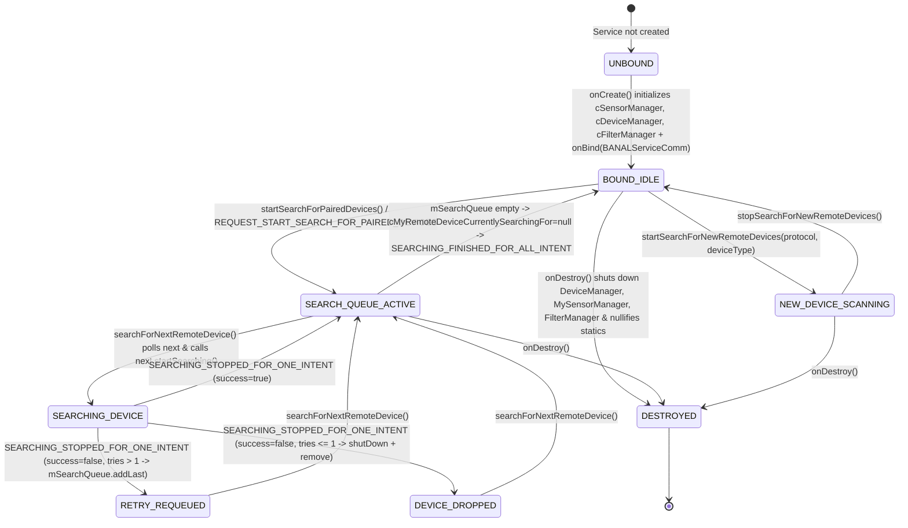

# Detailed Design: BANALService & DeviceManager (ASPICE SWE.3)

**Units**: `BANALService` (`app/src/main/java/com/atrainingtracker/banalservice/BANALService.java`, 948 LOC), `DeviceManager` (`app/src/main/java/com/atrainingtracker/banalservice/devices/DeviceManager.java`, 1,451 LOC), `MyRemoteDevice` (`MyRemoteDevice.java`, 139 LOC)  
**Collaborators**: `MySensorManager`, `ProxySensor`, `FilterManager`, `SportTypesRepository`, `BANALServiceComm`  
**SWE.2 Alignment**: `docs/architecture.md` §3.2, §4.2, §4.7, §4.8, §4.9 (`IF-SWE-03`, `IF-SWE-04`)  
**Requirement Trace**: `REQ-PRO-114.1`, `REQ-ARC-008.2`, `REQ-SEN-021`, `REQ-TRK-024`, `REQ-TRK-055`, `REQ-TRK-077`

---

## 1. Composite State Model
`BANALService` defines **no** standalone `SearchingState` enum. Instead, service lifecycle, sensor arbitration, and peripheral discovery state are partitioned cleanly across:
1. **Service Singleton Lifecycle (`BANALService`)**:
   - Static references (`cServiceContext`, `cSensorManager`, `cDeviceManager`, `cFilterManager`): populated in `onCreate()`, queried statically or via `BANALServiceComm` binder, and explicitly nullified in `onDestroy()`.
   - Sport & Indoor State: `mUserSelectedSportTypeId`, `mHaveUserSelectedSportType`, `mIsIndoorMode`, `mActivityTypeMax`.
2. **Paired Peripheral Search State Machine (`DeviceManager` + `MyRemoteDevice`)**:
   - `BANALService.isSearching()` delegates directly to `DeviceManager.isSearchingForARemoteDevice()`, which checks `cMyRemoteDeviceCurrentlySearchingFor != null`.
   - Queue & Retry State (`DeviceManager` synchronized on `mSearchQueue`): `mSearchQueue` (`Deque<MyRemoteDevice>`), `cMyRemoteDeviceCurrentlySearchingFor` (`static volatile MyRemoteDevice`), `mMyRemoteDeviceTries` (`Map<MyRemoteDevice, Integer>`), and per-device flag `MyRemoteDevice.mSearching`.
   - New-Device Discovery Engines (`DeviceManager`): `mAntAsyncSearchEngine` and `mBTSearchForNewDevicesEngine` (exposed via `isSearchingForNewRemoteDevices()`, `getNewRemoteDeviceTypeCurrentlySearchingFor()`).

---

## 2. Dynamic State Machine (`stateDiagram-v2`)

### 2.1 Service Lifecycle & Paired Device Search State Machine

---

## 3. Events, Guards & Transitions

| Trigger / Event | Pre-State & Guard | Transition / Side Effect | Target State |
| :--- | :--- | :--- | :--- |
| `onCreate()` | Service starting | Initialize `cServiceContext`, `cSensorManager`, `cDeviceManager`, `cFilterManager`; apply indoor mode; create virtual devices (`createVerticalSpeedAndSlopeDevice`, `createCyclingPowerMetricsDevice`, `createHrvMetricsDevice`); register `mStartSearchForPairedDevices` and `mNewLapReceiver` | `BOUND_IDLE` |
| `startSearchForPairedDevices()` | `!isSearchingForARemoteDevice()` | Populate paired ANT+/BLE devices into `mSearchQueue` (clamped to `MAX_FREE_PAIRED_DEVICES` on Free tier); seed `mMyRemoteDeviceTries`; broadcast `SEARCHING_STARTED_FOR_ALL_INTENT`; call `searchForNextRemoteDevice()` | `SEARCH_QUEUE_ACTIVE` |
| `searchForNextRemoteDevice()` | `next == null` | Set `cMyRemoteDeviceCurrentlySearchingFor = null`; broadcast `SEARCHING_FINISHED_FOR_ALL_INTENT` | `BOUND_IDLE` |
| `searchForNextRemoteDevice()` | `next != null && !next.isSearching() && !next.isReceivingData()` and sport filter matches | Set `cMyRemoteDeviceCurrentlySearchingFor = next`; call `next.startSearching()` (which invokes `MyRemoteDevice.notifyStartSearching()` -> `SEARCHING_STARTED_FOR_ONE_INTENT` and ends via `notifyStopSearching(success)` -> `SEARCHING_STOPPED_FOR_ONE_INTENT`) | `SEARCHING_DEVICE` |
| `mSearchingStoppedForOneReceiver.onReceive` | `current != null && current.getDeviceId() == deviceID` | Clear `cMyRemoteDeviceCurrentlySearchingFor = null`; if `!success && tries <= 1` call `current.shutDown()` & remove from `mMyRemoteDevices`; if `!success && tries > 1` decrement tries & `mSearchQueue.addLast(current)`; call `searchForNextRemoteDevice()` | `SEARCH_QUEUE_ACTIVE` |
| `mNewLapReceiver.onReceive` (`REQUEST_NEW_LAP`) | Active service | Read `LAP_NR`, `TIME_LAP`, `DISTANCE_m_LAP`, compute `lapSpeed`, forward `deviceManager.newLap()`, broadcast `LAP_SUMMARY` (optionally trigger `REQUEST_START_SEARCH_FOR_PAIRED_DEVICES`) | Unchanged |
| `setUserSelectedSportTypeId(sportTypeId)` | `BANALServiceComm` call | Set `mHaveUserSelectedSportType = true`; `updateIndoorModeForSportType`; broadcast `SPORT_TYPE_CHANGED_BY_USER_INTENT` | Unchanged |
| `onDestroy()` | Service tearing down | `deviceManager.stopSearchForNewRemoteDevices()`, `deviceManager.shutDown()`, `sensorManager.shutDown()`, `filterManager.shutDown()`; nullify `cDeviceManager`, `cSensorManager`, `cFilterManager`, `cServiceContext`; `LifecycleUtils.safeUnregisterReceiver` | `DESTROYED` |

---

## 4. Interfaces, Threading & Error Handling

### 4.1 Interfaces (`IF-SWE-03`, `IF-SWE-04`)
| Interface | Direction | Contract / Symbols |
| :--- | :--- | :--- |
| `IF-SWE-03` | `BANALServiceComm` -> `TrackerService` / Repo | Local `Binder` exposing `getBestSensorData(SensorType)`, `getAllSensorData()`, `getAllButBestSensorData()`, `getAvailableSensorTypeSet()`, `getAccumulatedSensorTypeSet()`, `getFilteredSensorData(FilterData)`, `getSourceDeviceId(SensorType)`, `getBSportType()`, `getSportTypeId()`, `getActivityType()`, `setIndoorMode(boolean)`, `addRrBeatListener(RrBeatListener)` |
| `IF-SWE-04` | Hardware HAL -> `DeviceManager` / `MySensorManager` | `MyRemoteDevice` subclasses (`MyBTLEDevice`, ANT+ devices) & location/pressure devices register `MySensor` instances into `MySensorManager`, which arbitrates priority via `ProxySensor` (`SPEED_PRIORITY`, `ALTITUDE_PRIORITY`, `LOCATION_PRIORITY`, `CADENCE_PRIORITY`) |
| Broadcasts | `BANALService` <-> `TrackerService` / UI | Emits `SEARCHING_STARTED_FOR_ALL_INTENT`, `SEARCHING_STARTED_FOR_ONE_INTENT`, `SEARCHING_STOPPED_FOR_ONE_INTENT`, `SEARCHING_FINISHED_FOR_ALL_INTENT`, `LAP_SUMMARY`, `SPORT_TYPE_CHANGED_BY_USER_INTENT`; receives `REQUEST_START_SEARCH_FOR_PAIRED_DEVICES`, `REQUEST_NEW_LAP` |

### 4.2 Threading & Synchronization
* **Main Looper / Binder Pool**: `onCreate`, `onBind`, `onDestroy`, `BroadcastReceiver` callbacks, and `BANALServiceComm` synchronous read queries.
* **`DeviceManager` Queue Lock (`synchronized (mSearchQueue)`)**: Protects `mSearchQueue`, `cMyRemoteDeviceCurrentlySearchingFor`, and `mMyRemoteDeviceTries` against concurrent search-completion broadcasts and `pairingChanged` mutations.
* **Volatile Static & Sensor State**: `cServiceContext`, `cDeviceManager`, `cSensorManager`, `cFilterManager`, `mIsIndoorMode`, `mHaveUserSelectedSportType`, and `MyRemoteDevice.mSearching` are `volatile` for safe cross-thread reads.

### 4.3 Error Handling & Fault Recovery
* **Null-Safe Static & Binder Access**: `getSensorData`, `getBestSensorData`, `getAvailableSensorTypeSet`, and `BANALServiceComm` methods guard against null `cDeviceManager` / `cSensorManager` / `cFilterManager` after `onDestroy()`, and exclude unbound `ProxySensor` instances (`getSourceSensor() == null`) per `REQ-TRK-055.1`.
* **Stale Broadcast Filtering**: `mSearchingStoppedForOneReceiver` ignores `SEARCHING_STOPPED_FOR_ONE_INTENT` when `current == null || current.getDeviceId() != deviceID` so background reconnect stops from already-tracking devices cannot corrupt `mSearchQueue`.
* **Safe Teardown**: `LifecycleUtils.safeUnregisterReceiver` absorbs duplicate/unregistered receiver exceptions; `updateIndoorModeForSportType` wraps `SportTypesRepository` lookup in `try/catch (Throwable)`.

---

## 5. Verification & Characterisation Test Traceability (`ATT-7902`)

| Test Class (`app/src/test/...`) | Verified Behavior & Arbitration |
| :--- | :--- |
| `BANALServiceArbitrationCharacterisationTest` | `SPEED_PRIORITY` (`ATT_FUSED > BIKE_SPEED > GPS`) & dynamic fallback, `ALTITUDE_PRIORITY` (`ATT_FUSED > POSITION > PRESSURE`), `ProxySensor` transparent listener migration on source switch, `WheelMeasurementListener` dispatch, `shutDown()` unbound proxy cleanup (`TST-ARC-008.3`) |
| `BANALServiceLifecycleTest` | `onDestroy()` nullifies `BANALService.getDeviceManager()` & `getSensorData()`, unbound `ProxySensor` exclusion from available set, `DeviceManager.shutDown()` nullifies internal devices (`TST-TRK-055.4`) |
| `HardwareHalIngestionIntegrationTest` | HAL -> `BANALService` / `MySensorManager` integration verification (`INT-SWE-04`, `TST-INT-012`) |
