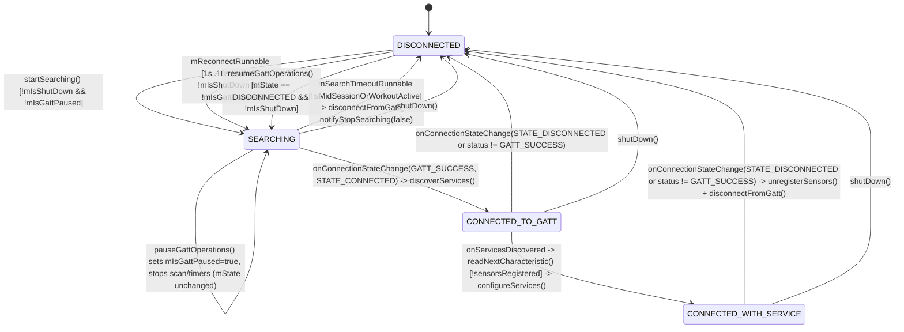

# Detailed Design: MyBTLEDevice (ASPICE SWE.3)

**Document ID**: `DOC-ARC-DD-BTLE`  
**Version**: 1.0.0  
**Status**: Reviewed  
**Approver**: Pending PO Sign-Off  

**Unit**: `MyBTLEDevice` (`app/src/main/java/com/atrainingtracker/banalservice/devices/bluetooth_le/MyBTLEDevice.java`, 1,177 LOC)  
**Superclass / Subclasses**: Extends `MyRemoteDevice`; specialized by BLE profiles (`BTLEHeartRateDevice`, `BTLERadarDevice`, cycling speed/cadence/power devices)  
**SWE.2 Alignment**: `docs/architecture.md` §3.4, §4.5, §4.9 (`IF-SWE-04`)  
**Requirement Trace**: `REQ-PRO-114.1`, `REQ-CON-007`, `REQ-CON-012`, `REQ-CON-020`, `REQ-CON-023`, `REQ-CON-028`, `REQ-CON-030`, `REQ-CON-031`

---

## 1. State Model & Guards
`MyBTLEDevice` maintains an explicit 4-state enum `MyBTLEDevice.State` in `protected volatile State mState = State.DISCONNECTED`, synchronized under `private final Object mGattLock = new Object()`:
1. **Enum `MyBTLEDevice.State`**:
   - `DISCONNECTED`: Initial and terminal state; `mBluetoothGatt == null`, sensors unregistered, `mGattQueue` cleared.
   - `SEARCHING`: `startSearching()` active; `mSearchTimeoutRunnable` scheduled, optional `startScanAssistance()` running, `connectGatt(..., TRANSPORT_LE)` triggered.
   - `CONNECTED_TO_GATT`: `BluetoothGattCallback.onConnectionStateChange` received `GATT_SUCCESS` + `STATE_CONNECTED`; `gatt.discoverServices()` posted to `mHandler`.
   - `CONNECTED_WITH_SERVICE`: `readNextCharacteristic()` drained `mReadCharacteristicQueue` and registered sensors (`registerSensors()`, `configureServices()`); `isReceivingData()` returns `true`.
2. **Lifecycle & Concurrency Flags**:
   - `mIsShutDown` (`volatile boolean`): Permanent shutdown gate (`shutDown()`).
   - `mIsGattPaused` (`volatile boolean`): External yield flag set by `pauseGattOperations()` / cleared by `resumeGattOperations()` (used by `PolarOfflineGattCoordinator`).
   - `mIsScanning` (`volatile boolean`): Active `BluetoothLeScanner` scan-assist state (`mScanCallback`, quota `MAX_SCANS_IN_WINDOW = 4` per `SCAN_QUOTA_WINDOW_MS = 30000L` under `sScanLock`).
   - `mHasConnectedInSession` (`volatile boolean`): Sticky session indicator enabling `autoConnect = true` via `isMidSessionOrWorkoutActive()`.
   - `mGattOperationPending` (`volatile boolean`) + `mGattQueue` (`ConcurrentLinkedQueue<GattOperation>`): Serializes `WriteDescriptorOp`, `ReadCharacteristicOp`, `WriteCharacteristicOp`, and `RequestMtuOp` with `GATT_OP_TIMEOUT_MS = 2500L`.

---

## 2. Dynamic State Machine (`stateDiagram-v2`)

*(Note: SMP bonding/authentication is handled implicitly when `WriteCharacteristicOp` selects `WRITE_TYPE_DEFAULT` for `PROPERTY_WRITE` characteristics; `MyBTLEDevice.State` has no separate bonded/handshake state.)*

---

## 3. Events, Guards & Transitions

| Trigger / Event | Pre-State & Guard | Transition / Side Effect | Target State |
| :--- | :--- | :--- | :--- |
| `startSearching()` | `!mIsShutDown && !mIsGattPaused` | `notifyStartSearching()`; `mState = SEARCHING`; schedule `mSearchTimeoutRunnable` (`TrainingApplication.getBtleSearchPeriodMs()`); `getBluetoothDevice()` (`getRemoteLeDevice` with `ADDRESS_TYPE_RANDOM` if `isRandomStaticAddress` on API 33+); `startScanAssistance()`; `triggerGattConnect()` if `!mIsScanning` or `isMidSessionOrWorkoutActive()` | `SEARCHING` |
| `mScanCallback.onScanResult` | `!mIsShutDown && mState == SEARCHING` and address matches | `stopScanAssistance()`; close any prior `mBluetoothGatt`; `dev.connectGatt(mContext, false, mGattCallback, BluetoothDevice.TRANSPORT_LE)` | `SEARCHING` |
| `mScanCallback.onScanFailed` | Scan throttled or failed | Clear `mIsScanning = false`; fallback immediately to `triggerGattConnect(dev, isMidSessionOrWorkoutActive())` | `SEARCHING` |
| `mSearchTimeoutRunnable` | `!isReceivingData()` and `!isMidSessionOrWorkoutActive()` | `stopScanAssistance()`; `disconnectFromGatt()`; `notifyStopSearching(false)` | `DISCONNECTED` |
| `mSearchTimeoutRunnable` | `!isReceivingData()` and `isMidSessionOrWorkoutActive()` | Exponential backoff `mCurrentReconnectDelayMs` (`1000..16000 ms`); post `mReconnectRunnable`; ensure `triggerGattConnect(dev, true)` if `mBluetoothGatt == null` | `SEARCHING` |
| `mGattCallback.onConnectionStateChange` | `status == GATT_SUCCESS && newState == STATE_CONNECTED` and `gatt == mBluetoothGatt` | `stopScanAssistance()`; `mState = CONNECTED_TO_GATT`; reset `mCurrentReconnectDelayMs = INITIAL_RECONNECT_DELAY_MS`; cancel `mReconnectRunnable` & `mSearchTimeoutRunnable`; post `gatt.discoverServices()` + `notifyStopSearching(true)` | `CONNECTED_TO_GATT` |
| `mGattCallback.onServicesDiscovered` | `gatt != null` | Enqueue battery read if `UUID_SERVICE_BATTERY` present; call `readNextCharacteristic()` | `CONNECTED_TO_GATT` -> `CONNECTED_WITH_SERVICE` |
| `readNextCharacteristic()` | `mReadCharacteristicQueue` empty and `!sensorsRegistered()` | Under `mGattLock`: `mState = CONNECTED_WITH_SERVICE`, `mHasConnectedInSession = true`; `setLastActive()`; `registerSensors()`; post `configureServices(gatt)` (notification + CCCD `enqueueWriteDescriptor` + battery CCCD) | `CONNECTED_WITH_SERVICE` |
| `onCharacteristicChanged` / `onCharacteristicRead` | `!mIsShutDown` | Clone bytes via `obtainSnapshotCharacteristic` (`REQ-CON-020.1`); dispatch `measurementCharacteristicUpdate` on `mHandler` when `mState == CONNECTED_WITH_SERVICE && gatt == mBluetoothGatt` | `CONNECTED_WITH_SERVICE` |
| `mGattCallback.onConnectionStateChange` | `newState == STATE_DISCONNECTED` or `(newState == STATE_CONNECTED && status != GATT_SUCCESS)` | `mState = DISCONNECTED`; `unregisterSensors()`; `disconnectFromGatt()`; if `!mIsShutDown` schedule `mReconnectRunnable` with exponential backoff (`1s..16s`) | `DISCONNECTED` |
| `pauseGattOperations()` / `resumeGattOperations()` | External GATT arbitration (`PolarOfflineGattCoordinator`) | `pauseGattOperations()` sets `mIsGattPaused = true`, `stopScanAssistance()`, cancels `mSearchTimeoutRunnable` & `mReconnectRunnable` without changing `mState` or closing GATT; `resumeGattOperations()` clears `mIsGattPaused = false` and calls `startSearching()` if `mState == DISCONNECTED && !mIsShutDown` | `mState` preserved on pause; `DISCONNECTED` -> `SEARCHING` on resume |
| `shutDown()` | Any state | Set `mIsShutDown = true`, `mHasConnectedInSession = false`; `stopScanAssistance()`; clear `mHandler` callbacks; `disconnectFromGatt()`; `super.shutDown()` | `DISCONNECTED` |

---

## 4. Interfaces, Threading & Error Handling

### 4.1 Interfaces (`IF-SWE-04`)
| Interface | Direction | Contract / Symbols |
| :--- | :--- | :--- |
| Android BLE HAL -> `MyBTLEDevice` | Callback | `BluetoothGattCallback` (`mGattCallback`) & `ScanCallback` (`mScanCallback`) deliver connection, discovery, read, write, MTU, and notification events |
| `MyBTLEDevice` -> `MySensorManager` | Registration & Telemetry | Subclasses implement `addSensors()` and `measurementCharacteristicUpdate(gatt, characteristic)` emitting into `MySensor` instances |
| `MyBTLEDevice` <-> `PolarOfflineGattCoordinator` | Yield Coordination | `pauseGattOperations()`, `resumeGattOperations()`, `isGattPaused()` yield the radio link cleanly without `shutDown()` |

### 4.2 Threading & Serialized GATT Queue
* **Main Looper (`mHandler = new Handler(mContext.getMainLooper())`)**: Executes `connectGatt`, `discoverServices`, `disconnect`/`close`, `configureServices`, `measurementCharacteristicUpdate`, `mSearchTimeoutRunnable`, `mReconnectRunnable`, `mBatteryReadRunnable`, and `mGattTimeoutRunnable`.
* **Lock Discipline (`mGattLock` & `sScanLock`)**: `mGattLock` guards `mState`, `mBluetoothGatt`, `mIsGattPaused`, `mHasConnectedInSession`, `mCurrentReconnectDelayMs`, `mGattQueue`, and `mGattOperationPending`. `sScanLock` guards static `sScanTimestamps` (Android 30s scan-quota window).
* **Serialized `mGattQueue`**: Only one `GattOperation` (`WriteDescriptorOp`, `ReadCharacteristicOp`, `WriteCharacteristicOp`, `RequestMtuOp`) executes at a time (`mGattOperationPending = true`). Completion callbacks (`onCharacteristicRead`, `onDescriptorWrite`, `onCharacteristicWrite`, `onMtuChanged`) or the `2500 ms` `mGattTimeoutRunnable` watchdog call `onGattOperationCompleted()` to advance the queue. `disconnectFromGatt()` clears both `mGattQueue` and `mReadCharacteristicQueue` and resets `mGattOperationPending = false`.

### 4.3 Error Handling & Fault Recovery
* **Stale GATT Filtering**: `onConnectionStateChange` checks `mBluetoothGatt != null && gatt != mBluetoothGatt` under `mGattLock` to discard callbacks from superseded `BluetoothGatt` handles.
* **TOCTOU & Permission Guards**: `triggerGattConnect`, `readNextCharacteristic`, `configureServices`, `processNextGattOperation`, and `disconnectFromGatt` re-check `BLUETOOTH_CONNECT`/`BLUETOOTH_SCAN`, `mIsShutDown`, and non-null `mBluetoothGatt` inside posted `mHandler` runnables and catch `SecurityException` / `IllegalStateException`.
* **Failed Queue Execution Recovery**: If `op.execute(currentGatt)` returns `false` or throws, `processNextGattOperation` immediately calls `onGattOperationCompleted()` so the queue never deadlocks; `mGattTimeoutRunnable` (`2500 ms`) prevents hung BLE stacks from stalling subsequent writes/reads.
* **Immutable Payload Snapshots**: `obtainSnapshotCharacteristic` clones incoming `byte[]` payloads before posting to `mHandler`, preventing ring-buffer overwrites (`REQ-CON-020.1`).

---

## 5. Verification & Unit Test Traceability

| Test Class (`app/src/test/...`) | Verified Behavior & Invariants |
| :--- | :--- |
| `MyBTLEDeviceLifecycleTest` | Null `mBluetoothGatt` guards in `readNextCharacteristic`, TOCTOU race immunity, `disconnectFromGatt` queue & lock cleanup, `mBatteryReadRunnable` cancellation on disconnect, `onConnectionStateChange` null guard, `shutDown()` cleanup, `BLUETOOTH_CONNECT` permission guard, `TRANSPORT_LE` connection (`REQ-CON-012`, `TST-CON-003`) |
| `MyBTLEDeviceQueueTest` | Sequential `mGattQueue` execution without dropping, queue clear on `disconnectFromGatt`, read-behind-descriptor serialization, `mBatteryReadRunnable` & `mReadCharacteristicQueue` routing through `mGattQueue`, `WriteCharacteristicOp` write-type selection, `onCharacteristicWriteCompleted` failure status propagation (`TST-CON-028.1`) |
| `MyBTLEDeviceAddressAndSearchTest` | `isRandomStaticAddress` MAC classification, scan-assist `ScanFilter` & stop on timeout/disconnect/shutdown, scan-resolved GATT replacement & stale callback rejection, `onScanFailed` direct-connect fallback (`REQ-CON-023`, `TST-CON-023`) |

---

## Change History

| Version | Date | Author | Ticket | Summary of Changes |
| :--- | :--- | :--- | :--- | :--- |
| `1.0.0` | 2026-11-17 | AI Agent (`ATT-8164`) | `ATT-8164` | Added standardized `DOC-ARC-DD-BTLE` work-product control header and Change History. |
