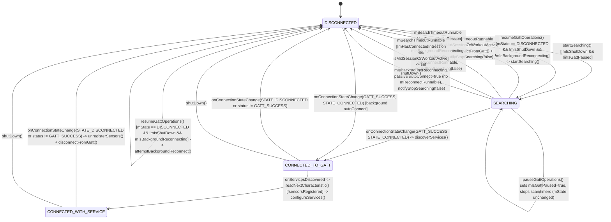

# Detailed Design: MyBTLEDevice (ASPICE SWE.3)

**Document ID**: `DOC-ARC-DD-BTLE`  
**Version**: 1.0.8  
**Status**: Reviewed  
**Approver**: Pending PO Sign-Off  

**Unit**: `MyBTLEDevice` (`app/src/main/java/com/atrainingtracker/banalservice/devices/bluetooth_le/MyBTLEDevice.java`, 1,424 LOC)  
**Superclass / Subclasses**: Extends `MyRemoteDevice`; specialized by BLE profiles (`BTLEHeartRateDevice`, `BTLERadarDevice`, cycling speed/cadence/power devices)  
**SWE.2 Alignment**: `docs/architecture.md` §3.4, §4.5, §4.9 (`IF-SWE-04`)  
**Requirement Trace**: `REQ-PRO-114.1`, `REQ-CON-007`, `REQ-CON-012`, `REQ-CON-020`, `REQ-CON-023`, `REQ-CON-028`, `REQ-CON-030`, `REQ-CON-031`, `REQ-CON-051`, `REQ-CON-052`, `REQ-CON-054`, `REQ-SET-120`, `REQ-SET-123`

---

## 1. State Model & Guards
`MyBTLEDevice` maintains an explicit 4-state enum `MyBTLEDevice.State` in `protected volatile State mState = State.DISCONNECTED`, synchronized under `private final Object mGattLock = new Object()`:
1. **Enum `MyBTLEDevice.State`**:
   - `DISCONNECTED`: Initial and terminal state; `mBluetoothGatt == null`, sensors unregistered, `mGattQueue` cleared.
   - `SEARCHING`: `startSearching()` active; `mSearchTimeoutRunnable` scheduled, optional `startScanAssistance()` running, `connectGatt(..., TRANSPORT_LE)` triggered.
   - `CONNECTED_TO_GATT`: `BluetoothGattCallback.onConnectionStateChange` received `GATT_SUCCESS` + `STATE_CONNECTED`; `gatt.discoverServices()` posted to `mHandler`.
   - `CONNECTED_WITH_SERVICE`: `readNextCharacteristic()` drained `mReadCharacteristicQueue` and registered sensors (`registerSensors()`, `configureServices()`); `isReceivingData()` returns `true`.
2. **Lifecycle & Concurrency Flags**:
   - `mIsShutDown` (`volatile boolean`): Permanent shutdown gate (`shutDown()`).
   - `mIsGattPaused` (`volatile boolean`): External yield flag set by `pauseGattOperations()` / cleared by `resumeGattOperations()` (used by `PolarOfflineGattCoordinator`).
   - `mIsScanning` (`volatile boolean`): Active `BluetoothLeScanner` scan-assist state (`mScanCallback`, quota `MAX_SCANS_IN_WINDOW = 4` per `SCAN_QUOTA_WINDOW_MS = 30000L` under `sScanLock`).
   - `mHasConnectedInSession` (`volatile boolean`): Sticky session indicator enabling active fast reconnect + scan-assist vs. passive never-connected convergence under `isMidSessionOrWorkoutActive()`.
   - `mIsBackgroundReconnecting` (`volatile boolean`): Decoupled background reconnect flag allowing `triggerGattConnect(..., true)` and `onScanResult()` attachment in `DISCONNECTED` without re-entering `State.SEARCHING` or `MyRemoteDevice.mSearching`.
   - `mCurrentGattAutoConnect` (`boolean`, guarded by `mGattLock`): Tracks whether the active `mBluetoothGatt` handle was opened with `autoConnect = true` (`triggerGattConnect`) vs. direct `autoConnect = false` (`READY` Try 1 or `onScanResult`), enabling atomic non-`autoConnect` replacement on `READY -> TRACKING` timeout convergence (`REQ-SET-123.1`).
   - `mGattOperationPending` (`volatile boolean`) + `mGattQueue` (`ConcurrentLinkedQueue<GattOperation>`): Serializes `WriteDescriptorOp`, `ReadCharacteristicOp`, `WriteCharacteristicOp`, and `RequestMtuOp` with `GATT_OP_TIMEOUT_MS = 2500L`.

---

## 2. Dynamic State Machine (`stateDiagram-v2`)

*(Note: SMP bonding/authentication is handled implicitly when `WriteCharacteristicOp` selects `WRITE_TYPE_DEFAULT` for `PROPERTY_WRITE` characteristics; `MyBTLEDevice.State` has no separate bonded/handshake state.)*

---

## 3. Events, Guards & Transitions

| Trigger / Event | Pre-State & Guard | Transition / Side Effect | Target State |
| :--- | :--- | :--- | :--- |
| `startSearching()` | `!mIsShutDown && !mIsGattPaused` | `notifyStartSearching()`; under `mGattLock`: clear `mIsBackgroundReconnecting = false`, `mState = SEARCHING`; schedule `mSearchTimeoutRunnable` (`TrainingApplication.getBtleSearchPeriodMs()`); `getBluetoothDevice()` (`getRemoteLeDevice` with `ADDRESS_TYPE_RANDOM` if `isRandomStaticAddress` on API 33+); `startScanAssistance()`; `triggerGattConnect()` if `!mIsScanning` or `isMidSessionOrWorkoutActive()` | `SEARCHING` |
| `mReconnectRunnable` (`attemptBackgroundReconnect`) | `!mIsShutDown && !mIsGattPaused && mState != CONNECTED_TO_GATT && mState != CONNECTED_WITH_SERVICE` | Under `mGattLock`: set `mIsBackgroundReconnecting = true` (leaving `mState = DISCONNECTED` and `MyRemoteDevice.mSearching = false`); schedule `mSearchTimeoutRunnable` only when `mHasConnectedInSession \|\| !isMidSessionOrWorkoutActive()` (skipped for passive never-connected workout convergence); call `initiateScanAndConnect(mHasConnectedInSession)` so `startScanAssistance()` executes strictly when `mHasConnectedInSession == true` and passive `triggerGattConnect(dev, isMidSessionOrWorkoutActive())` consumes `0` scan quota when never connected (`REQ-SET-123.2`) | `DISCONNECTED` |
| `mScanCallback.onScanResult` | `!mIsShutDown && (mState == SEARCHING \|\| (mIsBackgroundReconnecting && mState == DISCONNECTED))` and address matches | `stopScanAssistance()`; close any prior `mBluetoothGatt`; `dev.connectGatt(mContext, false, mGattCallback, BluetoothDevice.TRANSPORT_LE)` (`mCurrentGattAutoConnect = false`) | `SEARCHING` / `DISCONNECTED` |
| `mScanCallback.onScanFailed` | Scan throttled or failed | Clear `mIsScanning = false`; fallback immediately to `triggerGattConnect(dev, isMidSessionOrWorkoutActive())` | `SEARCHING` |
| `mSearchTimeoutRunnable` | `mState != CONNECTED_TO_GATT && mState != CONNECTED_WITH_SERVICE` and `!isMidSessionOrWorkoutActive()` | `stopScanAssistance()`; `disconnectFromGatt()`; if `isSearching()` call `notifyStopSearching(false)` | `DISCONNECTED` |
| `mSearchTimeoutRunnable` | `mState != CONNECTED_TO_GATT && mState != CONNECTED_WITH_SERVICE` and `mHasConnectedInSession` | Advance `mCurrentReconnectDelayMs` via `SensorReconnectBackoffPolicy.nextDelayMs(mCurrentReconnectDelayMs, mContext)` (`1s..16s->32s->64s->128s->finalPeriodMs` when enabled, or capped at `MAX_RECONNECT_DELAY_MS = 16000 ms` when disabled); clear `mState = DISCONNECTED` and set `mIsBackgroundReconnecting = true`; post `mReconnectRunnable`; ensure `triggerGattConnect(dev, true)` if `mBluetoothGatt == null`; if `isSearching()` call `notifyStopSearching(false)` to release `DeviceManager` queue (aborts immediately if `CONNECTED_TO_GATT`/`CONNECTED_WITH_SERVICE`) | `DISCONNECTED` |
| `mSearchTimeoutRunnable` | `mState != CONNECTED_TO_GATT && mState != CONNECTED_WITH_SERVICE` and `!mHasConnectedInSession && isMidSessionOrWorkoutActive()` | Clear `mState = DISCONNECTED`, set `mIsBackgroundReconnecting = true`, cancel `mReconnectRunnable` (MUST NOT reschedule), retain existing passive `autoConnect = true` GATT (`mCurrentGattAutoConnect == true`) or open/replace non-`autoConnect` GATT via atomic `disconnectFromGattInternal(onGattClosed, true)` -> `triggerGattConnect(dev, true)`, and if `isSearching()` call `notifyStopSearching(false)` (`REQ-SET-123.1`) | `DISCONNECTED` |
| `mGattCallback.onConnectionStateChange` | `status == GATT_SUCCESS && newState == STATE_CONNECTED` and `gatt == mBluetoothGatt` | `stopScanAssistance()`; under `mGattLock`: `mState = CONNECTED_TO_GATT`, `mIsBackgroundReconnecting = false`, `mHasConnectedInSession = true`, reset `mCurrentReconnectDelayMs = INITIAL_RECONNECT_DELAY_MS`, cancel `mReconnectRunnable` & `mSearchTimeoutRunnable`; post `gatt.discoverServices()` + `notifyStopSearching(true)` | `CONNECTED_TO_GATT` |
| `mGattCallback.onServicesDiscovered` | `gatt != null` | Enqueue battery read if `UUID_SERVICE_BATTERY` present; call `readNextCharacteristic()` | `CONNECTED_TO_GATT` -> `CONNECTED_WITH_SERVICE` |
| `readNextCharacteristic()` | `mReadCharacteristicQueue` empty and `!sensorsRegistered()` | Under `mGattLock`: `mState = CONNECTED_WITH_SERVICE`, `mHasConnectedInSession = true`; `setLastActive()`; `registerSensors()`; post `configureServices(gatt)` (notification + CCCD `enqueueWriteDescriptor` + battery CCCD) | `CONNECTED_WITH_SERVICE` |
| `onCharacteristicChanged` / `onCharacteristicRead` | `!mIsShutDown` | Clone bytes via `obtainSnapshotCharacteristic` (`REQ-CON-020.1`); dispatch `measurementCharacteristicUpdate` on `mHandler` when `mState == CONNECTED_WITH_SERVICE && gatt == mBluetoothGatt` | `CONNECTED_WITH_SERVICE` |
| `mGattCallback.onConnectionStateChange` | `newState == STATE_DISCONNECTED` or `(newState == STATE_CONNECTED && status != GATT_SUCCESS)` | `mState = DISCONNECTED`; `unregisterSensors()`; `disconnectFromGatt()` (clears `mIsBackgroundReconnecting = false` and `mCurrentGattAutoConnect = false`); if `!mIsShutDown` schedule `mReconnectRunnable` (floored at `>= NEVER_CONNECTED_WORKOUT_RECONNECT_FLOOR_MS = 60_000 ms` when `!mHasConnectedInSession && isMidSessionOrWorkoutActive()`, `REQ-SET-123.2`; `attemptBackgroundReconnect()` re-arms `mIsBackgroundReconnecting = true` upon execution) | `DISCONNECTED` |
| `pauseGattOperations()` / `resumeGattOperations()` | External GATT arbitration (`PolarOfflineGattCoordinator`) | `pauseGattOperations()` sets `mIsGattPaused = true`, `stopScanAssistance()`, cancels `mSearchTimeoutRunnable` & `mReconnectRunnable` without changing `mState` or closing GATT; `resumeGattOperations()` clears `mIsGattPaused = false` and if `mState == DISCONNECTED && !mIsShutDown` routes to `attemptBackgroundReconnect()` when `mIsBackgroundReconnecting` is `true` (staying `DISCONNECTED`, `mSearching = false`, and for never-connected active-workout devices restoring passive `autoConnect = true` with `0` scans / `0` timeout churn) or `startSearching()` otherwise | `mState` preserved on pause; `DISCONNECTED` or `SEARCHING` on resume |
| `shutDown()` / `shutDown(onTeardownComplete)` | Any state | Store `mPendingTeardownCallback` and dispatch polymorphically through `shutDown()` (preserving subclass overrides like `BTLEHeartRateDevice.shutDown()`), then `performShutDown`: set `mIsShutDown = true`, `mHasConnectedInSession = false`; `stopScanAssistance()`; clear `mHandler` callbacks; `disconnectFromGatt(onTeardownComplete)` (`gattToClose.disconnect(); gattToClose.close()` synchronously when `onGattClosed == null && mHandler.getLooper() != null && mHandler.getLooper() == Looper.myLooper()`, else posted to `mHandler` with synchronous `closeRunnable.run()` fallback when `!posted` before callback); `super.shutDown()`; late `onConnectionStateChange` callbacks strictly when `mIsShutDown == true` immediately disconnect & close `gatt` | `DISCONNECTED` |
| `triggerSilentConnectionReconnect()` | Subclass silent-HR watchdog (`BTLEHeartRateDevice`, `REQ-CON-054.3`) | `unregisterSensors()`; `disconnectFromGatt()`; if `!mIsShutDown && !mIsGattPaused`, set `mIsBackgroundReconnecting = true`, reset `mCurrentReconnectDelayMs = INITIAL_RECONNECT_DELAY_MS`, and post `mReconnectRunnable` after `INITIAL_RECONNECT_DELAY_MS` | `DISCONNECTED` |

---

## 4. Interfaces, Threading & Error Handling

### 4.1 Interfaces (`IF-SWE-04`)
| Interface | Direction | Contract / Symbols |
| :--- | :--- | :--- |
| Android BLE HAL -> `MyBTLEDevice` | Callback | `BluetoothGattCallback` (`mGattCallback`) & `ScanCallback` (`mScanCallback`) deliver connection, discovery, read, write, MTU, and notification events |
| `MyBTLEDevice` -> `MySensorManager` | Registration & Telemetry | Subclasses implement `addSensors()` and `measurementCharacteristicUpdate(gatt, characteristic)` emitting into `MySensor` instances |
| `MyBTLEDevice` <-> `PolarOfflineGattCoordinator` | Yield Coordination | `pauseGattOperations()`, `resumeGattOperations()`, `isGattPaused()` yield the radio link cleanly without `shutDown()`; `PolarOfflineGattCoordinator` symmetrically pauses/resumes `PolarOnlineStreamingBridge` via alias-aware ref-counted lease tokens (`REQ-SET-120.1`) |

### 4.2 Threading & Serialized GATT Queue
* **Main Looper (`mHandler = new Handler(mContext.getMainLooper())`)**: Executes `connectGatt`, `discoverServices`, `disconnect`/`close`, `configureServices`, `measurementCharacteristicUpdate`, `mSearchTimeoutRunnable`, `mReconnectRunnable`, `mBatteryReadRunnable`, and `mGattTimeoutRunnable`.
* **Lock Discipline (`mGattLock` & `sScanLock`)**: `mGattLock` guards `mState`, `mBluetoothGatt`, `mCurrentGattAutoConnect`, `mIsGattPaused`, `mHasConnectedInSession`, `mIsBackgroundReconnecting`, `mCurrentReconnectDelayMs`, `mGattQueue`, and `mGattOperationPending`. `sScanLock` guards static `sScanTimestamps` (Android 30s scan-quota window).
* **Serialized `mGattQueue`**: Only one `GattOperation` (`WriteDescriptorOp`, `ReadCharacteristicOp`, `WriteCharacteristicOp`, `RequestMtuOp`) executes at a time (`mGattOperationPending = true`). Completion callbacks (`onCharacteristicRead`, `onDescriptorWrite`, `onCharacteristicWrite`, `onMtuChanged`) or the `2500 ms` `mGattTimeoutRunnable` watchdog call `onGattOperationCompleted()` to advance the queue. `disconnectFromGatt()` clears both `mGattQueue` and `mReadCharacteristicQueue` and resets `mGattOperationPending = false`.

### 4.3 Error Handling & Fault Recovery
* **Stale GATT Filtering**: `onConnectionStateChange` checks `mBluetoothGatt != null && gatt != mBluetoothGatt` under `mGattLock` to discard callbacks from superseded `BluetoothGatt` handles.
* **TOCTOU & Permission Guards**: `triggerGattConnect`, `readNextCharacteristic`, `configureServices`, `processNextGattOperation`, and `disconnectFromGatt` re-check `BLUETOOTH_CONNECT`/`BLUETOOTH_SCAN`, `mIsShutDown`, and non-null `mBluetoothGatt` inside posted `mHandler` runnables and catch `SecurityException` / `IllegalStateException`.
* **Failed Queue Execution Recovery**: If `op.execute(currentGatt)` returns `false` or throws, `processNextGattOperation` immediately calls `onGattOperationCompleted()` so the queue never deadlocks; `mGattTimeoutRunnable` (`2500 ms`) prevents hung BLE stacks from stalling subsequent writes/reads.
* **Immutable Payload Snapshots**: `obtainSnapshotCharacteristic` clones incoming `byte[]` payloads before posting to `mHandler`, preventing ring-buffer overwrites (`REQ-CON-020.1`).

---

## 5. Verification & Unit Test Traceability

| Test Class (`app/src/test/...`) | Verified Behavior & Invariants |
| :--- | :--- |
| `MyBTLEDeviceLifecycleTest` | Null `mBluetoothGatt` guards in `readNextCharacteristic`, TOCTOU race immunity, `disconnectFromGatt` queue & lock cleanup, `mBatteryReadRunnable` cancellation on disconnect, `onConnectionStateChange` null guard, `shutDown()` cleanup, `BLUETOOTH_CONNECT` permission guard, `TRANSPORT_LE` connection (`REQ-CON-012`, `TST-CON-003`) |
| `MyBTLEDeviceQueueTest` | Sequential `mGattQueue` execution without dropping, queue clear on `disconnectFromGatt`, read-behind-descriptor serialization, `mBatteryReadRunnable` & `mReadCharacteristicQueue` routing through `mGattQueue`, `WriteCharacteristicOp` write-type selection, `onCharacteristicWriteCompleted` failure status propagation (`TST-CON-028.1`) |
| `MyBTLEDeviceAddressAndSearchTest` | `isRandomStaticAddress` MAC classification, scan-assist `ScanFilter` & stop on timeout/disconnect/shutdown, scan-resolved GATT replacement & stale callback rejection, `onScanFailed` direct-connect fallback (`REQ-CON-023`, `TST-CON-023`) |
| `BLEReconnectRobustnessTest` | Search timeout release (`notifyStopSearching(false)` + `State.DISCONNECTED`), passive never-connected workout convergence (`0` `mReconnectRunnable`, `READY -> TRACKING` replacement, `>= 60 s` disconnect floor, `0` background scan-assist), and session-connected fast `mReconnectRunnable` (`1s..16s`) + `autoConnect = true` (`REQ-CON-036`, `REQ-CON-051`, `REQ-SET-123`, `TST-CON-051`, `TST-SET-125`) |

---

## Change History

| Version | Date | Author | Ticket | Summary of Changes |
| :--- | :--- | :--- | :--- | :--- |
| `1.0.0` | 2026-11-17 | AI Agent (`ATT-8164`) | `ATT-8164` | Added standardized `DOC-ARC-DD-BTLE` work-product control header and Change History. |
| `1.0.1` | 2026-11-18 | AI Agent (`ATT-8714`) | `ATT-8714` | Documented `shutDown(onTeardownComplete)` / `disconnectFromGatt(onGattClosed)` post-close completion callback for ordered live Polar IMU handoff (`REQ-CON-050.1`). |
| `1.0.2` | 2026-11-18 | AI Agent (`ATT-8714`) | `ATT-8714` | Bounce 1/3 heal: routed `shutDown(onTeardownComplete)` via `mPendingTeardownCallback` + `shutDown()` -> `performShutDown` so subclass overrides (`BTLEHeartRateDevice`) never get bypassed. |
| `1.0.3` | 2026-11-18 | AI Agent (`ATT-8998`) | `ATT-8998` | Decoupled `mSearchTimeoutRunnable` and `mReconnectRunnable` from `State.SEARCHING` / `MyRemoteDevice.mSearching` via `mIsBackgroundReconnecting` and guaranteed `notifyStopSearching(false)` queue handoff (`REQ-CON-051`). |
| `1.0.4` | 2026-11-19 | AI Agent (`ATT-8998`) | `ATT-8998` | Stage 6 Bounce 1/3 heal: guarded `mSearchTimeoutRunnable` on `CONNECTED_TO_GATT`/`CONNECTED_WITH_SERVICE` under `mGattLock` and documented `resumeGattOperations()` routing to `attemptBackgroundReconnect()` when `mIsBackgroundReconnecting == true`. |
| `1.0.5` | 2026-11-19 | AI Agent (`ATT-8965`) | `ATT-8965` | Delegated runtime backoff progression beyond `16s` (`32s->64s->128s->finalPeriodMs`) to `SensorReconnectBackoffPolicy` while preserving `MAX_RECONNECT_DELAY_MS = 16000L` constant (`SYSREQ-TRK-002`, `REQ-CON-052`); updated unit LOC (`1,274`). |
| `1.0.6` | 2026-11-20 | Lane B Author (`ATT-9155`, `--as agent1`) | `ATT-9155` | Added null-safe same-looper synchronous `disconnectFromGatt()` (`onGattClosed == null`), strict `mIsShutDown == true` late `onConnectionStateChange` GATT close guard, and `triggerSilentConnectionReconnect()` for `BTLEHeartRateDevice` silent-HR recovery (`REQ-CON-054`, `1,324 LOC`). |
| `1.0.7` | 2026-11-20 | Lane B Author (`ATT-9175`, `--as agent1`) | `ATT-9175` | Documented symmetric `PolarOfflineGattCoordinator` alias-aware lease-token yield for `PolarOnlineStreamingBridge` alongside `MyBTLEDevice.pauseGattOperations()` (`REQ-SET-120`). |
| `1.0.8` | 2026-11-21 | Single-Lane Author (`ATT-9243`, `--as agent1`) | `ATT-9243` | Split `mSearchTimeoutRunnable` on `mHasConnectedInSession` vs. never-connected active-workout passive `autoConnect = true` convergence (`0` `mReconnectRunnable`, `mCurrentGattAutoConnect` + atomic `disconnectFromGattInternal` for `READY -> TRACKING`), gated `startScanAssistance()` & `mSearchTimeoutRunnable` in `attemptBackgroundReconnect()`, and floored never-connected workout disconnect delay `>= 60_000 ms` (`REQ-SET-123`, `1,424 LOC`). |
