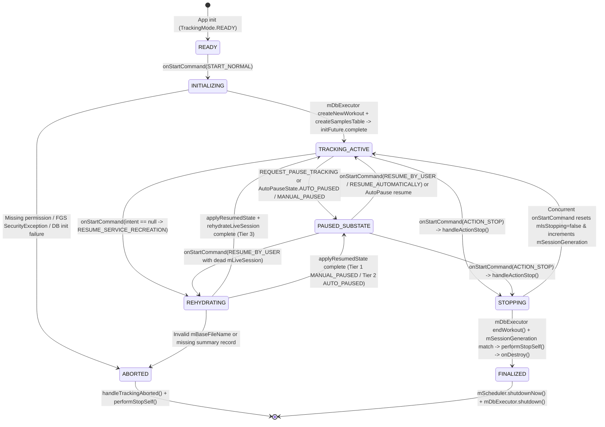
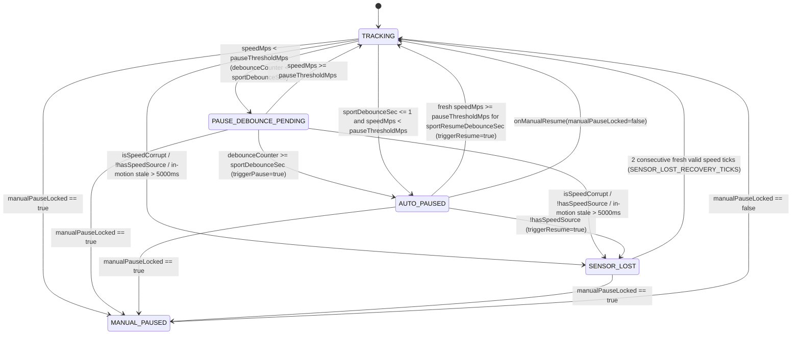

# Detailed Design: TrackerService (ASPICE SWE.3)

**Document ID**: `DOC-ARC-DD-TRK`  
**Version**: 1.0.5  
**Status**: Reviewed  
**Approver**: Pending PO Sign-Off  

**Unit**: `TrackerService` (`app/src/main/java/com/atrainingtracker/trainingtracker/tracker/TrackerService.java`, 3,537 LOC)  
**Collaborators**: `TrackingMode` (`TrackingMode.kt`), `AutoPauseManager` / `AutoPauseState` (`AutoPauseManager.kt`), `LiveWorkoutBroadcastTracker` (`LiveWorkoutBroadcastTracker.kt`), `DebugHeapWatchdog` (`DebugHeapWatchdog.kt`), `MultisportLapCoordinator` (`MultisportLapCoordinator.kt`), `WorkoutPostProcessingCoordinator` (`WorkoutPostProcessingCoordinator.kt`), `WorkoutPostProcessingService` (`WorkoutPostProcessingService.kt`), `WorkoutPostProcessingNotificationManager` (`WorkoutPostProcessingNotificationManager.kt`), `TrainingApplication`, `BANALServiceComm`, `LiveWorkoutSession`, `WorkoutRepository`  
**SWE.2 Alignment**: `docs/architecture.md` §3.1, §3.3, §4.2, §4.9 (`IF-SWE-03`, `IF-SWE-05`, `IF-SWE-06`)  
**Requirement Trace**: `REQ-PRO-114.1`, `REQ-ARC-008.1`, `REQ-STB-020.1`, `REQ-STB-020.2`, `REQ-STB-022.1`, `REQ-STB-022.2`, `REQ-TRK-009`, `REQ-TRK-010`, `REQ-TRK-018`, `REQ-TRK-026`, `REQ-TRK-033`, `REQ-TRK-034`, `REQ-TRK-076`, `REQ-TRK-090`, `REQ-TRK-091`

---

## 1. Composite State Model
`TrackerService` does not hold a single monolithic enum; its runtime behavior is governed by:
1. **Application Session State (`TrackingMode`)**: `IDLE`, `READY`, `TRACKING`, `PAUSED` (`TrainingApplication.getTrackingMode()`, `isTracking()`, `isPaused()`).
2. **Auto-Pause Sub-State (`AutoPauseState`)**: `TRACKING`, `PAUSE_DEBOUNCE_PENDING`, `AUTO_PAUSED`, `MANUAL_PAUSED`, `SENSOR_LOST` (`mAutoPauseManager` in `AutoPauseManager.kt`).
3. **Service Entry Mode (`TrackerService.StartType`)**: `START_NORMAL`, `RESUME_BY_USER`, `RESUME_AUTOMATICALLY`, `RESUME_SERVICE_RECREATION`.
4. **Lifecycle & Concurrency Flags**:
   - `mIsStopping` (`volatile boolean`): gates `tracker` 1-Hz sampling, suppresses duplicate `handleActionStop()`, and guards teardown.
   - `mTrackingInterrupted` (`volatile boolean`): suppresses `endWorkout()` finalization on permission/FGS/resume aborts.
   - `mIsRehydrating` (`volatile boolean`): blocks premature `mLiveSession` mutation during async resume rehydration.
   - `mSearching` (`volatile boolean`), `mBanalBound` (`volatile boolean`), `mReceiversRegistered` (`volatile boolean`), `mSessionGeneration` (`AtomicInteger`).
   - `mTableInitializationFuture` & `mFinalizationFuture` (`CompletableFuture<Void>`): asynchronous barrier gates on `mDbExecutor`.
   - `mBroadcastTracker` (`LiveWorkoutBroadcastTracker`): tracks `lastPausedState` so `WORKOUT_UPDATED_INTENT` is emitted strictly on discrete lifecycle edges (`START_NORMAL`/resume init, `TRACKING <-> PAUSED` edge, live `saveLap`, sport change) with zero 1-Hz active/paused emissions (`REQ-STB-020.1`, `REQ-STB-020.2`).

---

## 2. Dynamic State Machine (`stateDiagram-v2`)

### 2.1 Session & Service Lifecycle State Machine

### 2.2 Auto-Pause Sub-State Machine (`AutoPauseState`)

---

## 3. Events, Guards & Transitions

| Trigger / Event | Pre-State & Guard | Transition / Side Effect | Target State |
| :--- | :--- | :--- | :--- |
| `onStartCommand(START_NORMAL)` | `mIsStopping` reset if true | Increment `mSessionGeneration`; `acquireWakeLock()`; bind `BANALService`; schedule 1-Hz `tracker`; submit `createNewWorkout()` + `createSamplesTable()` on `mDbExecutor`; seed `LiveWorkoutBroadcastTracker` & dispatch initial `WORKOUT_UPDATED_INTENT`; `performStartForeground()` | `TRACKING_ACTIVE` |
| `onStartCommand(intent == null)` | `!hasBackgroundLocationPermission()` | Set `mTrackingInterrupted=true`; `showTrackingInterruptedNotification()`; `performStopSelf()` | `ABORTED` |
| `onStartCommand(intent == null)` | `hasBackgroundLocationPermission()` | Set `StartType.RESUME_SERVICE_RECREATION`; restore Tier 1 `MANUAL_PAUSED` / Tier 2 `AUTO_PAUSED` / Tier 3 `TRACKING`; `recreateValuesWhenResuming()` (seed `LiveWorkoutBroadcastTracker` & emit resume edge `WORKOUT_UPDATED_INTENT`) | `REHYDRATING` |
| `onServiceConnected` (`mBanalConnection`) | `mResumeFromPausedWhenConnectedToBanalService` or `mResumeTrackingWhenConnectedToBanalService` | Call `recreateValuesWhenResuming()`; if `!BANALService.isSearching()` call `onSearchingFinished()`; evaluate `AutoPauseManager.shouldStartInAutoPause` | `TRACKING_ACTIVE` or `AUTO_PAUSED` |
| 1-Hz `tracker` tick | `!mIsStopping && mBanalService != null` | Run `sampleAndWriteToDb(banalService)` -> `evaluateAutoPauseTick`, check `LiveWorkoutBroadcastTracker` for `TRACKING <-> PAUSED` edge (0 steady-state `WORKOUT_UPDATED_INTENT` & 0 `updateExtremaValueInMemory` calls; if paused still call `updateWorkoutTotalTime` per `REQ-TRK-009`), update `mLiveSession` if `!mIsRehydrating`, queue `recordLiveSample` behind `mTableInitializationFuture` on `mDbExecutor`, `maybeFlushLiveRrQueue()` | Unchanged or `AUTO_PAUSED` |
| Discrete live edge (`LAP_SUMMARY` / `SPORT_TYPE_CHANGED` / pause edge) | `!mIsStopping && workout active` | Persist lap (`saveLap` outside `endWorkout`) or sport update (`BANALService` / DB), and invoke `LiveWorkoutBroadcastTracker` to emit a single `WORKOUT_UPDATED_INTENT` (also preserving altitude calibration broadcast) | `TRACKING_ACTIVE` or `PAUSED_SUBSTATE` |
| `onStartCommand(ACTION_STOP)` | `!mIsStopping && (mWorkoutID > 0 \|\| mBaseFileName != null)` | `handleActionStop()`: set `mIsStopping=true`, capture `BanalFinalizationSnapshot` & `stoppingGeneration`, cancel `mTrackerHandle`, enqueue `endWorkout()` on `mDbExecutor`, gate `performStopSelf()` on `mSessionGeneration.get() == stoppingGeneration && mIsStopping` | `STOPPING` -> `FINALIZED` |
| `endWorkout(...)` | `!mTrackingInterrupted` | `createNewLap`, record active devices, `flushLiveRrQueueSync`, `markWorkoutFinishedBlocking` (`FINISHED=1`), `PolarRawTelemetryRecorder.stopActiveSession`, capture armed tokens & enqueue `WorkoutPostProcessingCoordinator` (async `shortService` Polar backfill -> HRV/ERTS -> `reloadWorkoutData` -> `ExportManager.workoutFinished` -> deferred `exportWorkout`), immediately broadcast `TRACKING_FINISHED_INTENT` | `FINALIZED` |

---

## 4. Interfaces, Threading & Error Handling

### 4.1 Interfaces (`IF-SWE-03`, `IF-SWE-05`, `IF-SWE-06`)
| Interface | Direction | Contract / Symbols |
| :--- | :--- | :--- |
| `IF-SWE-03` | `TrackerService` <-> `BANALService` | Binds `BANALServiceComm` via `mBanalConnection`; consumes `getBestSensorData`, `getAllSensorData`, `getSportTypeId`, `getBSportType`, `addRrBeatListener`, `SEARCHING_FINISHED_FOR_ALL_INTENT`, `LAP_SUMMARY`, `SPORT_TYPE_CHANGED_BY_USER_INTENT` |
| `IF-SWE-05` | `TrackerService` -> Domain | Synchronous calls to `AutoPauseManager.evaluateTick`, `AutoPauseManager.onManualResume`, `AutoPauseManager.shouldStartInAutoPause`, `LiveWorkoutSession.addSample` |
| `IF-SWE-06` | `TrackerService` -> SQLite | Asynchronous writes via `WorkoutRepository` (`createSamplesTable`, `recordLiveSample`, `updateWorkoutTotalTime`, `markWorkoutFinishedBlocking`, `getResumedWorkoutState`), `WorkoutRrRepository`, `KnownLocationsRepository` |

### 4.2 Threading & Concurrency Contract
* **Main Looper**: `onCreate`, `onStartCommand`, `handleActionStop`, `onDestroy`, `runOnMainThread`, `mBanalConnection`, `BroadcastReceiver` callbacks, and `performStartForeground` / `performStopSelf` teardown checks.
* **`mScheduler` (`Executors.newScheduledThreadPool(1)`)**: Executes 1-Hz `tracker` runnable (`scheduleAtFixedRate(..., 0, 1, TimeUnit.SECONDS)`). Cancelled in `handleActionStop()` (`cancelTrackerHandle()`); `mScheduler.shutdownNow()` deferred to `onDestroy()`.
* **`mDbExecutor` (`Executors.newSingleThreadExecutor()`)**: Serializes `createNewWorkout`, `createSamplesTable`, `rehydrateLiveSession`, `recordLiveSample` (chained via `mTableInitializationFuture.thenAcceptAsync`), `recordWorkoutStart`, `REQUEST_PAUSE_TRACKING` FIFO flush, and `endWorkout`. Shut down strictly in `onDestroy()`.
* **`mRrFlushExecutor` (`Executors.newSingleThreadExecutor()`)**: Drains lock-free `mLiveRrQueue` (`ConcurrentLinkedQueue`) every `>= 100` beats (`RR_FLUSH_BATCH_THRESHOLD = 100`) or `30000 ms`, plus synchronous drain in `flushLiveRrQueueSync(workoutId)` during `endWorkout()`.
* **`DebugHeapWatchdog` (`mDebugHeapWatchdog` / `getDebugHeapWatchdog()`)**: Strictly `BuildConfig.DEBUG`-only (`REQ-STB-022`); dispatches 30-second heap CSV logging, one-shot `>= 70%` `.hprof` dumping, and pruning onto its own lazily created daemon `ExecutorService` (`"DebugHeapWatchdog"`), isolated from UI, `mScheduler`, and `mDbExecutor` (`stopSession()` in `handleActionStop()`, `shutdown()` in `onDestroy()`).

### 4.3 Error Handling & Fault Recovery
* **Startup / FGS Failure**: `performStartForeground` catching `SecurityException`/`IllegalStateException` cancels `mTableInitializationFuture`, cancels `mTrackerHandle`, sets `mTrackingInterrupted = true`, shows `showTrackingInterruptedNotification()`, and stops self.
* **DB Init Failure**: `mDbExecutor` catch in `START_NORMAL` logs into `mDiagnosticCollector` (`WorkoutRecordingErrorCollector`), completes `mTableInitializationFuture` exceptionally, calls `runOnMainThread(this::handleTrackingAborted)`, and stops self.
* **Resumed Session Generation Guard**: `mSessionGeneration` prevents stale `handleActionStop()` teardown from calling `performStopSelf()` if a new `onStartCommand()` session began before `endWorkout()` finished.
* **Tick Exception Isolation**: `tracker` catches `Throwable`, increments `mSamplingErrorCount`, and rate-limits logging via `shouldLogSampleInsertFailure()` so 1-Hz tracking continues.

---

## 5. Verification & Characterisation Test Traceability (`ATT-7902`)

| Test Class (`app/src/test/...`) | Verified Behavior & Transitions |
| :--- | :--- |
| `TrackerServiceStateMachineCharacterisationTest` | `TrackingMode` (`READY`/`TRACKING`/`PAUSED`), `mIsStopping` tick gate, `sampleAndWriteToDb` active & paused, `AutoPauseManager` transition + `REQUEST_RESUME_FROM_PAUSED`, `endWorkout()` Polar backfill -> HRV -> refresh -> `ExportManager.workoutFinished` ordering (`TST-ARC-008.1`) |
| `TrackerServiceCrashRecoveryCharacterisationTest` | `StartType` startup recovery tiers, `applyResumedState` valid & invalid `mBaseFileName`, `recreateValuesWhenResuming` missing record, `handleTrackingAborted`, monotonic continuity across crash recovery (`TST-ARC-008.2`) |
| `TrackerServiceIntegrationTest` | End-to-end start/pause/resume/auto-pause/stop SQLite persistence (`INT-SWE-03`, `INT-SWE-06`) |
| `TrackerServiceFinalizationTest`, `TrackerServiceResilienceTest`, `TrackerServiceAsyncInitTest`, `TrackerServiceResumeTest`, `TrackerServiceRrFlushTest`, `TrackerServiceExportGatingTest` | `handleActionStop` vs `onDestroy` `mSessionGeneration` / `mDbExecutor` invariants, async DB init abort, `mLiveRrQueue` flush, and export gating |
| `LiveWorkoutBroadcastTrackerTest` | Discrete `WORKOUT_UPDATED_INTENT` edge dispatch (`START_NORMAL`/resume, `TRACKING <-> PAUSED`, live `saveLap`, sport change), session `reset()`, and 3,600-tick steady-state broadcast suppression (`TST-STB-020.1`) |
| `DebugHeapWatchdogTest`, `TrackerServiceHeapWatchdogTest` | `BuildConfig.DEBUG`-only release no-op, 30 s CSV logging + 20-file pruning, one-shot 2-sample `>= 70%` `.hprof` capture + disk/restart/error/2-file guards, and `TrackerService` lifecycle hooks (`TST-STB-022.1`–`TST-STB-022.4`) |

---

## Change History

| Version | Date | Author | Ticket | Summary of Changes |
| :--- | :--- | :--- | :--- | :--- |
| `1.0.0` | 2026-11-17 | AI Agent (`ATT-8164`) | `ATT-8164` | Added standardized `DOC-ARC-DD-TRK` work-product control header and Change History. |
| `1.0.1` | 2026-11-18 | AI Agent (`ATT-8999`, `--as agent1`) | `ATT-8999` | Documented `LiveWorkoutBroadcastTracker` discrete-edge `WORKOUT_UPDATED_INTENT` dispatch (`START_NORMAL`/resume, `TRACKING <-> PAUSED`, live `saveLap`, sport change), removal of 1-Hz `updateExtremaValueInMemory` & steady-state active/paused broadcasts, and `<= 3,559`-LOC ceiling (`REQ-STB-020.1`, `REQ-STB-020.2`). |
| `1.0.2` | 2026-11-19 | AI Agent (`ATT-8917`, `--as agent1`) | `ATT-8917` | Delegated `mLapSummaryReceiver`, `mMultisportTransitionReceiver` (`BANALService.MULTISPORT_TRANSITION_INTENT`), session anchor reset (placed after in-memory `mLiveSession` reuse early-return so pause/resume preserves ongoing multisport leg state), and final-leg anchored naming/UTC `TIME_START` to `MultisportLapCoordinator` (keeping `TrackerService.java` at `3,538 LOC`, `0` main-thread SQLite, `0` edits to `WorkoutSamplesDatabaseManager.java`) with `MultisportLapCoordinatorTest` & `TrackerServiceResumeTest` parity (`REQ-FIL-031.3`, `REQ-PRO-114`). |
| `1.0.3` | 2026-11-20 | AI Agent (`ATT-9159`, `--as agent1`) | `ATT-9159` | Updated `TrackerService.saveLap` (`3,539 LOC`, `+1` LOC) to resolve actual UTC lap start timestamp via `MultisportLapCoordinator.consumeLapStartTimeUtc(lapTime)` (preserving 4-/5-arg signatures, pre-mutation manual-split anchor capture, pause neutrality, and UTC `now - lapTime` fallback) (`REQ-TRK-090`). |
| `1.0.4` | 2026-11-20 | Lane A Author (`ATT-9154`, `--as agent1`) | `ATT-9154` | Decoupled stop-workout Polar backfill, HRV/ERTS recompute, and `ExportManager.workoutFinished()` out of synchronous `endWorkout()` into `WorkoutPostProcessingCoordinator` / `WorkoutPostProcessingService` (`shortService`) / `WorkoutPostProcessingNotificationManager` (`ID 8047` progress, `ID 8048` warning), shrinking `TrackerService.java` to `3,511 LOC` (`-28 LOC`) so `TRACKING_FINISHED_INTENT` -> `EditWorkoutScreen` fires immediately (`REQ-TRK-091`). |
| `1.0.5` | 2026-11-21 | Lane C Flash (`ATT-9352`, `--as agent1`) | `ATT-9352` | Wired `DebugHeapWatchdog` (`BuildConfig.DEBUG`-only headless periodic CSV & one-shot HPROF watchdog) into `TrackerService` (`3,537 LOC`, `<= 3,559` ceiling) with isolated daemon executor and `DebugHeapWatchdogTest` / `TrackerServiceHeapWatchdogTest` traceability (`REQ-STB-022`). |
