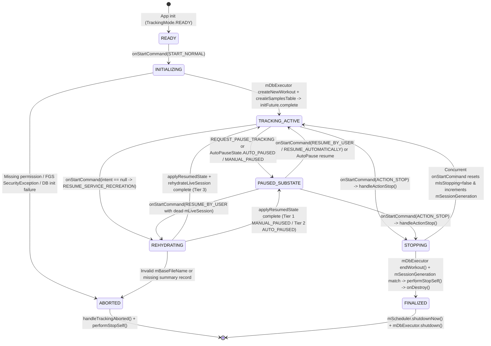
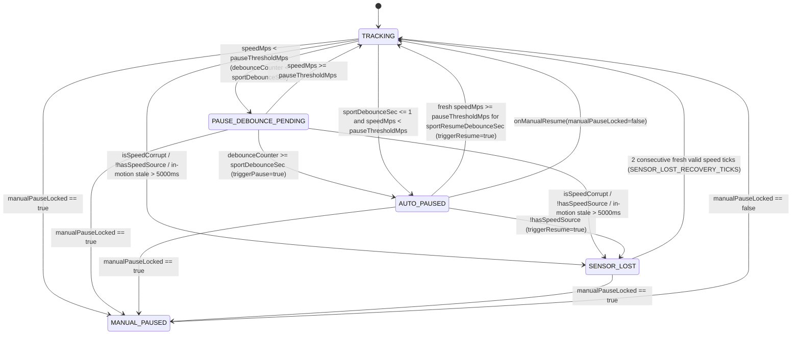

# Detailed Design: TrackerService (ASPICE SWE.3)

**Unit**: `TrackerService` (`app/src/main/java/com/atrainingtracker/trainingtracker/tracker/TrackerService.java`, 3,552 LOC)  
**Collaborators**: `TrackingMode` (`TrackingMode.kt`), `AutoPauseManager` / `AutoPauseState` (`AutoPauseManager.kt`), `TrainingApplication`, `BANALServiceComm`, `LiveWorkoutSession`, `WorkoutRepository`  
**SWE.2 Alignment**: `docs/architecture.md` §3.1, §3.3, §4.2, §4.9 (`IF-SWE-03`, `IF-SWE-05`, `IF-SWE-06`)  
**Requirement Trace**: `REQ-PRO-114.1`, `REQ-ARC-008.1`, `REQ-TRK-018`, `REQ-TRK-026`, `REQ-TRK-033`, `REQ-TRK-034`, `REQ-TRK-076`

---

## 1. Composite State Model
`TrackerService` does not hold a single monolithic enum; its runtime behavior is governed by:
1. **Application Session State (`TrackingMode`)**: `IDLE`, `READY`, `TRACKING`, `PAUSED` (`TrainingApplication.getTrackingMode()`, `isTracking()`, `isPaused()`).
2. **Auto-Pause Sub-State (`AutoPauseState`)**: `TRACKING`, `PAUSE_DEBOUNCE_PENDING`, `AUTO_PAUSED`, `MANUAL_PAUSED`, `SENSOR_LOST` (`mAutoPauseManager` in `AutoPauseManager.kt`).
3. **Service Entry Mode (`TrackerService.StartType`)**: `START_NORMAL`, `RESUME_BY_USER`, `RESUME_AUTOMATICALLY`, `RESUME_SERVICE_RECREATION`.
4. **Lifecycle & Concurrency Flags**:
   - `mIsStopping` (`volatile boolean`): gates `tracker` 1-Hz sampling, suppresses duplicate `handleActionStop()`, and guards teardown.
   - `mTrackingInterrupted` (`volatile boolean`): suppresses `endWorkout()` finalization on permission/FGS/resume aborts.
   - `mIsRehydrating` (`volatile boolean`): blocks premature `mLiveSession` mutation during async resume rehydration.
   - `mSearching` (`volatile boolean`), `mBanalBound` (`volatile boolean`), `mReceiversRegistered` (`volatile boolean`), `mSessionGeneration` (`AtomicInteger`).
   - `mTableInitializationFuture` & `mFinalizationFuture` (`CompletableFuture<Void>`): asynchronous barrier gates on `mDbExecutor`.

---

## 2. Dynamic State Machine (`stateDiagram-v2`)

### 2.1 Session & Service Lifecycle State Machine

### 2.2 Auto-Pause Sub-State Machine (`AutoPauseState`)

---

## 3. Events, Guards & Transitions

| Trigger / Event | Pre-State & Guard | Transition / Side Effect | Target State |
| :--- | :--- | :--- | :--- |
| `onStartCommand(START_NORMAL)` | `mIsStopping` reset if true | Increment `mSessionGeneration`; `acquireWakeLock()`; bind `BANALService`; schedule 1-Hz `tracker`; submit `createNewWorkout()` + `createSamplesTable()` on `mDbExecutor`; `performStartForeground()` | `TRACKING_ACTIVE` |
| `onStartCommand(intent == null)` | `!hasBackgroundLocationPermission()` | Set `mTrackingInterrupted=true`; `showTrackingInterruptedNotification()`; `performStopSelf()` | `ABORTED` |
| `onStartCommand(intent == null)` | `hasBackgroundLocationPermission()` | Set `StartType.RESUME_SERVICE_RECREATION`; restore Tier 1 `MANUAL_PAUSED` / Tier 2 `AUTO_PAUSED` / Tier 3 `TRACKING`; `recreateValuesWhenResuming()` | `REHYDRATING` |
| `onServiceConnected` (`mBanalConnection`) | `mResumeFromPausedWhenConnectedToBanalService` or `mResumeTrackingWhenConnectedToBanalService` | Call `recreateValuesWhenResuming()`; if `!BANALService.isSearching()` call `onSearchingFinished()`; evaluate `AutoPauseManager.shouldStartInAutoPause` | `TRACKING_ACTIVE` or `AUTO_PAUSED` |
| 1-Hz `tracker` tick | `!mIsStopping && mBanalService != null` | Run `sampleAndWriteToDb(banalService)` -> `evaluateAutoPauseTick`, update `mLiveSession` if `!mIsRehydrating`, queue DB write behind `mTableInitializationFuture` on `mDbExecutor`, `maybeFlushLiveRrQueue()` | Unchanged or `AUTO_PAUSED` |
| `onStartCommand(ACTION_STOP)` | `!mIsStopping && (mWorkoutID > 0 \|\| mBaseFileName != null)` | `handleActionStop()`: set `mIsStopping=true`, capture `BanalFinalizationSnapshot` & `stoppingGeneration`, cancel `mTrackerHandle`, enqueue `endWorkout()` on `mDbExecutor`, gate `performStopSelf()` on `mSessionGeneration.get() == stoppingGeneration && mIsStopping` | `STOPPING` -> `FINALIZED` |
| `endWorkout(...)` | `!mTrackingInterrupted` | `createNewLap`, record active devices, `flushLiveRrQueueSync`, `markWorkoutFinishedBlocking` (`FINISHED=1`), `PolarH10OfflineController`/`PolarVeritySenseOfflineController` backfill, `HrvPostWorkoutRecomputer`/`ErtsPostWorkoutRecomputer`, `WorkoutRepository.refreshWorkout`, `ExportManager.workoutFinished`, broadcast `TRACKING_FINISHED_INTENT` | `FINALIZED` |

---

## 4. Interfaces, Threading & Error Handling

### 4.1 Interfaces (`IF-SWE-03`, `IF-SWE-05`, `IF-SWE-06`)
| Interface | Direction | Contract / Symbols |
| :--- | :--- | :--- |
| `IF-SWE-03` | `TrackerService` <-> `BANALService` | Binds `BANALServiceComm` via `mBanalConnection`; consumes `getBestSensorData`, `getAllSensorData`, `getSportTypeId`, `getBSportType`, `addRrBeatListener`, `SEARCHING_FINISHED_FOR_ALL_INTENT`, `LAP_SUMMARY`, `SPORT_TYPE_CHANGED_BY_USER_INTENT` |
| `IF-SWE-05` | `TrackerService` -> Domain | Synchronous calls to `AutoPauseManager.evaluateTick`, `AutoPauseManager.onManualResume`, `AutoPauseManager.shouldStartInAutoPause`, `LiveWorkoutSession.addSample` |
| `IF-SWE-06` | `TrackerService` -> SQLite | Asynchronous writes via `WorkoutRepository` (`createSamplesTable`, `recordLiveSample`, `updateWorkoutTotalTime`, `markWorkoutFinishedBlocking`, `getResumedWorkoutState`), `WorkoutRrRepository`, `KnownLocationsRepository` |

### 4.2 Threading & Concurrency Contract
* **Main Looper**: `onCreate`, `onStartCommand`, `handleActionStop`, `onDestroy`, `runOnMainThread`, `mBanalConnection`, `BroadcastReceiver` callbacks, and `performStartForeground` / `performStopSelf` teardown checks.
* **`mScheduler` (`Executors.newScheduledThreadPool(1)`)**: Executes 1-Hz `tracker` runnable (`scheduleAtFixedRate(..., 0, 1, TimeUnit.SECONDS)`). Cancelled in `handleActionStop()` (`cancelTrackerHandle()`); `mScheduler.shutdownNow()` deferred to `onDestroy()`.
* **`mDbExecutor` (`Executors.newSingleThreadExecutor()`)**: Serializes `createNewWorkout`, `createSamplesTable`, `rehydrateLiveSession`, `recordLiveSample` (chained via `mTableInitializationFuture.thenAcceptAsync`), `recordWorkoutStart`, `REQUEST_PAUSE_TRACKING` FIFO flush, and `endWorkout`. Shut down strictly in `onDestroy()`.
* **`mRrFlushExecutor` (`Executors.newSingleThreadExecutor()`)**: Drains lock-free `mLiveRrQueue` (`ConcurrentLinkedQueue`) every `>= 100` beats (`RR_FLUSH_BATCH_THRESHOLD = 100`) or `30000 ms`, plus synchronous drain in `flushLiveRrQueueSync(workoutId)` during `endWorkout()`.

### 4.3 Error Handling & Fault Recovery
* **Startup / FGS Failure**: `performStartForeground` catching `SecurityException`/`IllegalStateException` cancels `mTableInitializationFuture`, cancels `mTrackerHandle`, sets `mTrackingInterrupted = true`, shows `showTrackingInterruptedNotification()`, and stops self.
* **DB Init Failure**: `mDbExecutor` catch in `START_NORMAL` logs into `mDiagnosticCollector` (`WorkoutRecordingErrorCollector`), completes `mTableInitializationFuture` exceptionally, calls `runOnMainThread(this::handleTrackingAborted)`, and stops self.
* **Resumed Session Generation Guard**: `mSessionGeneration` prevents stale `handleActionStop()` teardown from calling `performStopSelf()` if a new `onStartCommand()` session began before `endWorkout()` finished.
* **Tick Exception Isolation**: `tracker` catches `Throwable`, increments `mSamplingErrorCount`, and rate-limits logging via `shouldLogSampleInsertFailure()` so 1-Hz tracking continues.

---

## 5. Verification & Characterisation Test Traceability (`ATT-7902`)

| Test Class (`app/src/test/...`) | Verified Behavior & Transitions |
| :--- | :--- |
| `TrackerServiceStateMachineCharacterisationTest` | `TrackingMode` (`READY`/`TRACKING`/`PAUSED`), `mIsStopping` tick gate, `sampleAndWriteToDb` active & paused, `AutoPauseManager` transition + `REQUEST_RESUME_FROM_PAUSED`, `endWorkout()` Polar backfill -> HRV -> refresh -> `ExportManager.workoutFinished` ordering (`TST-ARC-008.1`) |
| `TrackerServiceCrashRecoveryCharacterisationTest` | `StartType` startup recovery tiers, `applyResumedState` valid & invalid `mBaseFileName`, `recreateValuesWhenResuming` missing record, `handleTrackingAborted`, monotonic continuity across crash recovery (`TST-ARC-008.2`) |
| `TrackerServiceIntegrationTest` | End-to-end start/pause/resume/auto-pause/stop SQLite persistence (`INT-SWE-03`, `INT-SWE-06`) |
| `TrackerServiceFinalizationTest`, `TrackerServiceResilienceTest`, `TrackerServiceAsyncInitTest`, `TrackerServiceResumeTest`, `TrackerServiceRrFlushTest`, `TrackerServiceExportGatingTest` | `handleActionStop` vs `onDestroy` `mSessionGeneration` / `mDbExecutor` invariants, async DB init abort, `mLiveRrQueue` flush, and export gating |
