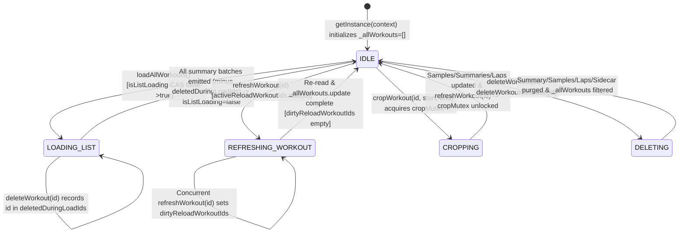

# Detailed Design: WorkoutRepository (ASPICE SWE.3)

**Document ID**: `DOC-ARC-DD-WKO`  
**Version**: 1.0.0  
**Status**: Reviewed  
**Approver**: Pending PO Sign-Off  

**Unit**: `WorkoutRepository` (`app/src/main/java/com/atrainingtracker/trainingtracker/ui/aftermath/WorkoutRepository.kt`, 5,117 LOC)  
**Collaborators**: `WorkoutSummariesDatabaseManager`, `WorkoutSamplesDatabaseManager`, `LapsDatabaseManager`, `WorkoutDeletionHelper`, `WorkoutRrRepository`, `WorkoutClusterRepository`, `ExportManager`, `StravaUploadDbHelper`, `CropCoordinator`  
**SWE.2 Alignment**: `docs/architecture.md` §1, §3.3, §4.1, §5.1 (`IF-SWE-02`, `IF-SWE-05`, `IF-SWE-06`, `IF-SWE-07`)  
**Requirement Trace**: `REQ-ARC-009`, `REQ-PRO-114`, `REQ-PRO-129.2`, `REQ-DAT-042`, `REQ-WKO-016`

---

## 1. Composite State Model & Singleton Lifecycle
`WorkoutRepository` is the centralized reactive single source of truth bridging legacy SQLite database managers and Jetpack Compose ViewModels:
1. **Singleton Lifecycle (`INSTANCE`, `getInstance`, `resetForTesting`)**: Double-checked volatile singleton bound to `Application` / `applicationContext`, supporting deterministic test isolation via `@VisibleForTesting fun resetForTesting(...)`.
2. **Reactive Store & Live Events**:
   - `_allWorkouts` / `allWorkouts` (`MutableStateFlow<List<WorkoutData>>` / `StateFlow<List<WorkoutData>>`), `getWorkoutById(id)`, and `getWorkoutDataDirect(workoutId)`.
   - `initialWorkoutLoaded` (`SingleLiveEvent<WorkoutData>`), `deletionProgress` (`MutableLiveData<DeletionProgress>`), and `saveFinishedEvent` (`SingleLiveEvent<Pair<Long, Boolean>>`).
3. **Concurrency & Anti-Stale-Load Guards**:
   - `isListLoading` (`AtomicBoolean`): single-flight gate protecting `loadAllWorkouts()`.
   - `deletedDuringLoadIds` (`ConcurrentHashMap.newKeySet<Long>()`): tombstones workouts deleted while `loadAllWorkouts()` is in flight so progressive batch appends never resurrect deleted items.
   - `activeReloadWorkoutIds` & `dirtyReloadWorkoutIds` (`ConcurrentHashMap.newKeySet<Long>()`): coalesces overlapping `refreshWorkout(workoutId)` requests into sequential re-reads.
   - `cropMutex` (`CropCoordinator.mutex`): serializes destructive `cropWorkout(workoutId, startIndex, endIndex)` mutations.

---

## 2. Dynamic State Machine (`stateDiagram-v2`)

---

## 3. Events, Guards & Transitions

| Trigger / Event | Pre-State & Guard | Transition / Side Effect | Target State |
| :--- | :--- | :--- | :--- |
| `loadAllWorkouts()` | `isListLoading.compareAndSet(false, true)` | Clears `deletedDuringLoadIds`, streams summary pages on `Dispatchers.IO`, filters tombstoned IDs, resets `isListLoading=false` in `finally` | `IDLE` |
| `refreshWorkout(workoutId)` | `synchronized(activeReloadWorkoutIds)` | If already active, adds to `dirtyReloadWorkoutIds` and returns; otherwise loops until `dirtyReloadWorkoutIds.remove(workoutId)` is false, updating `_allWorkouts` | `IDLE` |
| `recordLiveSample(...)` | Valid `samplesDb` & `summariesDb` | Runs dual-DB transaction (`samplesDb` + `summariesDb`), invokes `handleMissingColumns()` on missing table/column `SQLException`, updates extrema and encoded streams | `IDLE` |
| `cropWorkout(workoutId, startIndex, endIndex)` | `cropMutex.withLock` | Trims 1-Hz samples, adjusts laps/extrema/streams atomically on `Dispatchers.IO`, refreshes in-memory cache | `IDLE` |
| `deleteWorkout(id)` | `isListLoading.get()` check | Records tombstone in `deletedDuringLoadIds` when loading; invokes `deleteWorkoutCascade(id)` / `WorkoutDeletionHelper` and removes entry from `_allWorkouts` | `IDLE` |

---

## 4. Interfaces, Threading & Error Handling

### 4.1 Interfaces (`IF-SWE-02`, `IF-SWE-05`, `IF-SWE-06`, `IF-SWE-07`)
| Interface | Direction | Contract / Symbols |
| :--- | :--- | :--- |
| `IF-SWE-02` | ViewModels <-> `WorkoutRepository` | Exposes `allWorkouts`, `getWorkoutById`, `getWorkoutDataDirect`, `initialWorkoutLoaded`, `deletionProgress`, `saveFinishedEvent`, `loadAllWorkouts`, `refreshWorkout`, `cropWorkout`, `deleteWorkout` |
| `IF-SWE-05` | `WorkoutRepository` -> Domain | Invokes `ZoneDistributionCalculator`, `PowerHrDynamicsCalculator`, `ClimbDetector`, `WorkoutClusterEngine` (`discoverNamedSourceColumns`, `discoverMultiSourceOverlayColumns`) |
| `IF-SWE-06` | `TrackerService` / Repo -> SQLite | Executes `recordLiveSample`, `handleMissingColumns`, `getResumedWorkoutState`, `markWorkoutFinishedBlocking`, `getLaps`, `deleteWorkoutCascade` against `WorkoutSummariesDatabaseManager`, `WorkoutSamplesDatabaseManager`, `LapsDatabaseManager` |
| `IF-SWE-07` | `WorkoutRepository` -> Exporters | Coordinates `ExportManager` and `StravaUploadDbHelper` post-finalization |

### 4.2 Threading & Concurrency Contract
* **`coroutineContext` (`Dispatchers.Main + SupervisorJob()`)**: Repository-owned `CoroutineScope` (`job`) hosting lifecycle-independent background refreshes.
* **`Dispatchers.IO`**: Offloads SQLite queries, `loadAllWorkouts()`, `cropWorkout()`, `deleteWorkoutCascade()`, and multi-source overlay decoding (`MAX_OVERLAY_POINTS = 800`, `parseTimestampOffset`, `quoteSqlIdentifier`, `getSamplesTableName`).
* **Synchronized / Lock-Free Coordination**: `cropMutex` serializes crop transactions; `activeReloadWorkoutIds` / `dirtyReloadWorkoutIds` coalesce concurrent single-workout refreshes; `isListLoading` + `deletedDuringLoadIds` guarantee tombstone consistency.

### 4.3 Error Handling & Fault Recovery
* **Live Schema Self-Healing (`handleMissingColumns`)**: Catches `SQLException` (`no such table`, `no such column`, `has no column named`) during `recordLiveSample`, recreates missing sample tables or executes `ALTER TABLE ADD COLUMN`, and surfaces unrecoverable faults via `LiveSampleFailureCallback`.
* **Deletion Tombstone Protection**: Concurrent `deleteWorkout(id)` during `loadAllWorkouts()` records `id` in `deletedDuringLoadIds`, preventing stale in-memory batches from re-introducing deleted workouts.
* **Cancellation Safety**: Bulk deletions and finalization cleanups wrap non-abortable database steps cleanly with `NonCancellable` where required.

---

## 5. Verification & Unit Test Traceability

| Test Class (`app/src/test/...`) | Verified Behavior & Invariants |
| :--- | :--- |
| `WorkoutRepositoryConcurrencyTest`, `WorkoutRepositoryStressTest` | Coalesced `refreshWorkout` (`activeReloadWorkoutIds` / `dirtyReloadWorkoutIds`), `isListLoading` single-flight guard, and `deletedDuringLoadIds` tombstone consistency |
| `WorkoutRepositoryDeleteTest`, `WorkoutRepositoryCropTest` | Cascade deletion (`deleteWorkoutCascade`), `cropMutex` serialization, and extrema/lap consistency |
| `WorkoutRepositoryBoundaryMoveTest`, `WorkoutRepositoryLapSplitTest`, `WorkoutRepositoryLapUpdateTest`, `WorkoutRepositoryLapDeleteTest` | Lap boundary mutations, splits, updates, and deletions |
| `WorkoutRepositoryStreamTest`, `WorkoutRepositoryTelemetryTest`, `WorkoutRepositoryProjectionTest`, `WorkoutRepositoryTimestampFallbackTest` | Named source column discovery, overlay decimation (`MAX_OVERLAY_POINTS`), projection decoding, and `parseTimestampOffset` fallback |
| `WorkoutRepositoryCardioPowerBackfillTest`, `WorkoutRepositoryExportStatusTest`, `WorkoutRepositoryHistoricalZoneTest`, `WorkoutRepositoryHrvConsensusTest`, `WorkoutRepositoryMapMarkerApexTest`, `WorkoutRepositoryMarkerTest`, `WorkoutRepositorySaveClusteringTest` | Backfill, export status, zone/HRV consensus, map markers, and cluster save integration |

---

## Change History

| Version | Date | Author | Ticket | Summary of Changes |
| :--- | :--- | :--- | :--- | :--- |
| `1.0.0` | 2026-11-18 | AI Agent (`ATT-8203`) | `ATT-8203` | Initial SWE.3 living detailed design specification for `WorkoutRepository` (`REQ-PRO-129.2`). |
