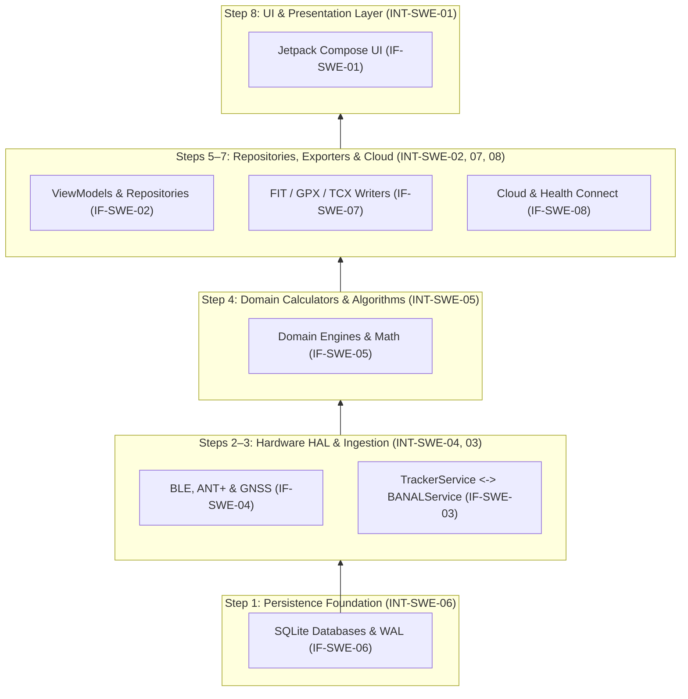

# Software Integration Verification Strategy: aTrainingTracker (ASPICE SWE.5.BP1)

This document establishes the authoritative **Software Integration and Verification Strategy** for **aTrainingTracker** in accordance with **Automotive SPICE (ASPICE v3.1 / v4.0) SWE.5 Base Practice 1 (Develop software integration strategy and software verification strategy)**.

It formalizes the bottom-up integration order across all architectural boundaries (`IF-SWE-01` through `IF-SWE-08`), allocates integration test steps (`INT-SWE-01` through `INT-SWE-08`), defines hierarchical verification levels, specifies entry and exit criteria, and details regression test selection.

---

## 1. Architectural Seams & Integration Sequence

Software elements in aTrainingTracker are integrated bottom-up to minimize dependency inversion risk, verify data layer stability prior to ingestion, and isolate hardware HAL interactions before UI coupling.



---

## 2. Integration Sequence Matrix

| Step ID | Target Boundary | Interface ID | Provider Element | Consumer Element | Mocked vs. Real Boundary | Verification Focus |
| :--- | :--- | :--- | :--- | :--- | :--- | :--- |
| `INT-SWE-06` | Step 1: Persistence | `IF-SWE-06` | Database Managers (`WorkoutSamplesDatabaseManager`, `KnownLocationsDatabaseManager`) | `TrackerService`, Repositories | Real SQLite engine (in-memory or temp DB); disk I/O serialized via single-thread executor or `dbDispatcher` (`KnownLocationsRepository`) / `Dispatchers.IO` | WAL concurrency, schema migration `onUpgrade`, batch insertion throughput |
| `INT-SWE-04` | Step 2: Hardware HAL | `IF-SWE-04` | HAL (BLE Gatt, ANT+ Plugin, Location Provider) | `BANALService`, `TrackerService` | Mocked hardware using fake GPS, BLE HR/Power simulators; real service listeners | Reconnection state machine, packet parsing, sensor drop-out debounce |
| `INT-SWE-03` | Step 3: Inter-Service | `IF-SWE-03` | `BANALServiceComm` (Local Binder) | `TrackerService` | Real Android Service Binder IPC harness; stubbed sensor streams | Connection arbitration, IPC broadcast delivery, null-safety during unbind |
| `INT-SWE-05` | Step 4: Domain Calculators | `IF-SWE-05` | Domain Calculators (`AutoPauseManager`, `ClimbDetector`) | Services & Repositories | Real pure JVM mathematical models; synthetic time-series input fixtures | Rolling-window math (NP/TSS), climb detection, auto-pause debounce |
| `INT-SWE-02` | Step 5: Repositories | `IF-SWE-02` | Repositories (`WorkoutRepository`, `BANALServiceRepository`) | ViewModels | Real repositories with test SQLite / fake DataStore; real coroutine scopes | Reactive Flow emissions, query caching, background dispatcher switching |
| `INT-SWE-07` | Step 6: Exporters | `IF-SWE-07` | Exporters (`FitFileWriter`, `GPXFileWriter`, `TCXFileWriter`) | `ExportManager`, Repositories | Real file streaming writers; mock storage volume | Byte-stream conformance, XML schema validity, cancellation recovery |
| `INT-SWE-08` | Step 7: Cloud APIs | `IF-SWE-08` | Cloud Endpoints (`StravaUploader`, `HealthConnectManager`, `HealthConnectHrvImporter`) | `ExportManager`, UI Controllers, `HrvReadinessRepository` | Authentic test doubles and repository fakes for REST endpoints; test doubles for `HealthConnectClient` | OAuth token refresh, JSON/Record mapping, exponential backoff retry, nocturnal HRV aggregation |
| `INT-SWE-01` | Step 8: UI & Compose | `IF-SWE-01` | ViewModels (`TrackingViewModel`, `TrackOnMapAftermathViewModel`) | Jetpack Compose Composables | Real ViewModels with mock repositories or Robolectric Compose test rule | MVI action dispatch, state hoisting, recomposition hygiene, dialog flows |

---

## 3. Verification Levels

Verification is partitioned across three hierarchical environments:

### Level 1: JVM & Robolectric Integration (Subsystem & Fast Integration)
* **Execution Environment**: Local JVM workstation and CI test runner (`./gradlew testDebugUnitTest`).
* **Scope**:
  * Unit tests and subsystem integration tests spanning `INT-SWE-06`, `INT-SWE-05`, `INT-SWE-02`, and `INT-SWE-07`.
  * Robolectric Android framework shadowing for `SharedPreferences`, `Cursor`, SQLite, and Jetpack Compose composables.
* **Turnaround Time**: 10–30 seconds for targeted suites; ~2–3 minutes for complete test suite.
* **Execution Rule**: Fast gate executed on every commit and branch review.

### Level 2: Instrumented Android & CI Emulator Smoke Integration
* **Execution Environment**:
  * **CI Smoke Gate**: GitHub Actions `emulator-test` job running on Android 14 (`api-level: 34`, `target: google_apis`, `arch: x86_64`) matching `.github/workflows/android-branch-build.yml` (ATT-6737). The job pre-builds debug and test APKs (`./gradlew :app:assembleDebug :app:assembleDebugAndroidTest`) and executes `:app:connectedDebugAndroidTest` on `reactivecircus/android-emulator-runner@v2` with hardware acceleration (KVM).
  * **Autonomous In-Sprint Policy (Rule 79)**: Local software emulator is retired during in-sprint development. Local verification relies on JVM unit tests, Robolectric Compose tests, living documentation, and Gradle Tier 2 lint/detekt gates.
* **Scope**:
  * Real ART runtime execution and `AppSmokeAndroidTest.kt` activity launch (`MainActivityWithNavigation`).
  * Real SQLite transaction concurrency and multi-threaded WAL locks.
  * Foreground service lifecycle (`location|health`) during system configuration changes and low-memory pressure under Android 14 FGS security enforcement.
  * Non-destructive synthetic tracking session lifecycle (`READY -> TRACKING -> STOP/DISCARD`) with cleanup via `WorkoutDeletionHelper`.
* **Turnaround Time**: 5–15 minutes (CI pipeline).
* **Execution Rule**: Executed automatically on every pull request / branch push in GitHub Actions CI prior to sprint integration.

### Level 3: Physical Hardware, Simulators & Full-Sprint Device Review
* **Execution Environment**:
  * **Ceremony 2 Full-Sprint Joint Review**: Mandatory deployment and human-in-the-loop verification of the integrated `sprint/<SPRINT_NAME>` build on the **real physical phone** (Pixel 10, Android 16) prior to release tagging.
  * **Per-Ticket Peripheral Simulators**: Physical Android test devices connected via ADB with external hardware and desktop script simulators (`tools/`).
* **Scope**:
  * Full end-to-end athlete experience and visual verification on physical device hardware.
  * Peripheral telemetry ingestion using Python desktop simulators:
    * `tools/ble_hr_simulator.py`: Emulates BLE Heart Rate Service (0x180D).
    * `tools/ble_power_simulator.py`: Emulates Cycling Power Service (0x1818).
    * `tools/fake_gps.py`: Streams mock NMEA GPS coordinates via ADB mock location.
    * `tools/replay_workout.py`: Replays recorded workouts to stress GPS and sensor pipelines.
    * `tools/simulate_kill.py`: Simulates OS process kill during active tracking to verify crash recovery.
  * Real Bluetooth Low Energy and ANT+ physical sensor pairing (Polar H10, Garmin HRM, Power meters).
* **Execution Rule**: Mandatory on-device evaluation during Ceremony 2 Joint Review; simulator verification during Stage 5 for sensor/hardware tickets.

---

## 4. Entry and Exit Criteria

### Level 1 (JVM / Robolectric)
* **Entry Criteria**: Source code compiles without errors (`./gradlew compileDebugSources`); no syntax or lint errors.
* **Exit Criteria**: 100% test pass rate across targeted test suites; zero flaky tests; zero unhandled coroutine exceptions.

### Level 2 (Instrumented / Emulator)
* **Entry Criteria**: Level 1 verification passed 100%; debug APK assembled successfully (`./gradlew assembleDebug`).
* **Exit Criteria**: Instrumented test suite passes 100%; zero Android runtime crashes or ANRs; schema migrations succeed without data loss.

### Level 3 (Physical Hardware & Simulators)
* **Entry Criteria**: Level 2 passed; physical device connected via ADB (`adb devices`); application installed (`./gradlew installDebug`).
* **Exit Criteria**: Telemetry packets successfully received from simulated or physical sensors; GPS track rendered on map without jitter; recovery from simulated process kill restores workout state.

### Release Candidate Milestone Exit Criteria
* Tier 2 Sprint Integration Gate passed (100% of all unit and contract tests).
* Architecture and interface living docs verified with `verify_requirement_governance.py`.
* Clean-room release build assembled (`./gradlew assembleRelease`).

---

## 5. Regression Selection & Defect Bisection

### Two-Tier Regression Selection
1. **Tier 1 (In-Sprint Targeted Regression)**:
   * During Stage 4 and Stage 5 of individual tickets, run targeted package wildcards:
     `./gradlew testDebugUnitTest --tests "com.atrainingtracker.<modified_package>.*"` plus contract tests (`AspiceSweAuditContractTest`).
   * Provides rapid feedback loop ($\le 30$ seconds) while guaranteeing boundary invariants.
2. **Tier 2 (Sprint Integration Gate)**:
   * Executed at the conclusion of every sprint phase under lock:
     `python3 tools/parallel_sprint_lock.py ./gradlew testDebugUnitTest --max-workers=2`
   * Runs all 3,660+ tests across the entire codebase without filters.

### Defect Bisection Workflow
* When an unexpected regression is identified across integrated subsystems, the defect is localized using Git bisection and automated sprint milestone tooling:
  1. **Exponential Sprint Milestone Bisection (`tools/sprint_bisect.py`)**:
     * For regressions spanning multiple sprints, `tools/sprint_bisect.py` (`regression-bisect` skill) automates exponential backward probing (`1, 2, 4, 8, 16...` sprints back) to establish regression boundaries in $O(\log N)$ evaluations:
       ```bash
       python3 tools/sprint_bisect.py probes
       python3 tools/sprint_bisect.py deploy-probe <N>
       ```
  2. **Commit-Level Git Bisection**:
     * Once bounded between two sprint milestones (good and bad commits):
       ```bash
       python3 tools/sprint_bisect.py bisect-start <bad_commit> <good_commit>
       git bisect run ./gradlew testDebugUnitTest --tests "<regressed_test>"
       ```
  3. **Culprit Commit Analysis**:
     * Run `python3 tools/sprint_bisect.py analyze <commit>` to perform Chesterton's Fence forensic analysis on the culprit commit prior to formulating a fix.
