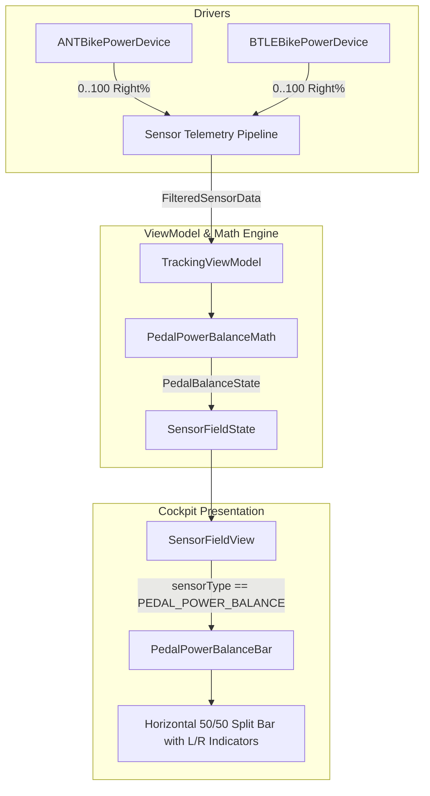

# Stage 1 Analysis: ATT-1295 - Visual pedal power balance indicator tile in cockpit

**Ticket**: [ATT-1295](https://rainerblind.atlassian.net/browse/ATT-1295)  
**Sub-task**: [ATT-3650](https://rainerblind.atlassian.net/browse/ATT-3650) (`[Analysis]`)  
**Parent Epic**: [ATT-235](https://rainerblind.atlassian.net/browse/ATT-235) (*UI Improvements & Visual Modernization*)  
**Target Release**: `V4.9.40`  
**Active Sprint**: `Sprint 2026-42.4`  
**Branch**: `feature/ATT-1295`  
**Requirement Mapping**: `REQ-UI-377` (extending `REQ-UI-171`, `REQ-UI-103`, and complementing `REQ-UI-376`)  
**Author**: AI Agent 1 (Implementer)  
**Reviewer / Auditor**: AI Agent 2 (Auditor)  
**Date**: 2026-10-15  

---

## 1. Problem Statement & Motivation

Dual-sided cycling power meters (e.g. dual-sided pedals like Garmin Rally, Favero Assioma, Wahoo POWRLINK, or dual-crank systems like Stages, Shimano Dura-Ace R9200-P) broadcast real-time Left/Right pedal power balance via ANT+ Bike Power Profile and Bluetooth LE Cycling Power Service (`0x1818`). 

Currently in **aTrainingTracker**:
1. `SensorType.PEDAL_POWER_BALANCE` is registered with an ordinary `IntegerFormatter` and unit `units_percent` (`%`).
2. When added to the live cockpit grid (`SensorGridScreen` / `SensorFieldView`), the tile displays a single monolithic integer (e.g. `"52 %"`) under the label `"Balance"`.
3. Athletes at high exertion cannot discern the asymmetry at a glance:
   - A single number `"52"` requires mental conversion to deduce the opposing leg ($100 - 52 = 48\%$) and internal memory of whether the value represents the right or left leg.
   - There is zero visual spatial indication: no left-versus-right split bar, no center anchor at $50/50$, and no glanceable shift indicating leg dominance.
   - There are no physiological feedback cues: athletes cannot tell if an asymmetry is within the normal biomechanical window ($\pm 2\%$) or indicates progressive neuromuscular fatigue, cleat misalignment, or injury compensation ($> 5\%$ deviation).
4. When coasting or when telemetry is lost, the tile either freezes or displays a raw `"-- %"` without communicating sensor connectivity status.

**Goal**: Provide a dedicated, high-contrast visual split-bar indicator tile (`PedalPowerBalanceBar`) in the cockpit, featuring dual-readout formatting (`48 | 52 %`), an anchor-centered horizontal split gauge, color-coded physiological deviation tiers (Balanced, Mild Imbalance, Severe Imbalance), and seamless True-Black AMOLED compliance.

---

## 2. Root Cause Analysis & Forensic Codebase Investigation

### 2.1 Sensor Ingestion Pipeline & Data Representation
- **ANT+ Ingestion (`ANTBikePowerDevice.java`)**:
  - `bikePowerPcc.subscribePedalPowerBalanceEvent(...)` receives `(boolean rightPedalIndicator, int pedalPowerPercentage)`.
  - In ANT+, `pedalPowerPercentage` denotes the percentage of total power contributed by the right pedal (when `rightPedalIndicator == true`, which is canonical standard).
  - An athlete option `mInvertPowerBalanceValues` allows inversion ($100 - P$).
  - Values are dispatched to `mPowerBalanceSensor.newValue(pedalPowerPercentage)`.
- **Bluetooth LE Ingestion (`BTLEBikePowerDevice.java`)**:
  - Characteristic `0x2A63` (Cycling Power Measurement) contains `PEDAL_POWER_BALANCE_PRESENT_MASK`.
  - The standard specification encodes the raw balance as an unsigned 8-bit integer with $0.5\%$ resolution.
  - `BTLEBikePowerDevice` normalizes this value: `balanceValue = mDoublePowerBalanceValues ? balanceValue : balanceValue / 2;` and dispatches it to `mPowerBalanceSensor.newValue(balanceValue)`.
- **Conclusion**:
  - Across both ANT+ and BLE, the underlying telemetry integer represents the Right pedal contribution $P_R \in [0, 100]\%$.
  - The Left pedal contribution is mathematically $P_L = 100 - P_R$.
  - The balance point is exactly $P_R = 50\%$, where $P_L = P_R = 50\%$.

### 2.2 Formatting Contract & Visual Gaps
- `SensorType.PEDAL_POWER_BALANCE` in `SensorType.java` currently uses:
  `new IntegerFormatter()`.
  This produces a single string `"52"`.
- A dedicated `PedalPowerBalanceFormatter` is required:
  - Formats valid readings as `"48 | 52"` (or `"48 / 52"`), with `"L"` and `"R"` labels or unit `"%"`.
  - When input is null or non-finite, returns `"-- | --"` or `"--"`.

### 2.3 Biomechanical & Physiological Deviation Tiers
Biomechanical cycling studies (e.g. Carpes et al., Bini et al.) define normal pedaling asymmetry:
1. **Balanced / Symmetrical Tier** ($48\% \le P_R \le 52\%$, i.e. $|P_R - 50| \le 2\%$):
   - Typical functional variation.
   - Indicator color: Neutral / Balanced Green (`TTColor.ConnectionStatusGreen` `#4CAF50` or `MaterialTheme.colorScheme.primary`).
2. **Mild Asymmetry Tier** ($45\% \le P_R < 48\%$ or $52\% < P_R \le 55\%$, i.e. $2\% < |P_R - 50| \le 5\%$):
   - Noticeable asymmetry often caused by one-legged cadence bias or moderate muscular fatigue.
   - Indicator color: Alert Amber (`TTColor.Zone3` `#FFA500` / warning container).
3. **Severe Asymmetry Tier** ($P_R < 45\%$ or $P_R > 55\%$, i.e. $|P_R - 50| > 5\%$):
   - Significant asymmetry indicating acute fatigue, biomechanical strain, cleat misalignment, or injury compensation.
   - Indicator color: Critical High-Alert Red (`TTColor.Zone4` `#FF0000` / error container).

### 2.4 AMOLED True-Black Cockpit Compliance (`REQ-UI-190`, Rule 23)
- In dark and AMOLED modes, the background is pure black (`#000000`).
- The split track must use an outer outline `MaterialTheme.colorScheme.outlineVariant` (`#2B3342`) to guarantee non-text contrast $\ge 3:1$.
- The central $50/50$ anchor line must be clearly visible as a vertical divider.
- The indicator cursor / fill bar must achieve $> 12:1$ contrast against black and colored backgrounds.

---

## 3. User Scope Grounding (ATT-1250)

* **In-Scope Goals**:
  1. Create `PedalPowerBalanceMath.kt` with pure algorithmic calculation for Left/Right percentages, deviation distance, physiological tiers, and clamp boundaries.
  2. Implement `PedalPowerBalanceFormatter.kt` outputting `"48 | 52"` (or localized split representation) with safe null fallback.
  3. Create `PedalPowerBalanceBar.kt` Compose widget:
     - Centered split bar with $50/50$ anchor mark.
     - "L" and "R" labels.
     - Dynamic marker / bar indicating deviation direction and magnitude.
     - Tier-based color coding (Green $\le 2\%$, Amber $3-5\%$, Red $> 5\%$).
     - Stale / null dimmed state handling (0.35 alpha).
  4. Integrate into `SensorFieldState.kt`, `SensorFieldView.kt`, and `TrackingViewModel.kt` for `SensorType.PEDAL_POWER_BALANCE`.
  5. 9-language localization parity for any new strings.
  6. Unit and Compose tests with 100% clean-room full suite regression pass rate.

* **Out-of-Scope Non-Goals (Scope Bounding)**:
  - Modifying ANT+ or BLE driver packet decoding (existing drivers already output valid 0..100 balance).
  - Post-ride balance charts or aftermath summary cards (belongs to post-ride analytics / separate epic).
  - Torque effectiveness or pedal smoothness visualizers (distinct sensor types: `PEDAL_SMOOTHNESS_R`, `TORQUE_EFFECTIVENESS_R`).

---

## 4. Requirement Archaeology & Chesterton's Fence Audit

* **Original Requirement ID & Target**: Net-new requirement `REQ-UI-377` (*Pedal Power Balance Real-Time Visual Split Indicator*). Extends `REQ-UI-171` (*High-Contrast Cockpit Typography*) and complements `REQ-UI-376` (*Visual Zone Gauge Tile*).
* **Historical Origin & Commit Trace**: `SensorType.PEDAL_POWER_BALANCE` was originally added in early ANT+ device integration (`ANTBikePowerDevice.java`), using standard `IntegerFormatter`.
* **Root Reason for Existing Formulation**: Early tracker versions only displayed raw single numeric values. With the introduction of modern Jetpack Compose cockpit tiles and visual gauges (e.g. `ZoneGaugeBar`), visual spatial telemetry is now standard.
* **Preservation of Core Invariants**:
  - Telemetry pipeline data types (`SensorType.PEDAL_POWER_BALANCE`) remain fully intact for GoldenCheetah, FIT, and TCX exporters.
  - Existing database schema and `SensorValueType.INTEGER` remain backward compatible.
  - Zero performance impact: pure $O(1)$ math and recomposition-isolated rendering.

---

## 5. Architectural Strategy & High-Level Solution

### 5.1 Architecture Overview

### 5.2 Key Deliverables
1. **Data Model**: `PedalBalanceState(val leftPercent: Int, val rightPercent: Int, val deviationPercent: Int, val dominantSide: DominantSide, val tier: PedalBalanceTier, val isStale: Boolean)`
2. **Pure Math**: `PedalPowerBalanceMath.kt` with pure functions:
   - `calculateBalance(rightPercentValue: Number?): PedalBalanceState`
   - `formatBalanceString(leftPercent: Int, rightPercent: Int): String`
3. **UI Composable**: `PedalPowerBalanceBar.kt` with `@Preview` in Light, Dark, and AMOLED modes.
4. **Sensor Tile Integration**: Embedded in `SensorFieldView.kt` whenever `fieldState.pedalBalanceState != null` or sensor is `PEDAL_POWER_BALANCE`.

---

## 6. System Invariants & Risk Assessment

* **Core Invariants**:
  1. Exporters (FIT, TCX, GC) must continue receiving unaltered numeric balance data.
  2. 60 FPS frame budget: rendering must execute within budget with zero memory allocation in draw scopes.
  3. AMOLED contrast: non-text contrast $\ge 3:1$, cursor contrast $> 12:1$.
  4. Human Decision Gate on parent ticket strictly preserved.
* **Risk Rating**: **LOW**
  - Pure presentation and mathematical transformation.
  - Fully decoupled and isolated to Compose UI and unit tests.
