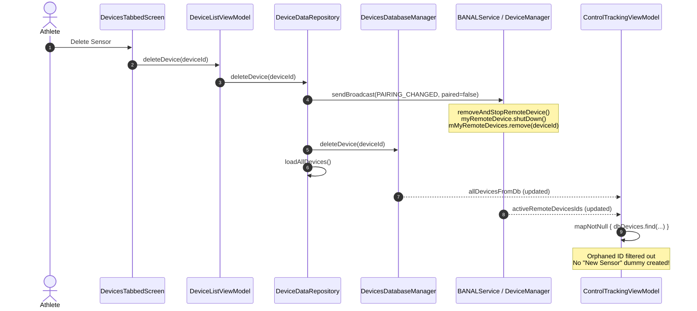

# Stage 1: Problem Domain & Root Cause Analysis - ATT-3169

## 1. Executive Summary & Problem Domain
* **Issue**: [ATT-3169](https://atrainingtracker.atlassian.net/browse/ATT-3169): `[Bug] Deleting active connected sensor leaves orphaned ghost 'New Sensor' in Control Tracking leading to dimmed blank dialog`
* **Parent Epic**: [ATT-355](https://atrainingtracker.atlassian.net/browse/ATT-355): *Good and consistent UI*
* **Target Requirements**: `REQ-UI-349` (refining `REQ-UI-278`, `REQ-UI-301`, and ASPICE Governance Rule 35)
* **Target Test Specs**: `TST-UI-309`
* **Sprint**: `2026-41.9`

### Problem Description
When an athlete deletes an active/connected sensor or device from the device list (*"Meine Sensoren"*, `DevicesTabbedScreen.kt`), the sensor tile in the `ControlTrackingScreen` does not disappear as expected.
Instead:
1. The sensor tile mutates into a ghost icon showing a research/search icon labeled `"New Sensor"`.
2. When the athlete taps on this `"New Sensor"` item, the screen darkens/dims completely and becomes non-responsive: an empty `DialogFragment` modal is attached with `FLAG_DIM_BEHIND` without any content, buttons, or dismissal controls, trapping the user until they press the Android system back button.

---

## 2. Forensic Investigation & Technical Root Cause

Forensic investigation reveals three interrelated architectural flaws spanning the repository, service, and presentation layers:

### 2.1 Missing Disconnection Broadcast in `DeviceDataRepository.kt`
* In `DeviceDataRepository.kt`, `deleteDevice(deviceId: Long)` currently executes:
  ```kotlin
  fun deleteDevice(deviceId: Long) {
      repositoryScope.launch {
          devicesDatabaseManager.deleteDevice(deviceId)
          loadAllDevices()
      }
  }
  ```
* While `devicesDatabaseManager.deleteDevice(deviceId)` deletes the database record from the `Devices` table in SQLite, **no notification or broadcast is dispatched to `BANALService` or `DeviceManager`**.
* Notice that `DeviceDataRepository` already contains:
  ```kotlin
  fun sendPairingChangedBroadcast(deviceId: Long, paired: Boolean) {
      val intent = Intent(BANALService.PAIRING_CHANGED)
          .putExtra(BANALService.DEVICE_ID, deviceId)
          .putExtra(BANALService.PAIRED, paired)
          .setPackage(application.getPackageName())
      application.sendBroadcast(intent)
  }
  ```
* When `BANALService` / `DeviceManager.java` receives `PAIRING_CHANGED` with `paired = false`, it calls:
  ```java
  removeAndStopRemoteDevice(deviceId);
  ```
  which cleanly shuts down the sensor connection (`myRemoteDevice.shutDown()`), terminates the Bluetooth GATT or ANT+ channel, and removes the device from `mMyRemoteDevices` and `mSearchQueue`.
* Because `deleteDevice()` neglected to call `sendPairingChangedBroadcast(deviceId, paired = false)`, `BANALService` continues to maintain the active hardware/GATT connection in memory, retaining the device ID in `mMyRemoteDevices` and repeatedly emitting it via `binder.databaseIdsOfActiveRemoteDevices`.

### 2.2 Unchecked Dummy Fallback in `ControlTrackingViewModel.kt`
* In `ControlTrackingViewModel.kt` (lines 120–144), `remoteDevices` combines `banalServiceRepository.activeRemoteDevicesIds` with `allDevicesFromDb`:
  ```kotlin
  val remoteDevices: StateFlow<List<RemoteDeviceUIData>> = banalServiceRepository.activeRemoteDevicesIds
      .combine(allDevicesFromDb) { ids, dbDevices ->
          ids.map { id ->
              val dbDevice = dbDevices.find { it.id == id }
              if (dbDevice != null) {
                  RemoteDeviceUIData(
                      id = dbDevice.id,
                      deviceType = dbDevice.deviceType,
                      name = dbDevice.deviceName,
                      iconRes = UIHelper.getIconId(dbDevice.deviceType, dbDevice.protocol)
                  )
              } else {
                  // Fallback if the device is found by service but not yet in DB
                  RemoteDeviceUIData(
                      id = id,
                      deviceType = DeviceType.DUMMY,
                      name = "New Sensor",
                      iconRes = R.drawable.research_icon
                  )
              }
          }
      }
  ```
* Commit `c69b24c56d59` originally used `repository.foundDeviceIds` for this fallback when scanning for un-paired hardware. However, for `activeRemoteDevicesIds` (active telemetry sensors), any ID missing from `dbDevices` is either deleted or orphaned.
* Emitting a dummy `RemoteDeviceUIData` with `DeviceType.DUMMY` and `"New Sensor"` violates defensive boundary validation (Rule 35). It should instead be filtered out (`mapNotNull`).

### 2.3 Screen-Darkening Blank Dialog Trapping the User
* When the user taps the `"New Sensor"` tile:
  1. `ControlTrackingViewModel.onDeviceClicked(device)` emits `ControlNavigation.ToEditDevice(device.id, DeviceType.DUMMY)`.
  2. `TrackingTabsScreen.kt` launches `EditDeviceFragmentFactory.create(deviceId, DeviceType.DUMMY).show(supportFragmentManager, "EditDeviceDialog")`.
  3. `ComposableEditDeviceDialogFragment` creates a `DialogFragment` with the default Android floating dialog theme, which enables `FLAG_DIM_BEHIND` (dimming the entire activity behind it).
  4. Inside `EditDeviceDialog.kt`:
     ```kotlin
     val snapshot by viewModel.deviceSnapshot.collectAsStateWithLifecycle()
     LaunchedEffect(deviceId) {
         viewModel.loadInitialDeviceData(deviceId)
     }
     snapshot?.let { data ->
         AppModalBottomSheet(...)
     }
     ```
     Because the device ID was deleted from SQLite, `devicesRepository.getDeviceSnapshotById(deviceId)` returns `null`.
  5. `snapshot` remains `null`. As a consequence, `AppModalBottomSheet` is never composed.
  6. The `DialogFragment` remains alive on the window manager as a 0-sized or invisible view, but its window attributes hold `FLAG_DIM_BEHIND`, darkening the screen with no UI controls and trapping the user.

---

## 3. Chesterton's Fence Requirement Archaeology (`REQ-PRO-022`)

1. **Original Requirement ID & Target**:
   - `REQ-UI-278` (*Pairing Triggers Relocation to Sensor Management & Control Tracking Layout Optimization*).
   - `REQ-UI-301` (*Control Tracking Screen Sensor Header Layout Isolation & Collision Elimination*).
   - `REQ-UI-304` (*Remote Device Tile Bounded Width and Multiline Name Wrapping*).
   - `REQ-UI-313` (*Symmetrical Balanced Sensor Header Centering and Touch-Safe Accessibility Isolation*).
2. **Historical Origin & Commit Trace**:
   - Commit `c69b24c5` ("Wiring From the BANALService to the Screens") introduced the `"New Sensor"` fallback for device discovery.
   - Commit `43b35eb6` (`ATT-2189`) relocated pairing to "Meine Sensoren".
   - Commit `26bf01aa` migrated `EditDeviceDialog` to Jetpack Compose `AppModalBottomSheet`.
3. **Root Reason for Existing Formulation**:
   - The `"New Sensor"` fallback was historically conceived to display newly discovered hardware before registration. However, `activeRemoteDevicesIds` is strictly populated by already-paired devices receiving telemetry (`remoteDevice.isReceivingData()`). Providing a fallback for an absent database entity in an active telemetry list is invalid.
4. **Preservation of Core Invariants**:
   - Active sensor telemetry streaming, BLE/ANT+ reconnection, device configuration dialogs for valid devices, and header centering/accessibility invariants (`REQ-UI-313`) must remain 100% intact.

---

## 4. Scope Bounding & Invariants (`ATT-1250`)

### In-Scope Objectives
1. **Service Disconnection on Delete**: In `DeviceDataRepository.deleteDevice(deviceId)`, dispatch `sendPairingChangedBroadcast(deviceId, paired = false)` prior to or during database deletion, ensuring `BANALService` / `DeviceManager` tears down the active BLE/ANT+ connection and removes the device ID from its active tracking sets.
2. **Defensive Filtering in ViewModel**: In `ControlTrackingViewModel.kt`, update `remoteDevices` to use `mapNotNull`, safely dropping any ID from `activeRemoteDevicesIds` that cannot be resolved in `allDevicesFromDb`.
3. **Defensive Auto-Dismiss in `EditDeviceDialog.kt`**: In `EditDeviceDialog.kt`, if `viewModel.deviceSnapshot` is `null` after initialization (or if the device cannot be found), trigger `onDismiss()` defensively rather than leaving a blank dimmed window.
4. **Null Safety in `DeviceManager.java`**: Ensure `removeAndStopRemoteDevice(long deviceId)` defensively handles null references if called for an already cleaned up device.

### Out-of-Scope (Forbidden Scope Creep)
* Re-architecting `BANALService` IPC binder protocols or state flows.
* Modifying sensor pairing workflows or Bluetooth scanning engines.
* Changing `EditDeviceViewModel` saving or editing mechanics for valid devices.

---

## 5. Proposed Solution Architecture



---

## 6. Verification & Test Strategy

1. **Unit Tests (`ControlTrackingViewModelTest.kt`)**:
   - Verify `remoteDevices` filters out active remote device IDs that do not exist in `allDevicesFromDb`.
   - Verify `remoteDevices` only contains `RemoteDeviceUIData` for devices existing in `allDevicesFromDb`.
   - Verify zero `"New Sensor"` or `DeviceType.DUMMY` instances are emitted when an unknown or deleted ID appears in `activeRemoteDevicesIds`.
2. **Repository Unit Tests (`DeviceDataRepositoryTest.kt`)**:
   - Verify `deleteDevice(deviceId)` broadcasts `BANALService.PAIRING_CHANGED` with `paired = false`.
   - Verify `devicesDatabaseManager.deleteDevice(deviceId)` is invoked.
3. **Dialog Safety Unit Tests (`EditDeviceDialogTest.kt` / `EditDeviceViewModelTest.kt`)**:
   - Verify that when `getDeviceSnapshotById(deviceId)` returns `null`, the dialog triggers `onDismiss()`.
4. **Full-Suite Clean-Room Regression**:
   - Execute `./gradlew testDebugUnitTest` ensuring 100% test pass rate.

---

## 7. Conclusion & Next Steps
Upon Gate 1 approval:
1. Advance ATT-3250 to `Erledigt`.
2. Proceed to Stage 2 (Requirement & Test Specification) to formalize `REQ-UI-349` and `TST-UI-309`.
