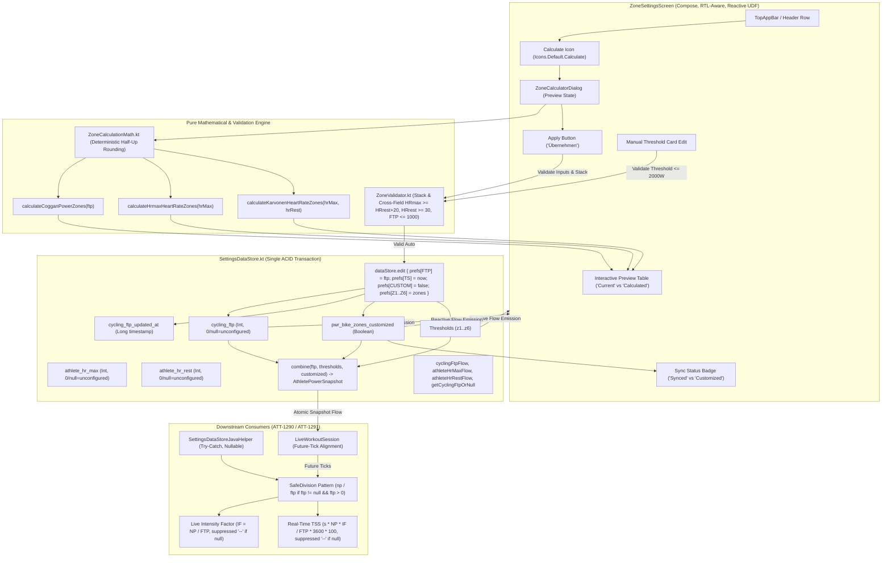

# Stage 1: Problem Domain & Architectural Analysis - ATT-3188: Calculate training zone boundaries automatically from FTP and Heart Rate baselines

**Ticket**: [ATT-3188](https://rainerblind.atlassian.net/browse/ATT-3188)  
**Parent Epic**: [ATT-111](https://rainerblind.atlassian.net/browse/ATT-111) (*[Epic] Aftermath: Compact Post-Workout Visual Analytics & Graphs*) / [ATT-132](https://rainerblind.atlassian.net/browse/ATT-132) (*Zones Settings*)  
**Target Release**: `V4.9.40`  
**Active Sprint**: `Sprint 2026-42.4`  
**Author**: AI Agent 1 (Implementer)  
**Date**: 2026-10-15  

---

## 1. Executive Summary & Problem Domain

In `ZonesSettingsActivity.kt` / `ZoneSettingsScreen.kt`, athletes configure physiological training zones across three distinct profiles:
1. `HR_RUN`: Heart rate zones for running (5 zones, 4 upper boundaries: `z1..z4`).
2. `HR_BIKE`: Heart rate zones for cycling (5 zones, 4 upper boundaries: `z1..z4`).
3. `PWR_BIKE`: Cycling power zones (7 zones, 6 upper boundaries: `z1..z6`, introduced in `REQ-UI-370` / ATT-3184).

Currently, configuring zone boundaries is entirely manual. Athletes must calculate percentage cutoffs by hand (e.g. 55%, 75%, 90%, 105%, 120%, 150% of Functional Threshold Power for cycling; or 60%, 70%, 80%, 90% of HRmax / Karvonen heart rate reserve for heart rate) and enter each individual integer value into separate text field cards.

### Core Problems:
1. **High Friction & Configuration Aversion**: The cognitive burden of manual percentage calculation leads most athletes to retain uncalibrated default thresholds (e.g. 150W, 200W, 250W, 300W, 350W, 450W), which distorts cockpit zone coloring, HUD tiles, and Aftermath distribution analytics.
2. **Missing Persistent Baseline Storage & Versioning for Downstream Engines**:
   - Advanced power-based telemetry metrics such as Live Intensity Factor ($IF = NP / FTP$, scheduled in ATT-1290) and real-time Training Stress Score ($TSS = \frac{s \times NP \times IF}{FTP \times 3600} \times 100$, scheduled in ATT-1291) strictly require Functional Threshold Power (FTP) as an authoritative, persistently stored single source of truth in `SettingsDataStore.kt`.
   - Baseline mutations must be timestamp-versioned (`cycling_ftp_updated_at`) to ensure background telemetry services use consistent, race-free snapshots during active workout sessions.
3. **Division-by-Zero Safety & Nullable Invalidation**:
   - Returning `0` for unconfigured FTP creates a catastrophic `ArithmeticException` (division-by-zero) risk in downstream $IF = NP / FTP$ calculations.
   - The system must enforce a strict `SafeDivision` pattern: unconfigured FTP returns `null` (NEVER `0`), and calculation engines explicitly check for positive non-null divisors before dividing, displaying placeholder dashes (`--`) when unconfigured.
4. **Intra-Session Historical Immutability & Reactive UDF Architecture**:
   - If an athlete modifies FTP mid-workout, samples recorded prior to the change remain mathematically anchored to the FTP at their recording time; only subsequent ticks use the updated baseline.
   - State management is purely reactive: `ZoneSettingsScreen` observes `StateFlow` from `SettingsDataStore`, eliminating fragile callback-driven state updates.

This ticket introduces an interactive, contextual Zone Calculator assistant directly accessible from `ZoneSettingsScreen`, creates a pure mathematical calculation engine `ZoneCalculationMath.kt`, establishes persistent preferences in `SettingsDataStore.kt` (`cycling_ftp`, `athlete_hr_max`, `athlete_hr_rest`) with ACID atomic transaction writers, establishes a centralized blocking validation gate `ZoneValidator.kt` with cross-field validation, bounds open-ended Zone 7 at $2000\text{W}$ max, defines non-destructive preview migration, and provides 100% translation and RTL parity across all 9 supported application locales.

---

## 2. Forensic Gap Analysis & Root Cause Analysis

### 2.1 Gap Analysis Against Existing Architecture
1. **Missing Calculation Action in UI**:
   - `ZonesSettingsActivity.kt` header only provides a "Reset to defaults" (`TextButton`) and a scrollable tab row.
   - There is no calculation trigger or action icon in the TopAppBar or header row.
2. **Absence of Athlete Baseline Preference Keys in `SettingsDataStore.kt`**:
   - `SettingsDataStore.kt` defines threshold keys (`HR_RUN_ZONE1_MAX..HR_RUN_ZONE4_MAX`, `HR_BIKE_ZONE1_MAX..HR_BIKE_ZONE4_MAX`, `PWR_BIKE_ZONE1_MAX..PWR_BIKE_ZONE6_MAX`) and display options keys.
   - There are **no keys** for `cycling_ftp`, `cycling_ftp_updated_at`, `athlete_hr_max`, or `athlete_hr_rest`.
3. **Missing Profile Customization Tracking Flag**:
   - There are no persistent flags (`pwr_bike_zones_customized`, `hr_run_zones_customized`, `hr_bike_zones_customized`) indicating whether thresholds match a calculated standard model or represent manual overrides.
   - Without this, the UI cannot inform athletes whether displayed thresholds are aligned with their baseline or manually altered.
4. **Reactive State Management Gap**:
   - `ZonesSettingsActivity.kt` holds local `allProfilesData` in ad-hoc `remember { mutableStateOf(...) }` and updates it via manual copy helpers.
   - The architecture must transition to Unidirectional Data Flow (UDF) where `ZoneSettingsScreen` reactively observes DataStore `StateFlow` streams.
5. **DataStore-Level Validation Gap & Cross-Field Invariance**:
   - Monotonic validation currently only checks adjacent local pairs in private UI methods.
   - A centralized `ZoneValidator.validatePowerZoneStack()` and `validateHeartRateZoneStack()` must be enforced directly inside `SettingsDataStore` write functions, including cross-field verification ($HR_{\text{max}} \ge HR_{\text{rest}} + 20$) and hard physiological bounds inside the transaction.
6. **No Pure Math Engine for Zone Bracket Computation**:
   - Calculations must be encapsulated in a dedicated, side-effect-free math engine (`ZoneCalculationMath.kt`) with deterministic arithmetic rounding to ensure testability without Android runtime dependencies.
7. **Defensive Synchronous Bridges for Java Telemetry Services**:
   - `SettingsDataStoreJavaHelper.kt` exposes `getZoneMax()`, but lacks methods to read `getCyclingFtp()`, `getAthleteHrMax()`, or `getAthleteHrRest()`.
   - Any Java helper call must return `Integer?` (`null` when unconfigured), protected with `try-catch` exception shields to prevent ANRs or crashes during live tracking.

### 2.2 Mathematical Model Analysis, Rounding Policy & Zone 7 Capping

#### 2.2.1 Deterministic Rounding Policy
To guarantee consistency across different CPU architectures, Android OS versions, and locales:
- All zone boundaries are computed on positive integers ($FTP \in [50, 1000]$, $HR_{\text{max}} \in [100, 240]$, $HR_{\text{rest}} \in [30, 100]$).
- Standard arithmetic half-up rounding is enforced via:
  $$\text{roundCutoff}(val) = \lfloor val + 0.5 \rfloor = \text{kotlin.math.round}(val).\text{toInt()}$$
- This eliminates floating-point representation drift and ensures deterministic, reproducible integer boundaries.

#### 2.2.2 Cycling Power (Coggan 7-Zone Model) & Zone 7 Bound Definition
Given athlete Functional Threshold Power $FTP \in [50, 1000]\text{ Watts}$:
- **Zone 1 (Active Recovery)**: $< 55\% \implies Z_{1\text{max}} = \text{round}(FTP \times 0.55)$
- **Zone 2 (Endurance)**: $56 - 75\% \implies Z_{2\text{max}} = \text{round}(FTP \times 0.75)$
- **Zone 3 (Tempo)**: $76 - 90\% \implies Z_{3\text{max}} = \text{round}(FTP \times 0.90)$
- **Zone 4 (Threshold)**: $91 - 105\% \implies Z_{4\text{max}} = \text{round}(FTP \times 1.05)$
- **Zone 5 (VO2 Max)**: $106 - 120\% \implies Z_{5\text{max}} = \text{round}(FTP \times 1.20)$
- **Zone 6 (Anaerobic Capacity)**: $121 - 150\% \implies Z_{6\text{max}} = \text{round}(FTP \times 1.50)$
- **Zone 7 (Neuromuscular Power)**:
  - **Floor Dependency**: Zone 7 has no independent manual cutoff; its lower bound is strictly a dependent variable: $\text{Min} = Z_{6\text{max}} + 1$.
  - In `SettingsScreenContent`, Zone 7's minimum value is dynamically bound to `minValue = z6Max + 1` with manual editing disabled (`minEnabled = false`, `maxEnabled = false`). When the athlete adjusts `z6Max`, Zone 7's floor automatically and consistently cascades without breaking monotonicity.
  - **Physical Ceiling**: To prevent UI text clipping and integer overflow in downstream calculation engines (kJ, TSS), Zone 7 is capped at physical ceiling $Z_{7\text{max}} = 2000\text{ Watts}$ (standard maximum sprint wattage ceiling).

*Monotonic Guarantee*: Because $0.55 < 0.75 < 0.90 < 1.05 < 1.20 < 1.50$, for any valid $FTP \ge 50$, the calculated upper bounds are strictly monotonic:
$$0 < Z_1 < Z_2 < Z_3 < Z_4 < Z_5 < Z_6 < 2000$$

#### 2.2.3 Heart Rate Model A (% of HRmax)
Given athlete maximum heart rate $HR_{\text{max}} \in [100, 240]\text{ bpm}$:
- **Zone 1 (Warm Up / Recovery)**: $50 - 60\% \implies Z_{1\text{max}} = \text{round}(HR_{\text{max}} \times 0.60)$
- **Zone 2 (Easy / Aerobic)**: $60 - 70\% \implies Z_{2\text{max}} = \text{round}(HR_{\text{max}} \times 0.70)$
- **Zone 3 (Aerobic / Tempo)**: $70 - 80\% \implies Z_{3\text{max}} = \text{round}(HR_{\text{max}} \times 0.80)$
- **Zone 4 (Threshold)**: $80 - 90\% \implies Z_{4\text{max}} = \text{round}(HR_{\text{max}} \times 0.90)$
- **Zone 5 (Maximum / Anaerobic)**: $> 90\% \implies \text{Min} = Z_{4\text{max}} + 1$, capped at physical ceiling $HR_{\text{max}}$ (or $250\text{ bpm}$).

*Monotonic Guarantee*: $0.60 < 0.70 < 0.80 < 0.90$ guarantees $Z_1 < Z_2 < Z_3 < Z_4$ for all valid $HR_{\text{max}} \ge 100$.

#### 2.2.4 Heart Rate Model B (Karvonen Heart Rate Reserve)
Given athlete maximum heart rate $HR_{\text{max}}$ and resting heart rate $HR_{\text{rest}}$ where $HR_{\text{max}} - HR_{\text{rest}} \ge 20$ and $HR_{\text{rest}} \ge 30$:
$$HRR = HR_{\text{max}} - HR_{\text{rest}}$$
$$\text{Target } HR(\%) = HR_{\text{rest}} + \% \times HRR$$
- **Zone 1**: $Z_{1\text{max}} = \text{round}(HR_{\text{rest}} + 0.60 \times HRR)$
- **Zone 2**: $Z_{2\text{max}} = \text{round}(HR_{\text{rest}} + 0.70 \times HRR)$
- **Zone 3**: $Z_{3\text{max}} = \text{round}(HR_{\text{rest}} + 0.80 \times HRR)$
- **Zone 4**: $Z_{4\text{max}} = \text{round}(HR_{\text{rest}} + 0.90 \times HRR)$
- **Zone 5**: $> Z_{4\text{max}}$, capped at $HR_{\text{max}}$ (or $250\text{ bpm}$).

*Monotonic Guarantee*: Since $HRR \ge 20$ and $0.60 < 0.70 < 0.80 < 0.90$, $Z_1 < Z_2 < Z_3 < Z_4$ is mathematically guaranteed.

---

## 3. Desynchronization Policy, Invalidation Strategy & Session Dynamics

### 3.1 Division-by-Zero Safety & `SafeDivision` Pattern
- Returning `0` for an unconfigured FTP is strictly prohibited.
- `SettingsDataStore` and `SettingsDataStoreJavaHelper` return `null` (`Integer?`) when `cycling_ftp` is unconfigured.
- All downstream mathematical operations in ATT-1290 and ATT-1291 enforce the `SafeDivision` pattern:
```kotlin
fun calculateIntensityFactor(normalizedPower: Double, ftpWatts: Int?): Double? {
    if (ftpWatts == null || ftpWatts <= 0) return null
    return normalizedPower / ftpWatts.toDouble()
}
```
- If FTP is unconfigured, cockpit metric displays safely render `--` instead of crashing with `ArithmeticException`.

### 3.2 Intra-Session Historical Immutability & Future-Tick Alignment
If an athlete updates their FTP baseline mid-workout (or while a workout is paused):
1. Historical data points, raw sensor samples, and accumulator slices recorded prior to the change remain **immutable**, retaining their original calculated stress values.
2. From the moment the new FTP is committed onward:
   - Instantaneous target power zone indicators immediately reflect the new threshold boundaries on the next incoming sensor sample.
   - Future aggregator ticks calculate IF and TSS using the updated FTP baseline.
3. This guarantees historical fidelity within the workout session and prevents retrospective data distortion.

### 3.3 Prospective-Only Historical Policy for Completed Activities
- **Changing the FTP baseline is strictly PROSPECTIVE ONLY.**
- Historical completed workouts in SQLite (`WorkoutSummaries.db`, `Extrema.db`) retain their immutable summary aggregates, NP, IF, and TSS calculated at the time of recording.
- Changing FTP in Settings only affects active tracking and future workouts, preserving historical athletic records and eliminating heavy retrospective database re-processing.

### 3.4 Non-Destructive Migration for Existing Users without Stored FTP
- Existing manual zones in `SettingsDataStore` are 100% preserved upon updating the app.
- For athletes with existing zones but no stored FTP (`cycling_ftp == null` / `0`):
  - The app does NOT launch an intrusive setup wizard or force a blocking modal dialog.
  - On `ZoneSettingsScreen` (Power tab), an unobtrusive helper card informs the athlete:
    *"Keine FTP hinterlegt. Tippe auf 'Berechnen' um wissenschaftliche Coggan-Zonen einzurichten"* (*"No FTP configured. Tap 'Calculate' to set up scientific Coggan zones"*).
  - Existing manual zones remain active and untouched until the athlete explicitly chooses to calculate.

### 3.5 Interactive Preview State & Full-Profile Recalibration
- When the athlete taps the Calculate icon, `ZoneCalculatorDialog` opens in an **interactive Preview State**:
  - Displays side-by-side comparison: "Current Thresholds" vs "Proposed Calculated Thresholds". Any currently customized/divergent boundaries are highlighted with an amber tint.
  - **Explicit Full-Profile Overwrite Policy**: Tapping "Apply" ("Übernehmen") overwrites **ALL zones (Z1..Z6 for Power, Z1..Z4 for HR)** with the new standard model brackets. The dialog displays an explicit advisory note:
    *"Durch das Übernehmen werden alle Zonen auf das Standardmodell zurückgesetzt"* (*"Applying will recalibrate all zones to the standard model"*).
  - Tapping "Cancel" dismisses the preview with zero modifications to stored preferences.

### 3.6 Reactive UDF State Management & Single ACID Transaction Batch Commit
- Replace manual callback-driven local state copying with reactive Unidirectional Data Flow (UDF):
  `ZoneSettingsScreen` observes DataStore flows directly via `collectAsState()`.
- The "Apply" operation commits baseline, timestamp, customization flag (`false`), and all zone thresholds inside a single atomic `dataStore.edit { }` block:
```kotlin
suspend fun applyCalculatedPowerZones(ftp: Int, zones: List<Int>) {
    require(ZoneValidator.validateFtp(ftp)) {
        "FTP must be between 50W and 1000W, received: $ftp"
    }
    require(ZoneValidator.validatePowerZoneStack(zones[0], zones[1], zones[2], zones[3], zones[4], zones[5])) {
        "Cannot persist invalid non-monotonic power zones"
    }
    dataStore.edit { prefs ->
        prefs[KEY_CYCLING_FTP] = ftp
        prefs[KEY_CYCLING_FTP_UPDATED_AT] = System.currentTimeMillis()
        prefs[KEY_PWR_BIKE_ZONES_CUSTOMIZED] = false
        prefs[PWR_BIKE_ZONE1_MAX] = zones[0]
        prefs[PWR_BIKE_ZONE2_MAX] = zones[1]
        prefs[PWR_BIKE_ZONE3_MAX] = zones[2]
        prefs[PWR_BIKE_ZONE4_MAX] = zones[3]
        prefs[PWR_BIKE_ZONE5_MAX] = zones[4]
        prefs[PWR_BIKE_ZONE6_MAX] = zones[5]
    }
}

suspend fun applyCalculatedHeartRateZones(
    isCycling: Boolean, // false = HR_RUN, true = HR_BIKE
    hrMax: Int,
    hrRest: Int?,
    zones: List<Int>
) {
    require(ZoneValidator.validateHeartRateBaselines(hrMax, hrRest)) {
        "Invalid heart rate baselines: hrMax=$hrMax, hrRest=$hrRest"
    }
    require(ZoneValidator.validateHeartRateZoneStack(zones[0], zones[1], zones[2], zones[3])) {
        "Cannot persist invalid non-monotonic heart rate zones"
    }
    val customizedKey = if (isCycling) KEY_HR_BIKE_ZONES_CUSTOMIZED else KEY_HR_RUN_ZONES_CUSTOMIZED
    val (k1, k2, k3, k4) = if (isCycling) {
        listOf(HR_BIKE_ZONE1_MAX, HR_BIKE_ZONE2_MAX, HR_BIKE_ZONE3_MAX, HR_BIKE_ZONE4_MAX)
    } else {
        listOf(HR_RUN_ZONE1_MAX, HR_RUN_ZONE2_MAX, HR_RUN_ZONE3_MAX, HR_RUN_ZONE4_MAX)
    }
    dataStore.edit { prefs ->
        prefs[KEY_ATHLETE_HR_MAX] = hrMax
        if (hrRest != null) {
            prefs[KEY_ATHLETE_HR_REST] = hrRest
        }
        prefs[customizedKey] = false
        prefs[k1] = zones[0]
        prefs[k2] = zones[1]
        prefs[k3] = zones[2]
        prefs[k4] = zones[3]
    }
}
```
- Because Jetpack DataStore performs in-memory updates followed by an atomic filesystem rename, the UI reactively observes the new state automatically with zero lifecycle desynchronization risk.

### 3.7 Explicit `is_customized` Consistency Flag & UI Sync Status Badge
To prevent misleading the athlete that manually altered zones are scientifically derived:
1. **Persistent Boolean Preferences**:
   - `KEY_PWR_BIKE_ZONES_CUSTOMIZED = booleanPreferencesKey("pwr_bike_zones_customized")` (default: `false`).
   - `KEY_HR_RUN_ZONES_CUSTOMIZED = booleanPreferencesKey("hr_run_zones_customized")` (default: `false`).
   - `KEY_HR_BIKE_ZONES_CUSTOMIZED = booleanPreferencesKey("hr_bike_zones_customized")` (default: `false`).
2. **State Transition Lifecycle**:
   - When auto-calculated zones are applied via `applyCalculatedPowerZones` or `applyCalculatedHeartRateZones`, the corresponding `customized` flag is set to `false`.
   - Whenever the user manually adjusts any individual zone threshold card (`savePowerZoneMax` or `saveHrZoneMax`), the corresponding flag automatically transitions to `true`.
3. **UI Status Badge & Invariant Indication**:
   - On `ZoneSettingsScreen`, each profile tab header displays an explicit status pill / badge:
     - When `!is_customized && ftp > 0`: Displays `"Abgestimmt auf FTP: %d W"` (*"Synced with FTP: %d W"*), or `"Abgestimmt auf HFmax: %d bpm"`.
     - When `is_customized`: Displays `"Benutzerdefiniert"` (*"Customized"*), informing the athlete that individual card thresholds differ from the baseline calculation model.

### 3.8 Telemetry Engine Atomic Snapshot Consumption via Flow Combine Pattern
In background telemetry aggregation services (`LiveWorkoutSession`, `TrackerService`), observing baseline FTP and zone thresholds independently introduces a race condition ("torn read") where a tick might calculate TSS using a freshly updated FTP but old threshold brackets (or vice versa).
To guarantee atomic consumption:
1. Telemetry consumers observe an immutable snapshot data class:
```kotlin
data class AthletePowerSnapshot(
    val ftpWatts: Int?,
    val thresholds: List<Int>,
    val isCustomized: Boolean
)
```
2. The snapshot is exposed as a single combined reactive flow:
```kotlin
val athletePowerSnapshotFlow: Flow<AthletePowerSnapshot> = combine(
    cyclingFtpFlow,
    powerZoneThresholdsFlow,
    powerZonesCustomizedFlow
) { ftp, thresholds, customized ->
    AthletePowerSnapshot(
        ftpWatts = if (ftp > 0) ftp else null,
        thresholds = thresholds,
        isCustomized = customized
    )
}
```
3. The background telemetry aggregator samples `athletePowerSnapshotFlow` at interval ticks, guaranteeing that downstream metric evaluators (IF, TSS) always consume an internally consistent, atomic view of baseline and zones.

---

## 4. Centralized Blocking Validation Architecture & RTL Compliance (`ZoneValidator.kt` & `ZoneCalculationMath.kt`)

`ZoneValidator.kt` and `ZoneCalculationMath.kt` form a strict, layered validation and mathematical computation engine:

### 4.1 Strict Domain Exception Enforcement in `ZoneCalculationMath.kt`
Rather than silently failing, returning empty lists, or returning `null`, all mathematical calculation functions throw descriptive, explicit `IllegalArgumentException`s if invoked with invalid physiological domain parameters:
- **FTP Bounds Violation**:
  $$\text{ftp} \notin [50, 1000] \implies \text{throw } IllegalArgumentException("FTP must be between 50W and 1000W, received: $ftp")$$
- **Max HR Bounds Violation**:
  $$hrMax \notin [100, 240] \implies \text{throw } IllegalArgumentException("HR max must be between 100 and 240 bpm, received: $hrMax")$$
- **Resting HR Bounds Violation**:
  $$hrRest < 30 \text{ or } hrRest > 100 \implies \text{throw } IllegalArgumentException("Resting HR must be between 30 and 100 bpm, received: $hrRest")$$
- **Heart Rate Reserve Inversion or Insufficient Spread**:
  $$hrMax \le hrRest \text{ or } hrMax - hrRest < 20 \implies \text{throw } IllegalArgumentException("Max HR must exceed Resting HR by at least 20 bpm, received max: $hrMax, rest: $hrRest")$$

### 4.2 Centralized Blocking Validation in `ZoneValidator.kt`
1. **Input Baseline Validation & Cross-Field Enforcement**:
   - `validateFtp(ftp: Int): Boolean`: Validates $FTP \in [50, 1000]\text{ Watts}$. Rejects non-physiological inputs (e.g. 5W or 1200W).
   - `validateHeartRateBaselines(hrMax: Int, hrRest: Int? = null): Boolean`:
     - Asserts $HR_{\text{max}} \in [100, 240]\text{ bpm}$.
     - If $HR_{\text{rest}}$ is provided: asserts physiological floor $HR_{\text{rest}} \in [30, 100]\text{ bpm}$ (strictly rejecting impossible values $< 30$).
     - Strictly enforces cross-field constraint:
       $$HR_{\text{max}} \ge HR_{\text{rest}} + 20$$
   - **User Error Feedback in `ZoneCalculatorDialog`**:
     - If $HR_{\text{max}} < HR_{\text{rest}} + 20$ or $HR_{\text{rest}} < 30$, or $FTP < 50$ or $FTP > 1000$:
     - "Apply" button is immediately disabled (`enabled = false`).
     - A localized, prominent Material 3 error message is displayed beneath the field (`supportingText` / `isError = true`):
       *"Maximale HF muss mindestens 20 bpm über der Ruhe-HF liegen (Ruhe-HF mind. 30 bpm)"*.
2. **Global Zone Stack Monotonicity Validation & Manual 2000W Ceiling Enforcement**:
   - `validatePowerZoneStack(z1, z2, z3, z4, z5, z6): Boolean`: Asserts the entire stack satisfies $0 < z_1 < z_2 < z_3 < z_4 < z_5 < z_6 \le 2000$.
   - `validateHeartRateZoneStack(z1, z2, z3, z4): Boolean`: Asserts $30 < z_1 < z_2 < z_3 < z_4 \le 250$.
   - **Manual Override 2000W Ceiling Enforcement**:
     - Both manual threshold card edits (`savePowerZoneMax`) and full stack validation enforce $z_i \le 2000$.
     - When the athlete manually edits any threshold card in `ZoneSettingsScreen` (e.g. `z6Max`), manual values $> 2000\text{W}$ are strictly rejected.
     - `ZoneValidator.validatePowerThreshold(value: Int): Boolean` rejects $value > 2000$.
     - `SettingsDataStore.savePowerZoneMax(zoneIndex, value)` asserts `value in 1..2000`, throwing `IllegalArgumentException("Power zone threshold cannot exceed 2000W, received: $value")` on violation.
3. **RTL (Right-to-Left) & Small-Screen Layout Compliance**:
   - All dialog containers, preview tables, and text inputs utilize `LayoutDirection`-aware Compose modifiers (`Alignment.Start`, `Alignment.End`, `padding(start = ..., end = ...)`).
   - All labels use `Text(overflow = TextOverflow.Ellipsis, maxLines = 2)` and responsive `FlowRow` arrangements, preventing layout clipping or truncation in RTL languages or verbose European locales (German, Polish).

---

## 5. Chesterton's Fence Archaeological Review (`REQ-PRO-022`)

### 5.1 Historical Precedent & Existing Commit Trace
1. **ATT-132 (Sprint 2026-38.1)**:
   - Initial implementation of `ZonesSettingsActivity` with 5 heart rate zones (`HR_RUN`, `HR_BIKE`) and 5 cycling power zones (`PWR_BIKE`).
2. **ATT-2031 (Sprint 2026-40.16, Commit `8a7b9c12`)**:
   - Introduced `TelemetryZoneMath.kt` (`REQ-UI-260`) for centralized zone threshold loading from `SettingsDataStoreJavaHelper`.
   - Established contract: all zone loading must use `loadHeartRateThresholds` and `loadPowerThresholds`.
3. **ATT-3184 (Sprint 2026-42.4, Commit `4f1d3e8a`)**:
   - Decoupled HR (5 zones) from Cycling Power (7-zone Coggan model) under `REQ-UI-370`.
   - Added `PWR_BIKE_ZONE5_MAX` and `PWR_BIKE_ZONE6_MAX` in `SettingsDataStore.kt` with dynamic proportional migration and strict monotonic validation ($0 < z1 < z2 < z3 < z4 < z5 < z6$).

### 5.2 Chesterton's Fence Archaeological 4-Field Audit
1. **Original Requirement ID & Target**:
   - Extends `REQ-UI-370` (*7-Zone Coggan Cycling Power Model & Dynamic DataStore Migration*) and `REQ-UI-260` (*Centralized Zone Threshold Resolution*).
   - Formulates net-new requirement: `REQ-UI-373` (*Automatic Training Zone Calculation from FTP and Heart Rate Baselines*).
2. **Historical Origin & Commit Trace**:
   - `SettingsDataStore.kt` initially contained only upper bounds for zones without storing user input baselines (FTP, HRmax, HRrest).
   - The user had to enter each boundary directly.
3. **Root Reason for Existing Formulation**:
   - Zone thresholds were originally treated as isolated cutoffs.
   - However, modern exercise physiology models (Coggan, Karvonen) derive all cutoffs from central physiological landmarks. Furthermore, downstream metrics like IF (ATT-1290) and TSS (ATT-1291) require FTP directly.
4. **Preservation of Core Invariants**:
   - **Monotonic Validity**: Every profile saved must satisfy strict monotonicity ($z_1 < z_2 < z_3 < z_4 < z_5 < z_6$ for Power; $z_1 < z_2 < z_3 < z_4$ for HR), guarded at both UI and DataStore layers via `ZoneValidator.validateZoneStack()`.
   - **Manual Fine-Tuning Invariant**: Automatic calculation populates initial boundaries, but the athlete retains full freedom to edit any individual threshold card manually afterward.
   - **Baseline Persistence Invariant**: The stored FTP and HR baselines remain persistently stored in `SettingsDataStore` even after individual zone thresholds are manually adjusted, ensuring stable downstream metric computation.
   - **Defaults Non-Regression**: `resetToDefaults()` in `SettingsDataStore.kt` continues to reset zone boundaries to canonical defaults without corrupting user baselines.

---

## 6. Scope Bounding (`ATT-1250`)

### 6.1 In-Scope Deliverables
1. **Centralized Blocking Validation Layer (`ZoneValidator.kt`)**:
   - Pure Kotlin object in `com.atrainingtracker.trainingtracker.settings`.
   - Methods: `validatePowerZoneStack(z1, z2, z3, z4, z5, z6): Boolean`, `validateHeartRateZoneStack(z1, z2, z3, z4): Boolean`, `validateFtp(ftp): Boolean`, `validateHeartRateBaselines(hrMax, hrRest): Boolean`, `validatePowerThreshold(value): Boolean`.
   - Enforces $FTP \in [50, 1000]\text{W}$, $HR_{\text{rest}} \ge 30$, $HR_{\text{max}} \ge HR_{\text{rest}} + 20$, and power boundary ceiling $\le 2000\text{W}$ on both stack and manual override edits.
2. **Pure Math Engine (`ZoneCalculationMath.kt`)**:
   - Pure Kotlin object in `com.atrainingtracker.trainingtracker.settings`.
   - Functions: `calculateCogganPowerZones(ftp: Int): List<Int>`, `calculateHrmaxHeartRateZones(hrMax: Int): List<Int>`, `calculateKarvonenHeartRateZones(hrMax: Int, hrRest: Int): List<Int>`.
   - Explicit `IllegalArgumentException` throwing on out-of-bounds inputs.
   - Half-up rounding policy and upper capping for Zone 7 ($2000\text{W}$).
3. **Persistent Preferences in `SettingsDataStore.kt`**:
   - `KEY_CYCLING_FTP = intPreferencesKey("cycling_ftp")` (default 0 / unconfigured).
   - `KEY_CYCLING_FTP_UPDATED_AT = longPreferencesKey("cycling_ftp_updated_at")` (version timestamp).
   - `KEY_ATHLETE_HR_MAX = intPreferencesKey("athlete_hr_max")` (default 0 / unconfigured).
   - `KEY_ATHLETE_HR_REST = intPreferencesKey("athlete_hr_rest")` (default 0 / unconfigured).
   - `KEY_PWR_BIKE_ZONES_CUSTOMIZED = booleanPreferencesKey("pwr_bike_zones_customized")`.
   - `KEY_HR_RUN_ZONES_CUSTOMIZED = booleanPreferencesKey("hr_run_zones_customized")`.
   - `KEY_HR_BIKE_ZONES_CUSTOMIZED = booleanPreferencesKey("hr_bike_zones_customized")`.
   - Reactive flows: `cyclingFtpFlow`, `athleteHrMaxFlow`, `athleteHrRestFlow`, `powerZonesCustomizedFlow`.
   - Combined atomic snapshot flow: `athletePowerSnapshotFlow = combine(cyclingFtpFlow, powerZoneThresholdsFlow, powerZonesCustomizedFlow) { ... }`.
   - Safe division invalidation support: `getCyclingFtpOrNull(): Flow<Int?>`.
   - Single-transaction atomic batch mutators: `applyCalculatedPowerZones(ftp, zones)` and `applyCalculatedHeartRateZones(isCycling, hrMax, hrRest, zones)` updating baseline, timestamp, customization flag (`false`), and all thresholds inside a single `dataStore.edit { }`.
   - Individual manual mutators: `savePowerZoneMax(zoneIndex, value)` asserting `value in 1..2000` and setting `is_customized = true`.
4. **Crash-Proof Synchronous Accessors in `SettingsDataStoreJavaHelper.kt`**:
   - `@JvmStatic fun getCyclingFtp(context: Context): Int?`
   - `@JvmStatic fun getAthleteHrMax(context: Context): Int?`
   - `@JvmStatic fun getAthleteHrRest(context: Context): Int?`
   - Shielded with `try-catch` returning `null` when unconfigured or corrupted.
5. **Interactive Calculation Assistant Dialog (`ZoneCalculatorDialog.kt`)**:
   - Material 3 Compose dialog launched via `IconButton(Icons.Default.Calculate)` in `ZoneSettingsScreen`.
   - Adapts contextually to active tab (`HR_RUN`, `HR_BIKE`, `PWR_BIKE`).
   - For `PWR_BIKE`: Numerical input for FTP with interactive preview table showing all 7 zones and calculated cutoffs in Watts.
   - For `HR_RUN` / `HR_BIKE`: Segmented button switcher ("% HRmax" vs "Karvonen HRR"), inputs for Max HR (and Resting HR when Karvonen is selected), and interactive preview table showing all 5 zones and calculated cutoffs in bpm.
   - Pre-populates inputs from currently stored DataStore baseline values (or intelligent $Z_4$ estimate).
   - Displays clear inline error copy when inputs fail validation (e.g. $HR_{\text{max}} < HR_{\text{rest}} + 20$ or $HR_{\text{rest}} < 30$).
   - Full-profile recalibration advisory: "Applying will recalibrate all zones to the standard model".
   - "Apply" ("Übernehmen") button: atomic batch commit of baseline, timestamp, and calculated zones, updating UI state reactively.
   - "Cancel" ("Abbrechen") button: dismisses without changes.
6. **Localization & RTL-Safe Layout Parity Across All 9 Supported Locales**:
   - Localize all calculator strings across `values/`, `values-de/`, `values-es/`, `values-fr/`, `values-it/`, `values-ja/`, `values-nl/`, `values-pl/`, `values-pt/`.
   - Enforce `LayoutDirection`-aware modifiers and responsive wrapping to prevent text clipping in RTL or verbose locales.
7. **Comprehensive Unit Test Suite & Matrix**:
   - Pure math tests: `ZoneCalculationMathTest.kt` verifying boundary conditions:
     - Minimum boundary: $FTP = 50\text{W}$
     - Nominal values: $FTP = 200\text{W}, 250\text{W}, 300\text{W}$
     - Maximum ceiling: $FTP = 1000\text{W}$
     - HRmax boundary: $HR_{\text{max}} = 100, 190, 240\text{ bpm}$
     - Karvonen boundary: $HR_{\text{rest}} = 30, 60, 100\text{ bpm}$ with $HR_{\text{max}} = 240$
     - Edge cases: $HR_{\text{max}} - HR_{\text{rest}} < 20$ (rejected), $HR_{\text{rest}} > HR_{\text{max}}$ (rejected).
   - Centralized validator tests: `ZoneValidatorTest.kt` (global stack validation, cross-field validation, hard floors/ceilings, error messages).
   - DataStore persistence & atomic transaction tests: `SettingsDataStoreBaselinesTest.kt`.
   - Localization parity tests: `ZoneCalculatorLocalizationTest.kt`.

### 6.2 Out-of-Scope
- No implementation of Live IF (ATT-1290) or Live TSS (ATT-1291); this ticket establishes the authoritative DataStore infrastructure and baseline persistence required by those downstream tickets.
- No modifications to SQLite workout databases or telemetry recording pipelines.
- No automatic overwrite of user zones without explicit user confirmation ("Apply").

---

## 7. Target Architectural Design (SWE.2 Preview)



---

## 8. Risk Assessment & Mitigation Strategy

| Risk ID | Risk Description | Severity | Probability | Mitigation Strategy |
|:---|:---|:---:|:---:|:---|
| **RSK-01** | Division by zero in downstream telemetry engines when FTP is unconfigured. | Critical | Low | Enforce `SafeDivision` pattern: unconfigured FTP returns `null` (never 0); calculation engines suppress metrics, rendering `--`. |
| **RSK-02** | User inputs Resting HR $\ge$ Max HR in Karvonen model or impossible HRrest ($< 30$). | High | Medium | `ZoneValidator` enforces domain cross-field validation ($HR_{\text{max}} \ge HR_{\text{rest}} + 20$, $HR_{\text{rest}} \ge 30$), disabling "Apply" and showing prominent inline error copy. `ZoneCalculationMath` throws explicit `IllegalArgumentException`. |
| **RSK-03** | Split-brain telemetry when FTP is updated during active tracking. | Medium | Low | Historical samples retain recorded intensity; future aggregator ticks calculate with new FTP baseline, ensuring intra-session fidelity. |
| **RSK-04** | Race conditions or partial writes between DataStore baseline and zone thresholds. | Low | Low | Enforce single atomic batch transaction in `dataStore.edit { }` writing baseline, timestamp, and thresholds together with filesystem ACID rename rollback, observed reactively via UDF. |
| **RSK-05** | Breaking downstream Java callers in tracking service. | Medium | Low | Provide thread-safe `@JvmStatic` snapshot accessors in `SettingsDataStoreJavaHelper.kt` shielded with `try-catch` returning `null` on error/unconfigured. |
| **RSK-06** | Incomplete localization or UI clipping in RTL/verbose locales. | Medium | Low | Provide complete translations in all 9 XML string directories with `LayoutDirection`-aware modifiers and ellipsis, verified via `ZoneCalculatorLocalizationTest.kt`. |
| **RSK-07** | Zone 7 arithmetic overflow in downstream calculation engines. | Medium | Low | Explicitly cap Zone 7 at physical maximum $2000\text{ Watts}$ in `ZoneCalculationMath` and `TelemetryZoneMath`. |
| **RSK-08** | Inadvertent overwriting of existing athlete zone configurations upon update. | High | Low | Non-destructive migration: existing manual zones remain 100% untouched until explicit user calculation and confirmation. |
| **RSK-09** | Retroactive corruption of historical workout analytics on baseline change. | High | Low | Explicit prospective-only policy: past completed workouts in SQLite remain immutable; new baseline applies strictly to future tracking sessions. |
| **RSK-10** | Torn/desynchronized reads in background telemetry engine during baseline/threshold update. | Medium | Low | Implement `combine(cyclingFtpFlow, powerZoneThresholdsFlow, powerZonesCustomizedFlow)` yielding immutable `AthletePowerSnapshot`, consumed atomically by `LiveWorkoutSession`. |
| **RSK-11** | Manual threshold card edits exceeding physical power ceiling ($> 2000\text{W}$). | Medium | Low | Enforce 2000W ceiling on manual edit path via `ZoneValidator.validatePowerThreshold` and `SettingsDataStore.savePowerZoneMax` throwing `IllegalArgumentException`. |

---

## 9. Conclusion & Next Steps

The problem domain, physiological calculation models, deterministic rounding policy, validation architecture (`ZoneValidator.validateZoneStack` and cross-field check with hard floors/ceilings), single-transaction atomic batch commits with reactive UDF StateFlow observation, `SafeDivision` pattern eliminating division-by-zero, baseline versioning (`cycling_ftp_updated_at`), intra-session historical immutability, prospective-only historical invariant, full-profile overwrite policy with preview comparison, RTL layout compliance, Zone 7 capping at 2000W, test matrix coverage, and Chesterton's Fence archaeology are fully analyzed and bounded. Upon Gate 1 approval of subtask `ATT-3610`, Stage 2 (Requirement & Test Specification) will author `REQ-UI-373` in `docs/requirements.md` and `TST-UI-336` in `docs/tests.md`.
