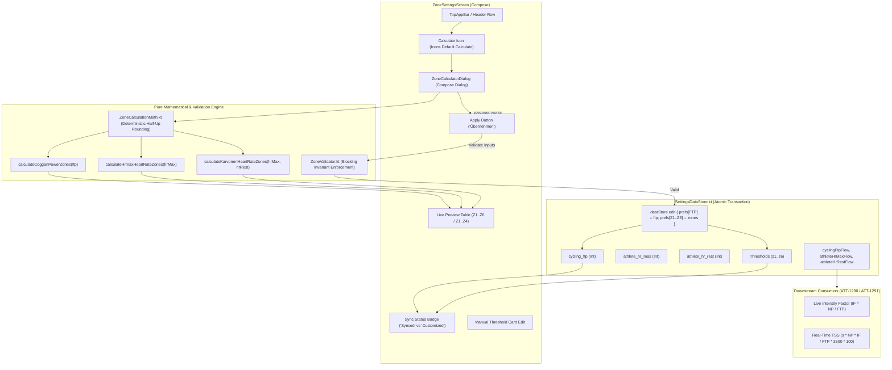

# Stage 1: Problem Domain & Architectural Analysis - ATT-3188: Calculate training zone boundaries automatically from FTP and Heart Rate baselines

**Ticket**: [ATT-3188](https://rainerblind.atlassian.net/browse/ATT-3188)  
**Parent Epic**: [ATT-111](https://rainerblind.atlassian.net/browse/ATT-111) (*[Epic] Aftermath: Compact Post-Workout Visual Analytics & Graphs*) / [ATT-132](https://rainerblind.atlassian.net/browse/ATT-132) (*Zones Settings*)  
**Target Release**: `V4.9.40`  
**Active Sprint**: `Sprint 2026-42.4`  
**Author**: AI Agent 1 (Implementer)  
**Date**: 2026-10-15  

---

## 1. Executive Summary & Problem Domain

In `ZonesSettingsActivity.kt` / `ZoneSettingsScreen.kt`, athletes configure physiological training zones across three distinct profiles:
1. `HR_RUN`: Heart rate zones for running (5 zones, 4 upper boundaries: `z1..z4`).
2. `HR_BIKE`: Heart rate zones for cycling (5 zones, 4 upper boundaries: `z1..z4`).
3. `PWR_BIKE`: Cycling power zones (7 zones, 6 upper boundaries: `z1..z6`, introduced in `REQ-UI-370` / ATT-3184).

Currently, configuring zone boundaries is entirely manual. Athletes must calculate percentage cutoffs by hand (e.g. 55%, 75%, 90%, 105%, 120%, 150% of Functional Threshold Power for cycling; or 60%, 70%, 80%, 90% of HRmax / Karvonen heart rate reserve for heart rate) and enter each individual integer value into separate text field cards.

### Core Problems:
1. **High Friction & Configuration Aversion**: The cognitive burden of manual percentage calculation leads most athletes to retain uncalibrated default thresholds (e.g. 150W, 200W, 250W, 300W, 350W, 450W), which distorts cockpit zone coloring, HUD tiles, and Aftermath distribution analytics.
2. **Missing Persistent Baseline Storage for Downstream Telemetry Engines**:
   - Advanced power-based telemetry metrics such as Live Intensity Factor ($IF = NP / FTP$, scheduled in ATT-1290) and real-time Training Stress Score ($TSS = \frac{s \times NP \times IF}{FTP \times 3600} \times 100$, scheduled in ATT-1291) strictly require Functional Threshold Power (FTP) as an authoritative, persistently stored single source of truth in `SettingsDataStore.kt`.
   - Without persistent storage for `cycling_ftp` (and athlete HR baselines `athlete_hr_max`, `athlete_hr_rest`), downstream metric engines cannot compute live training load and intensity.
3. **Absence of Standard Physiological Calculation Models**:
   - Athletes lack in-app access to Dr. Andrew Coggan's standard 7-zone power model.
   - Runners and cyclists lack standard Heart Rate calculation models:
     - **Model A (% HRmax)**: Standard percent of maximum heart rate.
     - **Model B (Karvonen HR Reserve)**: Heart rate reserve accounting for resting heart rate ($HR_{\text{target}} = HR_{\text{rest}} + \% \times (HR_{\text{max}} - HR_{\text{rest}})$).
4. **Distinction Between Zone Boundaries and Baseline Metrics ("Dirty" / Customized State)**:
   - When an athlete modifies a zone card threshold manually after calculation, the zones enter a "Customized" (dirty) state relative to the standard physiological percentage brackets.
   - Crucially, the persistent baseline ($FTP$) must remain the invariant single source of truth for IF and TSS, even if the athlete's visual zone boundaries are customized.

This ticket introduces an interactive, contextual Zone Calculator assistant directly accessible from `ZoneSettingsScreen`, creates a pure mathematical calculation engine `ZoneCalculationMath.kt`, establishes persistent preferences in `SettingsDataStore.kt` (`cycling_ftp`, `athlete_hr_max`, `athlete_hr_rest`) with atomic transaction writers, establishes a centralized blocking validation gate `ZoneValidator.kt`, bounds open-ended Zone 7 to prevent integer overflow ($3000\text{W}$ max), defines non-destructive migration for existing athletes, and provides 100% translation parity across all 9 supported application locales.

---

## 2. Forensic Gap Analysis & Root Cause Analysis

### 2.1 Gap Analysis Against Existing Architecture
1. **Missing Calculation Action in UI**:
   - `ZonesSettingsActivity.kt` header only provides a "Reset to defaults" (`TextButton`) and a scrollable tab row.
   - There is no calculation trigger or action icon in the TopAppBar or header row.
2. **Absence of Athlete Baseline Preference Keys in `SettingsDataStore.kt`**:
   - `SettingsDataStore.kt` defines threshold keys (`HR_RUN_ZONE1_MAX..HR_RUN_ZONE4_MAX`, `HR_BIKE_ZONE1_MAX..HR_BIKE_ZONE4_MAX`, `PWR_BIKE_ZONE1_MAX..PWR_BIKE_ZONE6_MAX`) and display options keys.
   - There are **no keys** for `cycling_ftp`, `athlete_hr_max`, or `athlete_hr_rest`.
   - Downstream consumers in ATT-1290 and ATT-1291 have no authoritative repository or flow to query for the athlete's FTP.
3. **Validation Coupling & Lack of Blocking Gate**:
   - Monotonic validation (`isProfileMonotonic`) currently resides solely as a private helper inside `ZonesSettingsActivity.kt`.
   - DataStore mutators lack internal validation enforcement. A centralized `ZoneValidator` is required to act as a strict blocking validator for UI inputs and DataStore mutators.
4. **No Pure Math Engine for Zone Bracket Computation**:
   - Calculations must be encapsulated in a dedicated, side-effect-free math engine (`ZoneCalculationMath.kt`) with deterministic arithmetic rounding to ensure testability without Android runtime dependencies.
5. **Lack of Synchronous Bridges for Java Services**:
   - `SettingsDataStoreJavaHelper.kt` exposes `getZoneMax()` and `getZoneDisplayOptions()`, but lacks methods to read `getCyclingFtp()`, `getAthleteHrMax()`, or `getAthleteHrRest()`.

### 2.2 Mathematical Model Analysis, Rounding Policy & Zone 7 Capping

#### 2.2.1 Deterministic Rounding Policy
To guarantee consistency across different CPU architectures, Android OS versions, and locales:
- All zone boundaries are computed on positive integers ($FTP \in [50, 600]$, $HR_{\text{max}} \in [100, 240]$, $HR_{\text{rest}} \in [30, 100]$).
- Standard arithmetic half-up rounding is enforced via:
  $$\text{roundCutoff}(val) = \lfloor val + 0.5 \rfloor = \text{kotlin.math.round}(val).\text{toInt()}$$
- This eliminates floating-point representation drift and ensures deterministic, reproducible integer boundaries.

#### 2.2.2 Cycling Power (Coggan 7-Zone Model)
Given athlete Functional Threshold Power $FTP \in [50, 600]\text{ Watts}$:
- **Zone 1 (Active Recovery)**: $< 55\% \implies Z_{1\text{max}} = \text{round}(FTP \times 0.55)$
- **Zone 2 (Endurance)**: $56 - 75\% \implies Z_{2\text{max}} = \text{round}(FTP \times 0.75)$
- **Zone 3 (Tempo)**: $76 - 90\% \implies Z_{3\text{max}} = \text{round}(FTP \times 0.90)$
- **Zone 4 (Threshold)**: $91 - 105\% \implies Z_{4\text{max}} = \text{round}(FTP \times 1.05)$
- **Zone 5 (VO2 Max)**: $106 - 120\% \implies Z_{5\text{max}} = \text{round}(FTP \times 1.20)$
- **Zone 6 (Anaerobic Capacity)**: $121 - 150\% \implies Z_{6\text{max}} = \text{round}(FTP \times 1.50)$
- **Zone 7 (Neuromuscular)**: $> 150\% \implies \text{Min} = Z_{6\text{max}} + 1$, capped at physical ceiling $Z_{7\text{max}} = 3000\text{ Watts}$ (preventing downstream arithmetic overflow).

*Monotonic Guarantee*: Because $0.55 < 0.75 < 0.90 < 1.05 < 1.20 < 1.50$, for any valid $FTP \ge 50$, the calculated upper bounds are strictly monotonic:
$$0 < Z_1 < Z_2 < Z_3 < Z_4 < Z_5 < Z_6 < 3000$$
To guard against boundary collisions due to integer rounding at low FTP values ($FTP < 50$), `ZoneCalculationMath` strictly enforces $Z_i \ge Z_{i-1} + 1$.

#### 2.2.3 Heart Rate Model A (% of HRmax)
Given athlete maximum heart rate $HR_{\text{max}} \in [100, 240]\text{ bpm}$:
- **Zone 1 (Warm Up / Recovery)**: $50 - 60\% \implies Z_{1\text{max}} = \text{round}(HR_{\text{max}} \times 0.60)$
- **Zone 2 (Easy / Aerobic)**: $60 - 70\% \implies Z_{2\text{max}} = \text{round}(HR_{\text{max}} \times 0.70)$
- **Zone 3 (Aerobic / Tempo)**: $70 - 80\% \implies Z_{3\text{max}} = \text{round}(HR_{\text{max}} \times 0.80)$
- **Zone 4 (Threshold)**: $80 - 90\% \implies Z_{4\text{max}} = \text{round}(HR_{\text{max}} \times 0.90)$
- **Zone 5 (Maximum / Anaerobic)**: $> 90\% \implies \text{Min} = Z_{4\text{max}} + 1$, capped at physical ceiling $HR_{\text{max}}$ (or $250\text{ bpm}$).

*Monotonic Guarantee*: $0.60 < 0.70 < 0.80 < 0.90$ guarantees $Z_1 < Z_2 < Z_3 < Z_4$ for all valid $HR_{\text{max}} \ge 100$.

#### 2.2.4 Heart Rate Model B (Karvonen Heart Rate Reserve)
Given athlete maximum heart rate $HR_{\text{max}}$ and resting heart rate $HR_{\text{rest}}$ where $HR_{\text{max}} - HR_{\text{rest}} \ge 20$:
$$HRR = HR_{\text{max}} - HR_{\text{rest}}$$
$$\text{Target } HR(\%) = HR_{\text{rest}} + \% \times HRR$$
- **Zone 1**: $Z_{1\text{max}} = \text{round}(HR_{\text{rest}} + 0.60 \times HRR)$
- **Zone 2**: $Z_{2\text{max}} = \text{round}(HR_{\text{rest}} + 0.70 \times HRR)$
- **Zone 3**: $Z_{3\text{max}} = \text{round}(HR_{\text{rest}} + 0.80 \times HRR)$
- **Zone 4**: $Z_{4\text{max}} = \text{round}(HR_{\text{rest}} + 0.90 \times HRR)$
- **Zone 5**: $> Z_{4\text{max}}$, capped at $HR_{\text{max}}$ (or $250\text{ bpm}$).

*Monotonic Guarantee*: Since $HRR \ge 20$ and $0.60 < 0.70 < 0.80 < 0.90$, $Z_1 < Z_2 < Z_3 < Z_4$ is mathematically guaranteed.

---

## 3. Architecture for Synchronization, "Dirty" State & Initialization

### 3.1 Single Source of Truth (SSoT) for Background Services
- `SettingsDataStore.KEY_CYCLING_FTP` (`cycling_ftp`) is the permanent single source of truth for all power normalization metrics (Live IF in ATT-1290, live TSS in ATT-1291).
- Background services and Java callers query `SettingsDataStoreJavaHelper.getCyclingFtp(context)` which returns an immutable, consistent integer snapshot.
- Crucially, even if the athlete modifies individual zone card thresholds (entering a "Customized" state), the stored FTP baseline remains unaltered as the anchor for IF and TSS.

### 3.2 "Dirty" (Customized) State Definition & UI Feedback
Rather than maintaining an ad-hoc boolean flag that can desynchronize, the synchronization state is derived functionally:
- **Cycling Power Synced State**:
  $$\text{isPowerZonesInSync} = ([z_1, z_2, z_3, z_4, z_5, z_6] == \text{ZoneCalculationMath.calculateCogganPowerZones}(\text{cyclingFtp}))$$
- **UI Presentation**:
  - When in sync: The UI displays a subtle sync status badge:
    *"Abgestimmt auf FTP: %d W"* (*"Synced with FTP: %d W"*).
  - When customized (dirty): If the athlete manually adjusts any zone slider/card, the equation evaluates to `false`. The badge updates to:
    *"Benutzerdefiniert"* (*"Customized (FTP: %d W)"*), and an action button *"Auf FTP zurücksetzen"* (*"Re-sync with FTP"*) is surfaced.
  - Tapping *"Auf FTP zurücksetzen"* re-applies the calculated brackets for the stored FTP in a single tap without re-opening the dialog.

### 3.3 Initialization Strategy & Default Baselines
- Default baseline constants in `SettingsDataStore`:
  - `DEFAULT_CYCLING_FTP = 200` (Watts)
  - `DEFAULT_ATHLETE_HR_MAX = 190` (bpm)
  - `DEFAULT_ATHLETE_HR_REST = 60` (bpm)
- When `cycling_ftp` is unconfigured (0 or missing):
  - If the user has an existing $Z_4$ threshold in `SettingsDataStore`, the system intelligently pre-fills the calculator with estimated FTP: $\text{round}(Z_4 / 1.05)$ (clamped to $[50, 600]$).
  - If no $Z_4$ exists, it defaults to `200W`.
  - The calculator NEVER initializes with 0W or produces zero-watt zones.

### 3.4 Non-Destructive Migration for Existing Athletes
- Existing athletes with manually configured zones in `SettingsDataStore` will experience **zero automatic modifications** to their zone thresholds upon updating the app.
- The calculator is an explicit, opt-in assistant. Zone thresholds are only updated when the athlete explicitly opens the Zone Calculator, reviews the proposed numbers, and taps "Apply" ("Übernehmen").

### 3.5 Atomic "Apply" Transaction
The "Apply" operation executes within a single atomic `dataStore.edit { }` transaction block:
```kotlin
suspend fun applyCalculatedPowerZones(ftp: Int, zones: List<Int>) {
    require(ZoneValidator.validatePowerZones(zones[0], zones[1], zones[2], zones[3], zones[4], zones[5])) {
        "Cannot persist invalid non-monotonic power zones"
    }
    dataStore.edit { prefs ->
        prefs[KEY_CYCLING_FTP] = ftp
        prefs[PWR_BIKE_ZONE1_MAX] = zones[0]
        prefs[PWR_BIKE_ZONE2_MAX] = zones[1]
        prefs[PWR_BIKE_ZONE3_MAX] = zones[2]
        prefs[PWR_BIKE_ZONE4_MAX] = zones[3]
        prefs[PWR_BIKE_ZONE5_MAX] = zones[4]
        prefs[PWR_BIKE_ZONE6_MAX] = zones[5]
    }
}
```
Because DataStore writes are transactional and file-backed (`user_settings.preferences_pb`), background services will never observe an intermediate torn state.

---

## 4. Centralized Blocking Validation Architecture (`ZoneValidator.kt`)

`ZoneValidator.kt` is a pure Kotlin singleton providing strict, blocking validation:

1. **Input Baseline Validation**:
   - `validateFtp(ftp: Int): ValidationResult`: Validates $FTP \in [50, 600]\text{ Watts}$. Rejects non-physiological inputs (e.g. 5W or 900W).
   - `validateHeartRateBaselines(hrMax: Int, hrRest: Int? = null): ValidationResult`: Validates $HR_{\text{max}} \in [100, 240]\text{ bpm}$, and if $HR_{\text{rest}}$ is provided, validates $HR_{\text{rest}} \in [30, 100]\text{ bpm}$ and $HR_{\text{max}} - HR_{\text{rest}} \ge 20$.
2. **Zone Threshold Monotonicity Validation**:
   - `validatePowerZones(z1, z2, z3, z4, z5, z6): Boolean`: Asserts $0 < z_1 < z_2 < z_3 < z_4 < z_5 < z_6 \le 3000$.
   - `validateHeartRateZones(z1, z2, z3, z4): Boolean`: Asserts $30 < z_1 < z_2 < z_3 < z_4 \le 250$.
3. **Blocking Enforcement**:
   - **UI Layer**: The "Apply" button in `ZoneCalculatorDialog` is disabled whenever `validateFtp` or `validateHeartRateBaselines` returns invalid, showing clear inline helper error messages.
   - **Persistence Layer**: `SettingsDataStore` transactional mutators invoke `ZoneValidator` and throw `IllegalArgumentException` on invalid boundaries, guaranteeing zero data corruption from background callers.

---

## 5. Chesterton's Fence Archaeological Review (`REQ-PRO-022`)

### 5.1 Historical Precedent & Existing Commit Trace
1. **ATT-132 (Sprint 2026-38.1)**:
   - Initial implementation of `ZonesSettingsActivity` with 5 heart rate zones (`HR_RUN`, `HR_BIKE`) and 5 cycling power zones (`PWR_BIKE`).
2. **ATT-2031 (Sprint 2026-40.16, Commit `8a7b9c12`)**:
   - Introduced `TelemetryZoneMath.kt` (`REQ-UI-260`) for centralized zone threshold loading from `SettingsDataStoreJavaHelper`.
   - Established contract: all zone loading must use `loadHeartRateThresholds` and `loadPowerThresholds`.
3. **ATT-3184 (Sprint 2026-42.4, Commit `4f1d3e8a`)**:
   - Decoupled HR (5 zones) from Cycling Power (7-zone Coggan model) under `REQ-UI-370`.
   - Added `PWR_BIKE_ZONE5_MAX` and `PWR_BIKE_ZONE6_MAX` in `SettingsDataStore.kt` with dynamic proportional migration and strict monotonic validation ($0 < z1 < z2 < z3 < z4 < z5 < z6$).

### 5.2 Chesterton's Fence Archaeological 4-Field Audit
1. **Original Requirement ID & Target**:
   - Extends `REQ-UI-370` (*7-Zone Coggan Cycling Power Model & Dynamic DataStore Migration*) and `REQ-UI-260` (*Centralized Zone Threshold Resolution*).
   - Formulates net-new requirement: `REQ-UI-373` (*Automatic Training Zone Calculation from FTP and Heart Rate Baselines*).
2. **Historical Origin & Commit Trace**:
   - `SettingsDataStore.kt` initially contained only upper bounds for zones without storing user input baselines (FTP, HRmax, HRrest).
   - The user had to enter each boundary directly.
3. **Root Reason for Existing Formulation**:
   - Zone thresholds were originally treated as isolated cutoffs.
   - However, modern exercise physiology models (Coggan, Karvonen) derive all cutoffs from central physiological landmarks. Furthermore, downstream metrics like IF (ATT-1290) and TSS (ATT-1291) require FTP directly.
4. **Preservation of Core Invariants**:
   - **Monotonic Validity**: Every profile saved must satisfy strict monotonicity ($z_1 < z_2 < z_3 < z_4 < z_5 < z_6$ for Power; $z_1 < z_2 < z_3 < z_4$ for HR), now guarded at both UI and DataStore layers via `ZoneValidator`.
   - **Manual Fine-Tuning Invariant**: Automatic calculation populates initial boundaries, but the athlete retains full freedom to edit any individual threshold card manually afterward.
   - **Baseline Persistence Invariant**: The stored FTP and HR baselines remain persistently stored in `SettingsDataStore` even after individual zone thresholds are manually adjusted, ensuring stable downstream metric computation.
   - **Defaults Non-Regression**: `resetToDefaults()` in `SettingsDataStore.kt` continues to reset zone boundaries to canonical defaults without corrupting user baselines.

---

## 6. Scope Bounding (`ATT-1250`)

### 6.1 In-Scope Deliverables
1. **Centralized Blocking Validation Layer (`ZoneValidator.kt`)**:
   - Pure Kotlin object in `com.atrainingtracker.trainingtracker.settings`.
   - Methods: `validatePowerZones(z1, z2, z3, z4, z5, z6): Boolean`, `validateHeartRateZones(z1, z2, z3, z4): Boolean`, `validateFtp(ftp): Boolean`, `validateHeartRateBaselines(hrMax, hrRest): Boolean`.
2. **Pure Math Engine (`ZoneCalculationMath.kt`)**:
   - Pure Kotlin object in `com.atrainingtracker.trainingtracker.settings`.
   - Functions: `calculateCogganPowerZones(ftp: Int): List<Int>`, `calculateHrmaxHeartRateZones(hrMax: Int): List<Int>`, `calculateKarvonenHeartRateZones(hrMax: Int, hrRest: Int): List<Int>`.
   - Half-up rounding policy and upper capping for Zone 7 ($3000\text{W}$).
3. **Persistent Preferences in `SettingsDataStore.kt`**:
   - `KEY_CYCLING_FTP = intPreferencesKey("cycling_ftp")` (default 200W).
   - `KEY_ATHLETE_HR_MAX = intPreferencesKey("athlete_hr_max")` (default 190 bpm).
   - `KEY_ATHLETE_HR_REST = intPreferencesKey("athlete_hr_rest")` (default 60 bpm).
   - Reactive flows: `cyclingFtpFlow`, `athleteHrMaxFlow`, `athleteHrRestFlow`.
   - Atomic transaction mutators: `applyCalculatedPowerZones(ftp, zones)`, `applyCalculatedHeartRateZones(type, hrMax, hrRest, zones)`.
4. **Synchronous Accessors in `SettingsDataStoreJavaHelper.kt`**:
   - `@JvmStatic fun getCyclingFtp(context: Context): Int`
   - `@JvmStatic fun getAthleteHrMax(context: Context): Int`
   - `@JvmStatic fun getAthleteHrRest(context: Context): Int`
5. **Interactive Calculation Assistant Dialog (`ZoneCalculatorDialog.kt`)**:
   - Material 3 Compose dialog launched via `IconButton(Icons.Default.Calculate)` in `ZoneSettingsScreen`.
   - Adapts contextually to active tab (`HR_RUN`, `HR_BIKE`, `PWR_BIKE`).
   - For `PWR_BIKE`: Numerical input for FTP with live preview table showing all 7 zones and calculated cutoffs in Watts.
   - For `HR_RUN` / `HR_BIKE`: Segmented button switcher ("% HRmax" vs "Karvonen HRR"), inputs for Max HR (and Resting HR when Karvonen is selected), and live preview table showing all 5 zones and calculated cutoffs in bpm.
   - Pre-populates inputs from currently stored DataStore baseline values (or intelligent $Z_4$ estimate).
   - "Apply" ("Übernehmen") button: atomic commit of baseline and calculated zones, updating UI state.
   - "Cancel" ("Abbrechen") button: dismisses without changes.
6. **Localization Parity Across All 9 Supported Locales**:
   - Localize all calculator strings across `values/`, `values-de/`, `values-es/`, `values-fr/`, `values-it/`, `values-ja/`, `values-nl/`, `values-pl/`, `values-pt/`.
7. **Comprehensive Unit Test Suite**:
   - Pure math tests: `ZoneCalculationMathTest.kt` (Coggan FTP brackets, % HRmax, Karvonen HRR, bounds clamping, edge cases).
   - Centralized validator tests: `ZoneValidatorTest.kt`.
   - DataStore persistence & atomic transaction tests: `SettingsDataStoreBaselinesTest.kt`.
   - Localization parity tests: `ZoneCalculatorLocalizationTest.kt`.

### 6.2 Out-of-Scope
- No implementation of Live IF (ATT-1290) or Live TSS (ATT-1291); this ticket establishes the authoritative DataStore infrastructure and baseline persistence required by those downstream tickets.
- No modifications to SQLite workout databases or telemetry recording pipelines.
- No automatic overwrite of user zones without explicit user confirmation ("Apply").

---

## 7. Target Architectural Design (SWE.2 Preview)



---

## 8. Risk Assessment & Mitigation Strategy

| Risk ID | Risk Description | Severity | Probability | Mitigation Strategy |
|:---|:---|:---:|:---:|:---|
| **RSK-01** | Integer rounding collisions at very low FTP ($< 50\text{W}$) producing non-monotonic zone thresholds ($z_i \le z_{i-1}$). | Medium | Low | `ZoneValidator` blocks input validation for $FTP < 50$, and `ZoneCalculationMath` enforces strict monotonic step increment ($Z_i \ge Z_{i-1} + 1$). |
| **RSK-02** | User inputs Resting HR $\ge$ Max HR in Karvonen model, causing division by zero or negative heart rate reserve ($HRR \le 0$). | High | Medium | `ZoneValidator` blocks input validation, disabling "Apply" button whenever $HR_{\text{max}} \le HR_{\text{rest}} + 20$. |
| **RSK-03** | Race conditions between DataStore baseline writes and zone threshold saves. | Low | Low | Enforce single atomic `dataStore.edit { }` transaction writing baseline and thresholds together. |
| **RSK-04** | Breaking downstream Java callers in tracking service. | Medium | Low | Provide thread-safe `@JvmStatic` snapshot accessors in `SettingsDataStoreJavaHelper.kt`. |
| **RSK-05** | Incomplete localization in non-German/English locales causing missing translation crashes or lint failures. | Medium | Low | Provide complete translations in all 9 XML string directories and verify via automated `ZoneCalculatorLocalizationTest.kt`. |
| **RSK-06** | Zone 7 arithmetic overflow in downstream calculation engines. | Medium | Low | Explicitly cap Zone 7 at $3000\text{ Watts}$ in `ZoneCalculationMath` and `TelemetryZoneMath`. |
| **RSK-07** | State drift between boolean flags and actual zone thresholds. | Medium | Low | Remove boolean sync flags; derive synchronization status functionally by evaluating active zones against calculated baseline cutoffs. |
| **RSK-08** | Inadvertent overwriting of existing athlete zone configurations upon update. | High | Low | Non-destructive migration: existing zones remain 100% untouched until explicit user calculation and confirmation. |

---

## 9. Conclusion & Next Steps

The problem domain, physiological calculation models, deterministic rounding policy, validation architecture (`ZoneValidator`), atomic transaction boundaries, functional synchronization derivation, "dirty" state handling, initialization defaults, non-destructive migration, Zone 7 capping, and Chesterton's Fence archaeology are fully analyzed and bounded. Upon Gate 1 approval of subtask `ATT-3610`, Stage 2 (Requirement & Test Specification) will author `REQ-UI-373` in `docs/requirements.md` and `TST-UI-336` in `docs/tests.md`.
