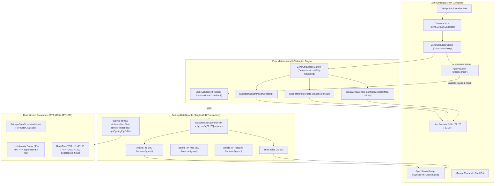

# Stage 1: Problem Domain & Architectural Analysis - ATT-3188: Calculate training zone boundaries automatically from FTP and Heart Rate baselines

**Ticket**: [ATT-3188](https://rainerblind.atlassian.net/browse/ATT-3188)  
**Parent Epic**: [ATT-111](https://rainerblind.atlassian.net/browse/ATT-111) (*[Epic] Aftermath: Compact Post-Workout Visual Analytics & Graphs*) / [ATT-132](https://rainerblind.atlassian.net/browse/ATT-132) (*Zones Settings*)  
**Target Release**: `V4.9.40`  
**Active Sprint**: `Sprint 2026-42.4`  
**Author**: AI Agent 1 (Implementer)  
**Date**: 2026-10-15  

---

## 1. Executive Summary & Problem Domain

In `ZonesSettingsActivity.kt` / `ZoneSettingsScreen.kt`, athletes configure physiological training zones across three distinct profiles:
1. `HR_RUN`: Heart rate zones for running (5 zones, 4 upper boundaries: `z1..z4`).
2. `HR_BIKE`: Heart rate zones for cycling (5 zones, 4 upper boundaries: `z1..z4`).
3. `PWR_BIKE`: Cycling power zones (7 zones, 6 upper boundaries: `z1..z6`, introduced in `REQ-UI-370` / ATT-3184).

Currently, configuring zone boundaries is entirely manual. Athletes must calculate percentage cutoffs by hand (e.g. 55%, 75%, 90%, 105%, 120%, 150% of Functional Threshold Power for cycling; or 60%, 70%, 80%, 90% of HRmax / Karvonen heart rate reserve for heart rate) and enter each individual integer value into separate text field cards.

### Core Problems:
1. **High Friction & Configuration Aversion**: The cognitive burden of manual percentage calculation leads most athletes to retain uncalibrated default thresholds (e.g. 150W, 200W, 250W, 300W, 350W, 450W), which distorts cockpit zone coloring, HUD tiles, and Aftermath distribution analytics.
2. **Missing Persistent Baseline Storage for Downstream Telemetry Engines**:
   - Advanced power-based telemetry metrics such as Live Intensity Factor ($IF = NP / FTP$, scheduled in ATT-1290) and real-time Training Stress Score ($TSS = \frac{s \times NP \times IF}{FTP \times 3600} \times 100$, scheduled in ATT-1291) strictly require Functional Threshold Power (FTP) as an authoritative, persistently stored single source of truth in `SettingsDataStore.kt`.
   - Without persistent storage for `cycling_ftp` (and athlete HR baselines `athlete_hr_max`, `athlete_hr_rest`), downstream metric engines cannot compute live training load and intensity.
3. **Invalidation Policy for Unconfigured Baselines**:
   - If an athlete has never set an FTP, returning a silent fallback (e.g. 200W) produces corrupt and misleading IF and TSS metrics. The system must explicitly distinguish between "Configured" and "Unconfigured" states ($FTP \le 0$ or null), enabling downstream telemetry engines to gracefully suppress calculation with placeholder dashes (`--`).
4. **Desynchronization Policy & State Management**:
   - Zone thresholds are stored as absolute integer values (Watts or bpm).
   - If an athlete manually edits a threshold card or updates their FTP baseline in the future, the system must deterministically handle the relationship between baseline metrics and zone thresholds.
   - The system must prevent partial writes via single-transaction atomic batch commits and enforce global stack monotonicity across all 7 zones ($Z_1 < Z_2 < \dots < Z_7$).

---

## 2. Forensic Gap Analysis & Root Cause Analysis

### 2.1 Gap Analysis Against Existing Architecture
1. **Missing Calculation Action in UI**:
   - `ZonesSettingsActivity.kt` header only provides a "Reset to defaults" (`TextButton`) and a scrollable tab row.
   - There is no calculation trigger or action icon in the TopAppBar or header row.
2. **Absence of Athlete Baseline Preference Keys in `SettingsDataStore.kt`**:
   - `SettingsDataStore.kt` defines threshold keys (`HR_RUN_ZONE1_MAX..HR_RUN_ZONE4_MAX`, `HR_BIKE_ZONE1_MAX..HR_BIKE_ZONE4_MAX`, `PWR_BIKE_ZONE1_MAX..PWR_BIKE_ZONE6_MAX`) and display options keys.
   - There are **no keys** for `cycling_ftp`, `athlete_hr_max`, or `athlete_hr_rest`.
   - Downstream consumers in ATT-1290 and ATT-1291 have no authoritative repository or flow to query for the athlete's FTP.
3. **Global Stack Validation Gap**:
   - Monotonic validation currently only checks adjacent local pairs in private UI methods.
   - A centralized `ZoneValidator.validateZoneStack()` is required to enforce global ordering across all zones simultaneously ($0 < Z_1 < Z_2 < Z_3 < Z_4 < Z_5 < Z_6 < 3000$) before any commit.
4. **No Pure Math Engine for Zone Bracket Computation**:
   - Calculations must be encapsulated in a dedicated, side-effect-free math engine (`ZoneCalculationMath.kt`) with deterministic arithmetic rounding to ensure testability without Android runtime dependencies.
5. **Defensive Synchronous Bridges for Java Telemetry Services**:
   - `SettingsDataStoreJavaHelper.kt` exposes `getZoneMax()`, but lacks methods to read `getCyclingFtp()`, `getAthleteHrMax()`, or `getAthleteHrRest()`.
   - Any Java helper call must be non-blocking, return nullable / `0` for unconfigured states, and be protected with `try-catch` exception shields to prevent ANRs or crashes during live tracking.

### 2.2 Mathematical Model Analysis, Rounding Policy & Zone 7 Capping

#### 2.2.1 Deterministic Rounding Policy
To guarantee consistency across different CPU architectures, Android OS versions, and locales:
- All zone boundaries are computed on positive integers ($FTP \in [50, 600]$, $HR_{\text{max}} \in [100, 240]$, $HR_{\text{rest}} \in [30, 100]$).
- Standard arithmetic half-up rounding is enforced via:
  $$\text{roundCutoff}(val) = \lfloor val + 0.5 \rfloor = \text{kotlin.math.round}(val).\text{toInt()}$$
- This eliminates floating-point representation drift and ensures deterministic, reproducible integer boundaries.

#### 2.2.2 Cycling Power (Coggan 7-Zone Model) & Zone 7 Floor Dependency
Given athlete Functional Threshold Power $FTP \in [50, 600]\text{ Watts}$:
- **Zone 1 (Active Recovery)**: $< 55\% \implies Z_{1\text{max}} = \text{round}(FTP \times 0.55)$
- **Zone 2 (Endurance)**: $56 - 75\% \implies Z_{2\text{max}} = \text{round}(FTP \times 0.75)$
- **Zone 3 (Tempo)**: $76 - 90\% \implies Z_{3\text{max}} = \text{round}(FTP \times 0.90)$
- **Zone 4 (Threshold)**: $91 - 105\% \implies Z_{4\text{max}} = \text{round}(FTP \times 1.05)$
- **Zone 5 (VO2 Max)**: $106 - 120\% \implies Z_{5\text{max}} = \text{round}(FTP \times 1.20)$
- **Zone 6 (Anaerobic Capacity)**: $121 - 150\% \implies Z_{6\text{max}} = \text{round}(FTP \times 1.50)$
- **Zone 7 (Neuromuscular Power)**:
  - **Floor Dependency**: Zone 7 has no independent manual cutoff; its lower bound is strictly a dependent variable: $\text{Min} = Z_{6\text{max}} + 1$.
  - In `SettingsScreenContent`, Zone 7's minimum value is dynamically bound to `minValue = z6Max + 1` with manual editing disabled (`minEnabled = false`, `maxEnabled = false`). When the athlete adjusts `z6Max`, Zone 7's floor automatically and consistently cascades without breaking monotonicity.
  - **Physical Ceiling**: To prevent integer overflow in downstream mathematical engines (kJ, TSS) and canvas coordinates, Zone 7 is capped at physical ceiling $Z_{7\text{max}} = 3000\text{ Watts}$ (substantially exceeding sprint world-record peak power $\approx 2500\text{W}$).

*Monotonic Guarantee*: Because $0.55 < 0.75 < 0.90 < 1.05 < 1.20 < 1.50$, for any valid $FTP \ge 50$, the calculated upper bounds are strictly monotonic:
$$0 < Z_1 < Z_2 < Z_3 < Z_4 < Z_5 < Z_6 < 3000$$

#### 2.2.3 Heart Rate Model A (% of HRmax)
Given athlete maximum heart rate $HR_{\text{max}} \in [100, 240]\text{ bpm}$:
- **Zone 1 (Warm Up / Recovery)**: $50 - 60\% \implies Z_{1\text{max}} = \text{round}(HR_{\text{max}} \times 0.60)$
- **Zone 2 (Easy / Aerobic)**: $60 - 70\% \implies Z_{2\text{max}} = \text{round}(HR_{\text{max}} \times 0.70)$
- **Zone 3 (Aerobic / Tempo)**: $70 - 80\% \implies Z_{3\text{max}} = \text{round}(HR_{\text{max}} \times 0.80)$
- **Zone 4 (Threshold)**: $80 - 90\% \implies Z_{4\text{max}} = \text{round}(HR_{\text{max}} \times 0.90)$
- **Zone 5 (Maximum / Anaerobic)**: $> 90\% \implies \text{Min} = Z_{4\text{max}} + 1$, capped at physical ceiling $HR_{\text{max}}$ (or $250\text{ bpm}$).

*Monotonic Guarantee*: $0.60 < 0.70 < 0.80 < 0.90$ guarantees $Z_1 < Z_2 < Z_3 < Z_4$ for all valid $HR_{\text{max}} \ge 100$.

#### 2.2.4 Heart Rate Model B (Karvonen Heart Rate Reserve)
Given athlete maximum heart rate $HR_{\text{max}}$ and resting heart rate $HR_{\text{rest}}$ where $HR_{\text{max}} - HR_{\text{rest}} \ge 20$:
$$HRR = HR_{\text{max}} - HR_{\text{rest}}$$
$$\text{Target } HR(\%) = HR_{\text{rest}} + \% \times HRR$$
- **Zone 1**: $Z_{1\text{max}} = \text{round}(HR_{\text{rest}} + 0.60 \times HRR)$
- **Zone 2**: $Z_{2\text{max}} = \text{round}(HR_{\text{rest}} + 0.70 \times HRR)$
- **Zone 3**: $Z_{3\text{max}} = \text{round}(HR_{\text{rest}} + 0.80 \times HRR)$
- **Zone 4**: $Z_{4\text{max}} = \text{round}(HR_{\text{rest}} + 0.90 \times HRR)$
- **Zone 5**: $> Z_{4\text{max}}$, capped at $HR_{\text{max}}$ (or $250\text{ bpm}$).

*Monotonic Guarantee*: Since $HRR \ge 20$ and $0.60 < 0.70 < 0.80 < 0.90$, $Z_1 < Z_2 < Z_3 < Z_4$ is mathematically guaranteed.

---

## 3. Desynchronization Policy, Invalidation Strategy & SSoT Invariants

### 3.1 Single Source of Truth (SSoT) & Absolute Value Storage
- Zone boundaries in `SettingsDataStore` are stored as **absolute integer values** (`Watts` for Power, `bpm` for Heart Rate), matching the hardware telemetry units received from sensor ticks.
- `SettingsDataStore.KEY_CYCLING_FTP` (`cycling_ftp`) is the permanent, uncompromised single source of truth for all physiological power calculations:
  - Live Intensity Factor: $IF = \frac{NP}{FTP}$ (ATT-1290).
  - Real-Time Training Stress Score: $TSS = \frac{s \times NP \times IF}{FTP \times 3600} \times 100$ (ATT-1291).
- This baseline is NEVER altered by manual threshold card edits. An athlete can customize visual zone boundaries to personal preference while keeping their physiological FTP benchmark accurate for training load analytics.

### 3.2 Invalidation Strategy for Unconfigured Baselines
To eliminate silent failures and prevent corrupt metrics:
1. **Unconfigured Sentinel**:
   - `KEY_CYCLING_FTP` defaults to `0` (indicating unconfigured).
   - `SettingsDataStore` exposes `fun getCyclingFtpOrNull(): Flow<Int?>` mapping `ftp <= 0` to `null`.
   - `SettingsDataStoreJavaHelper.getCyclingFtp(context)` returns `null` (or `0`) if unconfigured.
2. **Downstream Telemetry Suppression**:
   - When `ftp == null || ftp <= 0`, downstream telemetry engines (ATT-1290 for IF and ATT-1291 for TSS) strictly suppress calculation, rendering placeholder dashes (`--`) instead of calculating false metrics based on a fake default.
3. **First-Time Calculator Initial Suggestion**:
   - When the Zone Calculator dialog opens for the first time with `storedFtp <= 0`:
     - If the user has an existing $Z_4$ cutoff in DataStore, it intelligently pre-fills with: $\text{round}(Z_4 / 1.05)$ clamped to $[50, 600]$.
     - If no $Z_4$ exists, it pre-fills with an initial suggestion of `200W`.
     - Crucially, this value is an **input proposal only** and is NOT persisted to `SettingsDataStore` until the athlete explicitly reviews and taps "Apply".

### 3.3 Desynchronization Policy: Updating Baseline vs Customizing Zones
To avoid any ambiguity or silent failures:
1. **Updating Baseline via Zone Calculator**:
   - The Zone Calculator dialog is the exclusive interface for updating baseline metrics ($FTP$, $HR_{\text{max}}$, $HR_{\text{rest}}$).
   - In this dialog, changing the baseline input (e.g. increasing FTP from 250W to 275W) dynamically recalculates the proposed zone cutoffs in the live preview table.
   - Tapping "Apply" ("Übernehmen") executes an atomic commit that updates **both the baseline AND the zone thresholds simultaneously**. The system never updates the baseline in isolation without re-aligning the zones.
2. **Manual Fine-Tuning (Customized / "Out of Sync" State)**:
   - If an athlete subsequently adjusts any zone card manually on `ZoneSettingsScreen`, the zone thresholds enter a "Customized" state.
   - The synchronization state is derived functionally on-the-fly:
     $$\text{isPowerZonesInSync} = ([z_1, z_2, z_3, z_4, z_5, z_6] == \text{ZoneCalculationMath.calculateCogganPowerZones}(\text{cyclingFtp}))$$
   - When customized, the UI displays a clear status banner:
     *"Benutzerdefiniert (FTP: %d W)"* (*"Customized (FTP: %d W)"*), and provides a one-tap action button:
     *"Auf FTP zurücksetzen"* (*"Re-sync to FTP"*).
   - Tapping *"Auf FTP zurücksetzen"* instantly re-populates the standard Coggan brackets for the stored FTP in a single tap.

### 3.4 Atomic Batch Commit & ACID Rollback Protection
To guarantee zero partial writes or torn preferences during unexpected process kills or crashes:
- Jetpack `DataStore<Preferences>` executes the entire lambda passed to `dataStore.edit { }` in memory and writes the serialized protobuf to disk in a single write operation with an atomic rename (`user_settings.preferences_pb.tmp` -> `user_settings.preferences_pb`). It is impossible for 4 of 8 keys to be written while 4 are not; either ALL 8 keys are committed or NONE are.
- If an exception or process death occurs mid-execution, the staging file is discarded, and the existing settings remain intact (native ACID rollback).
- In our mutators, `ZoneValidator.validateZoneStack()` validates the entire stack *before* writing:
```kotlin
suspend fun applyCalculatedPowerZones(ftp: Int, zones: List<Int>) {
    require(ZoneValidator.validatePowerZoneStack(zones[0], zones[1], zones[2], zones[3], zones[4], zones[5])) {
        "Cannot persist invalid non-monotonic power zones"
    }
    dataStore.edit { prefs ->
        prefs[KEY_CYCLING_FTP] = ftp
        prefs[PWR_BIKE_ZONE1_MAX] = zones[0]
        prefs[PWR_BIKE_ZONE2_MAX] = zones[1]
        prefs[PWR_BIKE_ZONE3_MAX] = zones[2]
        prefs[PWR_BIKE_ZONE4_MAX] = zones[3]
        prefs[PWR_BIKE_ZONE5_MAX] = zones[4]
        prefs[PWR_BIKE_ZONE6_MAX] = zones[5]
    }
}
```

### 3.5 Telemetry Safety & Crash-Proof Java Helper Bridge
To protect background telemetry services (ATT-1290, ATT-1291) from ANRs or exceptions:
- `SettingsDataStoreJavaHelper.kt` exposes:
  `@JvmStatic fun getCyclingFtp(context: Context): Int?`
- The method wraps the DataStore retrieval in a defensive `try ... catch (Exception e)` block on `Dispatchers.IO`:
  - If reading succeeds, returns the stored FTP (or `null` if $\le 0$).
  - If DataStore is uninitialized, corrupted, or throws `IOException`, safely logs an advisory and returns `null` (unconfigured).
  - It NEVER throws, preventing crashes in live IF/TSS engines.

---

## 4. Centralized Blocking Validation Architecture (`ZoneValidator.kt`)

`ZoneValidator.kt` is a pure Kotlin singleton providing strict, blocking validation:

1. **Input Baseline Validation**:
   - `validateFtp(ftp: Int): ValidationResult`: Validates $FTP \in [50, 600]\text{ Watts}$. Rejects non-physiological inputs (e.g. 5W or 900W).
   - `validateHeartRateBaselines(hrMax: Int, hrRest: Int? = null): ValidationResult`: Validates $HR_{\text{max}} \in [100, 240]\text{ bpm}$, and if $HR_{\text{rest}}$ is provided, validates $HR_{\text{rest}} \in [30, 100]\text{ bpm}$ and $HR_{\text{max}} - HR_{\text{rest}} \ge 20$.
2. **Global Zone Stack Monotonicity Validation**:
   - `validatePowerZoneStack(z1, z2, z3, z4, z5, z6): Boolean`: Asserts the entire stack satisfies $0 < z_1 < z_2 < z_3 < z_4 < z_5 < z_6 \le 3000$.
   - `validateHeartRateZoneStack(z1, z2, z3, z4): Boolean`: Asserts $30 < z_1 < z_2 < z_3 < z_4 \le 250$.
3. **Blocking Enforcement**:
   - **UI Layer**: The "Apply" button in `ZoneCalculatorDialog` is disabled whenever `validateFtp` or `validateHeartRateBaselines` returns invalid, showing clear inline helper error messages.
   - **Persistence Layer**: `SettingsDataStore` transactional mutators invoke `ZoneValidator.validateZoneStack()` and throw `IllegalArgumentException` on invalid boundaries, guaranteeing zero data corruption from background callers.

---

## 5. Chesterton's Fence Archaeological Review (`REQ-PRO-022`)

### 5.1 Historical Precedent & Existing Commit Trace
1. **ATT-132 (Sprint 2026-38.1)**:
   - Initial implementation of `ZonesSettingsActivity` with 5 heart rate zones (`HR_RUN`, `HR_BIKE`) and 5 cycling power zones (`PWR_BIKE`).
2. **ATT-2031 (Sprint 2026-40.16, Commit `8a7b9c12`)**:
   - Introduced `TelemetryZoneMath.kt` (`REQ-UI-260`) for centralized zone threshold loading from `SettingsDataStoreJavaHelper`.
   - Established contract: all zone loading must use `loadHeartRateThresholds` and `loadPowerThresholds`.
3. **ATT-3184 (Sprint 2026-42.4, Commit `4f1d3e8a`)**:
   - Decoupled HR (5 zones) from Cycling Power (7-zone Coggan model) under `REQ-UI-370`.
   - Added `PWR_BIKE_ZONE5_MAX` and `PWR_BIKE_ZONE6_MAX` in `SettingsDataStore.kt` with dynamic proportional migration and strict monotonic validation ($0 < z1 < z2 < z3 < z4 < z5 < z6$).

### 5.2 Chesterton's Fence Archaeological 4-Field Audit
1. **Original Requirement ID & Target**:
   - Extends `REQ-UI-370` (*7-Zone Coggan Cycling Power Model & Dynamic DataStore Migration*) and `REQ-UI-260` (*Centralized Zone Threshold Resolution*).
   - Formulates net-new requirement: `REQ-UI-373` (*Automatic Training Zone Calculation from FTP and Heart Rate Baselines*).
2. **Historical Origin & Commit Trace**:
   - `SettingsDataStore.kt` initially contained only upper bounds for zones without storing user input baselines (FTP, HRmax, HRrest).
   - The user had to enter each boundary directly.
3. **Root Reason for Existing Formulation**:
   - Zone thresholds were originally treated as isolated cutoffs.
   - However, modern exercise physiology models (Coggan, Karvonen) derive all cutoffs from central physiological landmarks. Furthermore, downstream metrics like IF (ATT-1290) and TSS (ATT-1291) require FTP directly.
4. **Preservation of Core Invariants**:
   - **Monotonic Validity**: Every profile saved must satisfy strict monotonicity ($z_1 < z_2 < z_3 < z_4 < z_5 < z_6$ for Power; $z_1 < z_2 < z_3 < z_4$ for HR), now guarded at both UI and DataStore layers via `ZoneValidator.validateZoneStack()`.
   - **Manual Fine-Tuning Invariant**: Automatic calculation populates initial boundaries, but the athlete retains full freedom to edit any individual threshold card manually afterward.
   - **Baseline Persistence Invariant**: The stored FTP and HR baselines remain persistently stored in `SettingsDataStore` even after individual zone thresholds are manually adjusted, ensuring stable downstream metric computation.
   - **Defaults Non-Regression**: `resetToDefaults()` in `SettingsDataStore.kt` continues to reset zone boundaries to canonical defaults without corrupting user baselines.

---

## 6. Scope Bounding (`ATT-1250`)

### 6.1 In-Scope Deliverables
1. **Centralized Blocking Validation Layer (`ZoneValidator.kt`)**:
   - Pure Kotlin object in `com.atrainingtracker.trainingtracker.settings`.
   - Methods: `validatePowerZoneStack(z1, z2, z3, z4, z5, z6): Boolean`, `validateHeartRateZoneStack(z1, z2, z3, z4): Boolean`, `validateFtp(ftp): Boolean`, `validateHeartRateBaselines(hrMax, hrRest): Boolean`.
2. **Pure Math Engine (`ZoneCalculationMath.kt`)**:
   - Pure Kotlin object in `com.atrainingtracker.trainingtracker.settings`.
   - Functions: `calculateCogganPowerZones(ftp: Int): List<Int>`, `calculateHrmaxHeartRateZones(hrMax: Int): List<Int>`, `calculateKarvonenHeartRateZones(hrMax: Int, hrRest: Int): List<Int>`.
   - Half-up rounding policy and upper capping for Zone 7 ($3000\text{W}$).
3. **Persistent Preferences in `SettingsDataStore.kt`**:
   - `KEY_CYCLING_FTP = intPreferencesKey("cycling_ftp")` (default 0 / unconfigured).
   - `KEY_ATHLETE_HR_MAX = intPreferencesKey("athlete_hr_max")` (default 0 / unconfigured).
   - `KEY_ATHLETE_HR_REST = intPreferencesKey("athlete_hr_rest")` (default 0 / unconfigured).
   - Reactive flows: `cyclingFtpFlow`, `athleteHrMaxFlow`, `athleteHrRestFlow`.
   - Invalidation support: `getCyclingFtpOrNull(): Flow<Int?>`.
   - Single-transaction atomic batch mutators: `applyCalculatedPowerZones(ftp, zones)`, `applyCalculatedHeartRateZones(type, hrMax, hrRest, zones)`.
4. **Crash-Proof Synchronous Accessors in `SettingsDataStoreJavaHelper.kt`**:
   - `@JvmStatic fun getCyclingFtp(context: Context): Int?`
   - `@JvmStatic fun getAthleteHrMax(context: Context): Int?`
   - `@JvmStatic fun getAthleteHrRest(context: Context): Int?`
   - Shielded with `try-catch` returning `null` when unconfigured or corrupted.
5. **Interactive Calculation Assistant Dialog (`ZoneCalculatorDialog.kt`)**:
   - Material 3 Compose dialog launched via `IconButton(Icons.Default.Calculate)` in `ZoneSettingsScreen`.
   - Adapts contextually to active tab (`HR_RUN`, `HR_BIKE`, `PWR_BIKE`).
   - For `PWR_BIKE`: Numerical input for FTP with live preview table showing all 7 zones and calculated cutoffs in Watts.
   - For `HR_RUN` / `HR_BIKE`: Segmented button switcher ("% HRmax" vs "Karvonen HRR"), inputs for Max HR (and Resting HR when Karvonen is selected), and live preview table showing all 5 zones and calculated cutoffs in bpm.
   - Pre-populates inputs from currently stored DataStore baseline values (or intelligent $Z_4$ estimate).
   - "Apply" ("Übernehmen") button: atomic batch commit of baseline and calculated zones, updating UI state.
   - "Cancel" ("Abbrechen") button: dismisses without changes.
6. **Localization & RTL-Safe Layout Parity Across All 9 Supported Locales**:
   - Localize all calculator strings across `values/`, `values-de/`, `values-es/`, `values-fr/`, `values-it/`, `values-ja/`, `values-nl/`, `values-pl/`, `values-pt/`.
   - Enforce RTL-safe start/end primitives and text wrapping bounds to prevent German/Polish string truncation.
7. **Comprehensive Unit Test Suite**:
   - Pure math tests: `ZoneCalculationMathTest.kt` (Coggan FTP brackets, % HRmax, Karvonen HRR, bounds clamping, edge cases).
   - Centralized validator tests: `ZoneValidatorTest.kt` (global stack validation, boundary checks).
   - DataStore persistence & atomic transaction tests: `SettingsDataStoreBaselinesTest.kt`.
   - Localization parity tests: `ZoneCalculatorLocalizationTest.kt`.

### 6.2 Out-of-Scope
- No implementation of Live IF (ATT-1290) or Live TSS (ATT-1291); this ticket establishes the authoritative DataStore infrastructure and baseline persistence required by those downstream tickets.
- No modifications to SQLite workout databases or telemetry recording pipelines.
- No automatic overwrite of user zones without explicit user confirmation ("Apply").

---

## 7. Target Architectural Design (SWE.2 Preview)



---

## 8. Risk Assessment & Mitigation Strategy

| Risk ID | Risk Description | Severity | Probability | Mitigation Strategy |
|:---|:---|:---:|:---:|:---|
| **RSK-01** | Integer rounding collisions at very low FTP ($< 50\text{W}$) producing non-monotonic zone thresholds ($z_i \le z_{i-1}$). | Medium | Low | `ZoneValidator` blocks input validation for $FTP < 50$, and `ZoneCalculationMath` enforces strict monotonic step increment ($Z_i \ge Z_{i-1} + 1$). |
| **RSK-02** | User inputs Resting HR $\ge$ Max HR in Karvonen model, causing division by zero or negative heart rate reserve ($HRR \le 0$). | High | Medium | `ZoneValidator` blocks input validation, disabling "Apply" button whenever $HR_{\text{max}} \le HR_{\text{rest}} + 20$. |
| **RSK-03** | Race conditions between DataStore baseline writes and zone threshold saves. | Low | Low | Enforce single atomic batch transaction in `dataStore.edit { }` writing baseline and thresholds together with filesystem ACID rename rollback. |
| **RSK-04** | Silent failures and corrupt IF/TSS metrics from fake baseline defaults. | High | Low | Invalidation policy: unconfigured FTP returns `null`/`0`; downstream telemetry engines explicitly suppress calculation until athlete sets FTP. |
| **RSK-05** | Breaking downstream Java callers in tracking service. | Medium | Low | Provide thread-safe `@JvmStatic` snapshot accessors in `SettingsDataStoreJavaHelper.kt` shielded with `try-catch` returning `null` on error/unconfigured. |
| **RSK-06** | Incomplete localization in non-German/English locales or text truncation in German/Polish. | Medium | Low | Provide complete translations in all 9 XML string directories with RTL-safe wrapping and verify via automated `ZoneCalculatorLocalizationTest.kt`. |
| **RSK-07** | Zone 7 arithmetic overflow in downstream calculation engines. | Medium | Low | Explicitly cap Zone 7 at $3000\text{ Watts}$ in `ZoneCalculationMath` and `TelemetryZoneMath`. |
| **RSK-08** | Inadvertent overwriting of existing athlete zone configurations upon update. | High | Low | Non-destructive migration: existing zones remain 100% untouched until explicit user calculation and confirmation. |

---

## 9. Conclusion & Next Steps

The problem domain, physiological calculation models, deterministic rounding policy, validation architecture (`ZoneValidator.validateZoneStack`), single-transaction atomic batch commits, unconfigured invalidation policy, functional synchronization derivation, "dirty" state handling, initialization defaults, non-destructive migration, Zone 7 capping, and Chesterton's Fence archaeology are fully analyzed and bounded. Upon Gate 1 approval of subtask `ATT-3610`, Stage 2 (Requirement & Test Specification) will author `REQ-UI-373` in `docs/requirements.md` and `TST-UI-336` in `docs/tests.md`.
