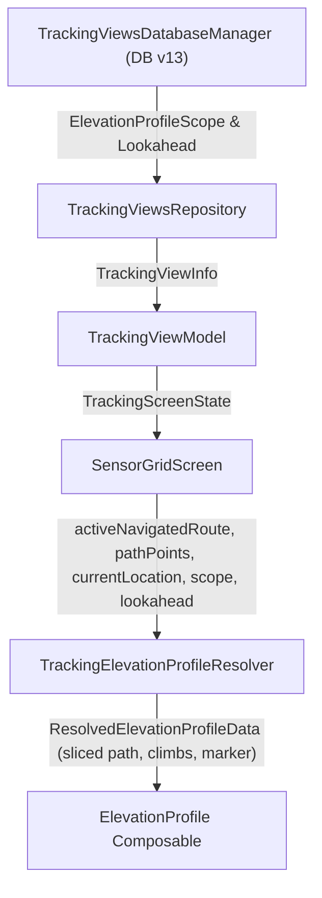

# Stage 1: Problem Domain & Root Cause Analysis - ATT-3317: Configure route elevation profile window scope and rolling lookahead distance individually per tracking tab

**Ticket**: [ATT-3317](https://rainerblind.atlassian.net/browse/ATT-3317)  
**Sub-task**: [ATT-3384](https://rainerblind.atlassian.net/browse/ATT-3384) (`[Analysis]`)  
**Parent Epic**: [ATT-2564](https://rainerblind.atlassian.net/browse/ATT-2564) (*Navigation: Turn-by-Turn Guidance & Cockpit Prompts*)  
**Target Release**: `Sprint 2026-42.1`  
**Active Sprint**: `Sprint 2026-42.1`  
**Requirement Mapping**: `REQ-UI-355` (amending & extending with Clause 5)  
**Test Mapping**: `TST-UI-315` (extending test specification)  
**Branch**: `feature/ATT-3317`  
**Author**: AI Agent 1 (Problem Domain & Root Cause Analyst)  
**Date**: 2026-10-13  

---

## 1. Problem Statement & Motivation

During Sprint 2026-41.10 Joint Review of `ATT-3199` (*Active Route Full Elevation Profile with Map-Matched Position Marker and Categorized Climbs During Tracking*), the athlete approved the initial implementation but identified an important usability limitation on longer routes (e.g. 50–150 km):
- **Horizontal Compression of Immediate Terrain**: When rendering an entire 80 km or 120 km route profile in the tracking cockpit, upcoming climbs and immediate elevation changes become compressed into thin vertical spikes. A 500 m hill with 8% gradient appears as a barely distinguishable blip on a 100 km horizontal axis.
- **Vertical Compression by Global Route Extrema**: If a 100 km course contains a single 1,500 m mountain pass at km 80, the vertical range of the entire profile is forced to 0..1500 m. As a consequence, 30–50 m rolling hills in the first 40 km are squashed into virtually flat lines.
- **Different Tab Use Cases**: Athletes configure different tabs for different stages or perspectives of their workout. On a dedicated Map tab, an athlete often wants a bird's-eye view of the full route to pace the entire ride. On a live Cockpit/Telemetry tab, however, the athlete needs high-resolution forward visibility of immediate upcoming gradients, summits, and descents within the next 1–5 km.

**Value Proposition**:
Enable athletes to configure the elevation profile's visible scope individually for each tracking tab:
1. **Full Route (`FULL_ROUTE`)**: The established macro view displaying the complete route from 0 km to destination.
2. **Rolling Window (`ROLLING_WINDOW`)**: A focused micro window centered on the athlete's current position with selectable lookahead distances (500 m, 1 km, 2 km [default], 5 km, 10 km). The athlete indicator is positioned at 15% from the left edge of the visible window to maximize forward terrain lookahead while maintaining immediate context of what was just climbed.

---

## 2. Forensic Investigation & Architectural Gap Analysis

### 2.1 Current Resolution Logic in `TrackingElevationProfileResolver.kt`
Currently, `TrackingElevationProfileResolver.kt` implements a binary decision:
```kotlin
object TrackingElevationProfileResolver {
    fun resolve(
        activeNavigatedRoute: MapRoute?,
        recordedPathPoints: List<PathPoint>,
        currentLocation: LatLng?
    ): ResolvedElevationProfileData {
        if (activeNavigatedRoute != null &&
            activeNavigatedRoute.path.size >= 2 &&
            activeNavigatedRoute.path.any { it.altitude != 0.0 }
        ) {
            val alongTrackDist = currentLocation?.let { loc ->
                PolylineProgressTracker.projectLocation(activeNavigatedRoute.path, loc)?.alongTrackDistance
            } ?: 0.0
            return ResolvedElevationProfileData(
                pathPoints = activeNavigatedRoute.path,
                climbs = activeNavigatedRoute.climbs,
                markerDistance = alongTrackDist,
                isRouteElevation = true
            )
        }
        ...
    }
}
```
**Architectural Gaps**:
1. `TrackingElevationProfileResolver` always returns the entire `activeNavigatedRoute.path` (from 0 to total distance) and all `activeNavigatedRoute.climbs`. It has no concept of viewport slicing or rolling lookahead windows.
2. It lacks parameters for `scope: ElevationProfileScope` and `lookaheadDistanceMeters: Int`.

### 2.2 Database & Tab Persistence in `TrackingViewsDatabaseManager.java`
Currently, tracking tabs are stored in `VIEWS_TABLE` (DB version 12):
```java
public static final String SHOW_MAP = "ShowMap";
public static final String SHOW_LAP_BUTTON = "ShowLapButton";
public static final String SHOW_LIVE_SEGMENTS = "ShowLiveSegments";
public static final String SHOW_ELEVATION_PROFILE = "ShowElevationProfile";
public static final String SHOW_LIVE_CLIMBS = "ShowLiveClimbs";
public static final String SHOW_NAVIGATION_HINTS = "ShowNavigationHints";
```
**Architectural Gaps**:
1. `VIEWS_TABLE` does not store per-tab elevation profile scope or lookahead settings.
2. `TrackingViewInfo` in `TrackingViewsRepository.kt` does not carry scope or lookahead attributes.
3. Database version needs to increment to `DB_VERSION = 13` with schema migration:
   - `ELEVATION_PROFILE_SCOPE`: `int DEFAULT 0` (0 = `FULL_ROUTE`, 1 = `ROLLING_WINDOW`).
   - `ELEVATION_PROFILE_LOOKAHEAD`: `int DEFAULT 2000` (e.g. 2,000 meters).

### 2.3 Rolling Window Geometry & Athlete Centering
The ticket specifies:
- *Selectable lookahead options*: 500 m, 1 km, 2 km (default), 5 km, 10 km.
- *Athlete Centering*: Position the athlete indicator at 15% from the left edge of the visible window.

**Mathematical Formulation**:
Let $D_{\text{forward}}$ be the configured lookahead distance (e.g. 2,000 m).
To position the athlete marker at 15% of the total visible window:
$$\frac{D_{\text{behind}}}{D_{\text{behind}} + D_{\text{forward}}} = 0.15 \implies D_{\text{behind}} = \frac{0.15}{0.85} D_{\text{forward}} = \frac{3}{17} D_{\text{forward}}$$
Total window length:
$$D_{\text{window}} = D_{\text{behind}} + D_{\text{forward}} = \frac{20}{17} D_{\text{forward}}$$
For each preset:
- **500 m lookahead**: $D_{\text{behind}} \approx 88.2\text{ m}$, $D_{\text{window}} \approx 588.2\text{ m}$.
- **1 km lookahead**: $D_{\text{behind}} \approx 176.5\text{ m}$, $D_{\text{window}} \approx 1176.5\text{ m}$.
- **2 km lookahead**: $D_{\text{behind}} \approx 352.9\text{ m}$, $D_{\text{window}} \approx 2352.9\text{ m}$.
- **5 km lookahead**: $D_{\text{behind}} \approx 882.4\text{ m}$, $D_{\text{window}} \approx 5882.4\text{ m}$.
- **10 km lookahead**: $D_{\text{behind}} \approx 1764.7\text{ m}$, $D_{\text{window}} \approx 11764.7\text{ m}$.

**Boundary Clamping**:
Let $D_{\text{route}}$ be the total route distance.
- If $D_{\text{route}} \le D_{\text{window}}$: The route is shorter than the window. Show full route: $W_{\text{start}} = 0.0$, $W_{\text{end}} = D_{\text{route}}$.
- If $alongTrackDist - D_{\text{behind}} < 0.0$: Near route start. Anchor start at $0.0$, window end at $D_{\text{window}}$. The athlete smoothly advances from 0% to 15% as they ride.
- If $alongTrackDist + D_{\text{forward}} > D_{\text{route}}$: Near route finish. Anchor end at $D_{\text{route}}$, window start at $D_{\text{route}} - D_{\text{window}}$. The athlete smoothly advances from 15% to 100% across the finish line.
- General case: $W_{\text{start}} = alongTrackDist - D_{\text{behind}}$, $W_{\text{end}} = alongTrackDist + D_{\text{forward}}$. The athlete is locked exactly at 15% from the left edge.

### 2.4 Path Point Slicing & Categorized Climbs Filtering
1. **Path Interpolation**:
   Extract all route points within $[W_{\text{start}}, W_{\text{end}}]$. To prevent visual jumping, linearly interpolate points at $W_{\text{start}}$ and $W_{\text{end}}$ on the bounding route segments.
2. **Climbs Filtering**:
   Filter `activeNavigatedRoute.climbs` to those intersecting $[W_{\text{start}}, W_{\text{end}}]$:
   $$\text{climb.endDistance} \ge W_{\text{start}} \land \text{climb.startDistance} \le W_{\text{end}}$$
3. **`ElevationProfile.kt` Coordinate Invariants**:
   Ensure `ElevationProfile.kt` respects non-zero `pathPoints.first().distance`:
   - `baseStartDist = pathPointsDownsampled.firstOrNull()?.distance ?: 0.0`
   - `totalDist = (pathPointsDownsampled.lastOrNull()?.distance ?: 0.0) - baseStartDist`
   - Start label renders `baseStartDist` when $> 0.0$.
   - Segment plotting, climb stems, and marker rendering naturally map using `distanceToCanvasX(dist, baseStartDist, visibleSpan, width)`.
   - `calculateElevationBounds` automatically computes the vertical span of only the local sliced points, dynamically adapting the height and elevation scale!

### 2.5 Cockpit Tab Configuration UI in `SensorGridScreen.kt`
In `ScreenMode.CONFIGURATION`, when `showElevationProfile` is active:
Below the `SpatialCockpitToggleCard` for Elevation Profile:
- **Scope Selector**: Switch between *Full Route* and *Rolling Window*.
- **Lookahead Selector** (visible when Rolling Window is active): Filter chips or segmented control for 500 m, 1 km, 2 km, 5 km, 10 km.
- Changes immediately persist to `TrackingViewsDatabaseManager` and update the live profile preview.

---

## 3. Chesterton's Fence Archaeology (`REQ-PRO-022`)

### 1. Original Requirement ID & Target
- **Requirement**: `REQ-UI-355` (*Active Route Full Elevation Profile with Map-Matched Position Marker and Categorized Climbs During Tracking*).
- **Target Components**: `TrackingElevationProfileResolver.kt`, `SensorGridScreen.kt`, `ElevationProfile.kt`, `TrackingViewsDatabaseManager.java`, `TrackingViewsRepository.kt`, `TrackingViewModel.kt`.

### 2. Historical Origin & Commit Trace
- Introduced in Commit `e0197e08` (Ticket `ATT-3199`, Sprint `2026-41.10`).

### 3. Root Reason for Existing Formulation
- `ATT-3199` provided full route elevation profile rendering to give athletes forward visibility instead of only showing historical recorded points. However, on long courses (50–150 km), rendering the entire route uniformly squashes micro-terrain and immediate hill gradients. The athlete requested per-tab configurable scoping to view the full route on one tab (e.g. Map) and a detailed rolling lookahead window on another tab (e.g. Cockpit).

### 4. Preservation of Core Invariants
- **Full Route Default**: `ElevationProfileScope.FULL_ROUTE` remains the default, ensuring 100% backward compatibility for existing tabs and workflows.
- **Free Tracking Fallback**: When tracking without an active route, fallback to recorded workout path points remains 100% intact.
- **Categorized Climbs Overlay**: Climbs overlay, category coloring (CAT 4/3/2/1/HC), and summit badges remain intact in both full route and rolling window modes.
- **Map-Matched Projection**: Orthogonal GPS map-matching via `PolylineProgressTracker` remains the source of truth for the athlete's along-track position.
- **Layout & Sizing Invariants**: Canonical adaptive height calculation ($70\text{dp} \dots 200\text{dp}$) and non-weighted wrapping `Surface` per `REQ-UI-346` remain strictly preserved.

---

## 4. User Scope Grounding (`ATT-1250`)

### In-Scope:
1. Schema migration to DB version 13 in `TrackingViewsDatabaseManager.java`: Add `ElevationProfileScope` (0=FULL_ROUTE, 1=ROLLING_WINDOW) and `ElevationProfileLookahead` (default 2000m).
2. Per-tab configuration and persistence methods in `TrackingViewsDatabaseManager.java`, `TrackingViewsRepository.kt`, and `TrackingViewModel.kt`.
3. Rolling window extraction and 15% athlete centering in `TrackingElevationProfileResolver.kt`.
4. Slice coordinate mapping and start label support in `ElevationProfile.kt`.
5. Configuration UI controls (Scope toggle & lookahead presets) in `SensorGridScreen.kt` in `ScreenMode.CONFIGURATION`.
6. 100% 9-language localization parity across EN, DE, ES, FR, IT, JA, NL, PL, PT.
7. Comprehensive unit testing for resolver slicing, clamping, database migration, and UI contracts.

### Out-of-Scope:
- Modifying offline route GPX parsing or climb detection algorithms (`ClimbDetector.java`).
- Adding interactive pan/zoom gestures to the tracking cockpit elevation profile (`showZoomControls` remains `false`).
- Altering the bottom sheet elevation profile in `MapDetailLayout.kt` or `LIveSegmentSheet.kt`.

---

## 5. Architectural Proposal & Touchpoints



### Key Files Modified:
1. `app/src/main/java/com/atrainingtracker/trainingtracker/database/TrackingViewsDatabaseManager.java`: DB version 13, column additions, `onUpgrade`, update methods.
2. `app/src/main/java/com/atrainingtracker/trainingtracker/ui/tracking/TrackingViewsRepository.kt`: `ElevationProfileScope` enum, `TrackingViewInfo` updates, update methods.
3. `app/src/main/java/com/atrainingtracker/trainingtracker/ui/tracking/tracking/TrackingViewModel.kt`: State exposure, toggle actions, repository delegation.
4. `app/src/main/java/com/atrainingtracker/trainingtracker/ui/tracking/tracking/TrackingElevationProfileResolver.kt`: Slicing, interpolation, 15% athlete positioning, climb filtering.
5. `app/src/main/java/com/atrainingtracker/trainingtracker/ui/map/ElevationProfile.kt`: Support non-zero start distance for sliced path points.
6. `app/src/main/java/com/atrainingtracker/trainingtracker/ui/tracking/tracking/SensorGridScreen.kt`: Configuration controls for scope & lookahead.
7. `app/src/main/res/values*/strings.xml`: 9-language localized strings.
