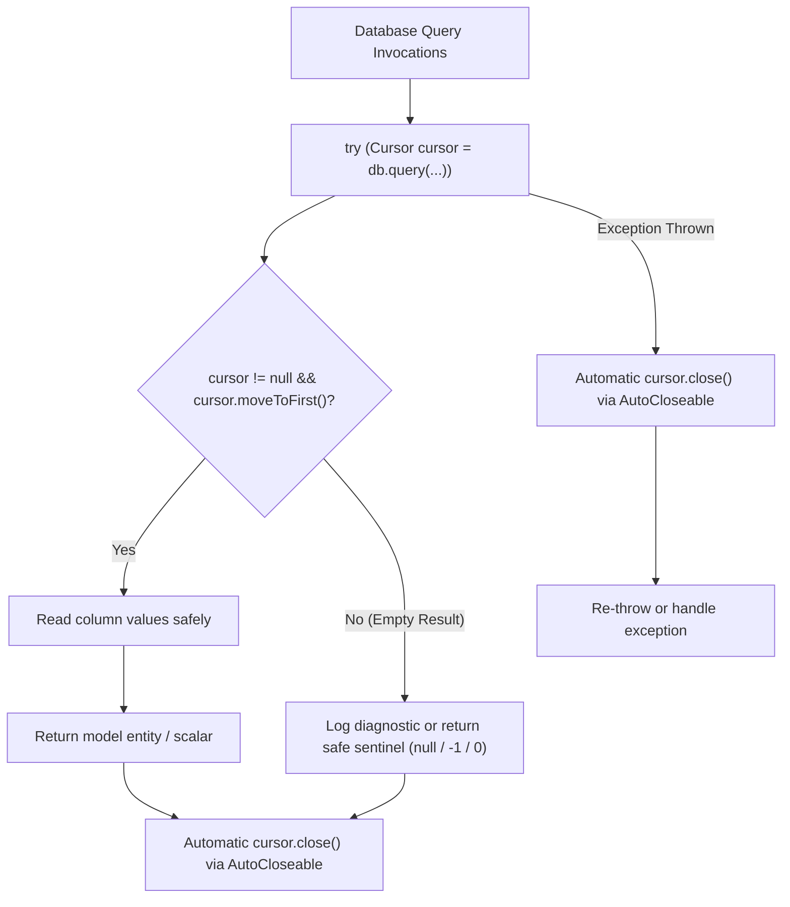

# Stage 1: Problem Domain & Root Cause Analysis - ATT-3550: Enforce Try-With-Resources and Cursor Bounds Checks Across Legacy Java Database Managers

**Ticket**: [ATT-3550](https://rainerblind.atlassian.net/browse/ATT-3550)  
**Parent Epic**: [ATT-431](https://rainerblind.atlassian.net/browse/ATT-431) (*Clean Code*)  
**Active Sprint**: `Sprint 2026-42.4`  
**Target Release**: `V4.9.40`  
**Author**: AI Agent 1 (Implementer)  
**Date**: 2026-10-15  

---

## 1. Executive Summary & Defect Overview

Android's `android.database.Cursor` encapsulates a native SQLite query result window (`CursorWindow`). A `Cursor` holds underlying native C++ memory allocations, file descriptors, and database locks until explicitly closed. In Java 7+ and Android API 19+, `Cursor` implements `java.io.Closeable` (and therefore `java.lang.AutoCloseable`), enabling deterministic resource management via `try-with-resources`.

A static audit across legacy Java SQLite database managers and exporters in `com.atrainingtracker` revealed two pervasive structural defects:
1. **Unshielded Cursor Allocations without Try-With-Resources**:
   - Over 40 query methods open `Cursor cursor = db.query(...)` with manual, trailing `cursor.close()` invocations.
   - If an unexpected runtime exception (e.g., `SQLiteException`, `IllegalStateException`, `NumberFormatException`, or out-of-memory) occurs between cursor instantiation and `cursor.close()`, the cursor is leaked indefinitely. Android Logcat eventually reports:
     `StrictMode: A resource was acquired at ... which was never released` / `Finalizing a Cursor that has not been deactivated or closed`.
   - Repeated leaks exhaust SQLite cursor window pools and file descriptors, causing application instability and crashes.
2. **Unchecked Cursor Position Navigation (`moveToFirst()` / `moveToLast()`)**:
   - Multiple query call sites invoke `cursor.moveToFirst()` or `cursor.moveToLast()` as an isolated statement, ignoring its `boolean` return value.
   - When a query yields an empty result set (0 rows), the cursor position remains at `-1`. Subsequent calls to `cursor.getString(...)`, `cursor.getLong(...)`, or `cursor.getInt(...)` fail immediately with:
     `android.database.CursorIndexOutOfBoundsException: Index 0 requested, with a size of 0`.

ATT-3550 eliminates these failure modes systematically across all legacy Java database managers, database helpers, and file exporters.

---

## 2. Requirement Archaeology & Chesterton's Fence

1. **Why were raw cursor allocations and unchecked navigations used initially?**
   - The legacy codebase was authored during early Android API levels (pre-API 19, Android 2.x/4.x), where `try-with-resources` was not supported by the Android Java compiler, and developers relied on manual `cursor.close()` at the end of methods.
   - Many database queries were written under the optimistic assumption that queried IDs always exist (e.g. looking up a device immediately after insertion or querying default sport types).
2. **Chesterton's Fence Audit**:
   - *Does enclosing queries in `try-with-resources` alter database transactions, locking, or query semantics?* No. `try (Cursor cursor = ...)` guarantees that `cursor.close()` is invoked deterministically at block exit (including normal completion, early `return`, or exception propagation).
   - *What should happen when `moveToFirst()` returns `false` on empty tables?*
     Methods that return an object/string/scalar must return the canonical empty/sentinel value (`null`, `-1L`, `0`, `false`, `""`, or empty collection) rather than throwing `CursorIndexOutOfBoundsException`.
   - *Are there methods returning a live `Cursor` to callers?*
     Yes, adapter loader methods like `getDeviceCursor(long deviceId)` and `getCursorForAllDevices()` explicitly return an open `Cursor` intended to be managed by a `CursorAdapter` or caller. These factory/provider methods MUST NOT close the cursor within their own body, but callers that consume them must use `try-with-resources`.
3. **Preservation of Core Invariants**:
   - Database schemas, table column indices, SQL queries, and return types remain 100% backward-compatible.
   - Zero cursor leaks under normal and exception execution paths.
   - Zero `CursorIndexOutOfBoundsException` on empty result sets.

---

## 3. Forensic Call Site Inventory

A thorough audit identified the following query sites requiring remediation:

### A. Database Managers
1. **`ExportStatusDatabaseManager.java`**:
   - Lines 198, 269, 300, 328: Raw cursor queries in `getExportStatus(...)`, `hasPendingExports(...)`, `getRecentExports(...)`.
2. **`DevicesDatabaseManager.java`**:
   - Lines 169, 189, 209, 230, 249, 305, 402, 454, 502, 528, 607, 627, 644, 657, 796, 836, 875, 1092, 1143, 1159:
     Queries for device names, addresses, calibration factors, paired state, and version upgrade migrations.
3. **`SportTypeDatabaseManager.java`**:
   - Lines 110, 127, 217, 243, 306, 321, 345, 371, 395, 468, 507:
     Queries for sport type names, icons, heart rate zones, power zones, and speed thresholds.
4. **`TrackingViewsDatabaseManager.java`**:
   - Lines 234, 348, 418, 451, 477, 497, 572, 969:
     Queries for view sizes, sensor mappings, layouts, and page indices.
5. **`SegmentsDatabaseManager.java`**:
   - Line 218: `getSegmentById` query and navigation.
6. **`WorkoutSamplesDatabaseManager.java`**:
   - Line 172: Sample count query.
7. **`PebbleDatabaseManager.java`**:
   - Lines 93, 111, 145, 162, 175, 220, 397:
     Views and rows queries for smartwatch layouts.
8. **`WorkoutSummariesDatabaseManager.java`**:
   - Legacy query methods without try-with-resources.

### B. Database Helpers
1. **`EquipmentDbHelper.java`**: Line 664: Migration query.
2. **`ActiveDevicesDbHelper.java`**: Lines 72, 105: Active device state queries.

### C. Exporters & File Writers
1. **`ExportManager.java`**: Line 393: Workout query for export processing.
2. **`BaseFileWriter.java`**: Line 71: Summary query before serialization.
3. **`GPXFileWriter.java`**: Line 133: Lap marker and sample query.

---

## 4. Scope Bounding & Invariants

### In Scope
- Refactoring all unshielded `Cursor` query blocks in legacy Java database managers, helpers, and file exporters to use `try (Cursor cursor = ...)`.
- Adding bounds validation checks (`if (cursor != null && cursor.moveToFirst())`) before reading columns, returning appropriate fallback/sentinel values when empty.
- Implementing an automated JUnit architecture audit test (`TryWithResourcesCursorAuditTest.kt`) to prevent regressions across `app/src/main`.
- Implementing a standalone Python lint tool (`tools/lint_cursor_safety.py`) for CI/CD.
- Adding targeted unit tests verifying empty cursor handling without `CursorIndexOutOfBoundsException`.

### Out of Scope
- Migrating SQLite database managers to Room ORM (large-scale architectural initiative outside sprint scope).
- Converting Java database managers to Kotlin (addressed incrementally in separate refactoring tickets).
- Modifying `TrackerService.java:745` (which is explicitly covered and optimized in subsequent sprint ticket ATT-3549).

### Invariants
1. **Deterministic Resource Management**: 100% of internally-consumed cursors are closed via `try-with-resources`.
2. **Crash Immunity**: Zero `CursorIndexOutOfBoundsException` when queries return 0 rows.
3. **Clean-Room Verification**: 100% test pass rate across the full unit test suite.

---

## 5. Technical Architecture & Prevention Strategy

### Static Architecture Guard & CI/CD Integration
1. **Automated Unit Test**: `TryWithResourcesCursorAuditTest.kt` scans all Java database managers in `app/src/main`, parsing query invocations and asserting that all local cursor allocations use `try (...)`.
2. **CLI Linter**: `tools/lint_cursor_safety.py` provides immediate developer and pre-commit verification.

---

## 6. Acceptance Criteria (Given-When-Then)

- **AC-1 (Try-With-Resources Coverage)**:
  - *Given* all Java database managers, helpers, and file exporters in `app/src/main`,
  - *When* querying SQLite tables for data,
  - *Then* all local `Cursor` instances are wrapped in `try-with-resources` blocks, guaranteeing zero cursor leaks on normal return or exception paths.
- **AC-2 (Empty Result Bounds Immunity)**:
  - *Given* any query method executed against an empty table or non-existent record ID,
  - *When* `cursor.moveToFirst()` returns `false`,
  - *Then* the method returns safely with sentinel/fallback value without throwing `CursorIndexOutOfBoundsException`.
- **AC-3 (Automated Architecture Guard)**:
  - *Given* the test suite,
  - *When* `TryWithResourcesCursorAuditTest` and `tools/lint_cursor_safety.py` run,
  - *Then* zero unshielded cursor allocations are detected.
- **AC-4 (Clean-Room Full Suite Regression)**:
  - *Given* the modified codebase,
  - *When* `./gradlew testDebugUnitTest` is executed,
  - *Then* all 2932+ tests pass with 100% success rate.
