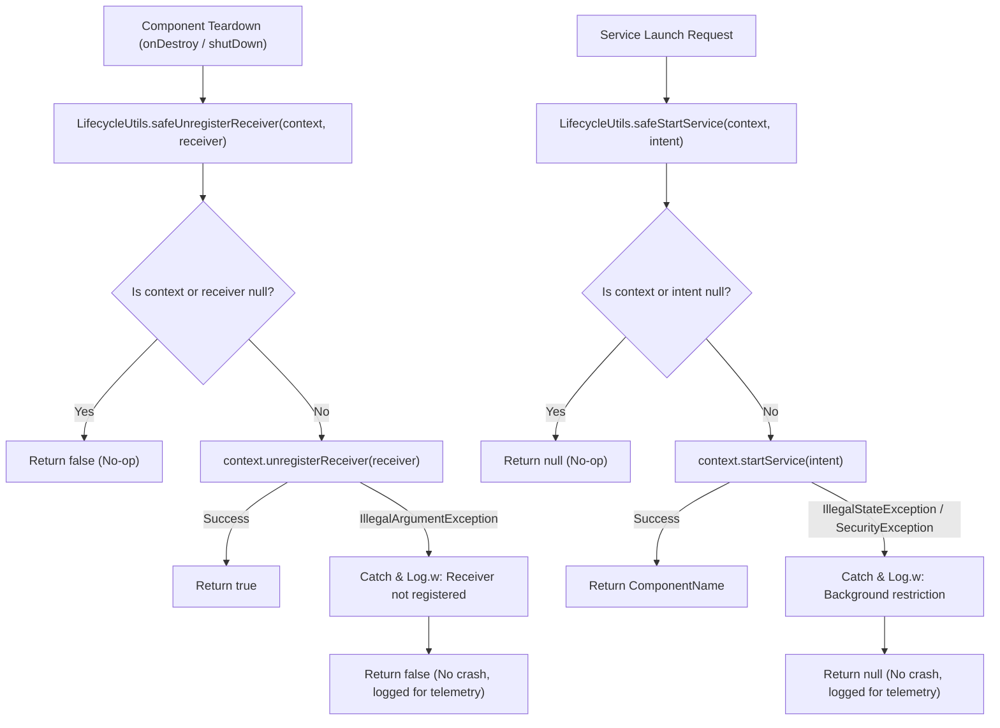

# Stage 1: Problem Domain & Root Cause Analysis - ATT-3563: Harden Service Launches and BroadcastReceiver Unregistration Against Android Lifecycle Exceptions

**Ticket**: [ATT-3563](https://rainerblind.atlassian.net/browse/ATT-3563)  
**Parent Epic**: [ATT-235](https://rainerblind.atlassian.net/browse/ATT-235) (*[Epic] No crashs*)  
**Active Sprint**: `Sprint 2026-42.4`  
**Target Release**: `V4.9.40`  
**Author**: AI Agent 1 (Implementer)  
**Date**: 2026-10-15  

---

## 1. Executive Summary & Defect Overview

Android 8.0+ (API 26+) enforces strict background execution limits, throwing `IllegalStateException` (`BackgroundServiceStartNotAllowedException` on API 31+) if an application attempts to call `Context.startService(...)` while in the background. Furthermore, Android 12+ (API 31+) restricts background foreground service starts with `ForegroundServiceStartNotAllowedException`.

While `TrainingApplication.startTracking()` addressed `TrackerService` foreground service startup in ATT-2661, a comprehensive codebase-wide lifecycle audit revealed two systemic, unshielded lifecycle crash vectors:
1. **Unguarded `startService(...)` Invocations**:
   - `MainActivityWithNavigation.kt` (line 629): `startService(banalServiceIntent)` directly called during activity background/launch transitions.
   - `BANALServiceRepository.kt` (line 257): `appContext.startService(intent)` invoked upon background repository bindings.
   - `TrainingApplication.java` (lines 356, 361): `startService(...)` for `PebbleServiceBuildIn` and `PebbleService` triggered during watchapp preference changes.
2. **Unguarded `unregisterReceiver(...)` Invocations (~35 Call Sites)**:
   - When an Activity, Fragment, Service, Repository, or Sensor Device is torn down (e.g., fast activity recreation, screen rotation, permission refusal, partial initialization failure, or double cleanup), calling `Context.unregisterReceiver(receiver)` throws an uncaught `IllegalArgumentException: Receiver not registered: ...`.
   - Affected components span `MainActivityWithNavigation.kt` (6 receivers), `TrackerService.java` (4 receivers), `TrainingApplication.java` (6 receivers), `BANALService.java` (2 receivers), `DeviceManager.java` (4 receivers), Sensor Device classes (`MyDevice.java`, `BatteryDevice.java`, `MyRemoteDevice.java`, `AltitudeFromPressureDevice.java`), `FilterManager.java` (2 receivers), `PebbleService.java` / `PebbleServiceBuildIn.java` (10 receivers), Fragments (`EquipmentFragment.kt`, `ConfigViewsFragment.java`), and Repositories/ViewModels (`DevicesTabbedViewModel.kt`, `ExportStatusRepository.kt`, `SensorGridScreen.kt`).

---

## 2. Requirement Archaeology & Chesterton's Fence

1. **Why was raw `startService` and `unregisterReceiver` used initially?**
   - In early Android API levels (pre-Oreo, API < 26), calling `startService()` was permissible at any time regardless of application state. Android Oreo introduced background service limits, turning standard calls into fatal `IllegalStateException` crashes when the app is backgrounded.
   - Similarly, Android's `unregisterReceiver()` contract expects symmetric lifecycle management (`registerReceiver` in `onStart`/`onCreate`, `unregisterReceiver` in `onStop`/`onDestroy`). However, in asynchronous multi-component architectures, unexpected lifecycle interruptions (e.g. process death, ungranted permissions, rapid back-button navigation, config changes) frequently disrupt registration symmetry, resulting in uncaught `IllegalArgumentException`.
2. **Chesterton's Fence Audit**:
   - *Is catching `IllegalStateException` / `SecurityException` safe for `BANALService` and `PebbleService`?* Yes. `BANALService` is also bound via `bindService(..., BIND_AUTO_CREATE)`. Failing to start it as a started service when backgrounded does not impede bounded operations, and crashing the entire process is strictly worse than logging the OS limitation.
   - *Is catching `IllegalArgumentException` on `unregisterReceiver` safe?* Yes. If a receiver was never registered or was already unregistered, unregistering it is a no-op from the system's perspective. Swallowing `IllegalArgumentException` prevents fatal crashes while achieving the desired postcondition (the receiver is not registered).
3. **Root Cause & Observable Anomaly Logging Policy**:
   - Swallowing `IllegalArgumentException` completely silently at `DEBUG` level risks masking upstream component initialization defects (e.g., a component failing to initialize properly and never registering its receivers).
   - Therefore, `safeUnregisterReceiver` **MUST** log at **`WARN` (`Log.w`)** severity, including the caller tag, the receiver's runtime class name, and the underlying exception message. This guarantees observability in production telemetry (Crashlytics / Logcat) while preserving process stability.

---

## 3. Scope Bounding & Invariants

### In Scope
- Creation of centralized utility `com.atrainingtracker.util.LifecycleUtils`:
  - `safeStartService(context: Context?, intent: Intent?, tag: String = "LifecycleUtils"): ComponentName?`
  - `safeUnregisterReceiver(context: Context?, receiver: BroadcastReceiver?, tag: String = "LifecycleUtils"): Boolean`
  - Inline / extension functions on `Context?`.
- Migration of all 4 unguarded `startService(...)` sites in `MainActivityWithNavigation.kt`, `BANALServiceRepository.kt`, and `TrainingApplication.java`.
- Migration of all 35+ unguarded `unregisterReceiver(...)` sites across activities, services, managers, fragments, and sensor device classes.
- Static architecture guard test (`LifecycleServiceReceiverSafetyAuditTest.kt`) executed as part of standard unit tests (`./gradlew testDebugUnitTest`).
- Dedicated Python linter (`tools/lint_lifecycle_safety.py`) for CI/CD and pre-commit checks.
- Dedicated unit tests for `LifecycleUtils` covering normal, null, unmocked, and exception conditions.

### Out of Scope
- Architectural redesign of `BANALService` into WorkManager.
- Modifying `TrackerService.startTracking()` which already implements ATT-2661 `startForegroundService` error handling.

### Guaranteed Invariants & Nullability Contract
1. **Crash Immunity**: No `IllegalStateException`, `SecurityException`, or `IllegalArgumentException` from OS lifecycle state violations escapes to crash the main thread.
2. **Idempotence**: Receiver teardown can safely be invoked multiple times or without prior registration without throwing exceptions.
3. **Observability**: Unregistered receivers and failed service launches are logged with structured diagnostic context at `WARN` level (`Log.w`) without breaking JVM unit tests.
4. **Nullability Contract**:
   - `safeStartService` returns `@Nullable ComponentName?`.
   - Call site audit: In all 4 call sites (`MainActivityWithNavigation`, `BANALServiceRepository`, `TrainingApplication`), the return value of `startService` is discarded. Downstream code has zero dependency on non-null `ComponentName`, guaranteeing zero downstream `NullPointerException`s when `null` is returned upon OS rejection.
   - `safeUnregisterReceiver` returns `Boolean` (`true` if unregistration succeeded, `false` if skipped or caught `IllegalArgumentException`).

---

## 4. Technical Architecture & Prevention Strategy

### Static Architecture Guard & CI/CD Integration
1. **Automated Unit Test**: `LifecycleServiceReceiverSafetyAuditTest.kt` scans all `.java` and `.kt` source files under `app/src/main` (excluding `LifecycleUtils`). Any raw `unregisterReceiver(` or `startService(` call fails the build during `./gradlew testDebugUnitTest`.
2. **CLI Linter**: `tools/lint_lifecycle_safety.py` provides standalone zero-dependency verification for pre-commit hooks and local developer audits.

---

## 5. Acceptance Criteria (Given-When-Then)

- **AC-1 (Service Start Immunity & Nullability)**:
  - *Given* an Android OS environment restricting background service creation with `IllegalStateException` or `SecurityException`,
  - *When* `safeStartService` is called from `MainActivityWithNavigation`, `BANALServiceRepository`, or `TrainingApplication`,
  - *Then* the operation returns `null` with a structured `Log.w` warning, and no exception crashes the application.
- **AC-2 (Receiver Teardown Idempotence & Observable Diagnostics)**:
  - *Given* any receiver that was not registered or already unregistered,
  - *When* `safeUnregisterReceiver` is called during activity, service, or sensor device teardown,
  - *Then* the operation returns `false` with a structured `Log.w` diagnostic log indicating the receiver class and error details, and no `IllegalArgumentException` escapes.
- **AC-3 (Static Architecture Guard & CI/CD Gate)**:
  - *Given* the automated test suite executing `./gradlew testDebugUnitTest`,
  - *When* `LifecycleServiceReceiverSafetyAuditTest` executes,
  - *Then* zero unshielded `unregisterReceiver(` or `startService(` calls remain in `app/src/main` outside `LifecycleUtils`.
- **AC-4 (Unit Test Robustness)**:
  - *Given* unit tests with mocked `Context` instances throwing `IllegalStateException`, `SecurityException`, and `IllegalArgumentException`,
  - *When* `LifecycleUtilsTest` executes,
  - *Then* all exception paths and log dispatches are verified with 100% test coverage.
