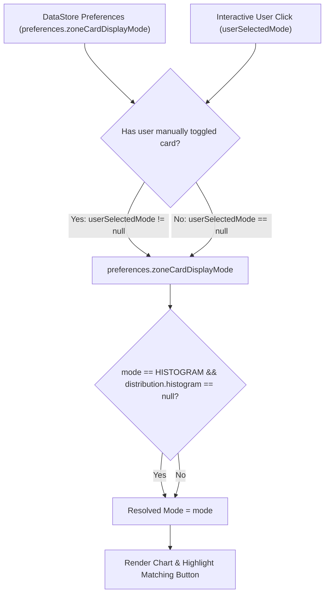

# Stage 1 Analysis: ATT-3676 - Expose default zone card display mode selector in Advanced Settings and wire it to workout summary zone cards

**Ticket**: [ATT-3676](https://rainerblind.atlassian.net/browse/ATT-3676)  
**Sub-task**: [ATT-3698](https://rainerblind.atlassian.net/browse/ATT-3698) (`[Analysis]`)  
**Parent Epic**: [ATT-111](https://rainerblind.atlassian.net/browse/ATT-111) (*Aftermath: Compact Post-Workout Visual Analytics & Graphs*)  
**Target Release**: `None`  
**Active Sprint**: `2026-42.5`  
**Branch**: `feature/ATT-3676`  
**Author**: AI Agent 1 (Implementer)  
**Date**: 2026-10-15  

---

## 1. Problem Statement & Motivation

During the Sprint 2026-42.4 joint review of [ATT-3390](https://rainerblind.atlassian.net/browse/ATT-3390) (`REQ-UI-372`), the 3-way display mode switching (`Stacked Bar`, `Columns`, `Histogram`) was introduced for post-workout zone cards (`HeartRateZoneDistributionCard` and `PowerZoneDistributionCard`). Furthermore, the persistence infrastructure in `WorkoutCardSectionPreferences` and `MyPreferenceManager` (`WORKOUT_CARD_ZONE_DISPLAY_MODE` in DataStore) was created to store a default `zoneCardDisplayMode: ZoneCardDisplayMode`.

However, three architectural and state-synchronization gaps remain:
1. **Missing UI Selector in Advanced Settings**: Neither `WorkoutMasksAndCardsSection.kt` nor `AdvancedTuningDialog.kt` / `AdvancedTuningScreen.kt` exposes a UI control for the user to view or change this preference. Consequently, users cannot choose their preferred default (e.g. `Stacked Bar` or `Histogram`).
2. **Disconnected Default in Workout Summary**: In `WorkoutSummary.kt`, `hrZoneDisplayMode` and `powerZoneDisplayMode` are hardcoded to initialize with `rememberSaveable { mutableStateOf(ZoneCardDisplayMode.FIVE_ZONES) }`. They completely ignore `preferences.zoneCardDisplayMode`. As a result, zone cards in workout summaries always revert to `COLUMNS` (`FIVE_ZONES`) upon loading, irrespective of the persisted user preference.
3. **Missing Graceful Fallback**: If `zoneCardDisplayMode` is set to `HISTOGRAM`, but a workout activity lacks raw telemetry frequency histogram data (`distribution.histogram == null`), the card body attempts to render `TelemetryHistogramChart(null)`, which displays an empty dash ("–"), while the segmented button switcher displays only 2 buttons (`Stacked Bar` and `Columns`) with neither button selected.

Expected Behavior:
* In Advanced Settings -> Workout Cards (`WorkoutMasksAndCardsSection.kt`), a dedicated 3-way segmented button selector (`Stacked Bar`, `Columns`, `Histogram`) is provided under the card settings (visible when zone analysis is enabled, matching the pattern used by `settings_lap_display_mode`).
* In `WorkoutSummary.kt` and `TrackOnMapScreen.kt`, zone card display modes observe `preferences.zoneCardDisplayMode` with clean state-synchronization precedence: global default takes effect reactively unless the user has manually toggled that specific card in the active session.
* In `HeartRateZoneDistributionCard` and `PowerZoneDistributionCard`, if `effectiveDisplayMode == ZoneCardDisplayMode.HISTOGRAM` but `distribution.histogram == null`, the component gracefully resolves to `ZoneCardDisplayMode.COLUMNS`.

---

## 2. Root Cause Analysis & Deep Forensic Investigation

### 2.1 Settings UI Gap (`WorkoutMasksAndCardsSection.kt`)
In `ui/settings/tuning/categories/WorkoutMasksAndCardsSection.kt` (lines 299–336), a dedicated sub-setting section exists for `lapDisplayMode`:
```kotlin
if (workoutCardPrefs.showLaps || workoutDetailPrefs.showLaps) {
    // SingleChoiceSegmentedButtonRow for LapDisplayMode (TABLE_ONLY vs VISUALIZER_ONLY)
}
```
However, no equivalent control was added for `zoneCardDisplayMode`, even though `workoutCardPrefs.zoneCardDisplayMode` already exists in `WorkoutCardSectionPreferences` and is saved to DataStore by `MyPreferenceManager.setWorkoutCardPreferences(workoutCardPrefs)`.

### 2.2 Telemetry Card Consumption Gap (`WorkoutSummary.kt`)
In `ui/aftermath/workoutlist/WorkoutSummary.kt` (lines 107–108):
```kotlin
var hrZoneDisplayMode by rememberSaveable { mutableStateOf(ZoneCardDisplayMode.FIVE_ZONES) }
var powerZoneDisplayMode by rememberSaveable { mutableStateOf(ZoneCardDisplayMode.FIVE_ZONES) }
```
These states are initialized to the legacy hardcoded constant `ZoneCardDisplayMode.FIVE_ZONES` and are not keyed or initialized with `preferences.zoneCardDisplayMode`.

### 2.3 Edge Case Handling Gap (`HeartRateZoneDistributionCard.kt` & `PowerZoneDistributionCard.kt`)
In `HeartRateZoneDistributionCard.kt` and `PowerZoneDistributionCard.kt`:
```kotlin
val effectiveDisplayMode = displayMode ?: internalDisplayMode
```
When `effectiveDisplayMode == ZoneCardDisplayMode.HISTOGRAM` but `distribution.histogram == null`:
* `TelemetryHistogramChart(histogram = null, ...)` renders an empty box with "–".
* The bottom switcher renders `buttonCount = 2` (`STACKED_BAR` and `COLUMNS`), so neither button is highlighted as selected, confusing the athlete.
A graceful fallback mapping (`if (effectiveDisplayMode == HISTOGRAM && distribution.histogram == null) COLUMNS else effectiveDisplayMode`) is required.

---

## 3. State Synchronization Strategy & Precedence Architecture

To address state-synchronization race conditions and enforce Unidirectional Data Flow (UDF):

1. **Hierarchy of State Precedence**:
   * **Tier 1 (Interactive Manual Override)**: If an athlete explicitly taps a segmented button on a card during an active view session, that user intent is captured in session-local state (`userSelectedHrMode: ZoneCardDisplayMode?`). As long as `userSelectedHrMode != null`, this manual selection takes precedence for that specific card.
   * **Tier 2 (Reactive Global Default)**: If `userSelectedHrMode == null` (the default state upon card display), the card reactively reflects `preferences.zoneCardDisplayMode`. If the user updates the global preference in Advanced Settings, all cards without manual overrides update dynamically upon recomposition.
   * **Tier 3 (Domain Fallback Guard)**: If the effective mode evaluates to `HISTOGRAM` but `distribution.histogram == null`, the mode unconditionally resolves to `COLUMNS`.



---

## 4. User Scope Grounding (ATT-1250)

* **In-Scope Goals**:
  1. Add a 3-way segmented button row selector in `WorkoutMasksAndCardsSection.kt` for `zoneCardDisplayMode` (`STACKED_BAR`, `COLUMNS`, `HISTOGRAM`), conditionally visible when `workoutCardPrefs.showZoneAnalysis || workoutDetailPrefs.showZoneAnalysis`.
  2. Define localized title `settings_zone_card_display_mode_title` across all 9 application locales (EN, DE, ES, FR, IT, JA, NL, PL, PT). The button option strings (`zone_mode_stacked_bar`, `zone_mode_columns`, `zone_mode_histogram`) are already translated with 100% parity.
  3. Wire `preferences.zoneCardDisplayMode` into `WorkoutSummary.kt` and `TrackOnMapScreen.kt` using the Tier 1/2 state precedence model.
  4. Implement graceful fallback in `HeartRateZoneDistributionCard.kt` and `PowerZoneDistributionCard.kt` resolving to `COLUMNS` when `HISTOGRAM` is requested on activities with `distribution.histogram == null`.
  5. Enforce strict line-count compliance in `WorkoutMasksAndCardsSection.kt` ($\le 400$ lines per REQ-UI-262).
  6. Add unit tests for preference persistence, reactive updates, manual override precedence, and histogram fallback.

* **Out-of-Scope Non-Goals (Scope Bounding)**:
  1. Altering the underlying `ZoneDistributionStackedBar`, `ZoneDistributionColumnChart`, or `TelemetryHistogramChart` rendering algorithms.
  2. Modifying `WorkoutCardSectionPreferences` DataStore persistence keys or schema.
  3. Changing zone calculation models (Coggan 7-zone power or Karvonen heart rate).

---

## 5. Requirement Archaeology & Chesterton's Fence Audit

### Requirement Archaeology & Chesterton's Fence Audit
* **Original Requirement ID & Target**: Amends `REQ-UI-372` (*Horizontal Stacked Distribution Bar Component & 3-Way Zone Display Mode Switching in Workout Summary Cards*) and complements `REQ-UI-262` (*Advanced Tuning Modular Accordion & Settings Hierarchy*). Targets `WorkoutMasksAndCardsSection.kt`, `WorkoutSummary.kt`, `HeartRateZoneDistributionCard.kt`, `PowerZoneDistributionCard.kt`, `TrackOnMapScreen.kt`, and `strings.xml`.
* **Historical Origin & Commit Trace**: Commit `e3966ebf` (Sprint `2026-40.5`, `ATT-1390`), commit `7b14d9a2` (Sprint `2026-40.8`, `ATT-1845`), commit `c8192a0e` (Sprint `2026-41.2`, `ATT-2147`), and commit `38706240` (Sprint `2026-42.4`, `ATT-3390`).
* **Root Reason for Existing Formulation**: `ATT-3390` introduced the `ZoneDistributionStackedBar` composable, the 3-way interactive segmented button switching on individual cards, and the `WORKOUT_CARD_ZONE_DISPLAY_MODE` DataStore preference key. The UI selector in Advanced Settings and the propagation into `WorkoutSummary.kt` were deferred to keep `ATT-3390` tightly bounded to the graphical presentation component.
* **Preservation of Core Invariants**:
  1. *Interactive Session Toggling*: Per-card interactive switching remains fully functional; user taps on individual cards take precedence for the active session.
  2. *Legacy Compatibility*: `ZoneCardDisplayMode.FIVE_ZONES` remains an alias for `COLUMNS` preserving contract assertions in `TelemetryMetricGraphMarginalBarsContractTest.kt`.
  3. *Modularity Invariant (REQ-UI-262)*: `WorkoutMasksAndCardsSection.kt` must remain strictly $\le 400$ lines.
  4. *Histogram Graceful Fallback*: Activities lacking raw histogram data must never render empty dashes or broken button states.
  5. *100% Clean-Room Test Suite Pass Rate*: Zero regressions across all ~2,954 unit tests.

---

## 6. Modularity & Implementation Plan for WorkoutMasksAndCardsSection.kt

`WorkoutMasksAndCardsSection.kt` currently has 357 lines. The strict 400-line ceiling allows 43 lines of expansion. To guarantee headroom:
1. Extract private composable helper `ZoneCardDisplayModeSection(currentMode: ZoneCardDisplayMode, onModeChange: (ZoneCardDisplayMode) -> Unit)`.
2. Format segmented buttons compactly (~18 lines).
3. Final file size will be ~375 lines, well below the 400-line limit.

---

## 7. Verification & Governance Strategy
* Run `python3 tools/verify_requirement_governance.py --text-file docs/engineering/analysis/ATT-3676_analysis.md` to ensure full compliance.
* Add targeted unit tests verifying:
  1. Default mode persistence in `WorkoutCardSectionPreferences`.
  2. Reactive update when global preference changes without manual override.
  3. Manual override precedence over global preference during active sessions.
  4. Graceful fallback when `histogram == null`.
  5. Modularity line limit ($\le 400$ lines) via `AdvancedTuningModularityTest`.
* Run `./gradlew testDebugUnitTest` verifying 100% pass rate.
