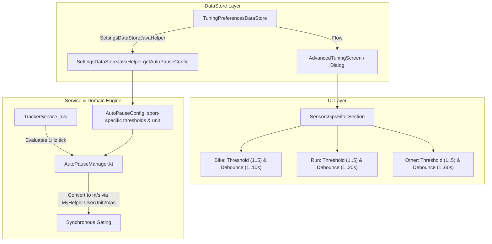

# Stage 1 Analysis: ATT-3677 - Configure auto-pause speed thresholds and debounce windows independently per sport (Bike, Run, Other)

**Ticket**: [ATT-3677](https://rainerblind.atlassian.net/browse/ATT-3677)  
**Sub-task**: [ATT-3691](https://rainerblind.atlassian.net/browse/ATT-3691) (`[Analysis]`)  
**Parent Epic**: [ATT-166](https://rainerblind.atlassian.net/browse/ATT-166) (*Filtering to improve sensor values (especially locations)*)  
**Target Release**: `None`  
**Active Sprint**: `2026-42.5`  
**Branch**: `feature/ATT-3677`  
**Author**: AI Agent 1 (Implementer)  
**Date**: 2026-10-15  

---

## 1. Problem Statement & Motivation

During the Sprint 2026-42.4 review of `ATT-45` (`REQ-TRK-018`), Auto-Pause activation toggles were successfully decoupled per sport (`BSportType.BIKE`, `BSportType.RUN`, `BSportType.UNKNOWN`). However, the speed threshold (`Float`, defaulting to $1.5\text{ km/h}$) and the debounce delay (`Int`, defaulting to $2\text{ s}$) were implemented as single global settings shared across all sports.

Because Cycling, Running, and Other sports exhibit drastically different low-speed dynamics (e.g. steep uphill trail running at $4\text{ km/h}$ vs. track sprinting vs. urban cycling stops vs. cross-country skiing), sharing a single threshold and debounce delay causes nuisance auto-pauses in one sport or delayed pauses in another. Furthermore, the existing speed threshold slider exposed fractional decimal values ($0.5 \dots 5.0\text{ km/h}$ with 44 steps) hardcoded to metric `"%.1f km/h"`, degrading user experience under Imperial units (`mph`).

Expected behavior:
Each sport profile (`Bike`, `Run`, `Other`) must have its own independent Speed Threshold and Debounce Delay, configured strictly in integer values (`Int`). The speed threshold slider must step cleanly in whole integers ($1 \dots 5$) in the user's active speed unit ($1 \dots 5\text{ km/h}$ in Metric, $1 \dots 5\text{ mph}$ in Imperial), and debounce sliders must provide sport-appropriate ranges ($1..10\text{ s}$ for Bike, $1..20\text{ s}$ for Run, $1..60\text{ s}$ for Other).

---

## 2. Root Cause Analysis (Forensic Investigation)

### 2.1 Preference Layer (`TuningPreferencesDataStore.kt`)
* Currently defines single global keys:
  ```kotlin
  val KEY_AUTO_PAUSE_SPEED_THRESHOLD_KMH: Preferences.Key<Float> = floatPreferencesKey("tuning_auto_pause_speed_threshold_kmh")
  val KEY_AUTO_PAUSE_DEBOUNCE_SEC: Preferences.Key<Int> = intPreferencesKey("tuning_auto_pause_debounce_sec")
  ```
* `TuningConfig` carries single scalar fields `autoPauseSpeedThresholdKmh: Float` and `autoPauseDebounceSec: Int`.
* When an athlete tunes the threshold for cycling (e.g. to $3\text{ km/h}$), that threshold inadvertently impacts running, where $3\text{ km/h}$ causes unexpected pauses during steep hill climbs or technical walking sections.

### 2.2 Domain Engine (`AutoPauseManager.kt` & `AutoPauseConfig`)
* `AutoPauseConfig` currently only evaluates sport type for enablement:
  ```kotlin
  fun isEnabledForSport(sportType: BSportType): Boolean
  ```
  It does not vary `speedThreshold` or `debounceSec` based on `sportType`.
* `evaluateTick` calculates thresholds by directly dividing `config.speedThresholdKmh / 3.6`, without unit awareness (Metric vs. Imperial) or sport-specific lookup.

### 2.3 User Interface (`SensorsGpsFilterSection.kt`)
* The UI displays toggles for Bike, Run, and Other, but places a single pair of sliders below them.
* The speed threshold slider uses:
  ```kotlin
  valueText = String.format(Locale.getDefault(), "%.1f km/h", autoPauseSpeedThresholdKmh)
  ```
  This hardcodes `"km/h"`, ignoring the athlete's unit preference (`MyUnits.IMPERIAL`), and uses fine-grained float steps instead of clean whole integers.

---

## 3. User Scope Grounding (ATT-1250)

* **In-Scope Goals**:
  1. Deconstruct global auto-pause speed threshold and debounce into 6 sport-specific integer keys in `TuningPreferencesDataStore.kt`:
     - **Bike (`BSportType.BIKE`)**:
       - Speed Threshold: Range `1 .. 5` (step `1`, integer in active user unit: `km/h` in Metric, `mph` in Imperial); Default: `3` (Metric) / `2` (Imperial).
       - Debounce Window: Range `1 .. 10 s` (step `1 s`); Default: `2 s`.
     - **Run (`BSportType.RUN`)**:
       - Speed Threshold: Range `1 .. 5` (step `1`, integer in active user unit); Default: `2` (Metric) / `1` (Imperial).
       - Debounce Window: Range `1 .. 20 s` (step `1 s`); Default: `5 s`.
     - **Other (`BSportType.UNKNOWN`)**:
       - Speed Threshold: Range `1 .. 5` (step `1`, integer in active user unit); Default: `1` (Metric & Imperial).
       - Debounce Window: Range `1 .. 60 s` (step `1 s`); Default: `10 s`.
  2. Extend `AutoPauseConfig` to carry sport-specific thresholds and debounce delays along with active unit mode (`isMetric: Boolean`).
  3. Update `AutoPauseManager.evaluateTick` to resolve sport-specific thresholds and debounce durations, converting user-unit thresholds cleanly to canonical `m/s` via `MyHelper.UserUnit2mps`.
  4. Update `SettingsDataStoreJavaHelper.kt` with `getAutoPauseConfig(Context)` and sport-specific accessors.
  5. Refactor `SensorsGpsFilterSection.kt` to mount each sport's Speed Threshold and Debounce sliders directly under that sport's toggle (collapsible when enabled), using `R.string.units_speed` / `MyHelper.getUnitsId(SensorType.SPEED_mps)`.
  6. Update `AdvancedTuningScreen.kt` and `AdvancedTuningDialog.kt` to bind the sport-specific properties.
  7. Update unit tests in `TuningPreferencesDataStoreAutoPauseTest.kt` and `AutoPauseManagerTest.kt`.

* **Out-of-Scope Non-Goals (Scope Bounding)**:
  1. Changing `mManualPauseLock` mutex semantics or state transitions (`TRACKING`, `PAUSE_DEBOUNCE_PENDING`, `AUTO_PAUSED`, `SENSOR_LOST`).
  2. Changing the anti-chatter hysteresis calculation ($+0.5$ in active speed units) or hard ceilings.
  3. Modifying sample database schemas or FIT/GPX export logic.

---

## 4. Requirement Archaeology & Chesterton's Fence Audit

* **Original Requirement ID & Target**: Amends `REQ-TRK-018` (*Sport-Specific Auto-Pause Engine, Anti-Chatter Hysteresis & Mutex*). Targets `TuningPreferencesDataStore.kt`, `AutoPauseManager.kt`, `SettingsDataStoreJavaHelper.kt`, `SensorsGpsFilterSection.kt`, `AdvancedTuningScreen.kt`, and `AdvancedTuningDialog.kt`.
* **Historical Origin & Commit Trace**: Commit `53c20db4` (Sprint `2026-42.4`, `ATT-45`).
* **Root Reason for Existing Formulation**: `ATT-45` introduced sport-specific enablement flags, but consolidated the numerical parameters into a single global slider set to limit the initial preference surface.
* **Preservation of Core Invariants**:
  1. Manual pause sovereignty via `mManualPauseLock` strictly preserved.
  2. Zero elevation drift during pause strictly preserved.
  3. Moving average speed ($v_{\text{avg}} = \text{Distance} / \text{TimeActive}$) strictly preserved.
  4. Backward compatibility: legacy `TuningConfig` getters preserved as deprecated bridges.
  5. 100% clean-room test suite pass rate strictly preserved.

---

## 5. Architectural Strategy & High-Level Solution



### Unit Handling Strategy (Option 1)
- Sliders store and display integer values `1..5`.
- In Metric: `1..5 km/h` (Default: Bike 3, Run 2, Other 1).
- In Imperial: `1..5 mph` (Default: Bike 2, Run 1, Other 1).
- The unit label is dynamically resolved via localized string resources (`R.string.units_speed`).
- `AutoPauseManager` converts active threshold to `m/s` via `MyHelper.UserUnit2mps(threshold.toDouble(), unit)`.

---

## 6. System Invariants & Risk Assessment

* **Core Invariants**:
  1. Strictly integer parameters stored and presented to the user.
  2. Pause gating, manual pause lock precedence, and session resume invariants remain intact.
  3. 100% test pass rate across `AutoPauseManagerTest`, `TuningPreferencesDataStoreAutoPauseTest`, and full `./gradlew testDebugUnitTest`.
* **Risk Rating**: **LOW**
  - Well-isolated settings and domain engine modifications with comprehensive existing test coverage.
