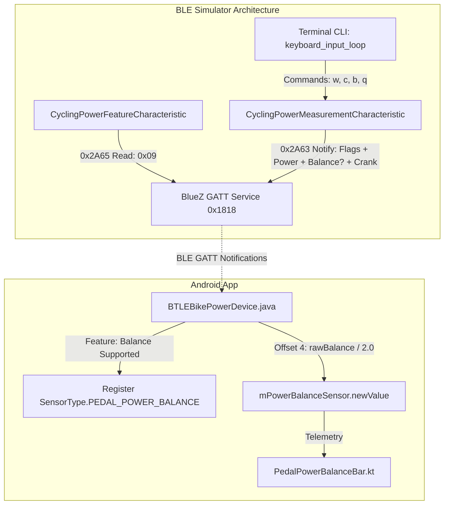

# Stage 1 Analysis: ATT-3678 - Add Pedal Power Balance simulation support to tools/ble_power_simulator.py

**Ticket**: [ATT-3678](https://rainerblind.atlassian.net/browse/ATT-3678)  
**Sub-task**: [ATT-3685](https://rainerblind.atlassian.net/browse/ATT-3685) (`[Analysis]`)  
**Parent Epic**: None (*Developer Tooling & Testing Infrastructure*)  
**Target Release**: `None`  
**Active Sprint**: `2026-42.5`  
**Branch**: `feature/ATT-3678`  
**Author**: AI Agent 1 (Implementer)  
**Date**: 2026-10-15  

---

## 1. Problem Statement & Motivation

During the Sprint 2026-42.4 Joint Review of [ATT-1295](https://rainerblind.atlassian.net/browse/ATT-1295) (*Visual pedal power balance indicator tile in cockpit*), live on-device testing and manual verification of `SensorType.PEDAL_POWER_BALANCE` (handling asymmetry tiers: Green $\le 2\%$, Amber $2..5\%$, Red $> 5\%$) was blocked because `tools/ble_power_simulator.py` only broadcast Instantaneous Power (Watts) and Crank Revolution Data (Cadence).

Currently, `tools/ble_power_simulator.py`:
1. Advertises Cycling Power Service (UUID `0x1818`), but its Cycling Power Feature Characteristic (UUID `0x2A65`) only sets bit 3 (`0x08`, Crank Revolution Data Supported). As a consequence, `BTLEBikePowerDevice.java` inspects `isPowerBalanceSupported(feature)` (bit 0, mask `0x01`), finds it false, and never registers `SensorType.PEDAL_POWER_BALANCE`.
2. Encodes the Cycling Power Measurement Characteristic (UUID `0x2A63`) payload with flags hardcoded to `0x0020` (Crank Revolution Data Present), Instantaneous Power (2 bytes), and Crank Revolution Data (4 bytes). It does not encode the 1-byte raw Pedal Power Balance field (UINT8 in $1/2\%$ resolution).
3. The interactive keyboard CLI loop (`keyboard_input_loop`) only accepts power adjustment (`+`, `-`, `w<num>`) and cadence adjustment (`c<num>`), lacking any control to adjust or disable simulated pedal power balance.

Expected behavior:
`tools/ble_power_simulator.py` must support the Bluetooth SIG Cycling Power Service profile for pedal power balance, setting Feature bit 0, conditionally encoding Measurement flag bit 0 with a 1-byte raw balance payload at offset 4, and providing interactive CLI commands (`b <0-100>` and `b off`) to dynamically simulate symmetrical, mild, and severe asymmetry tiers.

---

## 2. Root Cause Analysis (Forensic Investigation)

### 2.1 Bluetooth SIG Cycling Power Profile & `BTLEBikePowerDevice.java` Protocol Alignment

1. **Cycling Power Feature Characteristic (`UUID 0x2A65`)**:
   - In `BTLEBikePowerDevice.java`:
     ```java
     private static final int PEDAL_POWER_BALANCE_SUPPORTED_MASK = 1;      // Bit 0 (0x01)
     private static final int CRANK_REVOLUTION_DATA_SUPPORTED_MASK = 1 << 3; // Bit 3 (0x08)
     ```
   - When a device connects, `BTLEBikePowerDevice` reads characteristic `0x2A65`. If `isPowerBalanceSupported(feature)` is true, it marks `mIsPowerBalanceSupported = true` and registers `mPowerBalanceSensor = new MySensor<>(this, SensorType.PEDAL_POWER_BALANCE)`.
   - In `tools/ble_power_simulator.py`:
     ```python
     self.value = [0x08, 0x00, 0x00, 0x00] # Only bit 3 set!
     ```
   - Bit 0 (`0x01`) is missing, preventing ATT from ever recognizing pedal balance support.

2. **Cycling Power Measurement Characteristic (`UUID 0x2A63`) Payload Structure**:
   - According to Bluetooth SIG Cycling Power Service specification and `BTLEBikePowerDevice.java` lines 314–341:
     - **Offset 0..1 (Flags, 16-bit uint)**:
       - Bit 0 (`0x0001`): Pedal Power Balance Present.
       - Bit 1 (`0x0002`): Pedal Power Balance Reference (0 = Left Pedal Reference, 1 = Right Pedal Reference). For standard simulations, 0 (Left Pedal) is standard.
       - Bit 5 (`0x0020`): Crank Revolution Data Present.
     - **Offset 2..3 (Instantaneous Power, 16-bit signed int)**.
     - **Offset 4 (Pedal Power Balance, 8-bit unsigned int, 1 byte)**:
       - Present *only if* bit 0 is set in Flags.
       - Encoded as percentage in $1/2\%$ resolution ($0..200$, representing $0.0..100.0\%$).
       - In `BTLEBikePowerDevice.java`:
         ```java
         Integer rawBalance = characteristic.getIntValue(BluetoothGattCharacteristic.FORMAT_UINT8, offset);
         double balanceValue = rawBalance / 2.0;
         ```
       - Therefore, raw byte value must be `int(round(pedal_balance * 2))`, clamped to `[0, 200]`.
     - **Subsequent offsets**:
       - Accumulated Torque (if bit 2 set, not used).
       - Wheel Revolution Data (if bit 4 set, not used).
       - Crank Revolution Data (if bit 5 set): Cumulative Crank Revolutions (UINT16, 2 bytes) followed by Last Crank Event Time (UINT16, 2 bytes).
   - In `tools/ble_power_simulator.py`, the payload is currently hardcoded without offset 4 byte insertion:
     ```python
     payload = flags_bytes + power_bytes + crank_rev_bytes + crank_time_bytes
     ```
     When balance is active, the balance byte must be placed immediately after `power_bytes` (offset 4) and before `crank_rev_bytes`.

3. **Interactive Control Gap in `keyboard_input_loop`**:
   - `keyboard_input_loop` does not parse balance commands. Testers cannot evaluate cockpit balance UI transitions (Optimal Green: $48..52\%$, Mild Amber: $45..47\%$ or $53..55\%$, Severe Red: $<45\%$ or $>55\%$, or disconnected/off state) without interactive CLI control.

---

## 3. User Scope Grounding (ATT-1250)

* **In-Scope Goals**:
  1. Update `CyclingPowerFeatureCharacteristic` in `tools/ble_power_simulator.py` to set bit 0 (`0x01`, Pedal Power Balance Supported) in addition to bit 3 (`0x08`), making the initial feature mask `0x09, 0x00, 0x00, 0x00`.
  2. Add `pedal_balance` attribute to `CyclingPowerMeasurementCharacteristic` (default `50.0%`, configurable float `0.0..100.0`, or `None` when disabled).
  3. Dynamically set bit 0 (`0x0001`) in the 16-bit measurement `flags` field and pack `raw_balance = int(round(pedal_balance * 2))` at offset 4 when `pedal_balance is not None`.
  4. Expand `keyboard_input_loop` with `b <0-100>` (e.g. `b 50`, `b 48`, `b 54`, `b 60`) and `b off` commands, updating the interactive status readout.
  5. Add unit test suite `tools/test_ble_power_simulator.py` to verify packet packing, flag encoding, feature bits, and CLI parsing in clean-room CI without requiring a physical BlueZ controller.

* **Out-of-Scope Non-Goals (Scope Bounding)**:
  1. Modifying Android production app code (`app/src/main`)—the Android BLE bike power parser already fully implements the profile.
  2. Modifying TCX replay simulator (`tools/replay_workout.py`)—that tool has independent replay infrastructure governed by `REQ-TOOL-004`.
  3. Modifying other BLE services or characteristics (e.g. Heart Rate, Speed & Cadence, FTMS).

---

## 4. Requirement Archaeology & Chesterton's Fence Audit

* **Original Requirement ID & Target**: Net-new requirement only (`REQ-TOOL-005`). No existing requirements modified.
* **Historical Origin & Commit Trace**: Follows Sprint 2026-42.4 review of `ATT-1295` (`REQ-UI-377`).
* **Root Reason for Existing Formulation**: `tools/ble_power_simulator.py` was originally authored to test basic power and cadence data streaming for power meter pairing; dual-sided pedal power balance support was deferred until cockpit UI integration was undertaken.
* **Preservation of Core Invariants**: Backward compatibility for cadence and power generation is preserved 100%. If `pedal_balance` is toggled off (`b off`), the simulator falls back to the exact legacy payload structure and flags.

---

## 5. Architectural Strategy & High-Level Solution



### Affected Files
1. `tools/ble_power_simulator.py`: Feature bits, measurement payload encoding, CLI command parsing.
2. `tools/test_ble_power_simulator.py`: Clean-room unit tests verifying GATT bitmasks, byte offsets, and CLI parsing.
3. `docs/requirements.md`: Addition of `REQ-TOOL-005`.
4. `docs/tests.md`: Addition of `TST-TOOL-005`.

---

## 6. System Invariants & Risk Assessment

* **Core Invariants**:
  1. Zero regression in existing simulator features (Power, Cadence, Advertising, CLI).
  2. Zero changes to Android production code (`app/src/main`).
  3. Complete unit test coverage for payload generation and bitmask calculations without D-Bus dependencies during unit testing.
* **Risk Rating**: **LOW**
  - Tool-only modification in `tools/`. No runtime risk to production Android application.
