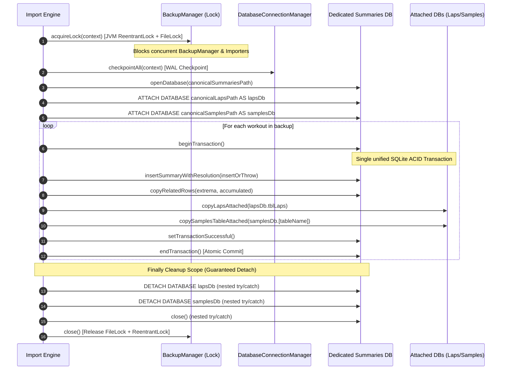

# Stage 1: Problem Domain & Root Cause Analysis: ATT-3992

**Ticket**: [ATT-3992](https://atrainingtracker.atlassian.net/browse/ATT-3992)  
**Subtask**: `ATT-4171` (`[Analysis]`)  
**Parent Epic**: [ATT-281](https://atrainingtracker.atlassian.net/browse/ATT-281) (*Data Sovereignty & Migration*)  
**Target Release**: `Next Minor Release` (V4.9.40)  
**Active Sprint**: `2026-42.10`  
**Requirement Mapping**: `REQ-MIG-043` (*Atomic Cross-Database Import via SQLite ATTACH, Dedicated Scoped Connection, Shared ReentrantLock, Non-Destructive Orphan Repair, insertOrThrow Enforcement & Cooperative Coroutine Responsiveness*)  
**Test Case Mapping**: `TST-MIG-040`  
**Branch**: `feature/ATT-3992`  
**Author**: AI Agent 1 (Implementer)  
**Date**: 2026-10-19  

---

## 1. Executive Summary & Problem Formulation

During the comprehensive October 2026 whole-app code review, critical architectural flaws were uncovered in the workout import pipelines (`ImportEngine.kt` and `LegacyImportEngine.kt`), causing orphan database rows, partial/corrupted workout imports, non-atomic cross-database mutations, and uncooperative coroutine thread blocking:

1. **Silent Insert Failures & Orphan Child Rows (`workout_id = -1`)**:
   - In `ImportEngine.kt:366`, `insertSummaryWithResolution` uses `db.insert(WorkoutSummaries.TABLE, null, values)`.
   - In Android SQLite, `db.insert()` internally catches SQLite constraint and syntax errors and returns `-1L` upon failure instead of propagating an exception.
   - The method does not check whether the returned `newId` is positive.
   - Consequently, `copyRelatedRows` for `TABLE_EXTREMA_VALUES` and `TABLE_ACCUMULATED_SENSORS`, as well as `copyLaps` for `Laps.db`, are invoked with `newId = -1L`.
   - Rows are written with `workout_id = -1`, completely orphaned from any summary row.
   - The transaction on `targetSummariesDb` commits successfully, incrementing `importedCount++` and reporting a corrupt, incomplete workout as a successful import!

2. **Cross-Database Non-Atomicity & Partial Mutations**:
   - Incremental backup restore spans three separate physical SQLite database files:
     - `WorkoutSummaries.db`
     - `Laps.db`
     - `WorkoutSamples.db`
   - The active database transaction in `ImportEngine.kt` only wraps `targetSummariesDb`.
   - If an error occurs during `copyLaps` or `copySamplesTable`, `targetSummariesDb` rolls back, but `targetLapsDb` and `targetSamplesDb` retain partial writes or orphaned tables (`targetLapsDb` lacks transaction rollback, and `targetSamplesDb` retains newly created tables).
   - In `LegacyImportEngine.kt:690-736`, `samplesDbManager.createNewTable` and sample row insertion execute *before* validating `firstTime != null` or checking the result of `summaryDb.database.insert`. If summary insertion fails (`workoutId = -1L`), or if `firstTime == null`, the created samples table remains orphaned indefinitely in `WorkoutSamples.db`.

3. **Schema Mismatches on Forward/Divergent Backups**:
   - In `ImportEngine.kt:copyRelatedRows` and `copyLaps`, columns from the source cursor are blindly transferred into target `ContentValues` without matching against the target schema.
   - If an archive contains unexpected columns or is missing `NOT NULL` columns required by the target schema, `db.insert()` fails silently or throws an exception.
   - Static schema mapping and intersection with explicit safe defaults must be applied to validate and sanitize column assignments prior to insertion.

4. **Uncooperative Coroutine Cancellation & Thread Blocking**:
   - In `LegacyImportEngine.kt:248-251`, bulk recovery worker coroutines catch generic `Exception`:
     ```kotlin
     } catch (e: Exception) {
         Log.e(TAG, "Failed to download/import ${entry.name}", e)
         failedCount.incrementAndGet()
     }
     ```
   - In Kotlin coroutines, `CancellationException` inherits from `IllegalStateException` / `Exception`. Catching generic `Exception` swallows coroutine cancellation, preventing cooperative job cancellation when the user navigates away or cancels the import.
   - Furthermore, `downloadFileWithRetry` and `downloadGoogleDriveFileWithRetry` call `Thread.sleep(backoffMs)`, blocking the underlying `Dispatchers.IO` threads instead of calling suspending `delay(backoffMs)`, and ignoring `coroutineContext.ensureActive()`.

---

## 2. Forensic Code Walkthrough

### 2.1 Failure Call Site in `ImportEngine.kt`
```kotlin
// ImportEngine.kt:189-228
val oldId = cursor.getLong(cursor.getColumnIndexOrThrow(WorkoutSummaries.C_ID))

targetSummariesDb.beginTransaction()
var effectiveBaseName = fileBaseName
try {
    if (isBaseNameTaken(targetSummariesDb, targetSamplesDb, fileBaseName)) {
        effectiveBaseName = disambiguateBaseName(targetSummariesDb, targetSamplesDb, fileBaseName, timeStart)
    }

    // a. Insert Summary: returns -1 if failed!
    val newId = insertSummaryWithResolution(
        context, targetSummariesDb, cursor, sportTypeMapping, equipmentMapping, effectiveBaseName
    )
    
    // BUG 1: If newId == -1L, these copy calls write orphan rows with WORKOUT_ID = -1L
    // BUG 2: targetLapsDb is NOT inside targetSummariesDb transaction.
    // BUG 3: targetSamplesDb created table is not rolled back if copyLaps fails!
    copyRelatedRows(srcSummariesDb, targetSummariesDb, WorkoutSummaries.TABLE_EXTREMA_VALUES, oldId, newId)
    copyRelatedRows(srcSummariesDb, targetSummariesDb, WorkoutSummaries.TABLE_ACCUMULATED_SENSORS, oldId, newId)
    copyLaps(srcLapsDb, targetLapsDb, oldId, newId)
    copySamplesTable(srcSamplesDb, targetSamplesDb, fileBaseName, effectiveBaseName)
    
    targetSummariesDb.setTransactionSuccessful()
    importedCount++
} catch (e: Exception) {
    Log.e(TAG, "Failed to import workout $fileBaseName", e)
} finally {
    targetSummariesDb.endTransaction()
}
```

### 2.2 Premature Side Effects in `LegacyImportEngine.kt`
```kotlin
// LegacyImportEngine.kt:690-736
// Post-parsing: Creates table in WorkoutSamples.db BEFORE verifying summary can be inserted!
if (parsedWorkout.bufferedSamples.isNotEmpty()) {
    samplesDbManager.createNewTable(effectiveBaseFileName, SensorType.values().toList())
    val targetDb = samplesDbManager.database
    val tableName = WorkoutSamplesDatabaseManager.getTableName(effectiveBaseFileName)
    targetDb.beginTransaction()
    try {
        parsedWorkout.bufferedSamples.forEach { sampleValues ->
            targetDb.insert(tableName, null, sampleValues)
        }
        targetDb.setTransactionSuccessful()
    } finally {
        targetDb.endTransaction()
    }
}

// Summary insert happens AFTER samples table is created:
if (firstTime != null) {
    workoutId = getWorkoutId(summaryDb, effectiveBaseFileName)
    if (workoutId == -1L) {
        ...
        workoutId = summaryDb.database.insert(WorkoutSummaries.TABLE, null, summaryValues)
        // BUG: If insert returns -1L, samples table is orphaned!
    }
}
// BUG: If firstTime == null, returns ImportStatus.FAILED but samples table is left in samplesDb!
```

### 2.3 Swallowed Cancellation & Thread Blocking in `LegacyImportEngine.kt`
```kotlin
// LegacyImportEngine.kt:248-251
} catch (e: Exception) { // Swallows CancellationException!
    Log.e(TAG, "Failed to download/import ${entry.name}", e)
    failedCount.incrementAndGet()
}
```
And in retry helpers:
```kotlin
// LegacyImportEngine.kt:288, 292, 480, 484
try { Thread.sleep(backoffMs) } catch (_: Exception) {} // Thread blocking instead of delay()
```

---

## 3. Chesterton's Fence & Invariant Archaeology

1. **Why does incremental import touch three separate databases?**
   - Architectural separation: `WorkoutSummaries.db` contains metadata and extrema, `Laps.db` stores lap markers, and `WorkoutSamples.db` stores high-frequency time-series telemetry.
   - Historically, each database was opened via independent `SQLiteOpenHelper` instances. To achieve true multi-database ACID atomicity without relying on unreliable in-memory compensatory deletes, SQLite's native `ATTACH DATABASE` feature must be utilized on a dedicated scoped connection.
2. **Why was `db.insert()` used instead of `db.insertOrThrow()`?**
   - Originally intended to prevent fatal crashes during bulk imports. However, silently returning `-1L` converted catchable exceptions into permanent database corruption with orphan rows.
3. **Why did `LegacyImportEngine` create the samples table early?**
   - Telemetry points were streamed and buffered in memory during parsing; creating the table early was intended to release memory, but broke transactional ordering by executing uncoordinated writes before verifying summary validity.
4. **Why was `Thread.sleep` used in download retries?**
   - Legacy Dropbox/Drive download helpers originated in older Java AsyncTask/Thread implementations before coroutines were introduced, leaving blocking calls in IO workers.

---

## 4. Remediation Architecture & Target State

### 4.1 True Cross-Database ACID Atomicity via SQLite `ATTACH DATABASE` on Dedicated Connection
Instead of brittle compensatory rollbacks or reactive automated scavengers, the system SHALL enforce "Correct by Construction" using SQLite's native multi-database transaction coordination on a dedicated, non-singleton connection:

1. **Dedicated Connection Lifecycle & Validated Canonical Absolute Paths**:
   - The system SHALL NOT use the global application singleton connection for `ATTACH DATABASE`. Attaching databases to a shared singleton connection risks locking conflicts, schema pollution, and thread contention.
   - Prior to opening the connection, `DatabaseConnectionManager.checkpointAll(context)` executes a WAL checkpoint across all singletons.
   - `ImportEngine` opens a dedicated, scoped `SQLiteDatabase` connection (`dedicatedSummariesDb = SQLiteDatabase.openDatabase(canonicalSummariesPath, null, OPEN_READWRITE)`) strictly for the multi-database import session.
   - Target database paths for `Laps.db` and `WorkoutSamples.db` are validated as canonical absolute paths on the local filesystem (`file.canonicalPath`) prior to calling `ATTACH`.
   - `dedicatedSummariesDb` executes:
     ```kotlin
     dedicatedSummariesDb.execSQL("ATTACH DATABASE ? AS lapsDb", arrayOf(canonicalLapsPath))
     dedicatedSummariesDb.execSQL("ATTACH DATABASE ? AS samplesDb", arrayOf(canonicalSamplesPath))
     ```

2. **Cross-Process & Cross-Thread Concurrency Lock (`BackupManager.acquireLock`)**:
   - A dual JVM-level `ReentrantLock` and OS-level `FileLock` (`BackupManager.acquireLock(context)`) is acquired before starting the import session and released in `finally`.
   - `BackupManager` already holds this dual lock during backup archive creation, and `ImportEngine` acquires it during the entire `ATTACH` import transaction window.
   - This prevents concurrent background tasks, service threads, or backup export workers from executing write operations or opening conflicting locks against these files while attached, completely preventing WAL lock contention and `SQLiteDatabaseLockedException`.



3. **Single Unified ACID Transaction with Hardened Detach & Startup Cleanup**:
   - In SQLite, DDL (`CREATE TABLE`) and DML (`INSERT`) across attached databases are fully transactional. If ANY step fails or if coroutine cancellation occurs, `endTransaction()` automatically rolls back `main`, `lapsDb`, and `samplesDb` in a single atomic rollback. Zero orphan rows, zero orphaned tables.
   - In the outer `finally` block, `DETACH DATABASE lapsDb`, `DETACH DATABASE samplesDb`, and `dedicatedSummariesDb.close()` are wrapped in independent nested `try/catch` blocks. Even if `DETACH` encounters an error, the database connection is closed, ensuring the OS and SQLite release all attachments and locks.
   - On startup, `DatabaseConnectionManager.verifyConnectionHealth()` inspects `PRAGMA database_list` to ensure no dangling attachments persist.

### 4.2 Non-Destructive Diagnostic Orphan Repair Tool
To prevent accidental data loss from automated destructive sweeps on startup:
1. Automated, silent table drops on startup are strictly prohibited.
2. The system introduces `OrphanDataDiagnosticHelper`:
   - Scans `WorkoutSamples.db` for unreferenced tables and child tables for invalid `workout_id <= 0`.
   - Logs findings to diagnostic logs.
   - Provides a non-destructive repair routine that verifies backup presence and user consent prior to executing safe cleanup.

### 4.3 Strict `insertOrThrow` Enforcement & Formal Schema Mapping Policy
1. **Global Replacement of `db.insert()`**:
   - Replace all `db.insert()` calls with `db.insertOrThrow()` across `ImportEngine.kt` and `LegacyImportEngine.kt`.
   - Assert `check(newId > 0)` immediately after insertion.
2. **Formal Data Transformation Policy & Explicit Defaults for `NOT NULL` Columns**:
   - In `copyRelatedRows` and `copyLaps`, source row columns are filtered against static target table column whitelists. Unknown/divergent columns from the source backup are safely discarded.
   - If required target columns with `NOT NULL` constraints are absent from older archives, explicit safe default values are supplied per formal policy:
     | Table | Target Column | Type | Constraint | Default Value | Rationale |
     |---|---|---|---|---|---|
     | `TABLE_EXTREMA_VALUES` | `WORKOUT_ID` | `INTEGER` | `NOT NULL` | `newId` | Relational parent foreign key |
     | `TABLE_EXTREMA_VALUES` | `SENSOR_TYPE` | `INTEGER` | `NOT NULL` | `0` | SensorType.NONE fallback |
     | `TABLE_EXTREMA_VALUES` | `MIN_VALUE` | `REAL` | `NOT NULL` | `0.0` | Zero metric neutral baseline |
     | `TABLE_EXTREMA_VALUES` | `MAX_VALUE` | `REAL` | `NOT NULL` | `0.0` | Zero metric neutral baseline |
     | `TABLE_EXTREMA_VALUES` | `AVG_VALUE` | `REAL` | `NOT NULL` | `0.0` | Zero metric neutral baseline |
     | `TABLE_ACCUMULATED_SENSORS` | `WORKOUT_ID` | `INTEGER` | `NOT NULL` | `newId` | Relational parent foreign key |
     | `TABLE_ACCUMULATED_SENSORS` | `SENSOR_TYPE` | `INTEGER` | `NOT NULL` | `0` | SensorType.NONE fallback |
     | `TABLE_ACCUMULATED_SENSORS` | `VALUE` | `REAL` | `NOT NULL` | `0.0` | Zero metric neutral baseline |
     | `Laps.TABLE` (`tblLaps`) | `WORKOUT_ID` | `INTEGER` | `NOT NULL` | `newId` | Relational parent foreign key |
     | `Laps.TABLE` (`tblLaps`) | `LAP_NUMBER` | `INTEGER` | `NOT NULL` | `1` | First lap ordinal default |
     | `Laps.TABLE` (`tblLaps`) | `START_TIME` | `INTEGER` | `NOT NULL` | `0L` | Epoch zero fallback |
     | `Laps.TABLE` (`tblLaps`) | `DURATION` | `INTEGER` | `NOT NULL` | `0L` | Zero duration fallback |
     | `Laps.TABLE` (`tblLaps`) | `DISTANCE` | `REAL` | `NOT NULL` | `0.0` | Zero distance fallback |
   - If a source record cannot satisfy required constraints and cannot be transformed safely via the default table, the row is rejected to prevent database corruption.

### 4.4 Pipeline Inversion in `LegacyImportEngine.kt`
1. **Validate Preconditions First**:
   - In `LegacyImportEngine.saveParsedWorkout()`, check `firstTime != null` before touching any database. If `firstTime == null`, return `ImportResult(ImportStatus.FAILED)` immediately with zero database side-effects.
2. **Inverted Transactional Staging**:
   - Move dynamic samples table creation and insertion *inside* the transaction block, strictly *after* the summary row has been successfully inserted with `insertOrThrow`.
   - Enclose the entire persistence sequence in a synchronized transaction block so that failures in sample insertion or statistical recalculation abort cleanly without leaving partial records or orphan tables.

### 4.5 Cooperative Coroutine Cancellation & Responsiveness
1. **Explicit `CancellationException` Propagation**:
   - In `LegacyImportEngine.kt:208-258` and all worker loops, catch `CancellationException` explicitly and rethrow it immediately.
2. **Non-Blocking Suspending Delays**:
   - Replace all `Thread.sleep(ms)` in `downloadFileWithRetry` and `downloadGoogleDriveFileWithRetry` with `delay(ms)`.
3. **Loop Responsiveness**:
   - Call `coroutineContext.ensureActive()` at the start of each import loop iteration to immediately respect job cancellation before initiating heavy I/O.

---

## 5. Risk Assessment & Verification Strategy

- **Risk**: Database concurrency during the `ATTACH` window across threads and processes.
  - *Mitigation*: Dual JVM `ReentrantLock` and OS-level `FileLock` (`BackupManager.acquireLock(context)`), WAL checkpoints prior to attach, dedicated scoped connection lifecycle, absolute path validation, and guaranteed `DETACH` + `close()`.
- **Verification Plan**:
  - Author `WorkoutImportAtomicityTest.kt`:
    - Test atomic rollback via `ATTACH DATABASE`: simulate a failure during sample copy or lap copy; assert that summary, laps, and samples table are all 100% rolled back.
    - Test partial failure during `ATTACH`: assert that if `ATTACH DATABASE` fails (e.g. invalid path or file missing), the connection cleanly closes and leaves no dangling transaction.
    - Test process death / transaction uncommitted rollback: verify SQLite uncommitted transaction state is rolled back cleanly upon reconnect.
    - Test shared dual concurrency lock: assert that concurrent `BackupManager` and import requests serialize cleanly without `SQLiteDatabaseLockedException`.
    - Test non-destructive orphan diagnostic tool: verify unreferenced tables are detected and logged without automated destruction.
    - Test `insertOrThrow` enforcement: assert that summary insertion failure throws and aborts without orphan child rows (`workout_id = -1`).
    - Test static schema mapping policy: verify extra unknown columns are discarded and missing `NOT NULL` columns receive explicit default values.
    - Test coroutine cancellation: assert worker job cancels promptly and rethrows `CancellationException` without thread blocking.
  - Run full clean-room suite: `./gradlew testDebugUnitTest`.
