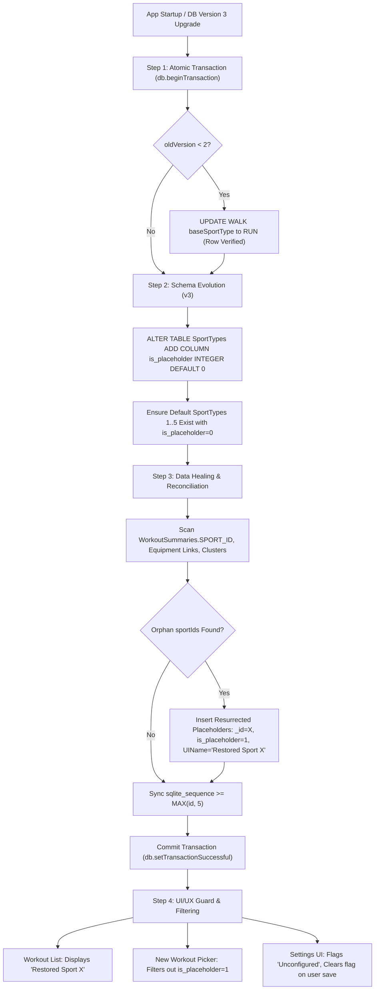

# Stage 1: Problem Domain & Root Cause Analysis: ATT-3993 (Revision 2)

**Ticket**: [ATT-3993](https://atrainingtracker.atlassian.net/browse/ATT-3993)  
**Subtask**: `ATT-4176` (`[Analysis]`)  
**Parent Epic**: [ATT-281](https://atrainingtracker.atlassian.net/browse/ATT-281) (*Data Sovereignty & Migration*)  
**Target Release**: `Next Minor Release` (V4.9.40)  
**Active Sprint**: `2026-42.10`  
**Requirement Mapping**: `REQ-MIG-044` (*Non-Destructive SportType Schema Upgrade, Custom Sport Preservation, Post-v2 Data Healing Reconciliation, Placeholder Flagging & Foreign Key Integrity*)  
**Test Case Mapping**: 
- `TST-MIG-041.1` (Clean v1->v3 Migration & Invariant Preservation)
- `TST-MIG-041.2` (Corrupted Post-v2 State Healing & Placeholder Flagging)
- `TST-MIG-041.3` (Atomic Transactionality & Sequence Protection)
- `TST-MIG-041.4` (UI Filtering & Legacy Representation)
- `TST-MIG-041.5` (Strict Downgrade Guard)  
**Branch**: `feature/ATT-3993`  
**Author**: AI Agent 1 (Implementer)  
**Date**: 2026-10-19  

---

## 1. Executive Summary & Problem Formulation

During the October 2026 whole-app code review, an urgent data-loss defect was identified in `SportTypeDatabaseManager.java`:
```java
// SportTypeDatabaseManager.java:797-804
@Override
public void onUpgrade(SQLiteDatabase db, int oldVersion, int newVersion) {
    // TODO: alter table instead of deleting!

    db.execSQL("drop table if exists " + SportType.TABLE);

    if (DEBUG) Log.d(TAG, "onUpgraded");
    onCreate(db);  // run onCreate to get new database
}
```

Whenever SQLite triggers `onUpgrade` on `SportType.db`:
1. The table `SportTypes` is dropped unconditionally via `DROP TABLE IF EXISTS SportTypes`.
2. `onCreate(db)` runs, which creates a fresh table and inserts only the 5 default system sport types:
   - `_id = 1`: `OTHER`
   - `_id = 2`: `RUN`
   - `_id = 3`: `BIKE`
   - `_id = 4`: `WALK`
   - `_id = 5`: `MTB`
3. Any custom sport types created or configured by the athlete (which receive `_id >= 6` via SQLite `AUTOINCREMENT`) are completely erased.
4. SQLite's internal sequence for `AUTOINCREMENT` (`sqlite_sequence`) is destroyed and reset.

On February 8, 2026 (commit `7339ebc505e415593b4a8365698b59d4ecdc7b43`), `DB_VERSION` was bumped from 1 to 2 to update the base sport type of `WALK` from `UNKNOWN` to `RUN`. Any athlete device upgrading from schema v1 to v2 suffered complete erasure of all user-defined sport types. Moreover, any future schema upgrade or version bump will repeat this catastrophic data loss unless remediated.

---

## 2. Forensic Code Walkthrough & State of the World

### 2.1 Two Distinct Affected User Populations
To ensure complete remediation, the system must address two distinct real-world states:
1. **Population A (Direct / Clean v1 -> v3 Upgrade)**:
   - Athletes who have not yet upgraded from v1 (e.g. upgrading from older app releases or restoring older database backups).
   - In their `SportType.db`, custom sport types still exist with their original IDs (`_id >= 6`).
   - For this population, `onUpgrade` must be strictly non-destructive: update `WALK`'s base sport type from `UNKNOWN` to `RUN`, preserve all existing custom sport types, and retain stable primary key IDs.
2. **Population B (Corrupted / Post-v2 State)**:
   - Athletes whose app already executed the buggy v1 -> v2 upgrade.
   - Their custom sport types were dropped in SQLite.
   - However, foreign key references in external databases remain intact:
     - `WorkoutSummaries.db` contains workouts where `WorkoutSummaries.SPORT_ID` references the old custom IDs (e.g. `6`, `7`).
     - `Equipment.db` contains equipment links where `COLUMN_SPORT_ID` references the old custom IDs.
     - `WorkoutClusters.db` contains cluster records with `COLUMN_PROBABLE_SPORT_ID` pointing to the old IDs.
   - When the user opened workouts after v2, `SportTypeDatabaseManager.getString(id, ...)` found no match for `id = 6` and silently fell back to `id = 1` (`OTHER`).
   - Worse, if the user subsequently created a new custom sport type (e.g. "Yoga"), SQLite's reset `AUTOINCREMENT` sequence reissued `_id = 6`. All historical "Inline Skating" workouts then silently became cross-wired and displayed as "Yoga"!

---

## 3. Data Healing, Schema Evolution & Reconciliation Architecture

To solve both future prevention and existing damage repair without creating unmanageable "zombie" data, Schema Version 3 introduces an explicit placeholder flag (`is_placeholder INTEGER DEFAULT 0`) coupled with transactional sequence synchronization and UI filtering:



### 3.1 Non-Destructive Placeholder Resurrection with `is_placeholder`
When `SportTypeReconciliationHelper` identifies orphan sport IDs (e.g. `sportId = 6`) referenced in `WorkoutSummaries`:
1. It inserts a resurrecting placeholder entry into `SportTypes`:
   - `_id = 6` (explicitly forced primary key)
   - `UIName = "Restored Sport 6"`
   - `baseSportType = "UNKNOWN"`
   - `is_placeholder = 1` (explicitly marking it as a system-healed placeholder)
   - Default export mappings (`TCX/Runkeeper/TrainingPeaks = "Other"`, `Strava/GC = ""`)
2. **Immediate Referential Restoration & UI Isolation**:
   - Workouts referencing `sportId = 6` immediately regain a distinct sport entity instead of collapsing to `OTHER`.
   - In active workout creation/tracking pickers (e.g. `SportTypeSelectorContract`), items where `is_placeholder == 1` are **filtered out** so users cannot inadvertently start new workouts using an unconfigured placeholder.
   - In historical workout cards, the workout safely displays "Restored Sport 6" with default icons, avoiding crash or confusion.
   - In the Sport Type management settings screen, these entries are badged as "Restored (Unconfigured)". If the athlete edits and saves the sport type, `is_placeholder` is reset to `0`, graduating it to a full user-managed sport type.

### 3.2 Transactional `sqlite_sequence` Protection
SQLite maintains the next auto-increment ID in `sqlite_sequence (name, seq)`.
To prevent future ID collisions:
- The reconciliation helper determines `maxId = MAX(MAX(SportTypes._id), MAX(WorkoutSummaries.sportId), 5)`.
- Inside the atomic migration transaction, it executes:
  ```sql
  INSERT OR REPLACE INTO sqlite_sequence (name, seq)
  VALUES ('SportTypes', MAX(COALESCE((SELECT seq FROM sqlite_sequence WHERE name = 'SportTypes'), 0), :maxId));
  ```
- This guarantees that any new custom sport types created by the user in the future will receive `_id > maxId`, strictly eliminating primary key collisions with existing or historical workout records.

### 3.3 Strict Downgrade Guard
`SportTypeDbHelper.onDowngrade(SQLiteDatabase db, int oldVersion, int newVersion)`:
- In order to prevent accidental schema reversal, data loss, or out-of-sync `sqlite_sequence` states, `onDowngrade` will **never** drop tables.
- It will throw a strict `SQLiteException("Downgrade of SportType.db from version " + oldVersion + " to " + newVersion + " is prohibited to prevent data loss and foreign key corruption.")`.

---

## 4. Chesterton's Fence Archaeology (`REQ-PRO-022`)

### 4.1 Original Requirement & Target
- Target: `SportTypeDatabaseManager.SportTypeDbHelper.onUpgrade`.
- Intended Behavior: Incremental database version upgrade without athlete data loss.

### 4.2 Historical Origin & Commit Trace
- Initial Scaffolding: `SportTypeDbHelper` was created with a placeholder `drop table if exists` implementation.
- Commit `7339ebc5`: Version 2 was introduced solely to change the default `BSportType` of `WALK` from `UNKNOWN` to `RUN`.

### 4.3 Root Reason for Existing Formulation
The table recreation was scaffolding written before production deployment with user-created custom sport types. The comment `// TODO: alter table instead of deleting!` explicitly acknowledges that dropping the table is wrong and must be replaced.

### 4.4 Preservation of Core Invariants
1. **Zero Data Loss**: User-defined sport types (`_id >= 6` and any modified custom records) must be 100% preserved across all database upgrades.
2. **Stable Primary Keys**: The primary keys (`_id`) of custom sport types must remain strictly immutable to preserve foreign key integrity with `WorkoutSummaries.SPORT_ID`, `SportTypeEquipmentLinkManager`, and `WorkoutClusters`.
3. **Atomic Migration Logic**:
   - All migration operations (`WALK` baseSportType update, `is_placeholder` column addition, default row checks, sequence sync) execute within a single atomic `beginTransaction` / `setTransactionSuccessful` block.
4. **Isolation of Healed Placeholders**: Resurrected sport types must not pollute active sport selection pickers (`is_placeholder = 1`).
5. **Strict Downgrade Rejection**: Downgrades are rejected with an explicit exception rather than executing table destruction.

---

## 5. Scope Bounding (`ATT-1250`)

### 5.1 In-Scope Objectives
- **Version 3 Bump & Non-Destructive `onUpgrade`**:
  - Bump `SportTypeDbHelper.DB_VERSION` to 3.
  - Implement incremental atomic migrations for `oldVersion < 2` and `oldVersion < 3`.
  - Transactional update for `WALK` base sport type with existence verification.
  - Add `is_placeholder INTEGER DEFAULT 0` column to `SportTypes`.
- **Data Healing & Reconciliation Engine (`SportTypeReconciliationHelper`)**:
  - Scan `WorkoutSummaries`, equipment links, and clusters for orphan sport IDs.
  - Resurrect placeholder sport types with `is_placeholder = 1` and exact original primary keys.
  - Synchronize `sqlite_sequence` to `MAX(id, 5)` to eliminate ID reuse vulnerabilities.
- **UI/UX Guarding**:
  - Filter out `is_placeholder = 1` sport types in `SportTypeSelectorContract` / new workout pickers.
  - Ensure safe display in historical workout cards.
- **Strict Downgrade Guard**:
  - Implement `onDowngrade` throwing `SQLiteException` to prevent data loss.
- **Unit & Migration Tests**:
  - `TST-MIG-041.1` through `TST-MIG-041.5`.
- **Documentation**: Register formal requirement `REQ-MIG-044` in `docs/requirements.md` and test case `TST-MIG-041` in `docs/tests.md`.

### 5.2 Out-of-Scope Items
- Modifying cloud export protocols (`Strava`, `Runkeeper`).
- Modifying unrelated database schemas (`Laps.db`, `WorkoutSamples.db`).

---

## 6. Acceptance Criteria & Verification Plan

### Acceptance Criteria
- **Criterion 1 (Custom Sport Preservation - Clean v1->v3)**: Given a SportType database at version 1 containing user-created sport types (`_id = 6`, `_id = 7`), when upgraded to version 3, then all user-created sport types and their primary key IDs are fully preserved.
- **Criterion 2 (v1->v2 Walk Base Sport Type Update)**: Given a SportType database at version 1 where `WALK` has `baseSportType = 'UNKNOWN'`, when upgraded to version 2 or 3, then `WALK` has `baseSportType = 'RUN'`.
- **Criterion 3 (Post-v2 Corrupted State Reconciliation & Flagging)**: Given a database in post-v2 state where custom sport types were lost and `WorkoutSummaries` contains records referencing `sportId = 6`, when reconciliation runs, then a placeholder sport type with `_id = 6` and `is_placeholder = 1` is resurrected, workouts point to this entity, and `sqlite_sequence` is set >= 6.
- **Criterion 4 (UI Isolation)**: Sport types with `is_placeholder = 1` are excluded from new workout selection lists but rendered safely in historical workout summaries.
- **Criterion 5 (Strict Downgrade Rejection)**: Invoking `onDowngrade` throws `SQLiteException` without dropping tables or modifying data.
- **Criterion 6 (Clean-Room Verification)**: 100% test pass rate across unit test suite.
