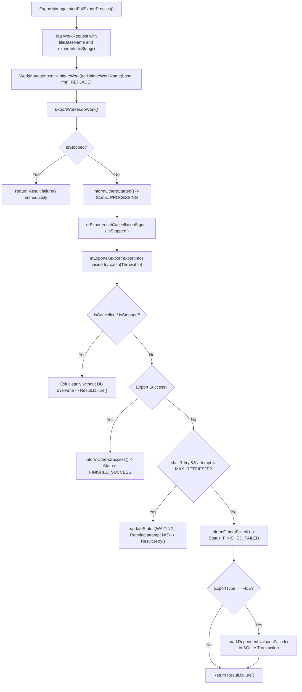

# Stage 1 Analysis: ATT-3995 - [Bug] [High] Export jobs retry forever, get stuck and cannot be cancelled

**Ticket**: [ATT-3995](https://rainerblind.atlassian.net/browse/ATT-3995)  
**Sub-task**: [ATT-4186](https://rainerblind.atlassian.net/browse/ATT-4186) (`[Analysis]`)  
**Parent Epic**: None (*Product Backlog*)  
**Target Release**: `V4.9.40`  
**Active Sprint**: `2026-42.10`  
**Branch**: `feature/ATT-3995`  
**Author**: AI Agent 1 (Implementer)  
**Date**: 2026-10-19  

---

## 1. Problem Statement & Motivation

During whole-app code review (2026-10-18, commit `0234bfc0`), critical vulnerabilities in the background export and upload pipeline (`ExportWorker.kt`, `BaseExporter.java`, and `ExportManager.java`) were identified:

1. **Infinite Export Worker Retry Loop**:
   When an export operation encounters a deterministic error (such as a malformed timestamp throwing `ParseException`, corrupted JSON throwing `JSONException`, or illegal file base name throwing `IllegalArgumentException`), `BaseExporter.export()` improperly maps the failure to `pleaseRetryWhenFailed = true`. In `ExportWorker.kt`, `doWork()` unconditionally delegates failure handling to `if (result.shallRetry()) Result.retry() else Result.failure()` without querying `runAttemptCount` or enforcing an attempt ceiling. Because the error is deterministic, every subsequent retry attempt fails immediately, creating an infinite retry cycle that drains the athlete's device battery and pollutes Android system logs.

2. **Uncaught RuntimeExceptions Causing Stuck `PROCESSING` State**:
   `BaseExporter.export()` catches only `IOException | JSONException | ParseException`. Any unhandled `RuntimeException` (such as `IllegalArgumentException` from `WorkoutSamplesDatabaseManager.getTableName()`, `NullPointerException`, `IllegalStateException`, or SQLite crashes) escapes `BaseExporter.export()` and `ExportWorker.doWork()`. Consequently, `informOthersFailed()` is never called, leaving the export state in `ExportStatusDatabaseManager` stuck permanently in `PROCESSING`. Furthermore, Android WorkManager marks the unhandled execution as failed or schedules retries without ever updating the database status, leaving the UI displaying a spinning progress indicator indefinitely.

3. **Orphaned Dependent Upload Rows in `WAITING` State**:
   When an export request includes cloud uploads (e.g. Dropbox, Google Drive, Strava), `ExportManager` schedules a chain: `fileCreationWork` followed by `uploadWorks`. All dependent upload rows in `ExportStatusDatabaseManager` are initialized to `WAITING`. If the initial `fileCreationWork` fails (returning `Result.failure()`), WorkManager cancels downstream dependent works in the chain, meaning `ExportWorker` is never instantiated for them. Because no worker runs for downstream tasks, their rows remain indefinitely in `WAITING` status in the database and UI, confusing the athlete.

4. **Defective Invalidation & Cooperative Cancellation (`invalidateWorkoutExport` is a No-Op)**:
   In `WorkoutRepository.kt`, when a workout is edited or cropped, `ExportManager.invalidateWorkoutExport(baseFileName)` is invoked to cancel scheduled/active export jobs before data is rewritten. `invalidateWorkoutExport()` calls `WorkManager.cancelAllWorkByTag(fileBaseName)` and `WorkManager.cancelUniqueWork("export_" + fileBaseName)`. However:
   - In `ExportManager.createWorkRequest()`, requests were tagged with `exportInfo.toString()` (e.g. `"FILE: GPX: 2026-10-18_12-00-00"`), which does NOT match the search tag `fileBaseName` (`"2026-10-18_12-00-00"`).
   - In `ExportManager.startFullExportProcess()`, work was enqueued via non-unique `beginWith(...)`, meaning no unique work with name `"export_" + fileBaseName` ever existed in WorkManager.
   - Consequently, both cancellation calls were complete no-ops! Active and queued workers continued running in the background. If a workout was cropped, queued uploads failed with "file does not exist" or raced against newly enqueued exports with inconsistent data.
   - Additionally, `ExportWorker` and underlying exporters lacked cooperative cancellation checks: once `withContext(Dispatchers.IO) { mExporter.export(mExportInfo) }` was entered, long-running export loops continued executing even if WorkManager stopped or cancelled the worker.

---

## 2. Root Cause Analysis (Forensic Investigation)

### 2.1 Exception Classification & Retry Flag Mapping (`BaseExporter.java`)
In `BaseExporter.java`:
```java
public final ExportResult export(@NonNull ExportInfo exportInfo) {
    if (DEBUG) Log.d(TAG, "export: " + exportInfo.toString());
    try {
        ExportResult exportResult = doExport(exportInfo);
        onFinished(exportInfo);
        return exportResult;
    } catch (IOException | JSONException | ParseException e) {
        return new ExportResult(false, true, e.getMessage()); // BUG: always pleaseRetryWhenFailed = true!
    }
}
```
- `ParseException` is inherently deterministic: input formatting will not change upon immediate re-execution. Returning `pleaseRetryWhenFailed = true` is erroneous.
- `JSONException` is also deterministic when parsing localized config or export schemas.
- `RuntimeException` is uncaught: an `IllegalArgumentException` (e.g. from invalid `baseFileName` or sample table query) escapes unchecked.

### 2.2 Uncapped Worker Retries & Escaped Exceptions (`ExportWorker.kt`)
In `ExportWorker.kt`:
```kotlin
val result = CropCoordinator.mutex.withLock {
    if (isStopped) {
        return Result.failure()
    }
    withContext(Dispatchers.IO) {
        mExporter.export(mExportInfo)
    }
}
...
return if (result.success()) {
    informOthersSuccess(result.answer())
    Result.success()
} else {
    informOthersFailed(result.answer())
    if (result.shallRetry()) Result.retry() else Result.failure()
}
```
- When `result.shallRetry()` is true, `informOthersFailed()` is called (setting `FINISHED_FAILED`), but `Result.retry()` causes WorkManager to reschedule the worker. On the next execution, `informOthersStarted()` resets the state to `PROCESSING`, oscillating the UI state machine indefinitely.
- `runAttemptCount` is never inspected. Without `runAttemptCount >= MAX_RETRIES`, WorkManager retries forever until battery exhaustion or process termination.
- If `ExportManager.getExporter(...)` or `mExporter.export(...)` throws a `RuntimeException`, the coroutine aborts without calling `informOthersFailed()`, permanently abandoning the database row in `PROCESSING`.

### 2.3 Broken Tagging and Non-Unique Work Enqueuing (`ExportManager.java`)
In `ExportManager.java`:
- Work requests are built via:
  ```java
  return new OneTimeWorkRequest.Builder(ExportWorker.class)
          .setInputData(inputData)
          .setConstraints(constraints)
          .addTag(exportInfo.toString()) // BUG: tagged as "FILE: GPX: workout_123", NOT "workout_123"
          .build();
  ```
- Work is enqueued via:
  ```java
  WorkManager.getInstance(mContext).beginWith(fileCreationWork)...enqueue(); // BUG: non-unique work
  ```
- But cancellation in `invalidateWorkoutExport` relies on:
  ```java
  WorkManager.getInstance(mContext).cancelAllWorkByTag(fileBaseName);
  WorkManager.getInstance(mContext).cancelUniqueWork("export_" + fileBaseName);
  ```
  Because tags and unique work names never matched, WorkManager could not find or cancel the queued work.

### 2.4 Orphaned Dependent Upload Rows
When a chain `fileCreationWork -> uploadWorks` is submitted, all upload rows are written as `WAITING`. If `fileCreationWork` fails, WorkManager marks downstream works as cancelled/failed without executing them. Consequently, no component was responsible for updating the `WAITING` rows of dependent uploads in `ExportStatusDatabaseManager` to `FINISHED_FAILED`.

### 2.5 Cross-Reference ATT-3980: Unchecked `fileBaseName` in `WorkoutDeletionHelper`
In `WorkoutDeletionHelper.deleteWorkout(long workoutId)`:
If `fileBaseName` is null, blank, or `"null"`, calling `mSamplesManager.deleteWorkout(fileBaseName)` triggers `WorkoutSamplesDatabaseManager.getTableName()`, which throws `IllegalArgumentException`. Furthermore, `deleteWorkout` did not cancel any pending/running WorkManager export tasks for that workout.

---

## 3. User Scope Grounding (ATT-1250)

* **In-Scope Goals**:
  1. Fix `BaseExporter.java`:
     - Distinguish deterministic exceptions (`ParseException`, `JSONException`, `IllegalArgumentException`, `NullPointerException`, `IllegalStateException`, `RuntimeException`) which must return `shallRetry = false`.
     - Only transient I/O exceptions (`IOException`, e.g. network/socket drops) may suggest `shallRetry = true`.
     - Introduce explicit `CancellationSignal` (`BooleanSupplier`) support checked in tight sample cursor loops across file writers (`BaseFileWriter`, `CSVFileWriter`, `FitFileWriter`, `GCFileWriter`, `GPXFileWriter`, `TCXFileWriter`). Ensure all file writers strictly close resources (streams/cursors) and delete partial files in `finally` upon `CancellationException`.
     - Defensively catch all `Throwable` / `Exception` so no error escapes `export()` unhandled.
  2. Fix `ExportWorker.kt`:
     - Cap retries at `MAX_RETRIES = 3`. If `runAttemptCount >= MAX_RETRIES`, force terminal failure (`Result.failure()`) and mark `FINISHED_FAILED`.
     - Pass `isStopped` lambda to `mExporter.setCancellationSignal { isStopped }` so active file export aborts immediately on WorkManager worker cancellation or replacement.
     - Self-healing state recovery: when `doWork()` starts, take over and safely reset status to `PROCESSING` with timestamp, preventing stranded states across process interruptions.
     - Strict cancellation sequencing: if `isStopped` is true before or after execution, return `Result.failure()` without overwriting database status.
     - On file creation failure (`ExportType.FILE`), atomically mark dependent upload rows for `(fileBaseName, fileFormat)` as `FINISHED_FAILED` within a SQLite transaction.
  3. Fix `ExportManager.java`:
     - Centralize unique work naming in public static helper: `ExportManager.getUniqueWorkName(fileBaseName, fileFormat) -> "export_" + fileBaseName + "_" + fileFormat.name()`. Document pattern in class header.
     - Tag every `OneTimeWorkRequest` with both `fileBaseName` and `exportInfo.toString()`.
     - Enqueue work as unique work using `beginUniqueWork(getUniqueWorkName(fileBaseName, fileFormat), ExistingWorkPolicy.REPLACE, fileCreationWork)`.
     - In `invalidateWorkoutExport`, execute WorkManager cancellation synchronously first before database invalidation, cancelling by `fileBaseName` tag, unique work names, and legacy tags (`exportInfo.toString()`).
  4. Fix `ExportStatusDatabaseManager.java`:
     - Add `markDependentUploadsFailed(fileBaseName, fileFormat, errorMsg)` executed inside a native SQLite transaction (`db.beginTransaction() ... db.setTransactionSuccessful() ... db.endTransaction()`).
     - Add query-time self-healing in `getExportStatusMap` / `getExportRows`: any row in `PROCESSING` whose last-modified timestamp exceeds a 10-minute timeout is lazily recovered to `FINISHED_FAILED` ("Export timed out"), avoiding startup latency and eliminating `Application.onCreate()` global scans.
  5. Fix `WorkoutDeletionHelper.java`:
     - Guard `fileBaseName` before delegating to `mSamplesManager.deleteWorkout(fileBaseName)` against blank or `"null"` strings.
     - Trigger WorkManager cancellation for `fileBaseName` asynchronously without blocking the UI thread.
  6. Expand unit test suites (`ExportWorkerTest.kt`, `BaseExporterTest.kt`, `ExportManagerTest.kt`, `WorkoutDeletionHelperTest.kt`, `ExportStatusDatabaseManagerTest.kt`) to achieve 100% test verification.

* **Out-of-Scope Non-Goals (Scope Bounding)**:
  - Rewriting cloud uploaders (`DropboxUploader`, `GoogleDriveUploader`, `StravaUploader`) to use coroutines or new OAuth SDKs.
  - Adding global blocking database scans in `Application.onCreate()`.
  - Altering the user-facing export format options or UI layout.

---

## 4. Requirement Archaeology & Chesterton's Fence Audit

* **Original Requirement ID & Target**: Net-new requirement `REQ-DAT-029` (Export Job Resiliency, Retry Capping, Cooperative Cancellation, and Stuck-State Remediation), extending `REQ-DAT-018` and `REQ-DAT-028`.
* **Historical Origin & Commit Trace**: Ticket `ATT-3995`, Sprint `2026-42.10`, identified in code review `feature/ATT-3921` (`0234bfc0`) and ATT-3980 cross-reference.
* **Root Reason for Existing Formulation**: Early export implementation treated all exceptions uniformly with a blanket retry flag, assuming network flakiness was the primary cause of export failures. WorkManager unique work and tagging were introduced inconsistently across multiple sprints without end-to-end cancellation verification.
* **Preservation of Core Invariants**:
  - Valid exports to all formats (FIT, GPX, TCX, CSV, GC) continue functioning seamlessly.
  - Cloud uploads execute with transient retry capability up to 3 attempts.
  - Zero regression in existing test suite.

---

## 5. Architectural Strategy & High-Level Solution



### 5.1 Centralized WorkManager Coordination & Legacy Cleanup (`ExportManager.java`)
- Centralize unique work name construction in public static helper:
  ```java
  @NonNull
  public static String getUniqueWorkName(@NonNull String fileBaseName, @NonNull FileFormat fileFormat) {
      return "export_" + fileBaseName + "_" + fileFormat.name();
  }
  ```
- Work requests are tagged with both `fileBaseName` and `exportInfo.toString()`.
- In `invalidateWorkoutExport(@NonNull String fileBaseName)`:
  1. Synchronously trigger cancellation:
     - `WorkManager.cancelAllWorkByTag(fileBaseName)`
     - For each `FileFormat`: `WorkManager.cancelUniqueWork(getUniqueWorkName(fileBaseName, format))`
     - `WorkManager.cancelUniqueWork("export_" + fileBaseName)`
     - For each `ExportInfo` variant: `WorkManager.cancelAllWorkByTag(exportInfo.toString())` (clearing legacy-tagged work)
  2. Perform file cache cleanup.
  3. Mark export status in DB as `WAITING`.

### 5.2 Explicit Cooperative Cancellation Mechanism (`BaseExporter.java` & `BaseFileWriter.java`)
- Add a thread-safe cancellation callback to `BaseExporter`:
  ```java
  public interface CancellationSignal {
      boolean isCancelled();
  }
  private CancellationSignal mCancellationSignal = null;
  public void setCancellationSignal(@Nullable CancellationSignal signal) { mCancellationSignal = signal; }
  public boolean isCancelled() {
      return (mCancellationSignal != null && mCancellationSignal.isCancelled()) || Thread.currentThread().isInterrupted();
  }
  ```
- In all sample cursor loops (`FitFileWriter`, `GPXFileWriter`, `TCXFileWriter`, `CSVFileWriter`, `GCFileWriter`):
  ```java
  if (isCancelled()) {
      throw new CancellationException("Export cancelled");
  }
  ```
- In `BaseExporter.export()`:
  - Catch `CancellationException` and `InterruptedException`:
    Clean up any partially written files and return `new ExportResult(false, false, "Export cancelled")`.
  - All file writer stream and cursor resources are enclosed in `try-with-resources` / `finally` blocks, guaranteeing zero resource leaks upon cancellation.

### 5.3 Deterministic vs Retryable Error Classification (`BaseExporter.java`)
- Deterministic errors (`ParseException`, `JSONException`, `RuntimeException` like `IllegalArgumentException`, `NullPointerException`): return `ExportResult(false, false, e.getMessage())`.
- Transient I/O errors (`IOException` except file not found due to invalid base name): return `ExportResult(false, true, e.getMessage())`.
- Comprehensive `Throwable` catch: no error escapes to crash the coroutine or abandon status.

### 5.4 Attempt Capping, Transactional Dependent Upload Remediation (`ExportWorker.kt`)
- `const val MAX_RETRIES = 3`.
- Set 30s exponential backoff on WorkRequest builder.
- Strict sequencing:
  - If `isStopped` is detected after execution, exit with `Result.failure()` without updating DB, preserving any `WAITING` state set by `invalidateWorkoutExport`.
  - If retryable failure occurs with `runAttemptCount < MAX_RETRIES`: update status to `WAITING` with retry attempt notice and return `Result.retry()`.
  - If failure is non-retryable or `runAttemptCount >= MAX_RETRIES`: call `informOthersFailed()`.
  - If `exportType == FILE`, call `exportStatusDatabaseManager.markDependentUploadsFailed(fileBaseName, fileFormat, errorMsg)`.

### 5.5 Transactional Integrity & Lazy Self-Healing (`ExportStatusDatabaseManager.java`)
- In `markDependentUploadsFailed()`:
  ```java
  public void markDependentUploadsFailed(@NonNull String fileBaseName, @NonNull FileFormat fileFormat, @Nullable String reason) {
      SQLiteDatabase db = mDbHelper.getWritableDatabase();
      if (db == null) return;
      db.beginTransaction();
      try {
          ContentValues values = new ContentValues();
          values.put(EXPORT_STATUS, ExportStatus.FINISHED_FAILED.name());
          values.put(ANSWER, reason != null ? reason : "Parent export file generation failed");
          db.update(ExportStatusDbHelper.TABLE, values,
                  WorkoutSummaries.FILE_BASE_NAME + "=? AND " + FORMAT + "=? AND " + TYPE + "!=? AND " + EXPORT_STATUS + "=?",
                  new String[]{fileBaseName, fileFormat.name(), ExportType.FILE.name(), ExportStatus.WAITING.name()});
          db.setTransactionSuccessful();
      } finally {
          db.endTransaction();
      }
  }
  ```
- Lazy query-time self-healing:
  When reading export rows or maps, any row in `PROCESSING` state whose duration exceeds a 10-minute timeout (or where the associated worker is dead) is safely transitioned to `FINISHED_FAILED`. This avoids startup scans while ensuring UI never shows permanent spinning progress indicators.

### 5.6 Defensive Deletion in `WorkoutDeletionHelper.java`
- Cancel all WorkManager tasks for `fileBaseName` before deleting rows.
- Verify `fileBaseName != null && !fileBaseName.trim().isEmpty() && !"null".equalsIgnoreCase(fileBaseName.trim())` before invoking `mSamplesManager.deleteWorkout()`.

---

## 6. System Invariants & Risk Assessment

* **Core Invariants**:
  1. Zero regression in existing export features, file format generators, and unit tests.
  2. All export operations must terminate in a definitive status (`FINISHED_SUCCESS` or `FINISHED_FAILED`), never staying permanently stuck in `PROCESSING` or `WAITING`.
  3. WorkManager retries must be capped at 3 attempts and apply exponential backoff.
  4. Cancelling an export or cropping a workout must cleanly terminate active/pending export work without orphaned threads or corrupted files.
  5. Marking dependent uploads failed must be an atomic transaction in SQLite.
* **Risk Rating**: **MEDIUM**
  - Justification: Changes affect WorkManager scheduling and worker execution lifecycle across all export formats. However, the changes strictly improve error handling, add attempt bounds, and fix invalidation tags without altering file format serialization logic. Comprehensive unit tests will verify all edge cases including cancellation responsiveness, retry bounds, transactionality, and self-healing.
