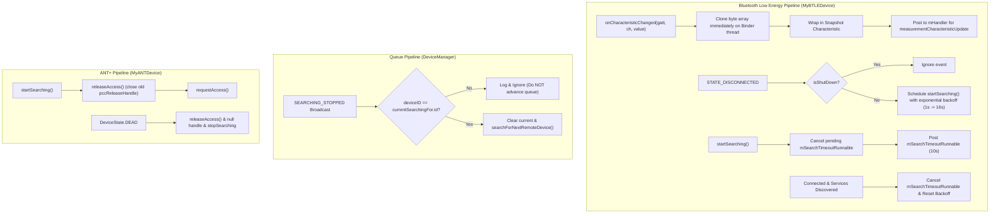

# Stage 1 Analysis: ATT-4007 - Improve BLE and ANT+ reconnect and notification handling robustness

**Ticket**: [ATT-4007](https://rainerblind.atlassian.net/browse/ATT-4007)  
**Sub-task**: [ATT-4206](https://rainerblind.atlassian.net/browse/ATT-4206) (`[Analysis]`)  
**Parent Epic**: [ATT-2466](https://rainerblind.atlassian.net/browse/ATT-2466) (*Developer Testing Tools*)  
**Target Release**: `V4.9.40`  
**Active Sprint**: `2026-42.10`  
**Branch**: `feature/ATT-4007`  
**Author**: AI Agent 1 (Implementer)  
**Date**: 2026-10-19  

---

## 1. Problem Statement & Motivation

During athletic tracking in aTrainingTracker, continuous and resilient connectivity to peripheral sensors (Heart Rate Monitors, Power Meters, Cycling Speed & Cadence, Stride Sensors) is essential. An independent codebase review (`feature/ATT-3921` @ `0234bfc0`) uncovered four critical architectural weaknesses in the sensor connection and telemetry pipeline across Bluetooth Low Energy (BLE) and ANT+:

1. **BLE Notification In-Place Payload Overwrite Race**: When high-frequency BLE notifications arrive (e.g. 1–4 Hz cadence, power, or dual speed/cadence packets), `MyBTLEDevice.characteristicUpdate` posts a task to `mHandler` (the main thread Looper) to decode data via `measurementCharacteristicUpdate(gatt, characteristic)`. Because Android's Bluetooth binder thread reuses the same underlying `BluetoothGattCharacteristic` instance across callbacks, a subsequent BLE packet arriving before the main thread executes mutates the characteristic's byte buffer in-place. This causes cumulative revolution counters, timestamp metrics, or sensor flags to be silently overwritten or corrupted.
2. **Stale Search Timeouts and Immediate Reconnect Storms**: When a BLE connection drops (`BluetoothProfile.STATE_DISCONNECTED`), `MyBTLEDevice` immediately invokes `startSearching()` with zero backoff delay. Rapid reconnect attempts trigger Android GATT error 133 (`GATT_ERROR`) or 257 (`GATT_BUSY`). Crucially, each invocation of `startSearching()` posts an anonymous, untracked 10-second timeout runnable. If a connection is established or re-attempted before a previous 10-second timeout fires, the stale timeout triggers unexpectedly, closes the active GATT handle (`disconnectFromGatt()`), and aborts the valid session (`notifyStopSearching(false)`). Furthermore, disconnections arriving during or after `shutDown()` restart searching due to the absence of a shutdown guard.
3. **Search Queue Preemption from Foreign Device Events**: In `DeviceManager.mSearchingStoppedForOneReceiver`, line 150 unconditionally calls `searchForNextRemoteDevice()` outside the conditional block that verifies `current != null && current.getDeviceId() == deviceID`. If an unrelated remote device (such as a currently tracking sensor or a failing background peripheral) emits `SEARCHING_STOPPED_FOR_ONE_INTENT`, `DeviceManager` prematurely pops the next device off `mSearchQueue`, aborting or corrupting the search state of the device currently being sought.
4. **ANT+ `pccReleaseHandle` Resource Leak and Unrecoverable DEAD Lock**: In `MyANTDevice.startSearching()`, `pccReleaseHandle = requestAccess()` is executed without first checking or releasing any existing `pccReleaseHandle`. When an ANT+ device transitions to `DeviceState.DEAD` (e.g. transient signal dropout or battery removal), `unregisterSensors()` is invoked, but `releaseAccess()` is never called, leaving the plugin channel allocated in the background ANT+ service (`DEVICE_ALREADY_IN_USE`). The device remains locked in `DEAD` state indefinitely with no recovery path.

Remediating these four defects ensures athletes experience uninterrupted sensor telemetry, resilient mid-ride dropout recovery without reconnect storms, and robust queue management.

---

## 2. Root Cause Analysis (Forensic Investigation)

### Issue 1: BLE Notification Payload Race (`MyBTLEDevice.java:153-155, 273-289`)
* **Mechanism**:
  ```java
  @Override
  public void onCharacteristicChanged(BluetoothGatt gatt, BluetoothGattCharacteristic characteristic) {
      characteristicUpdate(gatt, characteristic);
  }
  ...
  if (BluetoothConstants.getCharacteristicUUID(getDeviceType()).equals(characteristic.getUuid())) {
      mHandler.post(new Runnable() {
          @Override
          public void run() {
              measurementCharacteristicUpdate(gatt, characteristic);
          }
      });
  }
  ```
  `BluetoothGattCallback.onCharacteristicChanged` executes on an arbitrary Binder thread provided by Android's `bluetooth.default` process. The method defers parsing by posting `measurementCharacteristicUpdate(gatt, characteristic)` to the main application Looper.
* **Failure Mode**: The Binder thread reuses the single `BluetoothGattCharacteristic` object. Before `mHandler` dispatches the Runnable on the main thread, the next notification can overwrite `characteristic.getValue()`. Subclasses (`BTLEHeartRateDevice`, `BTLEBikePowerDevice`, `BTLEBikeDevice`, `BTLERunSpeedDevice`) then call `characteristic.getValue()` or `characteristic.getIntValue(...)`, reading corrupted or premature bytes. Furthermore, `onCharacteristicChanged(gatt, ch)` and `characteristic.getValue()` were deprecated in Android 13 (API 33) in favor of `onCharacteristicChanged(gatt, ch, byte[] value)`.
* **Remediation**:
  - Implement both the modern API 33 `onCharacteristicChanged(BluetoothGatt gatt, BluetoothGattCharacteristic characteristic, byte[] value)` and the legacy `onCharacteristicChanged(BluetoothGatt gatt, BluetoothGattCharacteristic characteristic)` callback.
  - Clone the byte array immediately on the Binder callback thread:
    ```java
    final byte[] payload = (value != null ? value : characteristic.getValue()).clone();
    ```
  - Create a snapshot characteristic (`new BluetoothGattCharacteristic(...)`) with `snapshot.setValue(payload)` or pass the cloned buffer directly to `mHandler`, guaranteeing absolute immutability and thread isolation.

### Issue 2: Stale Search Timeout & Missing Disconnect Backoff (`MyBTLEDevice.java:99-107, 190-223`)
* **Mechanism**:
  - `startSearching()` posts an anonymous Runnable with delay `SEARCH_PERIOD` (10,000 ms) without storing a reference or cancelling existing callbacks:
    ```java
    mHandler.postDelayed(new Runnable() { ... }, SEARCH_PERIOD);
    ```
  - When disconnected:
    ```java
    } else if (newState == BluetoothProfile.STATE_DISCONNECTED) {
        ...
        disconnectFromGatt();
        startSearching();
    }
    ```
* **Failure Mode**:
  - If a device drops and immediately reconnects within 2 seconds, the 10-second timeout scheduled from the previous search is still pending on `mHandler`. At $T = 10\text{ s}$, the stale runnable executes, sees `!isReceivingData()`, calls `disconnectFromGatt()`, and terminates the freshly established connection.
  - Immediate reconnection with 0 ms delay causes a storm of GATT connects against an unready BLE radio, frequently yielding status 133 (`GATT_ERROR`).
  - If `shutDown()` is called, an asynchronous `STATE_DISCONNECTED` event from the Bluetooth stack re-invokes `startSearching()`, resurrecting a device that was intended to be dead.
* **Remediation**:
  - Maintain a single, reusable `mSearchTimeoutRunnable`.
  - Explicitly cancel `mHandler.removeCallbacks(mSearchTimeoutRunnable)` in `startSearching()`, `disconnectFromGatt()`, `shutDown()`, and upon successful discovery (`notifyStopSearching(true)`).
  - Implement an atomic `mIsShutDown` guard to ignore disconnect events during/after teardown.
  - Introduce exponential reconnect backoff (initial delay: 1,000 ms; doubling up to 16,000 ms on successive disconnects; reset to base delay upon successful connection).

### Issue 3: Search Queue Preemption on Alien Events (`DeviceManager.java:120-151`)
* **Mechanism**:
  ```java
  MyRemoteDevice current = cMyRemoteDeviceCurrentlySearchingFor;
  if (current != null && current.getDeviceId() == deviceID) {
      if (!success) { ... }
  } else {
      Log.d(TAG, "WTF: a remote device we are not searching for stopped searching.");
  }
  searchForNextRemoteDevice(); // Line 150 - OUTSIDE the if-check!
  ```
* **Failure Mode**: When any peripheral not currently at the head of the search queue (or an already connected device whose background search timed out) broadcasts `SEARCHING_STOPPED_FOR_ONE_INTENT`, line 150 unconditionally executes `searchForNextRemoteDevice()`. This shifts `cMyRemoteDeviceCurrentlySearchingFor` away from the legitimate target, popping the next device from `mSearchQueue` and initiating concurrent or out-of-order searches.
* **Remediation**: Move `searchForNextRemoteDevice()` strictly inside the `current != null && current.getDeviceId() == deviceID` branch. Clear `cMyRemoteDeviceCurrentlySearchingFor = null` before advancing the queue. If an event belongs to an alien device, log and discard it without disturbing the search queue.

### Issue 4: ANT+ Handle Overwrites & Permanent DEAD Lock (`MyANTDevice.java:107-112, 143-152, 361-373`)
* **Mechanism**:
  - `startSearching()` calls `pccReleaseHandle = requestAccess()` without releasing `pccReleaseHandle` if already populated.
  - In `onDeviceStateChangeHandler`:
    ```java
    case DEAD:
        unregisterSensors();
        // TODO: something else?
        break;
    ```
* **Failure Mode**: When an ANT+ device transitions to `DeviceState.DEAD`, `pccReleaseHandle` is not released or closed. The ANT+ plugin daemon retains channel access. Subsequent search attempts or reconnection calls overwrite `pccReleaseHandle`, triggering `DEVICE_ALREADY_IN_USE` errors in the ANT+ Plugin Service. The device is unable to auto-recover from `DEAD` state.
* **Remediation**:
  - In `startSearching()`, call `releaseAccess()` before requesting new access to guarantee no dangling handles exist.
  - In `onDeviceStateChangeHandler(DeviceState.DEAD)`, invoke `releaseAccess()`, set `pccReleaseHandle = null`, ensure `notifyStopSearching(false)`, and schedule clean reconnection via `startSearching()` with exponential backoff if tracking is active.

---

## 3. User Scope Grounding (ATT-1250)

### In-Scope Goals
1. **Immutable BLE Payload Dispatch**: Implement API 33 payload capture and immediate array defensive copying in `MyBTLEDevice` to eliminate in-place buffer mutation.
2. **Deterministic Search Timeout Lifecycle & Backoff**: Add single tracked search timeout runnable, cancellation on connection/shutdown, shutdown guard, and exponential reconnect backoff in `MyBTLEDevice`.
3. **Strict Queue Isolation in `DeviceManager`**: Ensure `searchForNextRemoteDevice()` only triggers when the event corresponds to `cMyRemoteDeviceCurrentlySearchingFor`.
4. **Clean ANT+ Handle Lifecycle & DEAD Recovery**: Close and nullify `pccReleaseHandle` prior to new searches and upon `DeviceState.DEAD`, providing clean teardown and recovery.
5. **Automated Unit Verification Suite**: Provide comprehensive unit test coverage (`BLEPayloadDispatchTest`, `BLEReconnectRobustnessTest`, `DeviceManagerSearchQueueTest`, `ANTDeviceLifecycleTest`).

### Out-of-Scope Non-Goals (Scope Bounding)
1. **BLE Background Scanning Redesign**: Modifying Bluetooth LE advertisement scan filters or BluetoothLeScanner settings is out of scope; existing discovery architecture is preserved.
2. **Sensor UI or Cockpit Visuals**: No UI components, dialogs, or settings screens are modified.
3. **Database Schema Changes**: No alterations to `Devices.db` or database tables.

---

## 4. Requirement Archaeology & Chesterton's Fence Audit

* **Original Requirement ID & Target**: Net-new formal requirement `REQ-CON-020` (*Resilient Bluetooth LE & ANT+ Reconnection, Immutable Telemetry Dispatch, and Queue Integrity Architecture*), extending `REQ-CON-019` (`ATT-2773`). Targets `MyBTLEDevice.java`, `DeviceManager.java`, `MyANTDevice.java`, and associated unit tests under `com.atrainingtracker.banalservice.devices`.
* **Historical Origin & Commit Trace**: Ticket `ATT-4007`, discovered during whole-app code review of `feature/ATT-3921` (`0234bfc0`). `DeviceManager` and `MyBTLEDevice` were part of the initial ANT+/BTLE architecture and have not received concurrency/lifecycle hardening for modern Android 13+ Bluetooth APIs.
* **Root Reason for Existing Formulation**: Early Bluetooth LE APIs on Android (API 18–32) passed `BluetoothGattCharacteristic` directly without providing byte array parameters, and single-threaded main looper assumptions obscured race conditions. In `DeviceManager`, `searchForNextRemoteDevice()` was placed outside the check under the naive assumption that `SEARCHING_STOPPED` would only ever fire for the active device.
* **Preservation of Core Invariants**: Existing sensor protocols (HR, Power, Speed/Cadence, CSC, Running Speed), BLE GATT service discovery sequences, and pairing flows must continue to function with 100% fidelity. Clean-room test suite must pass completely.

---

## 5. Architectural Strategy & High-Level Solution



---

## 6. System Invariants & Risk Assessment

* **Core Invariants**:
  1. Zero regression in existing sensor drivers (`BTLEHeartRateDevice`, `BTLEBikePowerDevice`, `BTLEBikeDevice`, `BTLERunSpeedDevice`).
  2. Single-thread Looper contract on `mHandler` preserved without introducing new threading hazards.
  3. Parent ticket Human Decision Gate remains strictly enforced.
* **Risk Rating**: **MEDIUM**
  - Justification: Modifies core peripheral connection lifecycles across BLE and ANT+. Mitigation: Strict scoping, defensive byte copying without subclass API breakage, and comprehensive automated unit testing verifying backoff, queue management, and resource release.
