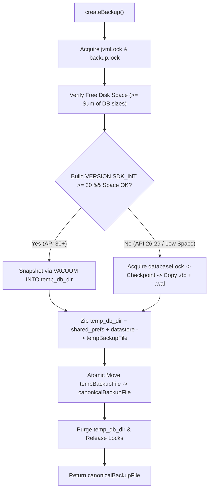

# Stage 1 Analysis: ATT-4011 - Backup snapshots are inconsistent under concurrent writes and leak DB helpers

**Ticket**: [ATT-4011](https://rainerblind.atlassian.net/browse/ATT-4011)  
**Sub-task**: [ATT-4231](https://rainerblind.atlassian.net/browse/ATT-4231) (`[Analysis]`)  
**Parent Epic**: [ATT-281](https://rainerblind.atlassian.net/browse/ATT-281) (*Data Sovereignty & Migration*)  
**Target Release**: `V4.9.40`  
**Active Sprint**: `Sprint 2026-42.10`  
**Branch**: `feature/ATT-4011`  
**Author**: AI Agent 1 (Implementer)  
**Date**: 2026-10-19  

---

## 1. Problem Statement & Motivation

During the independent whole-app architecture review (`0234bfc0`), critical data consistency and resource management vulnerabilities were discovered in the application's backup creation pipeline (`BackupManager.kt`) and database connection management (`DatabaseConnectionManager.kt`):

1. **Inconsistent Database Snapshots Under Concurrent Writes**:
   - `BackupManager.createBackup()` relies on `checkpointAndCloseAllDatabases(context)`, which invokes `DatabaseConnectionManager.quiesceAllDatabases(context, closeConnections = false)`.
   - `quiesceAllDatabases` executes `PRAGMA wal_checkpoint(TRUNCATE);` across active databases. However:
     - The return code from `wal_checkpoint(TRUNCATE)` is logged at verbose level but never inspected for `BUSY` (`result == 1`). If concurrent write transactions are active (e.g. `TrackerService` writing live sensor samples, `ExportWorker` writing export status, Strava sync updating upload tables), the checkpoint fails to truncate or quiesce the WAL.
     - Immediately after the unvalidated checkpoint, `zipFolder` archives the raw `.db` files from `context.applicationInfo.dataDir/databases` while strictly excluding all `-wal`, `-shm`, and `-journal` files:
       ```kotlin
       if (file.name.endsWith("-journal") || file.name.endsWith("-shm") || file.name.endsWith("-wal")) {
           continue
       }
       ```
     - Consequently, any transactions committed after the checkpoint, or uncheckpointed pages remaining in the WAL due to `BUSY`, are permanently omitted from the `.attbackup` archive.
     - Worse, if an automatic SQLite checkpoint executes while `zipFolder` reads the `.db` file across 8KB chunks, the main `.db` file can be read in a torn, internally inconsistent state, resulting in a corrupted backup that fails `PRAGMA integrity_check` upon restore.

2. **Unmanaged Database Helper Leakage**:
   - In `DatabaseConnectionManager.kt:72-90`, `getActiveDatabases(context)` constructs new unmanaged `SQLiteOpenHelper` instances on every invocation for databases without manager singletons:
     ```kotlin
     try { StravaUploadDbHelper(context).writableDatabase } catch (_: Throwable) { null },
     try { EquipmentDbHelper(context).writableDatabase } catch (_: Throwable) { null },
     try { ActiveDevicesDbHelper(context).writableDatabase } catch (_: Throwable) { null }
     ```
   - These `SQLiteOpenHelper` instances are never closed or retained in singletons.
   - Similar ad-hoc helper instantiations occur in:
     - `LegacyImportEngine.kt:722`: `StravaUploadDbHelper(context).deleteWorkout(effectiveBaseFileName)`
     - `WorkoutDeletionHelper.java:58`: `new StravaUploadDbHelper(context)`
     - `StravaUploader.kt:495, 629`: `EquipmentDbHelper(mContext)`
     - `TrackerService.java:1866, 2000`: `new ActiveDevicesDbHelper(this)`
   - Every ad-hoc instantiation leaks an open database handle, connection pool, and file descriptor, preventing clean quiescence and leaking SQLite connection handles.

---

## 2. Root Cause Analysis (Forensic Investigation)

### 2.1 Concurrency Window During File Copy
SQLite write-ahead logging (WAL) maintains changes in a separate `-wal` file until transferred back to the main database file during a checkpoint.
In `BackupManager.kt`:
1. `BackupManager` acquires a process/JVM lock (`jvmLock` and `backup.lock`), which protects against concurrent backup runs, but **does not synchronize with application writer threads** (such as `TrackerService` writing to `WorkoutSamples.db` / `WorkoutSummaries.db`, or `ExportWorker` writing to `ExportStatus.db`).
2. `PRAGMA wal_checkpoint(TRUNCATE)` is executed on the connection. If another thread holds an active read or write transaction, SQLite returns `BUSY` (code `1`). The checkpoint aborts without completing truncation.
3. `BackupManager` ignores the cursor result from `wal_checkpoint` and proceeds to zip files.
4. Because `zipFolder` filters out `-wal` files, committed transactions in the WAL are lost.
5. If SQLite background threads or writer threads execute page writes to the `.db` file while `FileInputStream` reads it in 8KB blocks, a torn page write corrupts the copied database file.

### 2.2 API Compatibility & Storage Boundaries
- **Android 11+ (API 30+) Primary Path (`VACUUM INTO`)**:
  - SQLite 3.27.0 (shipped natively in Android 11 / API 30+) provides the `VACUUM INTO 'target_path'` statement.
  - `VACUUM INTO` creates an atomic, crash-consistent, defragmented, standalone snapshot of the database file directly on disk, without stopping concurrent reader or writer threads and without copying the WAL file.
  - Requirement: Target directory must have sufficient free disk space (at least the sum of the sizes of the databases being snapshotted).
- **Android 8.0–10 (API 26–29) Fallback Path**:
  - On API 26–29 (or if available disk space is insufficient for `VACUUM INTO`), `VACUUM INTO` is unavailable or unsafe.
  - SQLite prevents checkpointing inside an open transaction on the same connection.
  - Safe sequence for fallback:
    1. Synchronize on the shared application database lock (`DatabaseConnectionManager.databaseLock` / writer synchronization).
    2. Execute `PRAGMA wal_checkpoint(FULL)` or `PASSIVE` to drain dirty pages, asserting non-busy result or retrying with bounded backoff.
    3. Open an immediate transaction (`BEGIN IMMEDIATE`) or hold the shared mutex to block other threads from initiating write transactions.
    4. Copy the `.db` and `-wal` file together into the staging directory, or ensure the WAL is fully truncated to 0 bytes before copying `.db`.
    5. Commit/end the transaction and release the lock.

### 2.3 Unmanaged Helper Instances
- `StravaUploadDbHelper`, `EquipmentDbHelper`, and `ActiveDevicesDbHelper` inherit from `SQLiteOpenHelper`.
- Unlike `WorkoutSummariesDatabaseManager`, `LapsDatabaseManager`, and `WorkoutSamplesDatabaseManager`, which implement singleton patterns with managed `getDatabase()` lifecycles, these three classes were instantiated ad-hoc via `new ...DbHelper(context)`.
- Creating new `SQLiteOpenHelper` instances without calling `close()` results in dangling SQLite connection pools and leaked file descriptors.
- Adding thread-safe singleton accessors (`getInstance(Context)`) to `StravaUploadDbHelper`, `EquipmentDbHelper`, and `ActiveDevicesDbHelper` eliminates all helper leakage and allows `DatabaseConnectionManager` to track, checkpoint, and quiesce the single authoritative instances.

---

## 3. User Scope Grounding (ATT-1250)

* **In-Scope Goals**:
  1. **Consistent Database Snapshots**:
     - Modernize `BackupManager` snapshot generation using `VACUUM INTO` on API 30+ (Android 11+) to guarantee atomic, consistent database snapshots without tearing or missing WAL transactions.
     - Implement a robust writer-blocked fallback on API 26–29 (or low-storage scenarios) holding writer locks across checkpoint and snapshot copy.
     - Verify available disk space before initiating snapshotting.
  2. **Singleton Management for All SQLite Helpers**:
     - Convert `StravaUploadDbHelper`, `EquipmentDbHelper`, and `ActiveDevicesDbHelper` to thread-safe singletons via `getInstance(Context)`.
     - Update all ad-hoc call sites (`DatabaseConnectionManager`, `LegacyImportEngine`, `WorkoutDeletionHelper`, `StravaUploader`, `TrackerService`, `StravaDataPurgeManager`) to reuse the singletons.
     - Ensure `DatabaseConnectionManager.quiesceAllDatabases` inspects and handles checkpoint results (`BUSY` handling) across all registered singleton connections.
  3. **Verification Suite**:
     - Unit and contract tests verifying `VACUUM INTO` execution on API 30+, fallback path correctness on API 26–29, singleton helper reuse, absence of unclosed helper instances, and `PRAGMA integrity_check` pass on restored databases created during simulated concurrent writes.

* **Out-of-Scope Non-Goals (Scope Bounding)**:
  - Modifying SQLite table schemas or table definitions in `StravaUpload.db`, `Equipment.db`, or `ActiveDevices.db`.
  - Altering the `.attbackup` archive structure (`databases/`, `shared_prefs/`, `datastore/`).
  - Refactoring unrelated database managers (e.g. `RoutesDatabaseManager`, `SegmentsDatabaseManager`).
  - Changing Google Drive or Dropbox remote backup transfer logic (handled in `GoogleDriveBackupManager` / `DropboxBackupManager`).

---

## 4. Requirement Archaeology & Chesterton's Fence Audit

* **Original Requirement ID & Target**: Net-new requirement `REQ-DAT-031` (*Atomic Concurrent-Safe Database Backup Snapshots, Storage Verification, and Singleton Helper Lifecycle*), extending `REQ-MIG-040` (`ATT-3982`), `REQ-MIG-041` (`ATT-3989`), and `REQ-MIG-043` (`ATT-3992`). Targets `BackupManager.kt`, `DatabaseConnectionManager.kt`, `StravaUploadDbHelper.java`, `EquipmentDbHelper.java`, and `ActiveDevicesDbHelper.java`.
* **Historical Origin & Commit Trace**:
  - `ATT-3992` (commit `9642b9db`): Introduced `DatabaseConnectionManager.databaseLock` to serialize `ATTACH DATABASE` import windows with backup operations.
  - `ATT-3989` (commit `f320b92b`): Introduced `DatabaseConnectionManager.quiesceAllDatabases` to checkpoint WALs prior to full restore.
  - Original `BackupManager.kt`: Authored to zip the `databases` directory directly while filtering out `-wal` files.
* **Root Reason for Existing Formulation**:
  - Direct file zipping was implemented before WAL mode was pervasive across all app databases. Filtering out `-wal` files was intended to prevent copying ephemeral locks (`-shm`), but did not account for uncheckpointed transactions in WAL mode under concurrent tracking writes.
* **Preservation of Core Invariants**:
  - The `.attbackup` format and folder structure remain 100% backward and forward compatible.
  - Full restore and incremental import pipelines continue to function identically.
  - Existing singletons (`WorkoutSummariesDatabaseManager`, etc.) and database locking contracts remain intact.

---

## 5. Architectural Strategy & High-Level Solution

### 5.1 Staging Snapshot Pipeline in `BackupManager`


1. **Storage Verification**:
   - Calculate total size of all active `.db` files.
   - Assert `context.filesDir.usableSpace >= totalDbSize * 1.5` before staging snapshots.
2. **API 30+ Primary Path (`VACUUM INTO`)**:
   - Create a temporary staging directory `temp_db_snapshot/`.
   - For each active database in `DatabaseConnectionManager`:
     - Execute `VACUUM INTO '<temp_db_snapshot>/<db_name>'`.
     - SQLite produces a single, self-contained, fully checkpointed, non-WAL database file with zero writer blocking.
3. **API 26–29 Fallback Path**:
   - Acquire `DatabaseConnectionManager.databaseLock`.
   - Execute `PRAGMA wal_checkpoint(FULL)` on all active databases. If `BUSY` is returned, retry up to 3 times with exponential backoff (10ms, 25ms, 50ms).
   - If checkpoint fails or writer activity continues, copy both the `.db` and `-wal` / `-shm` files into staging, or lock writers using `BEGIN IMMEDIATE` across the copy.
4. **Staging Cleanup & Atomic Packaging**:
   - `zipFolder` archives the clean snapshot files from `temp_db_snapshot/` into `tempBackupFile`.
   - Temporary staging files are strictly cleaned up in `finally`.

### 5.2 Singleton Helpers Transformation
1. Add `getInstance(Context context)` with double-checked locking to:
   - `StravaUploadDbHelper`
   - `EquipmentDbHelper`
   - `ActiveDevicesDbHelper`
2. Update all ad-hoc instantiations across `app/src/main/`:
   - `DatabaseConnectionManager.getActiveDatabases`
   - `LegacyImportEngine`
   - `WorkoutDeletionHelper`
   - `StravaUploader`
   - `TrackerService`
   - `StravaDataPurgeManager`
3. Provide `resetForTesting()` methods on the helpers for test isolation.

---

## 6. System Invariants & Risk Assessment

* **Core Invariants**:
  1. Restored backup archives must pass `PRAGMA integrity_check` on all SQLite databases under active concurrent tracking writes.
  2. All database open helpers must be managed singletons; zero unclosed `SQLiteOpenHelper` instances leaked.
  3. Android minSdk 26 compatibility: `VACUUM INTO` on API 30+, fallback with writer locking on API 26–29.
  4. 100% clean-room unit test pass rate (`./gradlew testDebugUnitTest`).
  5. Parent ticket Human Decision Gate remains strictly enforced.

* **Risk Rating**: **MEDIUM**
  - *Justification*: Changes affect database backup creation and helper lifecycle across multiple services. However, risk is mitigated by using standard SQLite `VACUUM INTO` on API 30+, preserving the existing `.attbackup` archive structure, and adding automated unit and concurrency tests.
