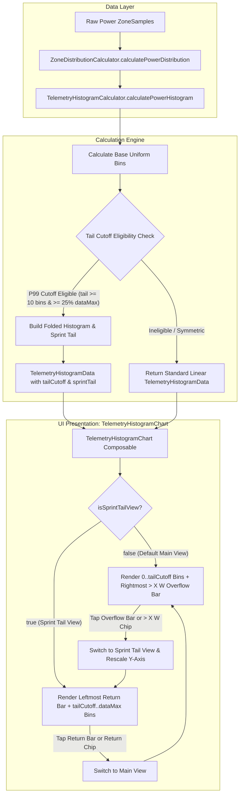

# Stage 1 Analysis: ATT-4293 - Fold rare high-power spikes into an overflow bar in Power Histogram with interactive Sprint Tail zoom and return bar

**Ticket**: [ATT-4293](https://rainerblind.atlassian.net/browse/ATT-4293)  
**Sub-task**: [ATT-4305](https://rainerblind.atlassian.net/browse/ATT-4305) (`[Analysis]`)  
**Parent Epic**: [ATT-355](https://rainerblind.atlassian.net/browse/ATT-355) (*Good and consistent UI*)  
**Target Release**: `V4.9.40`  
**Active Sprint**: `2026-43.1`  
**Branch**: `feature/ATT-4293`  
**Author**: AI Agent 1 (Implementer)  
**Date**: 2026-10-19  

---

## 1. Problem Statement & Motivation

In the post-workout analysis view of **aTrainingTracker**, athletes can inspect physiological training zone distributions (`Leistungszonen` card in `PowerZoneDistributionCard.kt`) and toggle between three visualization modes (`ZoneCardDisplayMode`: `STACKED_BAR`, `COLUMNS`, and `HISTOGRAM`). When `HISTOGRAM` is selected, `TelemetryHistogramChart.kt` renders fine-grained 10 W frequency bins across the entire recorded power range (`dataMin..dataMax`).

Unlike heart rate telemetry, which naturally follows a symmetric, bounded normal distribution (typically 80–185 bpm, spanning ~50 bins of 2 bpm), cycling power is characterized by a **heavy right-tailed distribution**:
1. **X-Axis Compression on Endurance Rides**: In typical road cycling, gravel, or endurance rides, approximately 99% of active ride time is spent between 0 W and ~350–400 W (Zones 1 through 4/5). However, a handful of brief sprints, steep punchy climbs, or acceleration surges can spike up to 800–1000+ W. Because the current calculation engine (`TelemetryHistogramCalculator.kt`) allocates uniform linear bins from `0 W` to `dataMax` (e.g. 940 W), the chart generates 94+ narrow 10 W bins. Consequently, the right 55–60% of the chart is virtually empty, populated only by 1-pixel baseline dots, while the active 99% of the workout is squished into the leftmost ~40% of the card width (as evidenced in on-device capture `power_zones_histogram.png` from Pixel 10).
2. **Y-Axis Compression for Sprinters**: Even when an athlete attempts to inspect high-wattage sprint efforts in the 400–940 W region, the global vertical Y-axis auto-scaling scales linearly to the maximum bin duration across the whole ride (e.g., a 15-minute steady endurance bin at 200 W = 900 seconds). In comparison, a 5-second sprint bin at 850 W represents less than $0.6\%$ relative height, rendering as an indistinguishable baseline dot. Sprinters are entirely unable to evaluate their high-wattage power profile, cadence surges, or peak interval wattages.

### Observable User Need
Athletes require a dual-view adaptive histogram:
- **Main View (Default)**: Rare sprint spikes are automatically folded into a distinct rightmost **Overflow Bar (`> X W →`)**, reclaiming the full card width for the primary aerobic and threshold distribution ($0\dots X\text{ W}$, covering 99% of the ride).
- **Sprint Tail View**: Tapping the overflow bar or its readout header chip transitions seamlessly into an expanded **Sprint Tail View ($X\dots\text{Max W}$)** with an independent, local Y-axis scale (elevating 3–15 second sprint efforts into tall, clearly readable bars) and a symmetric leftmost **Return Bar (`← < X W`)** and return chip (`← 0–X W`) that restores the Main View with a single tap.

---

## 2. Root Cause Analysis (Forensic Investigation)

### 2.1 Algorithmic Pipeline & Uniform Linear Binning
Investigation of `TelemetryHistogramCalculator.kt` reveals the mathematical mechanism producing the visual compression:
- `calculatePowerHistogram` invokes internal helper `calculateHistogram(samples, binWidth = 10, getZoneForValue)`:
  ```kotlin
  val minVal = validSamples.minOf { it.value }
  val maxVal = validSamples.maxOf { it.value }

  val dataMin = (minVal / binWidth) * binWidth
  val dataMax = ((maxVal / binWidth) + 1) * binWidth
  val numBins = ((dataMax - dataMin) / binWidth).coerceAtLeast(1)
  ```
- Duration accumulation is executed linearly across all `numBins`:
  ```kotlin
  val binIdx = ((sample.value - dataMin) / binWidth).coerceIn(0, numBins - 1)
  binDurations[binIdx] += dt
  ```
- Every bin from `dataMin` to `dataMax` is instantiated into a flat `List<TelemetryHistogramBin>` without statistical distribution analysis, percentile tracking, or tail partitioning.

### 2.2 Canvas Geometry & Layout Squeezing
In `TelemetryHistogramChart.kt`:
- Canvas bar width is determined by total width divided by bin count:
  ```kotlin
  val spacingPx = 1.dp.toPx()
  val totalSpacing = (numBins - 1) * spacingPx
  val barWidthPx = ((totalWidth - totalSpacing) / numBins.toFloat()).coerceAtLeast(0.5f)
  ```
- For a ride spanning 0 to 940 W, `numBins = 94`. On a typical 360 dp viewport (~1000 px at 420 dpi), total width minus 93 px spacing leaves ~900 px, yielding `barWidthPx ≈ 9.5 px` (~3.2 dp).
- More critically, out of the 94 bins, ~55 bins (from 400 W to 940 W) contain between 0 and 5 seconds of active duration:
  ```kotlin
  val heightFraction = (bin.durationSec.toFloat() / maxDuration.toFloat()).coerceIn(0f, 1f)
  ```
- When `maxDuration` is 900 s, `heightFraction` for a 5 s sprint is $5 / 900 = 0.0055$, clamping to the baseline tick `2.dp.toPx()`. The right 58% of the card renders as empty whitespace with barely visible baseline dots, while the active aerobic power range is compressed into the left 42%.

### 2.3 Gesture Handling & Viewport Inflexibility
- Current gesture detection in `TelemetryHistogramChart.kt` uses linear index division:
  ```kotlin
  val binWidthWithGap = size.width / numBins.toFloat()
  val clickedIndex = (offset.x / binWidthWithGap).toInt().coerceIn(0, numBins - 1)
  ```
- There is no conceptual distinction between regular bins, overflow aggregates, or navigation return anchors.
- Readout header `Surface` only supports a single flat state: displaying either the hovered/tapped bin or the static range `${histogram.dataMin}–${histogram.dataMax} $unit`.

---

## 3. User Scope Grounding (ATT-1250)

In strict accordance with ASPICE governance and ATT-1250 User Scope Grounding, review boundaries and implementation tasks are strictly grounded in the user story and parent ticket description.

### In-Scope Objectives
1. **Statistical 99% Tail-Folding Cutoff ($P_{99}$) in `TelemetryHistogramCalculator.kt`**:
   - Compute cumulative active duration to locate the 99th percentile threshold ($P_{99}$).
   - Floor the cutoff candidate at the athlete's Zone 4 upper boundary (`thresholds.z4Max`) to guarantee that the full aerobic and threshold spectrum (Zones 1–4) remains permanently visible in the Main View.
   - Round the cutoff candidate up to a clean `50 W` boundary (`tailCutoff = ((rawCutoff + 49) / 50) * 50`).
   - Enforce bounded eligibility gating: tail folding is enabled IF AND ONLY IF `dataMax - tailCutoff >= 10 * binWidth` (at least 10 bins / 100 W in the tail) AND `dataMax >= tailCutoff * 1.25f` (tail exceeds cutoff by at least 25%) AND duration in the tail is strictly $> 0$.
2. **Domain Model Extensions in `ZoneDistributionModels.kt`**:
   - Extend `TelemetryHistogramBin` with backward-compatible defaults: `val isOverflow: Boolean = false`, `val isReturn: Boolean = false`.
   - Extend `TelemetryHistogramData` with backward-compatible defaults: `val tailCutoff: Int? = null`, `val sprintTail: TelemetryHistogramData? = null`.
3. **Two-View Interactive Navigation in `TelemetryHistogramChart.kt`**:
   - **Main View (Default)**: Renders bins $0\dots\text{tailCutoff}$ with a prominent rightmost **Overflow Bar (`> tailCutoff W →`)** aggregating total time above cutoff. Readout header renders a clickable overflow chip `> tailCutoff W →`.
   - **Sprint Tail View**: Renders a prominent leftmost **Return Bar (`← < tailCutoff W`)** followed by all individual 10 W sprint bins from `tailCutoff` to `dataMax`. Readout header renders a clickable return chip `← 0–tailCutoff W`.
   - **Independent Y-Axis Scaling in Sprint Tail View**: In Sprint Tail View, calculate `maxDuration` strictly across sprint bins (`filter { !it.isReturn }`), excluding the bulk duration of the return bar so that 3–15 second sprint bars scale up to full vertical canvas height.
   - **Interactive Navigation Transitions**:
     - Main View: Tapping either the rightmost overflow bar on the canvas or the `> tailCutoff W →` header chip transitions to Sprint Tail View.
     - Sprint Tail View: Tapping either the leftmost return bar on the canvas or the `← 0–tailCutoff W` header chip transitions back to Main View.
     - Scrubbing / dragging across regular bins in either view inspects exact wattage range, duration, percentage, and zone index (`Z1`–`Z7`).
4. **9-Language Localization Parity**:
   - Localize all user-facing chips, labels, and accessibility content descriptions across all 9 supported locales (`values/`, `values-de/`, `values-es/`, `values-fr/`, `values-it/`, `values-ja/`, `values-nl/`, `values-pl/`, `values-pt/`).
5. **Comprehensive Automated Test Coverage**:
   - Unit tests in `TelemetryHistogramCalculatorTest.kt` verifying tail cutoff computation, floor and 50 W rounding, eligibility gating, overflow bin aggregation, return bin aggregation, and non-regression on HR and endurance power datasets.
   - Contract tests in `TelemetryHistogramCardTest.kt` validating model backwards compatibility, readout string invariants, and gesture state transitions.

### Out-of-Scope Non-Goals (Scope Bounding)
1. **7-Zone Power Color Re-mapping (ATT-4294)**: Separate active sprint ticket ATT-4294 handles expanding `ZONE_COLORS` to all 7 cycling power zones and theming across `TelemetryMetricGraph`. Ticket ATT-4293 focuses strictly on tail folding, overflow aggregation, and sprint tail zoom navigation.
2. **Heart Rate Telemetry Folding**: Heart rate telemetry does not exhibit extreme sprint tails and remains strictly linear.
3. **Modifications to Other Zone Card Display Modes**: `STACKED_BAR` and `COLUMNS` display modes in `PowerZoneDistributionCard.kt` are unaffected.
4. **Database Schema & Persistence**: Histograms are computed dynamically in-memory from existing raw `ZoneSample` points; zero database migrations or DataStore schema modifications.

---

## 4. Requirement Archaeology & Chesterton's Fence Audit

### Target Requirement Trace
- **New Requirement**: `REQ-UI-419` (*Power Histogram Rare Sprint Spike Folding, Overflow Bar, and Interactive Sprint Tail Zoom Navigation*).
- **Complements**: `REQ-UI-372` (*Horizontal Stacked Distribution Bar Component & 3-Way Zone Display Mode Switching*) and `REQ-UI-388` (*Decoupled Default Zone Card Display Modes for Workout Summary and Workout Details*).

### 4-Field Chesterton's Fence Archaeology
1. **Original Requirement ID & Target**:
   - `REQ-UI-372.5` (`TelemetryHistogramChart` rendered when `effectiveDisplayMode == HISTOGRAM`), introduced in Sprint 2026-40.8 (`ATT-1845`), refined in Sprint 2026-42.4 (`ATT-3390`), and decoupled in Sprint 2026-42.5 (`REQ-UI-388`, `ATT-3773`).
   - Targets: `TelemetryHistogramCalculator.kt`, `TelemetryHistogramChart.kt`, `ZoneDistributionModels.kt`, and `PowerZoneDistributionCard.kt`.
2. **Historical Origin & Commit Trace**:
   - Commit `7b14d9a2` (`ATT-1845`) introduced fine-grained frequency histograms with linear binning.
   - Commit `38706240` (`ATT-3390`) introduced 3-way mode switching on individual zone cards.
   - Commit `b989e1ce` (`ATT-3676`) and commit `e927c3da` (`ATT-3773`) established `HISTOGRAM` as the default mode in Workout Details.
3. **Root Reason for Existing Formulation ("Why was this fence built?")**:
   - The initial histogram implementation applied identical uniform linear binning across both Heart Rate and Power metrics. Heart rate telemetry naturally spans a narrow, bounded physiological interval (~80–185 bpm), which maps cleanly onto a uniform linear X-axis. Cycling power was initially assumed to follow a similar structure, without accounting for the fact that power exhibits extreme right-skewed kurtosis where 99% of time is spent at moderate wattages and 1% in sprint spikes up to 1000+ W.
4. **Preservation of Core Invariants ("Why is it safe to alter now?")**:
   - *Linear Mode for Non-Skewed Rides*: If a ride does not exhibit an extended sprint tail (e.g., steady indoor trainer ride where `dataMax` is within 25% of $P_{99}$), `tailCutoff` resolves to `null`, and the chart renders in standard linear mode with zero visual difference.
   - *Heart Rate Parity*: Heart rate histograms are unaffected and retain their existing calculation and linear layout.
   - *Source Contract Test Preservation*: Contract tests asserting resting readout strings (`content.contains("\${histogram.dataMin}–\${histogram.dataMax} \$unit")` and `content.contains("Δ \${histogram.binWidth} \$unit")`) remain 100% satisfied.
   - *Zero Regressions in Mode Switching*: 3-way mode switching (`STACKED_BAR`, `COLUMNS`, `HISTOGRAM`) in `PowerZoneDistributionCard.kt` and `WorkoutSummary.kt` remains 100% preserved.

---

## 5. Architectural Strategy & High-Level Solution

### 5.1 Architecture Overview (Mermaid)



### 5.2 Model Extensions (`ZoneDistributionModels.kt`)
Extend `TelemetryHistogramBin` and `TelemetryHistogramData` with default parameters to preserve complete binary and source backward compatibility:
```kotlin
data class TelemetryHistogramBin(
    val binIndex: Int,
    val rangeMin: Int,
    val rangeMax: Int,
    val durationSec: Long,
    val percentage: Float,
    val zoneIndex: Int,
    val color: Color,
    val isOverflow: Boolean = false,
    val isReturn: Boolean = false
)

data class TelemetryHistogramData(
    val binWidth: Int,
    val dataMin: Int,
    val dataMax: Int,
    val totalActiveTimeSec: Long,
    val bins: List<TelemetryHistogramBin>,
    val tailCutoff: Int? = null,
    val sprintTail: TelemetryHistogramData? = null
)
```

### 5.3 Mathematical Cutoff Algorithm (`TelemetryHistogramCalculator.kt`)
1. **$P_{99}$ Computation**:
   - Calculate cumulative duration across all regular bins.
   - Identify the bin where cumulative duration reaches 99% of total active time:
     $$P_{99} = \text{bin.rangeMax where } \sum_{i=0}^{k} d_i \ge 0.99 \times T_{\text{total}}$$
2. **Floor & Clean Boundary Rounding**:
   - Floor at athlete's Zone 4 upper boundary: $\text{rawCutoff} = \max(P_{99}, \text{thresholds.z4Max})$.
   - Round up to the nearest clean 50 W boundary:
     $$\text{tailCutoff} = \left\lceil \frac{\text{rawCutoff}}{50} \right\rceil \times 50$$
3. **Strict Eligibility Gating**:
   - Tail folding is enabled if and only if:
     $$\text{dataMax} - \text{tailCutoff} \ge 10 \times \text{binWidth} \quad (\ge 100\text{ W})$$
     $$\text{dataMax} \ge \text{tailCutoff} \times 1.25$$
     $$\sum_{P_i > \text{tailCutoff}} d_i > 0$$
   - If conditions are not satisfied, return standard linear dataset (`tailCutoff = null`, `sprintTail = null`).
4. **Dataset Partitioning**:
   - **Main View Dataset**:
     - Regular bins from `dataMin` to `tailCutoff`.
     - Rightmost **Overflow Bar (`isOverflow = true`)**: `rangeMin = tailCutoff`, `rangeMax = dataMax`, `durationSec = \sum_{P_i > \text{tailCutoff}} d_i`, `percentage = (\text{duration} / T_{\text{total}}) \times 100\%`, `zoneIndex = 5` (or highest zone reached), `color = TTColor.Zone5`.
   - **Sprint Tail Dataset (`sprintTail`)**:
     - Leftmost **Return Bar (`isReturn = true`)**: `binIndex = 0`, `rangeMin = dataMin`, `rangeMax = tailCutoff`, `durationSec = \sum_{P_i \le \text{tailCutoff}} d_i`, `percentage = (\text{duration} / T_{\text{total}}) \times 100\%`, `color = MaterialTheme.colorScheme.outlineVariant`.
     - Sprint bins: All 10 W bins from `tailCutoff` to `dataMax`.

### 5.4 UI Interaction & Canvas Rendering (`TelemetryHistogramChart.kt`)
1. **Interactive State Management**:
   ```kotlin
   var isSprintTailView by remember(histogram) { mutableStateOf(false) }
   var selectedBinIndex by remember(histogram, isSprintTailView) { mutableStateOf<Int?>(null) }
   ```
2. **Independent Y-Axis Scaling**:
   ```kotlin
   val currentBins = if (isSprintTailView && histogram.sprintTail != null) {
       histogram.sprintTail.bins
   } else {
       histogram.bins
   }
   val maxDuration = remember(currentBins, isSprintTailView) {
       if (isSprintTailView) {
           currentBins.filter { !it.isReturn }.maxOfOrNull { it.durationSec }?.coerceAtLeast(1L) ?: 1L
       } else {
           currentBins.maxOfOrNull { it.durationSec }?.coerceAtLeast(1L) ?: 1L
       }
   }
   ```
3. **Readout Header Architecture**:
   - **Main View Resting State**: Displays `0–400 W`, an interactive chip `> 400 W →` (`surfaceVariant` pill with border and arrow icon), and `Δ 10 W`. Tapping the chip switches to Sprint Tail View.
   - **Sprint Tail View Resting State**: Displays an interactive return chip `← 0–400 W`, active sprint range `400–940 W`, and `Δ 10 W`. Tapping the return chip switches back to Main View.
   - **Selected Bin State**: Displays wattage range, duration, percentage, and zone badge (`Z1`–`Z7`).
4. **Canvas Affordances & Touch Detection**:
   - Return Bar: Drawn at index 0 in Sprint Tail View with distinctive outlined contour stroke (`Stroke(1.5.dp.toPx())`) and subtle fill.
   - Overflow Bar: Drawn at index `numBins - 1` in Main View with a minimum visible height (at least 6 dp) and distinct border accent.
   - Tap Gestures:
     - Tapping the overflow bar on the canvas toggles `isSprintTailView = true` and clears `selectedBinIndex`.
     - Tapping the return bar on the canvas toggles `isSprintTailView = false` and clears `selectedBinIndex`.
     - Tapping regular bins toggles bin selection.
   - Drag Scrubbing: Continuous scrubbing smoothly inspects bins under the touch pointer.

---

## 6. System Invariants & Risk Assessment

### Core Invariants
1. **Zero Regression on Existing Model Consumers**:
   - `TelemetryHistogramBin` and `TelemetryHistogramData` default parameters ensure that existing calls and contract tests compile and function identically.
2. **Heart Rate Histogram Invariance**:
   - Heart rate telemetry remains strictly linear with zero tail folding.
3. **Duration & Percentage Mathematical Conservation**:
   - In Main View: $\sum \text{mainBins.duration} + \text{overflowBin.duration} = \text{totalActiveTimeSec}$.
   - In Sprint Tail View: $\text{returnBin.duration} + \sum \text{sprintBins.duration} = \text{totalActiveTimeSec}$.
   - Percentages sum to $100.0\% \pm 0.1\%$ across all views.
4. **Layout Height & Recomposition Stability**:
   - The card container maintains its standard fixed height (`110.dp` / `96.dp` canvas) without vertical jumping or layout displacement during view transitions.
5. **9-Language Localization Parity**:
   - All format specifiers and string tokens exist across all 9 application locales (`values/`, `values-de/`, `values-es/`, `values-fr/`, `values-it/`, `values-ja/`, `values-nl/`, `values-pl/`, `values-pt/`).
6. **Parent Ticket Human Decision Gate**:
   - Parent ticket ATT-4293 progresses through ASPICE workflow stages and strictly pauses at `Final Review (Human)`.

### Risk Rating & Technical Justification
- **Risk Rating**: **LOW**
- **Justification**:
  - The tail-folding algorithm is pure, stateless mathematics executed in `TelemetryHistogramCalculator.kt`.
  - All modifications to data classes provide default arguments, preserving complete backward compatibility with existing tests and callers.
  - Interactive navigation is encapsulated entirely inside `TelemetryHistogramChart.kt` with zero side effects on the database, Android background services, or tracking lifecycles.
  - The feature is fully verifiable via fast, deterministic JVM unit tests in less than 5 seconds.
