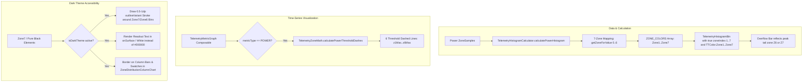

# Stage 1 Analysis: ATT-4294 - Support all 7 cycling power zones (Z1–Z7) in Power Histogram, TelemetryMetricGraph threshold lines, and Dark Mode chart rendering

**Ticket**: [ATT-4294](https://rainerblind.atlassian.net/browse/ATT-4294)  
**Sub-task**: [ATT-4310](https://rainerblind.atlassian.net/browse/ATT-4310) (`[Analysis]`)  
**Parent Epic**: [ATT-355](https://rainerblind.atlassian.net/browse/ATT-355) (*Good and consistent UI*)  
**Target Release**: `V4.9.40`  
**Active Sprint**: `2026-43.1`  
**Branch**: `feature/ATT-4294`  
**Author**: AI Agent 1 (Implementer)  
**Date**: 2026-10-19  

---

## 1. Problem Statement & Motivation

Cycling power in **aTrainingTracker** follows Andrew Coggan's standard 7-zone training model:
* **Zone 1 (Active Recovery)**: $< 55\%$ FTP (`TTColor.Zone1`, Gray `#9E9E9E`)
* **Zone 2 (Endurance)**: $56–75\%$ FTP (`TTColor.Zone2`, Blue `#2196F3`)
* **Zone 3 (Tempo)**: $76–90\%$ FTP (`TTColor.Zone3`, Green `#4CAF50`)
* **Zone 4 (Lactate Threshold)**: $91–105\%$ FTP (`TTColor.Zone4`, Yellow `#FFEB3B`)
* **Zone 5 (VO2 Max)**: $106–120\%$ FTP (`TTColor.Zone5`, Purple/Dark Violet `#9400D3`)
* **Zone 6 (Anaerobic Capacity)**: $121–150\%$ FTP (`TTColor.Zone6`, Warm Earthy Brown `#8B5A2B`, REQ-UI-392)
* **Zone 7 (Neuromuscular Power)**: $> 150\%$ FTP (`TTColor.Zone7`, Pure Black `#000000`)

While 7-zone data structures, threshold storage (`SettingsDataStore.ZoneType.PWR_BIKE`), and distribution math (`ZoneDistributionCalculator.calculatePowerDistribution` returning 7 entries) were introduced, several downstream charts, calculations, and visual elements still restrict cycling power to 5 zones or fail to render readable visuals on dark backgrounds:

1. **Power Histogram Clamped to 5 Zones (`TelemetryHistogramCalculator.kt`)**:
   - `calculatePowerHistogram` (lines 104–114) correctly classifies samples across 7 zones (`0..6` using `thresholds.z1Max..z6Max`).
   - However, `ZONE_COLORS` (lines 48–54) only defines 5 colors (`TTColor.Zone1`..`TTColor.Zone5`, missing `TTColor.Zone6` and `TTColor.Zone7`).
   - Furthermore, `calculateHistogram` (line 295) hard-clamps the zone index: `val zoneIdx = getZoneForValue(midpoint).coerceIn(0, 4)`.
   - **Observable Symptom**: All wattage bins in Zone 6 (Anaerobic) and Zone 7 (Neuromuscular Sprint) are forcibly colored with `TTColor.Zone5` (`#9400D3`) and labeled `"Z5"`. When inspecting high-wattage sprint efforts in either the main view or the Sprint Tail view (REQ-UI-419), bins exceeding `z5Max` never transition to Brown (`Z6`) or Black (`Z7`).
   - Additionally, the folded rightmost overflow bar in `calculatePowerHistogram` (lines 137–138) hardcodes `zoneIndex = 5` and `color = TTColor.Zone5`, rather than reflecting the peak zone reached in the folded sprint tail.

2. **Missing Z5/Z6 and Z6/Z7 Threshold Lines in Power Time-Series Graph (`TelemetryMetricGraph.kt`)**:
   - In `TelemetryMetricGraph.kt` (line 216), `zoneBands` calls `TelemetryZoneMath.calculatePowerZoneBands(it, dataMin, dataMax)`, which computes all 7 colored zone bands.
   - However, at line 228, `thresholdDashes` invokes the 4-threshold heart-rate helper:
     `TelemetryZoneMath.calculateThresholdDashes(it.z1Max, it.z2Max, it.z3Max, it.z4Max, dataMin, dataMax)`
     instead of `TelemetryZoneMath.calculatePowerThresholdDashes(it, dataMin, dataMax)`.
   - The dedicated 6-threshold power helper `TelemetryZoneMath.calculatePowerThresholdDashes` was already implemented at `TelemetryZoneMath.kt:161` but was never hooked up.
   - **Observable Symptom**: On the power time-series chart, the horizontal dashed boundary lines for `z5Max` (Z5/Z6 boundary, 120% FTP) and `z6Max` (Z6/Z7 boundary, 150% FTP) are completely missing.

3. **Missing Dark Mode Contrast Outline for `TTColor.Zone7` (`#000000` Pure Black) in Zone Charts**:
   - `TTColor.Zone7` is defined as `Color(0xFF000000)` (Pure Black).
   - In `ElevationProfile.kt:1174`, `Zone6` and `Zone7` swatches receive a subtle outline (`hasOutline = color == TTColor.Zone6 || color == TTColor.Zone7`, `BorderStroke(1.dp, MaterialTheme.colorScheme.outlineVariant)`) so they remain distinct on dark backgrounds.
   - In `TelemetryHistogramChart.kt`, `ZoneDistributionColumnChart.kt`, and `ZoneDistributionStackedBar.kt`, `Zone7` bars, canvas round-rects, and legend swatches lack a contrast border/outline. On AMOLED and Dark themes, pure black bars blend into the dark container/canvas surface, becoming nearly invisible.
   - Additionally, when a Zone 7 bin is selected in `TelemetryHistogramChart.kt`, the header readout text renders with `color = selectedBin.color` (`#000000`), producing unreadable black text on a dark surface.
   - In `ZoneDistributionModels.kt` (lines 59, 78, 123), KDoc comments still state `// 1..5` and `Aggregate 5-zone time distribution...` rather than documenting `1..7` for cycling power.

---

## 2. Root Cause Analysis (Forensic Investigation)

### 2.1 Clamped Palette in `TelemetryHistogramCalculator.kt`
In `TelemetryHistogramCalculator.kt`:
```kotlin
// Line 48-54:
private val ZONE_COLORS = arrayOf(
    TTColor.Zone1,
    TTColor.Zone2,
    TTColor.Zone3,
    TTColor.Zone4,
    TTColor.Zone5
)
```
When `calculateHistogram` constructs bins:
```kotlin
// Line 295:
val zoneIdx = getZoneForValue(midpoint).coerceIn(0, 4)
TelemetryHistogramBin(
    binIndex = idx,
    rangeMin = rangeMin,
    rangeMax = rangeMax,
    durationSec = duration,
    percentage = percentage,
    zoneIndex = zoneIdx + 1,
    color = ZONE_COLORS[zoneIdx]
)
```
Even though `calculatePowerHistogram` passes a lambda returning `0..6`:
```kotlin
// Lines 104-113:
when {
    pwr <= thresholds.z1Max -> 0
    pwr <= thresholds.z2Max -> 1
    pwr <= thresholds.z3Max -> 2
    pwr <= thresholds.z4Max -> 3
    pwr <= thresholds.z5Max -> 4
    pwr <= thresholds.z6Max -> 5
    else -> 6
}
```
The result is forcibly clamped by `.coerceIn(0, 4)`. Thus:
- A bin at 380 W (where `z5Max = 350`, `z6Max = 450`) evaluates to `zoneIdx = 5`, which is clamped to `4` $\implies$ `zoneIndex = 5` (`"Z5"`), `color = TTColor.Zone5`.
- A bin at 600 W (Zone 7) evaluates to `zoneIdx = 6`, which is clamped to `4` $\implies$ `zoneIndex = 5` (`"Z5"`), `color = TTColor.Zone5`.
- The overflow bin at lines 137–138 hardcodes `zoneIndex = 5` and `color = TTColor.Zone5`.

### 2.2 Threshold Dashes Call Site in `TelemetryMetricGraph.kt`
In `TelemetryMetricGraph.kt` (lines 222–232):
```kotlin
val thresholdDashes = remember(metricType, effectiveHrThresholds, effectivePowerThresholds, dataMin, dataMax) {
    when (metricType) {
        TelemetryMetricType.HEART_RATE -> effectiveHrThresholds?.let {
            TelemetryZoneMath.calculateThresholdDashes(it.z1Max, it.z2Max, it.z3Max, it.z4Max, dataMin, dataMax)
        } ?: emptyList()
        TelemetryMetricType.POWER -> effectivePowerThresholds?.let {
            TelemetryZoneMath.calculateThresholdDashes(it.z1Max, it.z2Max, it.z3Max, it.z4Max, dataMin, dataMax)
        } ?: emptyList()
        else -> emptyList()
    }
}
```
The `POWER` branch passes only `it.z1Max` through `it.z4Max` to `calculateThresholdDashes`.
Meanwhile, `TelemetryZoneMath.calculatePowerThresholdDashes` already exists at line 161 of `TelemetryZoneMath.kt`:
```kotlin
fun calculatePowerThresholdDashes(
    thresholds: PowerZoneThresholds,
    dataMin: Double,
    dataMax: Double
): List<Double> {
    return listOf(
        thresholds.z1Max,
        thresholds.z2Max,
        thresholds.z3Max,
        thresholds.z4Max,
        thresholds.z5Max,
        thresholds.z6Max
    )
        .map { it.toDouble() }
        .filter { it > dataMin && it < dataMax }
}
```
The call site in `TelemetryMetricGraph.kt` was simply never updated from the legacy 4-threshold call.

### 2.3 Dark Theme Contrast for `TTColor.Zone7` (`#000000`)
- In `TelemetryHistogramChart.kt`:
  On the `Canvas` (line 360), `drawRoundRect` fills the bar with `bin.color.copy(alpha = alpha)`. When `bin.color == TTColor.Zone7` (`Color(0xFF000000)`), the black fill is invisible against dark card surfaces (`MaterialTheme.colorScheme.surface` / `surfaceContainer`).
  In the header readout (lines 131, 143), `selectedBin.color` is passed directly as `color = selectedBin.color`. On dark backgrounds, black text has a 1:1 contrast ratio (unreadable).
- In `ZoneDistributionColumnChart.kt`:
  - `ZoneColumnItem` (lines 189–197): Active bar `Box` has `.background(entry.color)` without a border.
  - X-Axis zone badges (lines 119–124): `Box(modifier = Modifier.size(7.dp).clip(CircleShape).background(entry.color))` lacks any border, disappearing into the dark background.
- In `ZoneDistributionStackedBar.kt`:
  - Stacked bar segments (lines 168–173): `Box(modifier = Modifier.weight(entry.percentage).fillMaxHeight().background(entry.color))` lacks segment borders for black Zone 7 segments against dark background.

---

## 3. User Scope Grounding (ATT-1250)

* **In-Scope Goals**:
  1. **`TelemetryHistogramCalculator.kt`**:
     - Expand `ZONE_COLORS` to 7 colors (`TTColor.Zone1` .. `TTColor.Zone7`).
     - Update `coerceIn(0, 4)` in `calculateHistogram` to `coerceIn(0, ZONE_COLORS.lastIndex)` (`0..6`).
     - Align `overflowBin` in `calculatePowerHistogram` to reflect the peak zone in `tailBins` (`tailBins.maxByOrNull { it.zoneIndex }?.zoneIndex ?: 7`, `color = peakTailBin?.color ?: TTColor.Zone7`).
  2. **`TelemetryMetricGraph.kt`**:
     - Call `TelemetryZoneMath.calculatePowerThresholdDashes(it, dataMin, dataMax)` in the `POWER` branch of `thresholdDashes`, rendering dashed lines for all 6 power thresholds (`z1Max`..`z6Max`).
  3. **Dark-Mode Contrast & Readability**:
     - In `TelemetryHistogramChart.kt`, draw a subtle 1dp outline (`colorScheme.outlineVariant`) around `TTColor.Zone7` (and `Zone6`) canvas bars when in dark theme or unselected.
     - In `TelemetryHistogramChart.kt` header readout, ensure text color for `TTColor.Zone7` in dark mode resolves to `colorScheme.onSurface` (or `Color.White`) instead of invisible pure black.
     - In `ZoneDistributionColumnChart.kt`, apply `BorderStroke(0.5.dp, MaterialTheme.colorScheme.outlineVariant)` to `ZoneColumnItem` active bars and legend swatches when `entry.color == TTColor.Zone7 || entry.color == TTColor.Zone6`.
     - In `ZoneDistributionStackedBar.kt`, apply a subtle outline border to `TTColor.Zone7` segments.
  4. **Documentation & Models**:
     - Update KDoc comments in `ZoneDistributionModels.kt` (lines 59, 78, 123) from `1..5` to `1..7` for cycling power.
  5. **Unit Tests**:
     - Add tests in `TelemetryHistogramCalculatorTest.kt` verifying that power values in Z6 and Z7 map to `zoneIndex = 6` (`TTColor.Zone6`) and `zoneIndex = 7` (`TTColor.Zone7`).
     - Add unit tests in `TelemetryZoneMathTest.kt` verifying `calculatePowerThresholdDashes` produces all 6 dashed lines across the visible data range.

* **Out-of-Scope Non-Goals (Scope Bounding)**:
  1. No modification of heart rate zone counts (heart rate strictly remains 5 zones, `Z1`–`Z5`).
  2. No modification of running pace zones (pace distribution remains 5 zones).
  3. No modification of database schemas or athlete settings entities (`PowerZoneThresholds` and `PWR_BIKE` already support 6 boundaries).
  4. No modification of elevation profile grading calculations (already supports 7 grade categories).

---

## 4. Requirement Archaeology & Chesterton's Fence Audit

* **Original Requirement ID & Target**: Net-new requirement `REQ-UI-420` ("Support All 7 Cycling Power Zones in Power Histogram, TelemetryMetricGraph Threshold Lines, and Dark Mode Chart Rendering"). Complements `REQ-UI-419` (*Power Histogram Rare Sprint Spike Folding, Overflow Bar, and Interactive Sprint Tail Zoom Navigation*), `REQ-UI-372` (*Fine-Grained Telemetry Frequency Histograms*), and `REQ-UI-392` (*High-Contrast Warm Earthy Brown Zone 6 Color Token*).
* **Historical Origin & Commit Trace**:
  - `REQ-UI-372` (`ATT-1845`, commit `7b14d9a2`): Introduced fine-grained frequency histograms with linear binning, originally designed for 5-zone Heart Rate and then adapted for Power with an initial 5-color array.
  - `REQ-UI-392` (`ATT-3696`, commit `0da639ba`): Refined `TTColor.Zone6` to `#8B5A2B` for $\ge 3.0:1$ WCAG contrast against `TTColor.Zone7` (`#000000`).
  - `REQ-UI-419` (`ATT-4293`, commit `5694bca5`): Introduced sprint tail folding, but inherited the existing 5-zone clamping in `TelemetryHistogramCalculator.kt`.
* **Root Reason for Existing Formulation**:
  When `TelemetryHistogramCalculator.kt` was originally ported from `ZoneDistributionCalculator.kt`, only `calculateHeartRateHistogram` was fully verified. Cycling power was given the same 5-element `ZONE_COLORS` array and `coerceIn(0, 4)` clamp as a temporary placeholder. In `TelemetryMetricGraph.kt`, the threshold line helper call was copy-pasted from the `HEART_RATE` branch.
* **Preservation of Core Invariants**:
  - Heart rate histograms remain strictly 5-zone (`0..4` index, `Z1`–`Z5`), as `getZoneForValue` for HR returns `0..4` and `coerceIn(0, 6)` does not alter values $\le 4$.
  - Power zone bands (`calculatePowerZoneBands`) are already 7-zone; adding dashed lines at `z5Max` and `z6Max` aligns threshold dashes with existing background bands.
  - Total active duration and percentage conservation ($100.0\% \pm 0.1\%$) are mathematically preserved.

---

## 5. Architectural Strategy & High-Level Solution

### 5.1 Architecture Overview (Mermaid)



### 5.2 Key Changes by Component

1. **`TelemetryHistogramCalculator.kt`**:
   ```kotlin
   private val ZONE_COLORS = arrayOf(
       TTColor.Zone1,
       TTColor.Zone2,
       TTColor.Zone3,
       TTColor.Zone4,
       TTColor.Zone5,
       TTColor.Zone6,
       TTColor.Zone7
   )
   ```
   In `calculateHistogram`:
   ```kotlin
   val zoneIdx = getZoneForValue(midpoint).coerceIn(0, ZONE_COLORS.lastIndex)
   ```
   In `calculatePowerHistogram`:
   ```kotlin
   val peakTailBin = tailBins.maxByOrNull { it.zoneIndex }
   val overflowBin = TelemetryHistogramBin(
       binIndex = regularBins.size,
       rangeMin = tailCutoff,
       rangeMax = linearData.dataMax,
       durationSec = tailDuration,
       percentage = if (totalDuration > 0L) (tailDuration.toFloat() / totalDuration) * 100f else 0f,
       zoneIndex = peakTailBin?.zoneIndex ?: 7,
       color = peakTailBin?.color ?: TTColor.Zone7,
       isOverflow = true,
       isReturn = false
   )
   ```

2. **`TelemetryMetricGraph.kt`**:
   ```kotlin
   val thresholdDashes = remember(metricType, effectiveHrThresholds, effectivePowerThresholds, dataMin, dataMax) {
       when (metricType) {
           TelemetryMetricType.HEART_RATE -> effectiveHrThresholds?.let {
               TelemetryZoneMath.calculateThresholdDashes(it.z1Max, it.z2Max, it.z3Max, it.z4Max, dataMin, dataMax)
           } ?: emptyList()
           TelemetryMetricType.POWER -> effectivePowerThresholds?.let {
               TelemetryZoneMath.calculatePowerThresholdDashes(it, dataMin, dataMax)
           } ?: emptyList()
           else -> emptyList()
       }
   }
   ```

3. **`TelemetryHistogramChart.kt`**:
   - Header readout:
     ```kotlin
     val isDark = isSystemInDarkTheme()
     val labelColor = if (isDark && (selectedBin.color == TTColor.Zone7 || selectedBin.color == TTColor.Zone6)) {
         MaterialTheme.colorScheme.onSurface
     } else {
         selectedBin.color
     }
     ```
   - Canvas bin drawing:
     When drawing regular/overflow bins, if `bin.color == TTColor.Zone7 || bin.color == TTColor.Zone6`, draw an outline stroke (`Stroke(1.dp.toPx())`, `color = MaterialTheme.colorScheme.outlineVariant`) when `!isSelected`.

4. **`ZoneDistributionColumnChart.kt` & `ZoneDistributionStackedBar.kt`**:
   - Apply `BorderStroke(0.5.dp, MaterialTheme.colorScheme.outlineVariant)` to active bars and legend swatches for `TTColor.Zone7` and `TTColor.Zone6`.

5. **`ZoneDistributionModels.kt`**:
   - Update KDoc comments to document 7 zones for power and 5 zones for heart rate/pace.

---

## 6. System Invariants & Risk Assessment

* **Core Invariants**:
  1. **Zero Regression in Heart Rate Histograms**: Heart rate remains strictly 5 zones (`Z1`–`Z5`) with unchanged colors and binning.
  2. **Mathematical Conservation of Duration & Percentages**: Sum of durations equals `totalActiveTimeSec`, percentages sum to $100.0\% \pm 0.1\%$.
  3. **Thread Safety & Stateless Calculation**: All histogram and threshold calculations remain pure functions on immutable data.
  4. **WCAG 2.1 AA Contrast**: All zone visuals (including Zone 7 Pure Black and Zone 6 Warm Earthy Brown) maintain clear visibility and $\ge 3.0:1$ non-text contrast against dark theme surfaces.
  5. **Parent Ticket Human Decision Gate**: Parent ticket ATT-4294 progresses through ASPICE workflow stages and strictly pauses at `Final Review (Human)`.

* **Risk Rating**: **LOW**
  - **Justification**: The changes consist of expanding a static color array from 5 to 7 entries, replacing a 4-threshold helper call with an existing 6-threshold helper call, adding decorative contrast outlines in Compose canvas/modifier styling, and updating KDoc comments. No database schemas, background services, or network protocols are touched. All logic is verified by fast JVM unit tests.
