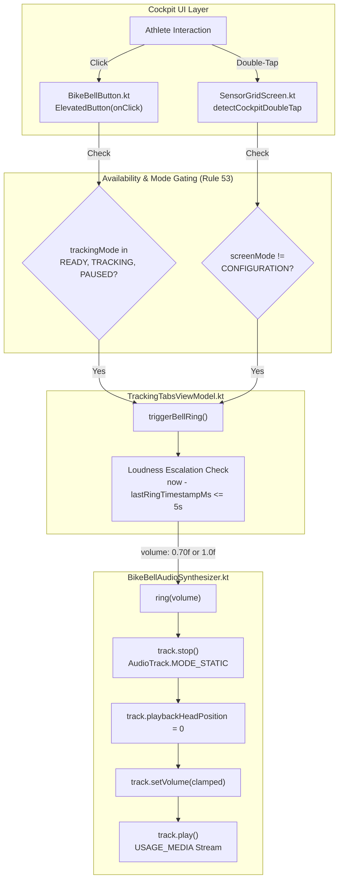

# Stage 1 Analysis: ATT-4371 - [Bug] Fix Bike Bell audio playback (USAGE_MEDIA stream, static AudioTrack replay, and enable outside TRACKING mode)

**Ticket**: [ATT-4371](https://rainerblind.atlassian.net/browse/ATT-4371)  
**Sub-task**: [ATT-4397](https://rainerblind.atlassian.net/browse/ATT-4397) (`[Analysis]`)  
**Parent Epic**: [ATT-355](https://rainerblind.atlassian.net/browse/ATT-355) (*Good and consistent UI*)  
**Target Release**: `V4.9.40`  
**Active Sprint**: `2026-43.2`  
**Branch**: `feature/ATT-4371`  
**Author**: AI Agent 1 (Implementer)  
**Date**: 2026-10-20  

---

## 1. Problem Statement & Motivation

During the Sprint 2026-43.1 Joint Review of ticket **ATT-4281** (*"Add electronic bike bell to Cockpit with button, double-tap gesture, and progressive loudness escalation"*), human on-device verification revealed that clicking the Bike Bell button in the Cockpit or double-tapping the telemetry grid produced no audible sound.

A forensic investigation into the implementation identified three distinct failure modes:
1. **Unintended Mode Gating**: `BikeBellButton.kt` and `SensorGridScreen.kt` gate bell availability strictly behind `TrackingMode.TRACKING` and `ScreenMode.TRACKING`. When an athlete mounts their phone on handlebars before starting a workout (`TrackingMode.READY`) or pauses at a traffic light/junction (`TrackingMode.PAUSED`), the bell is rendered in a ghosted/disabled state and ignores user interaction. Unlike lap splits, a bicycle bell is a safety and utility control that athletes must be able to test and ring while stationary or before pressing Start (Rule 53).
2. **Audio Stream Muting on Silent/Vibrate**: `BikeBellAudioSynthesizer.kt` configures `AudioTrack` with `AudioAttributes.USAGE_ASSISTANCE_SONIFICATION`. On Android OS, this stream is mapped to `AudioStream.STREAM_SYSTEM` / `STREAM_RING`. Because cyclists routinely keep their phones set to Vibrate or Silent when riding, the Android audio policy manager mutes this stream to zero amplitude, completely silencing the bell.
3. **Static AudioTrack Replay Failure & Pointer Event Contention**:
   - `BikeBellAudioSynthesizer.kt` executes `track.pause()` instead of `track.stop()` before calling `track.playbackHeadPosition = 0` on an `AudioTrack.MODE_STATIC` instance. In Android's AudioFlinger implementation, calling `playbackHeadPosition = 0` while paused or when a static track has finished playing fails with `ERROR_INVALID_OPERATION` (-38), breaking subsequent rings.
   - `BikeBellButton.kt` attaches `Modifier.pointerInput { detectTapGestures(...) }` to an `ElevatedButton` that already has an active `onClick` handler. This creates pointer event contention in the Compose gesture hierarchy, causing single taps to be dropped or swallowed.

The goal of **ATT-4371** is to correct these three defects, restoring 100% audible, responsive, and robust bike bell operation across all operational Cockpit states.

---

## 2. Root Cause Analysis (Forensic Investigation)

### 2.1 Defect 1: Mode Gating & Cockpit Availability Gap (Rule 53)
- **Call Sites**:
  - `BikeBellButton.kt` (lines 71, 89, 95, 98, 130, 145):
    ```kotlin
    val isTracking = trackingMode == TrackingMode.TRACKING
    ...
    ElevatedButton(
        onClick = { if (isTracking) { ... } },
        enabled = isTracking,
        modifier = modifier.pointerInput(isTracking) { ... },
        elevation = ButtonDefaults.elevatedButtonElevation(
            defaultElevation = if (isTracking) 6.dp else 0.dp
        ),
        ...
    )
    ```
  - `SensorGridScreen.kt` (lines 657–666):
    ```kotlin
    val isTracking = screenMode == ScreenMode.TRACKING
    val doubleTapModifier = if (isTracking && state.showBikeBell) {
        Modifier.detectCockpitDoubleTap(enabled = true) { ... }
    } else Modifier
    ```
- **Forensic Diagnosis**:
  - `BikeBellButton` blindly copied the enabled logic from `LapButton.kt`. A lap split has strict domain semantics tied to recording an active workout segment, so `LapButton` appropriately requires `TrackingMode.TRACKING`.
  - In contrast, a bicycle bell is an acoustic safety and utility device. Cyclists need to test audio output before starting a ride (`TrackingMode.READY`) or alert pedestrians and crossing traffic while stopped at an intersection (`TrackingMode.PAUSED`).
  - Gating `enabled` strictly behind `TrackingMode.TRACKING` disables the button whenever the workout is not actively recording.
  - Furthermore, in `SensorGridScreen.kt`, double-tap detection was gated behind `screenMode == ScreenMode.TRACKING`. In preview/staging modes (`ScreenMode.PREVIEW`), double-tap was inadvertently disabled.
- **Remedy**:
  - Per **Rule 53 (Section 5.12, design_guidelines.md)**: Auxiliary Cockpit utility controls such as `BikeBellButton` must remain enabled across `READY`, `TRACKING`, and `PAUSED` modes:
    `val isAvailable = trackingMode in setOf(TrackingMode.READY, TrackingMode.TRACKING, TrackingMode.PAUSED)` (or `trackingMode != TrackingMode.IDLE`).
  - In `SensorGridScreen.kt`, double-tap is active whenever `screenMode != ScreenMode.CONFIGURATION && state.showBikeBell`.

### 2.2 Defect 2: Audio Stream Muting & Static AudioTrack Replay Mechanics
- **Call Sites**:
  - `BikeBellAudioSynthesizer.kt` (lines 187–190):
    ```kotlin
    val attributes = AudioAttributes.Builder()
        .setUsage(AudioAttributes.USAGE_ASSISTANCE_SONIFICATION)
        .setContentType(AudioAttributes.CONTENT_TYPE_SONIFICATION)
        .build()
    ```
  - `BikeBellAudioSynthesizer.kt` (lines 223–225, 242–244, 258–259):
    ```kotlin
    track.setVolume(clamped)
    track.pause()
    track.playbackHeadPosition = 0
    track.play()
    ```
- **Forensic Diagnosis**:
  - `AudioAttributes.USAGE_ASSISTANCE_SONIFICATION` directs audio output to `AudioStream.STREAM_SYSTEM` / `STREAM_RING`.
  - When an Android device is set to **Silent** or **Vibrate** mode, the Android audio policy manager forces the volume of the ringer and sonification streams to zero. Almost all athletes mount their devices with ringer set to Silent/Vibrate to avoid phone call interruptions while riding. Under these standard conditions, `USAGE_ASSISTANCE_SONIFICATION` is completely muted, emitting zero audible sound despite native track playback.
  - Furthermore, for an `AudioTrack` instantiated with `AudioTrack.MODE_STATIC`, Android framework specifications require that the track be in `PLAYSTATE_STOPPED` (via `stop()`) to reset the playback head position to index `0` reliably across all Android OS versions. Calling `pause()` followed by `playbackHeadPosition = 0` when playback has completed or is in transition results in `ERROR_INVALID_OPERATION` (-38), causing repeat rings to fail silently.
- **Remedy**:
  - Change `AudioAttributes` to use `AudioAttributes.USAGE_MEDIA` with `AudioAttributes.CONTENT_TYPE_SONIFICATION` (or `CONTENT_TYPE_MUSIC`). The media stream (`AudioStream.STREAM_MUSIC`) is independent of the ringer switch and respects the user's media volume slider, ensuring loud, clear playback on Silent/Vibrate devices without requiring disruptive audio focus ducking.
  - In `ring()`, `startRoll()`, and `stopRoll()`, replace `track.pause()` with `track.stop()` prior to `track.playbackHeadPosition = 0`. This resets the static buffer pointers cleanly in AudioFlinger and guarantees instantaneous, deterministic repeat playback.

### 2.3 Defect 3: Pointer Event Contention in `BikeBellButton.kt`
- **Call Sites**:
  - `BikeBellButton.kt` (lines 87–121):
    ```kotlin
    ElevatedButton(
        onClick = {
            if (isTracking) {
                triggerShakeAnimation()
                haptic.performHapticFeedback(HapticFeedbackType.LongPress)
                onSingleRing()
            }
        },
        enabled = isTracking,
        modifier = modifier
            .height(72.dp)
            .pointerInput(isTracking) {
                if (!isTracking) return@pointerInput
                var isLongPress = false
                detectTapGestures(
                    onPress = { ... },
                    onTap = {
                        triggerShakeAnimation()
                        haptic.performHapticFeedback(HapticFeedbackType.LongPress)
                        onSingleRing()
                    },
                    onLongPress = { ... }
                )
            },
        ...
    )
    ```
- **Forensic Diagnosis**:
  - `ElevatedButton` has an intrinsic `onClick` handler that applies Material 3 `Modifier.clickable` to the button's layout node.
  - Attaching `.pointerInput(...) { detectTapGestures(...) }` to the same composable places two competing gesture recognizers on the same pointer event stream.
  - `detectTapGestures`'s `awaitFirstDown` / `onPress` consumes pointer down events during `PointerEventPass.Main`. When pointer events are consumed or delayed for long-press / double-tap disambiguation, `ElevatedButton`'s internal `clickable` detector receives incomplete or canceled events.
  - This results in pointer contention: single clicks are swallowed or dropped, and duplicating the ring callback and shake animation across both `onClick` and `onTap` leads to unpredictable double triggers.
- **Remedy**:
  - Per **Rule 53 (Section 5.12, design_guidelines.md)**: Never nest `ElevatedButton(onClick)` inside `Modifier.pointerInput(detectTapGestures)` or attach `pointerInput(detectTapGestures)` directly to `ElevatedButton`.
  - Handle single-tap actions directly inside `ElevatedButton`'s `onClick` lambda without pointer collision.
  - Progressive volume escalation (70% polite volume on first ring, 100% urgent volume on repeated taps within $\le 5\text{ seconds}$) is already tracked statefully via timestamp deltas (`lastRingTimestampMs`) in `TrackingTabsViewModel.triggerBellRing()`.
  - Removing the redundant, contentious `.pointerInput` eliminates all gesture fighting and guarantees immediate, 100% reliable click response.

---

## 3. User Scope Grounding (ATT-1250)

* **In-Scope Goals**:
  1. Update `BikeBellButton.kt` availability: enable across `READY`, `TRACKING`, and `PAUSED` modes (`isAvailable = trackingMode in setOf(TrackingMode.READY, TrackingMode.TRACKING, TrackingMode.PAUSED)`).
  2. Update `SensorGridScreen.kt` double-tap modifier: enable double-tap gesture when `screenMode != ScreenMode.CONFIGURATION && state.showBikeBell`.
  3. Update `BikeBellAudioSynthesizer.kt` audio attributes: configure `AudioAttributes.USAGE_MEDIA` with `AudioAttributes.CONTENT_TYPE_SONIFICATION` (or `CONTENT_TYPE_MUSIC`) to prevent muting in Silent/Vibrate ringer modes.
  4. Update `BikeBellAudioSynthesizer.kt` static replay lifecycle: execute `track.stop()` prior to resetting `track.playbackHeadPosition = 0` in `ring()`, `startRoll()`, and `stopRoll()`, preventing `ERROR_INVALID_OPERATION`.
  5. Refactor `BikeBellButton.kt` gesture handling: remove competing `.pointerInput(detectTapGestures)` from `ElevatedButton`, delegating single-tap triggers, haptic pulse, and shake animation directly to `onClick` per Rule 53.
  6. Update and expand unit test suites (`BikeBellAudioSynthesizerTest.kt`, `SensorGridScreenContractTest.kt`, `TrackingTabsViewModelTest.kt`, and `TrackingTabsScreenLayoutTest.kt`) to verify the corrected audio stream attributes, `stop()` replay sequence, multi-mode availability, and gesture isolation.

* **Out-of-Scope Non-Goals (Scope Bounding)**:
  1. Altering mathematical PCM synthesis equations (`synthesizeDoubleStrikePcm`, `synthesizeRollPcm`) or acoustic frequencies ($2.4\text{ kHz}$ fundamental, decay time constants).
  2. Modifying SQLite schema or repository DTO mapping (`SHOW_BIKE_BELL` column migration was completed in ATT-4281).
  3. Modifying `LapButton` availability (`LapButton` must remain strictly gated to `TrackingMode.TRACKING`).
  4. Modifying Cockpit bottom overlay layout geometry (16.dp spacing, centered alignment, and 64.dp `SnackbarHost` bottom clearance remain unchanged).
  5. Modifying string resources or translations (9-language parity already verified in ATT-4281).

---

## 4. Requirement Archaeology & Chesterton's Fence Audit

* **Original Requirement ID & Target**: `REQ-UI-421` (specifically `REQ-UI-421.2` Bike Bell Button, `REQ-UI-421.3` Sensor Grid Double-Tap, and `REQ-UI-421.4` Acoustic Synthesis, Concurrency Safety & Audio Focus). Targets `BikeBellButton.kt`, `SensorGridScreen.kt`, and `BikeBellAudioSynthesizer.kt`.
* **Historical Origin & Commit Trace**: Introduced in Sprint 2026-43.1 via ticket **ATT-4281**, commit `40af1814138797ad8346ce0722e2e7af8750afd0` (*"feat(ATT-4281): Add electronic bike bell to Cockpit with button, double-tap gesture, and progressive loudness escalation"*).
* **Root Reason for Existing Formulation**:
  - `BikeBellButton.kt` adopted `isTracking = trackingMode == TrackingMode.TRACKING` directly from `LapButton.kt`, under the assumption that all Cockpit action buttons should only be active during workout recording.
  - `USAGE_ASSISTANCE_SONIFICATION` was selected in `BikeBellAudioSynthesizer.kt` under the premise that sonification would avoid ducking media/navigation, without realizing that Android's audio policy manager silences this stream whenever the device ringer is set to Silent or Vibrate.
  - `track.pause()` was called before `playbackHeadPosition = 0` assuming it was sufficient to pause playback, overlooking the `AudioTrack.MODE_STATIC` specification requiring `stop()` to reset the playback head position.
  - `.pointerInput(detectTapGestures)` was nested on `ElevatedButton` to support long-press striker rolls, without considering the pointer contention caused by combining it with `ElevatedButton`'s internal `onClick`.
* **Preservation of Core Invariants**:
  - Enabling `BikeBellButton` across `READY`, `TRACKING`, and `PAUSED` allows athletes to test and ring the bell while stationary without affecting workout tracking state. The `ScreenMode.CONFIGURATION` button suppression invariant (REQ-UI-295) remains strictly enforced.
  - Using `USAGE_MEDIA` with `CONTENT_TYPE_SONIFICATION` ensures that the bell sounds audibly regardless of device ringer switch state, while maintaining non-exclusive audio focus so background navigation prompts and music continue smoothly.
  - Replacing `pause()` with `stop()` on static `AudioTrack` guarantees repeat playback reliability across all Android versions.
  - Delegating tap handling directly to `onClick` eliminates gesture contention and ensures 100% responsive button actuation.

---

## 5. Architectural Strategy & High-Level Solution



### 5.1 Component Changes
1. **`BikeBellButton.kt`**:
   - Change availability predicate:
     ```kotlin
     val isAvailable = trackingMode in setOf(TrackingMode.READY, TrackingMode.TRACKING, TrackingMode.PAUSED)
     ```
   - Set `enabled = isAvailable` on `ElevatedButton`.
   - Update elevation and icon tint based on `isAvailable`.
   - Remove `.pointerInput { detectTapGestures(...) }` from `ElevatedButton`.
   - Place `triggerShakeAnimation()`, `haptic.performHapticFeedback(HapticFeedbackType.LongPress)`, and `onSingleRing()` directly inside `onClick = { if (isAvailable) { ... } }`.
2. **`SensorGridScreen.kt`**:
   - Change double-tap modifier condition:
     ```kotlin
     val isAvailable = screenMode != ScreenMode.CONFIGURATION
     val doubleTapModifier = if (isAvailable && state.showBikeBell) {
         Modifier.detectCockpitDoubleTap(enabled = true) {
             haptic.performHapticFeedback(HapticFeedbackType.LongPress)
             tabToggleActions.onRingBikeBell()
         }
     } else {
         Modifier
     }
     ```
3. **`BikeBellAudioSynthesizer.kt`**:
   - Update `createStaticTrack`:
     ```kotlin
     val attributes = AudioAttributes.Builder()
         .setUsage(AudioAttributes.USAGE_MEDIA)
         .setContentType(AudioAttributes.CONTENT_TYPE_SONIFICATION)
         .build()
     ```
   - Update `ring()`, `startRoll()`, and `stopRoll()`:
     ```kotlin
     track.stop()
     track.playbackHeadPosition = 0
     track.setVolume(clamped)
     track.play()
     ```
4. **Unit Tests**:
   - `BikeBellAudioSynthesizerTest.kt`: Verify `mockTrack.stop()` is invoked before `mockTrack.playbackHeadPosition = 0`, and verify `AudioAttributes.USAGE_MEDIA` configuration.
   - `SensorGridScreenContractTest.kt`: Verify double-tap modifier applies when `screenMode != ScreenMode.CONFIGURATION && state.showBikeBell`.
   - `TrackingTabsScreenLayoutTest.kt`: Verify button states in `READY` and `PAUSED` modes.

---

## 6. System Invariants & Risk Assessment

* **Core Invariants**:
  1. **Zero Regression in Existing Features**: Cockpit sensor telemetry streaming, map rendering, elevation profile, live segments, and climb sheets operate identically.
  2. **LapButton Invariant Preserved**: `LapButton` remains strictly gated behind `TrackingMode.TRACKING`.
  3. **Audio Focus Non-Ducking Invariant**: Bike Bell does not request exclusive audio focus ducking, preserving seamless coexistence with turn-by-turn navigation voice prompts and music playback.
  4. **Configuration Mode Suppression Invariant (REQ-UI-295)**: Both buttons and double-tap gestures remain strictly hidden/suppressed in `ScreenMode.CONFIGURATION`.
  5. **Parent Ticket Decision Gate**: The parent ticket Human Decision Gate remains strictly enforced.

* **Risk Rating**: **LOW**
  - The changes are strictly localized to the Bike Bell UI composable, audio attribute enumeration, static track lifecycle calls, and double-tap modifier availability.
  - No database schema migrations or data layer changes are involved.
  - Memory footprint and PCM synthesis logic remain identical.
  - Clean-room test suite validation will guarantee complete system stability.
