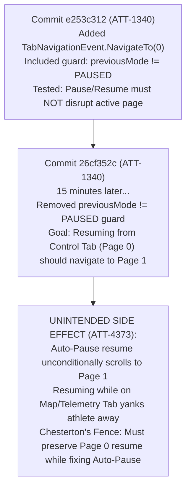

# Stage 1 Analysis: ATT-4373 - [Bug] Do not navigate to first Cockpit tab when Auto-Pause ends

**Ticket**: [ATT-4373](https://rainerblind.atlassian.net/browse/ATT-4373)  
**Sub-task**: [ATT-4387](https://rainerblind.atlassian.net/browse/ATT-4387) (`[Analysis]`)  
**Parent Epic**: [ATT-355](https://rainerblind.atlassian.net/browse/ATT-355) (*Good and consistent UI*)  
**Target Release**: `V4.9.40`  
**Active Sprint**: `2026-43.2`  
**Branch**: `feature/ATT-4373`  
**Author**: AI Agent 1 (Implementer)  
**Date**: 2026-10-20  

---

## 1. Problem Statement & Motivation

During an active workout session (cycling, running, hiking) with Auto-Pause enabled, an athlete who decelerates below the auto-pause speed threshold (e.g., stopping at an intersection, traffic light, or trail overlook) transitions into the `PAUSED` state (`TrainingApplication.isAutoPaused() == true`). While stationary or moving slowly, athletes routinely swipe to inspect other Cockpit tabs, such as:
* Secondary telemetry data tabs (Page 2+, configured with lap splits, heart rate zone gauges, or power charts).
* The Map and route polyline tab (displaying live GPS positioning, turn cues, or elevation profile).

### Current Defective Behavior
When the athlete resumes moving above the hysteresis threshold (or manually taps "Resume" on the [`AutoPauseHudBanner`](file:///home/rainer/AndroidStudioProjects/aTrainingTracker/app/src/main/java/com/atrainingtracker/trainingtracker/ui/tracking/tracking/SensorGridScreen.kt#L814)), [`TrackerService`](file:///home/rainer/AndroidStudioProjects/aTrainingTracker/app/src/main/java/com/atrainingtracker/trainingtracker/tracker/TrackerService.java#L2032) dispatches `REQUEST_RESUME_FROM_PAUSED`. Upon receiving this broadcast, [`TrainingApplication.resumeFromPaused()`](file:///home/rainer/AndroidStudioProjects/aTrainingTracker/app/src/main/java/com/atrainingtracker/trainingtracker/TrainingApplication.java#L1678) transitions `cTrackingMode` to `TrackingMode.TRACKING` and broadcasts `TRACKING_STATE_CHANGED`.

In [`TrackingTabsViewModel.kt:243-249`](file:///home/rainer/AndroidStudioProjects/aTrainingTracker/app/src/main/java/com/atrainingtracker/trainingtracker/ui/tracking/trackingtabs/TrackingTabsViewModel.kt#L243-L249), the rising-edge collector for `banalServiceRepository.trackingMode` observes the transition `PAUSED -> TRACKING` and unconditionally emits:
```kotlin
_navigationEvent.send(TabNavigationEvent.NavigateTo(0))
```
In [`TrackingTabsScreen.kt:453-463`](file:///home/rainer/AndroidStudioProjects/aTrainingTracker/app/src/main/java/com/atrainingtracker/trainingtracker/ui/tracking/trackingtabs/TrackingTabsScreen.kt#L453-L463), this event is translated into an animated pager scroll to Page 1 (`offset = 1`, `target = 0 + 1 = 1`, the first Cockpit telemetry data tab). 

**Impact**: The athlete is abruptly and involuntarily jerked away from the tab they were actively consulting (e.g. Map navigation or secondary stats) and snapped back to Page 1 every single time Auto-Pause ends.

### Expected Behavior
* Automatic or manual resumption from **Auto-Pause** MUST NOT emit `TabNavigationEvent.NavigateTo(0)`; the athlete MUST remain uninterrupted on whichever Cockpit tab or Map tab they were actively viewing.
* Navigating to the first Cockpit tab (`NavigateTo(0)`) is ONLY intended when:
  1. Starting an initial tracking session from the "Start Tracking" / Control tab (`READY -> TRACKING`).
  2. Resuming an active workout from a **manual pause** while actively viewing the Control tab (`Page 0`).
* Resuming a manual pause from outside Page 0 (e.g., via smartwatch or notification action while viewing Page 2 or the Map) MUST NOT scroll away from the athlete's chosen tab.

---

## 2. Root Cause Analysis (Forensic Investigation)

### 2.1 Code Site 1: Unconditional Rising-Edge Collector in `TrackingTabsViewModel.kt`
In [`TrackingTabsViewModel.kt:237-252`](file:///home/rainer/AndroidStudioProjects/aTrainingTracker/app/src/main/java/com/atrainingtracker/trainingtracker/ui/tracking/trackingtabs/TrackingTabsViewModel.kt#L237-L252):
```kotlin
viewModelScope.launch {
    var previousMode: TrackingMode? = null
    banalServiceRepository.trackingMode.asFlow().collect { mode ->
        if (mode == TrackingMode.READY) {
            _hasRenderedCoachmarkInSession.value = false
        }
        if (mode == TrackingMode.TRACKING &&
            previousMode != null &&
            previousMode != TrackingMode.TRACKING
        ) {
            Log.i("TrackingTabsViewModel", "Tracking started (rising edge) -> navigating to cockpit tab")
            _navigationEvent.send(TabNavigationEvent.NavigateTo(0))
        }
        previousMode = mode
    }
}
```
**Mechanism of Failure**:
The collector triggers whenever `mode == TRACKING` and `previousMode != null && previousMode != TRACKING`. It makes no distinction between:
1. `previousMode == READY` (fresh workout start) versus `previousMode == PAUSED` (resuming).
2. Resuming from **Auto-Pause** versus resuming from **Manual Pause**.
3. Whether the athlete is currently on the **Control Tab** (`Page 0`) versus actively viewing a **Telemetry / Map Tab** (`Page >= 1`).

### 2.2 Code Site 2: Premature Flag Clearing in `TrainingApplication.java`
In [`TrainingApplication.java:1678-1692`](file:///home/rainer/AndroidStudioProjects/aTrainingTracker/app/src/main/java/com/atrainingtracker/trainingtracker/TrainingApplication.java#L1678-L1692):
```java
public void resumeFromPaused() {
    if (DEBUG) Log.d(TAG, "resume tracking");

    setManualPauseLock(false, this);
    setAutoPaused(false, this);
    TrackerService.notifyManualResume();

    if (TrainingApplication.startSearchWhenResumeFromPaused()) {
        sendBroadcast(new Intent(REQUEST_START_SEARCH_FOR_PAIRED_DEVICES)
                .setPackage(getPackageName()));
    }

    cTrackingMode = TrackingMode.TRACKING;
    notifyTrackingStateChanged();
}
```
**Mechanism of Failure**:
`setAutoPaused(false, this)` is invoked on line 1682, *prior* to setting `cTrackingMode = TrackingMode.TRACKING` and broadcasting `TRACKING_STATE_CHANGED` on lines 1690-1691. By the time downstream observers (such as [`BANALServiceRepository`](file:///home/rainer/AndroidStudioProjects/aTrainingTracker/app/src/main/java/com/atrainingtracker/trainingtracker/repositories/BANALServiceRepository.kt#L173) or ViewModels) receive the mode change, `TrainingApplication.isAutoPaused()` has already been wiped to `false`. Downstream consumers have no way of knowing whether the transition `PAUSED -> TRACKING` originated from Auto-Pause.

### 2.3 Code Site 3: Pager Translation in `TrackingTabsScreen.kt`
In [`TrackingTabsScreen.kt:453-463`](file:///home/rainer/AndroidStudioProjects/aTrainingTracker/app/src/main/java/com/atrainingtracker/trainingtracker/ui/tracking/trackingtabs/TrackingTabsScreen.kt#L453-L463) and [`navigateToPagerTarget`](file:///home/rainer/AndroidStudioProjects/aTrainingTracker/app/src/main/java/com/atrainingtracker/trainingtracker/ui/tracking/trackingtabs/TrackingTabsScreen.kt#L967-L980):
```kotlin
val offset = if (screenMode == ScreenMode.TRACKING) 1 else 0
val target = tabIndex + offset
Log.i(TAG, "Navigating to target=$target (offset=$offset)")
```
In `ScreenMode.TRACKING`:
* Page 0 is the Control tab ([`ControlTrackingScreen.kt`](file:///home/rainer/AndroidStudioProjects/aTrainingTracker/app/src/main/java/com/atrainingtracker/trainingtracker/ui/tracking/controltracking/ControlTrackingScreen.kt)).
* Page 1 is the 1st telemetry tab (`tabIndex = 0`).
* Page 2+ are subsequent telemetry / map tabs.

Receiving `TabNavigationEvent.NavigateTo(0)` forces the pager to execute `currentPagerState.animateScrollToPage(1)`, overriding the user's manual selection.

---

## 3. User Scope Grounding (ATT-1250)

* **In-Scope Goals**:
  1. Distinguish Auto-Pause resumes from Manual Pause resumes in [`TrainingApplication.java`](file:///home/rainer/AndroidStudioProjects/aTrainingTracker/app/src/main/java/com/atrainingtracker/trainingtracker/TrainingApplication.java) and expose whether the session was auto-paused upon resuming.
  2. Maintain `wasAutoPaused` context in [`BANALServiceRepository.kt`](file:///home/rainer/AndroidStudioProjects/aTrainingTracker/app/src/main/java/com/atrainingtracker/trainingtracker/repositories/BANALServiceRepository.kt) across the `TRACKING_STATE_CHANGED` broadcast.
  3. Track current pager page index in [`TrackingTabsViewModel.kt`](file:///home/rainer/AndroidStudioProjects/aTrainingTracker/app/src/main/java/com/atrainingtracker/trainingtracker/ui/tracking/trackingtabs/TrackingTabsViewModel.kt) via [`TrackingTabsScreen.kt`](file:///home/rainer/AndroidStudioProjects/aTrainingTracker/app/src/main/java/com/atrainingtracker/trainingtracker/ui/tracking/trackingtabs/TrackingTabsScreen.kt).
  4. Suppress `TabNavigationEvent.NavigateTo(0)` whenever Auto-Pause ends (movement recovery or tapping Resume on the HUD banner).
  5. Suppress `TabNavigationEvent.NavigateTo(0)` when resuming a manual pause while already on a Cockpit telemetry tab (`Page >= 1`).
  6. Preserve automatic navigation to Cockpit Page 1 (`NavigateTo(0)`) strictly for:
     - Fresh workout start (`READY -> TRACKING`).
     - Manual resume initiated while actively on the Control tab (`Page 0`).
  7. Update unit test suite in [`TrackingTabsViewModelTest.kt`](file:///home/rainer/AndroidStudioProjects/aTrainingTracker/app/src/test/java/com/atrainingtracker/trainingtracker/ui/tracking/trackingtabs/TrackingTabsViewModelTest.kt) to verify both Auto-Pause neutrality and Control tab resume navigation.

* **Out-of-Scope Non-Goals (Scope Bounding)**:
  1. Modifying the speed calculation, sensor timeout, debounce window, or hysteresis thresholds in [`AutoPauseManager.kt`](file:///home/rainer/AndroidStudioProjects/aTrainingTracker/app/src/main/java/com/atrainingtracker/trainingtracker/tracker/autopause/AutoPauseManager.kt) (`REQ-TRK-018` / `REQ-TRK-028`).
  2. Modifying visual design, countdown animations, or layout of the [`AutoPauseHudBanner`](file:///home/rainer/AndroidStudioProjects/aTrainingTracker/app/src/main/java/com/atrainingtracker/trainingtracker/ui/tracking/tracking/SensorGridScreen.kt#L814) (`REQ-UI-359`).
  3. Modifying swipe gesture handling, cancellation safety, or 2000 ms timeout safety in [`navigateToPagerTarget`](file:///home/rainer/AndroidStudioProjects/aTrainingTracker/app/src/main/java/com/atrainingtracker/trainingtracker/ui/tracking/trackingtabs/TrackingTabsScreen.kt#L967) (`REQ-UI-412`).
  4. Altering [`ControlTrackingScreen`](file:///home/rainer/AndroidStudioProjects/aTrainingTracker/app/src/main/java/com/atrainingtracker/trainingtracker/ui/tracking/controltracking/ControlTrackingScreen.kt) UI buttons or timer presentation.

---

## 4. Requirement Archaeology & Chesterton's Fence Audit



### 4.1 Requirement Archaeology (`REQ-PRO-022`)

* **Original Requirement ID & Target**:
  [`REQ-UI-163`](file:///home/rainer/AndroidStudioProjects/aTrainingTracker/docs/requirements.md#L346) (*Cockpit Tab Navigation on Tracking Initiation*), implemented under `ATT-1340`.
  Targets [`TrackingTabsViewModel.kt`](file:///home/rainer/AndroidStudioProjects/aTrainingTracker/app/src/main/java/com/atrainingtracker/trainingtracker/ui/tracking/trackingtabs/TrackingTabsViewModel.kt), [`TrackingTabsScreen.kt`](file:///home/rainer/AndroidStudioProjects/aTrainingTracker/app/src/main/java/com/atrainingtracker/trainingtracker/ui/tracking/trackingtabs/TrackingTabsScreen.kt), [`TrainingApplication.java`](file:///home/rainer/AndroidStudioProjects/aTrainingTracker/app/src/main/java/com/atrainingtracker/trainingtracker/TrainingApplication.java), [`BANALServiceRepository.kt`](file:///home/rainer/AndroidStudioProjects/aTrainingTracker/app/src/main/java/com/atrainingtracker/trainingtracker/repositories/BANALServiceRepository.kt), and [`TrackingTabsViewModelTest.kt`](file:///home/rainer/AndroidStudioProjects/aTrainingTracker/app/src/test/java/com/atrainingtracker/trainingtracker/ui/tracking/trackingtabs/TrackingTabsViewModelTest.kt).

* **Historical Origin & Commit Trace**:
  - **Commit `e253c312`** (`2026-09-24 18:33:57`, `ATT-1340`):
    Unified cockpit navigation onto `SharedFlow<TabNavigationEvent>`. The collector originally included:
    ```kotlin
    if (mode == TrackingMode.TRACKING &&
        previousMode != null &&
        previousMode != TrackingMode.TRACKING &&
        previousMode != TrackingMode.PAUSED
    ) { ... }
    ```
    The accompanying unit test (`testPauseAndResumeDoesNotDisruptActivePage`) asserted that `PAUSED -> TRACKING` emitted 0 navigation events.
  - **Commit `26cf352c`** (`2026-09-24 18:49:16`, `ATT-1340`):
    Rainer observed that after pausing manually on the Control tab (`Page 0`), tapping "Resume" left the user stranded on Page 0 instead of animating back to the metrics screen. Rainer removed `previousMode != TrackingMode.PAUSED` so resuming from `PAUSED` would scroll to Page 1, updating TC-3 to `testResumeFromPausedNavigatesToFirstCockpitTab()`.

* **Root Reason for Existing Formulation**:
  Removing `previousMode != TrackingMode.PAUSED` was an expedient, local fix to allow Control tab manual resume to scroll to Page 1 without plumbing pager page index state into the ViewModel or distinguishing between Auto-Pause and manual pause. At that time, the interaction between Auto-Pause and telemetry tab browsing was not considered.

* **Preservation of Core Invariants**:
  - Starting tracking (`READY -> TRACKING`) MUST ALWAYS navigate smoothly to Cockpit Page 1 (`NavigateTo(0)`).
  - Resuming a manual pause while on the Control tab (`Page 0`) MUST CONTINUE to navigate to Cockpit Page 1 (`NavigateTo(0)`).
  - Cold starts and screen rotations in `TRACKING` mode MUST emit 0 navigation events.
  - Manual touch gestures, swipe interruptions, and cancellation resilience ([`REQ-UI-412`](file:///home/rainer/AndroidStudioProjects/aTrainingTracker/docs/requirements.md#L844)) MUST remain 100% intact.
  - *Refinement for ATT-4373*: Restricting `PAUSED -> TRACKING` navigation to non-auto-pause sessions where `currentPage == 0` completely preserves the intent of commit `26cf352c` while eliminating the defect introduced by removing the guard.

---

## 5. Architectural Strategy & High-Level Solution

### 5.1 Decision Table: Navigation Evaluation
| Transition | Was Auto-Paused? | Active Page (`currentPage`) | Trigger `NavigateTo(0)`? | Athlete Experience |
| :--- | :--- | :--- | :--- | :--- |
| `READY -> TRACKING` | N/A | `0` (Start Tab) | **YES** | Smooth transition to live metrics on start |
| `PAUSED -> TRACKING` | **YES** (Auto-Pause) | `>= 1` (Telemetry / Map) | **NO** | Athlete stays on active telemetry / map tab |
| `PAUSED -> TRACKING` | **YES** (Auto-Pause) | `0` (Control Tab) | **NO** | Auto-pause end does not hijack pager |
| `PAUSED -> TRACKING` | **NO** (Manual Pause) | `0` (Control Tab) | **YES** | Athlete returns to live metrics after manual resume |
| `PAUSED -> TRACKING` | **NO** (Manual Pause) | `>= 1` (Telemetry / Map) | **NO** | Resuming via watch/notification preserves current tab |

### 5.2 Architectural Component Changes

```mermaid
sequenceDiagram
    autonumber
    actor Athlete
    participant TTS as TrackingTabsScreen
    participant VM as TrackingTabsViewModel
    participant Repo as BANALServiceRepository
    participant App as TrainingApplication
    participant Svc as TrackerService

    Note over Athlete, TTS: Auto-Pause Scenario
    Athlete->>Svc: Decelerates below threshold
    Svc->>App: pauseTracking(isAutoPause = true)
    App->>App: setAutoPaused(true)
    Athlete->>TTS: Swipes to Map tab (Page 3)
    TTS->>VM: onPageSelected(3)
    Athlete->>Svc: Accelerates above threshold
    Svc->>App: sendBroadcast(REQUEST_RESUME_FROM_PAUSED)
    App->>App: mWasAutoPaused.set(true); setAutoPaused(false)
    App->>App: cTrackingMode = TRACKING
    App->>Repo: sendBroadcast(TRACKING_STATE_CHANGED)
    Repo->>Repo: _wasAutoPaused.value = true; _trackingMode.value = TRACKING
    Repo->>VM: trackingMode flow emits TRACKING
    VM->>VM: Evaluate: wasAutoPaused=true -> SUPPRESS NavigateTo(0)
    Note over TTS: Page 3 remains active uninterrupted!
```

#### A. `TrainingApplication.java`
1. Add thread-safe static state for auto-pause resume memory:
   ```java
   public static final String EXTRA_WAS_AUTO_PAUSED = "com.atrainingtracker.trainingapplication.EXTRA_WAS_AUTO_PAUSED";
   private static final AtomicBoolean mWasAutoPaused = new AtomicBoolean(false);

   public static boolean wasAutoPaused() {
       return mWasAutoPaused.get();
   }
   ```
2. In `resumeFromPaused()`:
   ```java
   public void resumeFromPaused() {
       if (DEBUG) Log.d(TAG, "resume tracking");

       boolean wasAuto = mIsAutoPaused.get();
       mWasAutoPaused.set(wasAuto);

       setManualPauseLock(false, this);
       setAutoPaused(false, this);
       TrackerService.notifyManualResume();
       ...
       cTrackingMode = TrackingMode.TRACKING;
       notifyTrackingStateChanged();
   }
   ```
3. In `notifyTrackingStateChanged()`, include `EXTRA_WAS_AUTO_PAUSED` in `TRACKING_STATE_CHANGED` intent.
4. In `pauseTracking()`, `stopTracking()`, `resetTrackingStateOnAbort()`, `onTrackingAborted()`, `startTracking()`: reset `mWasAutoPaused.set(false)`.

#### B. `BANALServiceRepository.kt`
1. Expose `wasAutoPaused: StateFlow<Boolean>`:
   ```kotlin
   private val _wasAutoPaused = MutableStateFlow(false)
   val wasAutoPaused: StateFlow<Boolean> = _wasAutoPaused.asStateFlow()
   ```
2. In `trackingModeReceiver.onReceive`:
   ```kotlin
   val wasAuto = intent?.getBooleanExtra(TrainingApplication.EXTRA_WAS_AUTO_PAUSED, false)
       ?: TrainingApplication.wasAutoPaused()
   _wasAutoPaused.value = wasAuto

   val newTrackingMode = TrainingApplication.getTrackingMode()
   if (_trackingMode.value != newTrackingMode) {
       _trackingMode.postValue(newTrackingMode)
   }
   ```

#### C. `TrackingTabsViewModel.kt`
1. Add reactive `currentPage` state tracking:
   ```kotlin
   private val _currentPage = MutableStateFlow(0)
   val currentPage: StateFlow<Int> = _currentPage.asStateFlow()

   fun onPageSelected(page: Int) {
       _currentPage.value = page
   }
   ```
2. In `init` tracking mode collector:
   ```kotlin
   viewModelScope.launch {
       var previousMode: TrackingMode? = null
       banalServiceRepository.trackingMode.asFlow().collect { mode ->
           if (mode == TrackingMode.READY) {
               _hasRenderedCoachmarkInSession.value = false
           }
           if (mode == TrackingMode.TRACKING &&
               previousMode != null &&
               previousMode != TrackingMode.TRACKING
           ) {
               val wasAuto = banalServiceRepository.wasAutoPaused.value
               val isControlTab = _currentPage.value == 0
               val shouldNavigate = when (previousMode) {
                   TrackingMode.READY -> true
                   TrackingMode.PAUSED -> !wasAuto && isControlTab
                   else -> false
               }

               if (shouldNavigate) {
                   Log.i("TrackingTabsViewModel", "Navigating to cockpit tab (prevMode=$previousMode, wasAuto=$wasAuto, page=${_currentPage.value})")
                   _navigationEvent.send(TabNavigationEvent.NavigateTo(0))
               } else {
                   Log.i("TrackingTabsViewModel", "Suppressed cockpit navigation on resume (prevMode=$previousMode, wasAuto=$wasAuto, page=${_currentPage.value})")
               }
           }
           previousMode = mode
       }
   }
   ```

#### D. `TrackingTabsScreen.kt`
Synchronize pager page changes to the ViewModel:
```kotlin
LaunchedEffect(pagerState.currentPage) {
    lastKnownPage = pagerState.currentPage
    trackingTabsViewModel.onPageSelected(pagerState.currentPage)
}
```

---

## 6. System Invariants & Risk Assessment

### 6.1 Core System Invariants
1. **Initial Start Navigation**: Starting tracking (`READY -> TRACKING`) MUST ALWAYS navigate the pager from Page 0 to Page 1 (`NavigateTo(0)`).
2. **Control Tab Manual Resume**: Resuming a manually paused session from the Control tab (`Page 0`) MUST navigate to Page 1 (`NavigateTo(0)`), preserving the core behavior specified in `ATT-1340`.
3. **Auto-Pause Neutrality**: Ending Auto-Pause (via speed recovery or tapping Resume on the HUD banner) MUST NEVER scroll the pager or disrupt the athlete's active tab.
4. **Telemetry Tab Manual Resume Neutrality**: Resuming a manually paused session while on `Page >= 1` (e.g. via smartwatch or notification) MUST NOT force navigation back to Page 1.
5. **Cold Start & Recreation Immunity**: App launch, process restoration, or screen rotation while in `TRACKING` mode MUST emit 0 navigation events.
6. **Thread Safety**: `mWasAutoPaused` is guarded by `AtomicBoolean`; `BANALServiceRepository` flows run on main dispatcher and post safely.
7. **Parent Ticket Human Gate**: Human Decision Gate remains strictly enforced prior to merge.

### 6.2 Risk Rating
**Risk Rating**: **LOW**

**Technical Justification**:
The modifications are strictly localized to:
- Recording an atomic boolean flag (`mWasAutoPaused`) during resume in `TrainingApplication.java`.
- Propagating that flag through `BANALServiceRepository.kt` into `TrackingTabsViewModel.kt`.
- Adding a lightweight `onPageSelected` callback from `TrackingTabsScreen.kt`.
- Refining the navigation predicate in `TrackingTabsViewModel.kt`.

No database schemas, SQL queries, sensor protocol decoders, BLE/ANT+ stacks, or background thread dispatchers are altered. Full unit test regression (`./gradlew testDebugUnitTest`) will ensure zero collateral breakage across the application.
