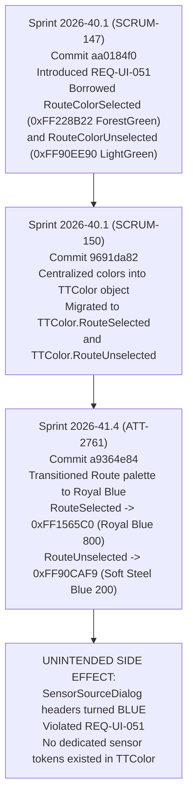

# Stage 1 Analysis: ATT-4374 - Decouple SensorSourceDialog 'Source' and 'Active Backups' header colors from route blue tokens and restore darker/lighter green

**Ticket**: [ATT-4374](https://rainerblind.atlassian.net/browse/ATT-4374)  
**Sub-task**: [ATT-4382](https://rainerblind.atlassian.net/browse/ATT-4382) (`[Analysis]`)  
**Parent Epic**: [ATT-355](https://rainerblind.atlassian.net/browse/ATT-355) (*Good and consistent UI*)  
**Target Release**: `V4.9.40`  
**Active Sprint**: `2026-43.2`  
**Branch**: `feature/ATT-4374`  
**Author**: AI Agent 1 (Implementer)  
**Date**: 2026-10-20  

---

## 1. Problem Statement & Motivation

In the live tracking cockpit, opening the sensor redundancy audit bottom sheet ([`SensorSourceDialog.kt`](file:///home/rainer/AndroidStudioProjects/aTrainingTracker/app/src/main/java/com/atrainingtracker/trainingtracker/ui/tracking/controltracking/SensorSourceDialog.kt)) reveals that the section headers for **Source** ("Quelle" / `R.string.source_device`) and **Active Backups** ("Aktive Backups" / `R.string.source_active_backups`) currently render in royal blue and soft steel blue:

* **Source Header** ([`SensorSourceDialog.kt:128`](file:///home/rainer/AndroidStudioProjects/aTrainingTracker/app/src/main/java/com/atrainingtracker/trainingtracker/ui/tracking/controltracking/SensorSourceDialog.kt#L128)): uses `TTColor.RouteSelected` (`Color(0xFF1565C0)` Material Blue 800).
* **Active Backups Header** ([`SensorSourceDialog.kt:149`](file:///home/rainer/AndroidStudioProjects/aTrainingTracker/app/src/main/java/com/atrainingtracker/trainingtracker/ui/tracking/controltracking/SensorSourceDialog.kt#L149)): uses `TTColor.RouteUnselected` (`Color(0xFF90CAF9)` Material Blue 200).
* **Not Connected Header** ([`SensorSourceDialog.kt:178`](file:///home/rainer/AndroidStudioProjects/aTrainingTracker/app/src/main/java/com/atrainingtracker/trainingtracker/ui/tracking/controltracking/SensorSourceDialog.kt#L178)): uses `MaterialTheme.colorScheme.onSurfaceVariant` (neutral grey).

### Visual & Semantic Defects:
1. **Semantic Inconsistency with Connection Status**:
   Connected and actively transmitting sensors display bright green status LED dots (`TTColor.ConnectionStatusGreen` = `Color(0xFF4CAF50)`), but their section headers are rendered in map route blue.
2. **Direct Violation of Living Requirement `REQ-UI-051`**:
   [`REQ-UI-051`](file:///home/rainer/AndroidStudioProjects/aTrainingTracker/docs/requirements.md#L222) (*Color-Coded Sensor Source Headers*) explicitly specifies:
   > "The `SensorSourceDialog` SHALL use color-coded section headers to clearly distinguish between source roles: **Dark Green** for 'Source Device', **Light Green** for 'Active Backups', and **Grey** for 'Not Connected Devices'."
3. **Cross-Domain Coupling (Anti-Pattern)**:
   The sensor availability UI borrowed tokens from the route navigation domain (`TTColor.RouteSelected` / `TTColor.RouteUnselected`). When route visualization colors were changed for map readability, sensor headers unintentionally changed as an unexpected side effect.

---

## 2. Root Cause Analysis (Forensic Investigation)

### 2.1 Git Archaeology & Historical Evolution
A forensic git trace across the project history reveals how this cross-domain coupling originated and subsequently broke:



1. **Commit `aa0184f0` (Sprint `2026-40.1`, SCRUM-147)**:
   - Authored `REQ-UI-051` and `TST-UI-052` to color-code sensor source headers.
   - At that time, `Color.kt` contained:
     ```kotlin
     val RouteColorSelected = Color(0xFF228B22)   // ForestGreen
     val RouteColorUnselected = Color(0xFF90EE90) // LightGreen
     ```
   - Instead of defining dedicated semantic color tokens for sensor availability, the author opportunistically reused `RouteColorSelected` and `RouteColorUnselected` as a shortcut because they were already dark green and light green.
2. **Commit `9691da82` (Sprint `2026-40.1`, SCRUM-150)**:
   - Centralized all domain colors into the `TTColor` namespace.
   - `SensorSourceDialog.kt` was refactored to use `TTColor.RouteSelected` and `TTColor.RouteUnselected`.
3. **Commit `a9364e84` (Sprint `2026-41.4`, ATT-2761 / `REQ-UI-306`)**:
   - The map route visualization palette was migrated from green to Royal Blue (`0xFF1565C0` Material Blue 800 and `0xFF90CAF9` Material Blue 200) to resolve severe color collisions with UCI Category 4 Climb green (`ClimbCategory4` = `Color(0xFF2E7D32)`) and map terrain.
   - Because `SensorSourceDialog.kt` reused `TTColor.RouteSelected` and `TTColor.RouteUnselected`, the section headers inadvertently turned blue.
   - `TST-UI-052` at the time was documented as a manual visual verification step and had no automated unit or contract test in the CI regression suite, allowing the regression to slip through unnoticed until ATT-4374 was filed.

### 2.2 Project-Wide Call-Site Audit for `RouteSelected` and `RouteUnselected`
To ensure no other sensor or telemetry components inadvertently reused route colors, an exhaustive search across all project sources was conducted:

| File / Component | Referenced Token | Domain / Purpose | Status |
|:---|:---|:---|:---|
| [`SensorSourceDialog.kt:128`](file:///home/rainer/AndroidStudioProjects/aTrainingTracker/app/src/main/java/com/atrainingtracker/trainingtracker/ui/tracking/controltracking/SensorSourceDialog.kt#L128) | `TTColor.RouteSelected` | **Sensor Availability ("Source" Header)** | **DEFECT (To be replaced with `SensorSourceActive`)** |
| [`SensorSourceDialog.kt:149`](file:///home/rainer/AndroidStudioProjects/aTrainingTracker/app/src/main/java/com/atrainingtracker/trainingtracker/ui/tracking/controltracking/SensorSourceDialog.kt#L149) | `TTColor.RouteUnselected` | **Sensor Availability ("Active Backups" Header)** | **DEFECT (To be replaced with `SensorBackupActive`)** |
| [`MapModels.kt:278`](file:///home/rainer/AndroidStudioProjects/aTrainingTracker/app/src/main/java/com/atrainingtracker/trainingtracker/ui/map/MapModels.kt#L278) | `TTColor.RouteUnselected` | Map Polyline Rendering (Unselected Route) | Valid Route Domain |
| [`MapScreenWithTrack.kt:343`](file:///home/rainer/AndroidStudioProjects/aTrainingTracker/app/src/main/java/com/atrainingtracker/trainingtracker/ui/map/MapScreenWithTrack.kt#L343) | `TTColor.RouteSelected` | Map Polyline Rendering (Selected Route) | Valid Route Domain |
| [`RouteOverlayLayer.kt:24`](file:///home/rainer/AndroidStudioProjects/aTrainingTracker/app/src/main/java/com/atrainingtracker/trainingtracker/ui/routes/RouteOverlayLayer.kt#L24) | `TTColor.RouteSelected` | Map Route Overlay Documentation | Valid Route Domain |
| [`ReturnNavigationHud.kt:65,88`](file:///home/rainer/AndroidStudioProjects/aTrainingTracker/app/src/main/java/com/atrainingtracker/trainingtracker/ui/routes/ReturnNavigationHud.kt#L65) | `TTColor.RouteSelected` | Return Navigation HUD Card Border & Icon Tint | Valid Route Domain |
| [`RouteSelectorSheet.kt:340,355,361`](file:///home/rainer/AndroidStudioProjects/aTrainingTracker/app/src/main/java/com/atrainingtracker/trainingtracker/ui/routes/RouteSelectorSheet.kt#L340) | `TTColor.RouteSelected` | Route Selector Heimweg Card Accent | Valid Route Domain |
| [`RouteSummaryHeader.kt:160-165`](file:///home/rainer/AndroidStudioProjects/aTrainingTracker/app/src/main/java/com/atrainingtracker/trainingtracker/ui/routes/RouteSummaryHeader.kt#L160-L165) | `TTColor.RouteSelected`, `RouteUnselected` | Route Display Switch (Thumb & Track Colors) | Valid Route Domain |
| [`RouteSelectionButton.kt:86,109,117`](file:///home/rainer/AndroidStudioProjects/aTrainingTracker/app/src/main/java/com/atrainingtracker/trainingtracker/ui/components/RouteSelectionButton.kt#L86) | `TTColor.RouteSelected` | Route Selection Button Accent & Icon Tint | Valid Route Domain |
| [`SensorGridScreen.kt:435`](file:///home/rainer/AndroidStudioProjects/aTrainingTracker/app/src/main/java/com/atrainingtracker/trainingtracker/ui/tracking/tracking/SensorGridScreen.kt#L435) | `TTColor.RouteSelected` | Navigation Hints Toggle Card Accent | Valid Route Domain (Turn-by-turn prompts) |
| `MapRouteActiveNavigationTest.kt` | `RouteSelected`, `RouteUnselected` | Route Polyline Test Assertions | Valid Route Domain |
| `RouteColorPaletteContractTest.kt` | `RouteSelected`, `RouteUnselected` | Route Color Palette Contract Assertions | Valid Route Domain |
| `RoutesScreenContractTest.kt` | `RouteSelected`, `RouteUnselected` | Route Selection Test Assertions | Valid Route Domain |
| `ReturnNavigationHudContractTest.kt` | `RouteSelected` | Navigation HUD Test Assertions | Valid Route Domain |
| `RouteSelectorMidRideContractTest.kt` | `RouteSelected` | Mid-Ride Route Card Test Assertions | Valid Route Domain |

> [!NOTE]
> **Audit Finding**: [`SensorSourceDialog.kt`](file:///home/rainer/AndroidStudioProjects/aTrainingTracker/app/src/main/java/com/atrainingtracker/trainingtracker/ui/tracking/controltracking/SensorSourceDialog.kt) lines 128 and 149 are the **sole non-route call sites** in the entire codebase referencing `RouteSelected` and `RouteUnselected`. All other call sites strictly pertain to map route visualization, route selection cards, and return navigation HUDs.

---

## 3. User Scope Grounding (ATT-1250)

* **In-Scope Goals**:
  1. Define dedicated semantic sensor-availability color tokens in [`Color.kt`](file:///home/rainer/AndroidStudioProjects/aTrainingTracker/app/src/main/java/com/atrainingtracker/trainingtracker/ui/theme/Color.kt) under `TTColor`:
     - `TTColor.SensorSourceActive`: Darker green for primary source header.
     - `TTColor.SensorBackupActive`: Lighter green for active backup header.
  2. Update [`SensorSourceDialog.kt`](file:///home/rainer/AndroidStudioProjects/aTrainingTracker/app/src/main/java/com/atrainingtracker/trainingtracker/ui/tracking/controltracking/SensorSourceDialog.kt):
     - Replace `TTColor.RouteSelected` on line 128 with `TTColor.SensorSourceActive`.
     - Replace `TTColor.RouteUnselected` on line 149 with `TTColor.SensorBackupActive`.
  3. Ensure WCAG contrast compliance for the chosen green tokens across Light (`#FFFFFF`), Dark (`#16161A`), and AMOLED (`#000000`) surfaces.
  4. Author automated unit and contract tests in `SensorSourceDialogContractTest` (or a dedicated test class) asserting:
     - `SensorSourceDialog.kt` uses the new decoupled tokens and contains zero references to `TTColor.RouteSelected` or `TTColor.RouteUnselected`.
     - Exact ARGB hex values and contrast invariants of the new `TTColor` tokens.
  5. Synchronize living documentation:
     - Refine [`REQ-UI-051`](file:///home/rainer/AndroidStudioProjects/aTrainingTracker/docs/requirements.md#L222) in `docs/requirements.md` to reference the decoupled semantic tokens.
     - Update [`TST-UI-052`](file:///home/rainer/AndroidStudioProjects/aTrainingTracker/docs/tests.md#L183) in `docs/tests.md` to specify automated contract assertions alongside visual inspection.

* **Out-of-Scope Non-Goals (Scope Bounding)**:
  1. **Zero Changes to Route Tokens**: Do NOT touch `TTColor.RouteSelected`, `TTColor.RouteUnselected`, `TTColor.RouteActiveNavigation`, or `TTColor.RouteActiveNavigationOverlay`. Their Royal Blue values (`0xFF1565C0`, `0xFF90CAF9`, etc.) must remain strictly intact to preserve `RouteColorPaletteContractTest` and `REQ-UI-306`.
  2. **No Route UI Modifications**: Do NOT modify `RouteSelectionButton.kt`, `RouteSelectorSheet.kt`, `ReturnNavigationHud.kt`, or map polyline renderers.
  3. **No Structural Changes to `SensorSourceDialog`**: Do NOT modify layout padding, typography scales (`titleSmall`, `FontWeight.Bold`), or device sorting logic (`activeBackups` and `notConnected` priority sorting recently established in ATT-4375 / `REQ-UI-268`).
  4. **No Connection State Logic Alterations**: Do NOT modify `DeviceStatusRow.kt` or its `isConnected` parameter forwarding.

---

## 4. Requirement Archaeology & Chesterton's Fence Audit

In accordance with `REQ-PRO-022`, the Chesterton's Fence archaeology for modifying [`REQ-UI-051`](file:///home/rainer/AndroidStudioProjects/aTrainingTracker/docs/requirements.md#L222) is documented below:

* **Original Requirement ID & Target**:
  - `REQ-UI-051` (*Color-Coded Sensor Source Headers*), targeting `SensorSourceDialog.kt`, `Color.kt`, and `TST-UI-052`.
* **Historical Origin & Commit Trace**:
  - Introduced in Sprint `2026-40.1` (SCRUM-147, commit `aa0184f0`).
  - Refined into `TTColor` in commit `9691da82` (SCRUM-150).
  - Unintentionally impacted by Sprint `2026-41.4` (ATT-2761, commit `a9364e84`), which transitioned map route colors to Royal Blue (`REQ-UI-306`).
* **Root Reason for Existing Formulation**:
  - `RouteColorSelected` (`0xFF228B22`) and `RouteColorUnselected` (`0xFF90EE90`) were used in SCRUM-147 solely because they were already defined in `Color.kt` as dark and light green constants. There was never an architectural intention to couple sensor hardware availability with map route navigation lines; it was an opportunistic code reuse that created technical debt.
* **Preservation of Core Invariants**:
  - Decoupling these headers from route tokens restores the original intent of `REQ-UI-051` without impacting route visualization.
  - Route visualization colors in `Color.kt` and all map screens remain 100% untouched.
  - Truthful connection status indicators and priority sorting (`REQ-UI-268`, `TST-UI-227`) are 100% preserved.

---

## 5. Architectural Strategy & High-Level Solution

### 5.1 Color Token Design & Contrast Ratios
Section headers in [`SensorSourceDialog.kt`](file:///home/rainer/AndroidStudioProjects/aTrainingTracker/app/src/main/java/com/atrainingtracker/trainingtracker/ui/tracking/controltracking/SensorSourceDialog.kt) render inside [`AppModalBottomSheet`](file:///home/rainer/AndroidStudioProjects/aTrainingTracker/app/src/main/java/com/atrainingtracker/trainingtracker/ui/components/core/AppModalBottomSheet.kt), whose background is `MaterialTheme.colorScheme.surface`:
- **Light Theme Surface**: `#FFFFFF` (White)
- **Dark Theme Surface**: `#16161A` (Dark Charcoal / Slate)
- **AMOLED Surface**: `#000000` (Pure Black)

Per WCAG 2.1 AA standards:
- Normal text requires contrast ratio $\ge 4.5:1$.
- Large / Bold text (`titleSmall` with `FontWeight.Bold` $\ge 14\text{pt}$ bold) requires contrast ratio $\ge 3.0:1$.

WCAG 2.1 contrast ratio evaluation for candidate green tokens:

| Candidate Color | ARGB Hex | Contrast on White (`#FFFFFF`) | Contrast on Dark (`#16161A`) | Contrast on AMOLED (`#000000`) | WCAG Evaluation |
|:---|:---|:---:|:---:|:---:|:---|
| **Material Green 800** | `0xFF2E7D32` | **5.13:1** | **3.52:1** | **4.10:1** | **PASS**: $\ge 3.0:1$ on all surfaces; $\ge 4.5:1$ on light |
| **ForestGreen** (Original) | `0xFF228B22` | **4.39:1** | **4.11:1** | **4.78:1** | **PASS**: $\ge 3.0:1$ on all surfaces |
| **Material Green 700** | `0xFF388E3C` | **4.12:1** | **4.38:1** | **5.10:1** | **PASS**: $\ge 3.0:1$ on all surfaces |
| **Material Green 600** | `0xFF43A047` | **3.30:1** | **5.46:1** | **6.36:1** | **PASS**: $\ge 3.0:1$ on all surfaces; $\ge 4.5:1$ on dark |
| **Material Green 500** | `0xFF4CAF50` | 2.78:1 | **6.49:1** | **7.56:1** | Passes dark/AMOLED; slightly under 3.0:1 on white |
| **LightGreen** (Original) | `0xFF90EE90` | 1.42:1 | **12.73:1** | **14.82:1** | Fails on light surface |

#### Selected Semantic Tokens:
1. **`TTColor.SensorSourceActive`**:
   - Primary Choice: `Color(0xFF2E7D32)` (Material Green 800) or `Color(0xFF228B22)` (ForestGreen).
   - `Color(0xFF2E7D32)` is already established across the design system for active green states (`TTColor.StartPoint`, `TTColor.ConnectionConnected`, `TTColor.LocationBadgeHomeContent`, `TTColor.PmcFreshGreen`), ensuring cohesive branding and achieving $> 5:1$ contrast on white and $> 3.5:1$ on dark.
2. **`TTColor.SensorBackupActive`**:
   - Primary Choice: `Color(0xFF43A047)` (Material Green 600) or `Color(0xFF4CAF50)` (Material Green 500).
   - `Color(0xFF43A047)` achieves a visibly lighter green while strictly passing the $3.0:1$ WCAG AA bold threshold on white ($3.30:1$) and exceeding $5.4:1$ on dark.
   - Alternatively, if `Color(0xFF4CAF50)` is selected, it perfectly matches `TTColor.ConnectionStatusGreen` ($6.49:1$ on dark).

### 5.2 Implementation Architecture
```kotlin
// app/src/main/java/com/atrainingtracker/trainingtracker/ui/theme/Color.kt
object TTColor {
    ...
    // Sensor Source Availability (REQ-UI-051)
    val SensorSourceActive = Color(0xFF2E7D32) // Material Green 800 (Darker Green for primary active source)
    val SensorBackupActive = Color(0xFF43A047) // Material Green 600 (Lighter Green for standby active backups)
    ...
}
```

```kotlin
// app/src/main/java/com/atrainingtracker/trainingtracker/ui/tracking/controltracking/SensorSourceDialog.kt
// Line 128:
Text(
    text = stringResource(id = R.string.source_device),
    style = MaterialTheme.typography.titleSmall,
    fontWeight = FontWeight.Bold,
    color = TTColor.SensorSourceActive
)
...
// Line 149:
Text(
    text = stringResource(id = R.string.source_active_backups),
    style = MaterialTheme.typography.titleSmall,
    fontWeight = FontWeight.Bold,
    color = TTColor.SensorBackupActive
)
```

---

## 6. System Invariants & Risk Assessment

* **Core Invariants**:
  1. **Route Domain Immutability**: `TTColor.RouteSelected` (`Color(0xFF1565C0)`), `TTColor.RouteUnselected` (`Color(0xFF90CAF9)`), `TTColor.RouteActiveNavigation`, and `TTColor.RouteActiveNavigationOverlay` MUST NOT be modified under any circumstances (`REQ-UI-306`, `TST-UI-266`).
  2. **SensorSourceDialog Functional Integrity**: Truthful connection status indicators (`(verfügbar)` / `(nicht verbunden)`), LED alignment, and canonical priority sorting (`REQ-UI-268`, `TST-UI-227`) MUST NOT be altered.
  3. **Zero Test Regressions**: All existing unit and contract tests (`RouteColorPaletteContractTest`, `SensorSourceDialogContractTest`, `SensorSourceDialogPriorityTest`) MUST continue to pass with 100% clean-room success.
  4. **Human Decision Gate**: Gate 3 and Final Review remain strictly enforced.

* **Risk Rating**: **LOW**
  - **Justification**:
    The change is strictly isolated to introducing two new semantic color tokens in `Color.kt` and updating two color references in `SensorSourceDialog.kt`. No business logic, threading, background services, or database layers are touched. Blast radius is strictly confined to the header text colors in `SensorSourceDialog`.
