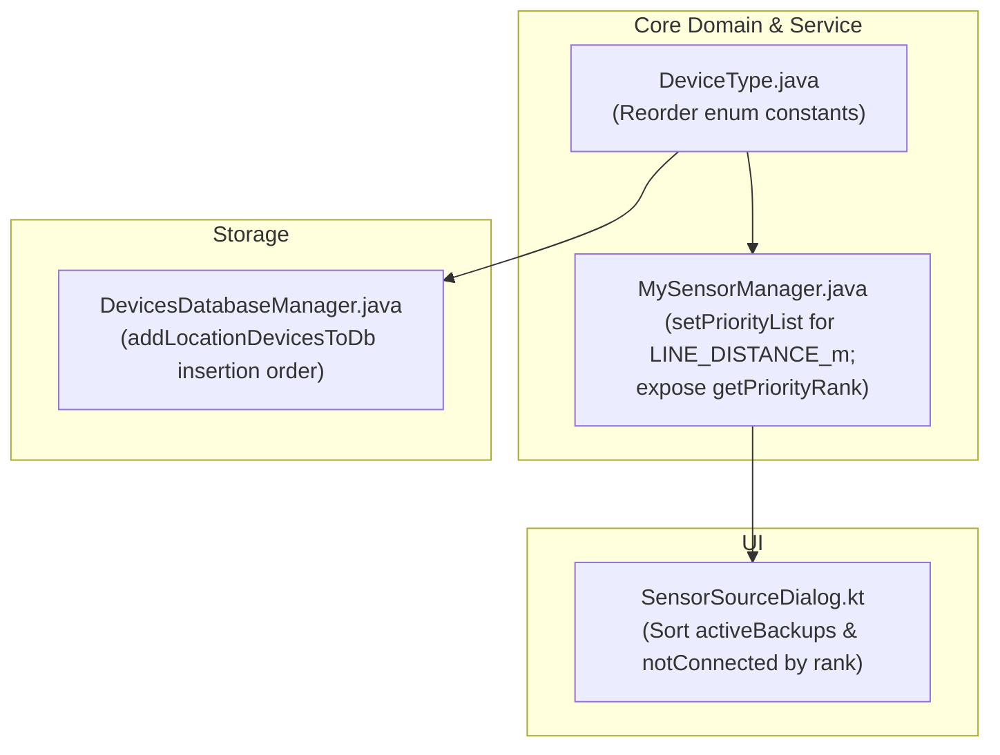

# Stage 1 Analysis: ATT-4375 - Align location and sensor priority order across DeviceType, MySensorManager, DevicesDatabaseManager, and SensorSourceDialog

**Ticket**: [ATT-4375](https://rainerblind.atlassian.net/browse/ATT-4375)  
**Sub-task**: [ATT-4377](https://rainerblind.atlassian.net/browse/ATT-4377) (`[Analysis]`)  
**Parent Epic**: [ATT-355](https://rainerblind.atlassian.net/browse/ATT-355) (*Good and consistent UI*)  
**Target Release**: `TBD (Set on Completion per Rule 14)`  
**Active Sprint**: `2026-43.2`  
**Branch**: `feature/ATT-4375`  
**Author**: AI Agent 1 (Implementer)  
**Date**: 2026-10-20  

---

## 1. Problem Statement & Motivation

While [`MySensorManager.java`](file:///home/rainer/AndroidStudioProjects/aTrainingTracker/app/src/main/java/com/atrainingtracker/banalservice/sensor/MySensorManager.java) explicitly defines `SPEED_PRIORITY`, `ALTITUDE_PRIORITY`, and `LOCATION_PRIORITY` with the canonical location priority hierarchy:
$$\text{GPS} \longrightarrow \text{GOOGLE\_FUSED} \longrightarrow \text{NETWORK}$$
there are three fundamental ordering inconsistencies across `DeviceType`, `MySensorManager`, `DevicesDatabaseManager`, and the user-facing `SensorSourceDialog`:

1. **`DeviceType.java` Enum Declaration Order & Missing `LINE_DISTANCE_m` Priority in `MySensorManager.java`**:
   - In [`DeviceType.java`](file:///home/rainer/AndroidStudioProjects/aTrainingTracker/app/src/main/java/com/atrainingtracker/banalservice/devices/DeviceType.java#L45-L47), `SPEED_AND_LOCATION_NETWORK` is declared *before* `SPEED_AND_LOCATION_GOOGLE_FUSED`.
   - In [`MySensorManager.java`](file:///home/rainer/AndroidStudioProjects/aTrainingTracker/app/src/main/java/com/atrainingtracker/banalservice/sensor/MySensorManager.java#L107-L110), `setPriorityList(..., LOCATION_PRIORITY)` is called for `ACCURACY`, `BEARING`, `LATITUDE`, and `LONGITUDE`, but **`SensorType.LINE_DISTANCE_m` was omitted**.
   - Because `mAllSensorsMapMap` is an `EnumMap<DeviceType, ...>`, when `priorityList == null`, `getBestSensor()` falls back to `EnumMap.keySet()` which iterates strictly in `DeviceType` enum declaration order (`ordinal()`). As a result, `getBestSensor(SensorType.LINE_DISTANCE_m)` mistakenly selects `SPEED_AND_LOCATION_NETWORK` over `SPEED_AND_LOCATION_GOOGLE_FUSED` when both sensors are active.

2. **Database Insertion Order in `DevicesDatabaseManager.java` (`NETWORK` Before `GOOGLE_FUSED`)**:
   - In [`DevicesDatabaseManager.java`](file:///home/rainer/AndroidStudioProjects/aTrainingTracker/app/src/main/java/com/atrainingtracker/banalservice/database/DevicesDatabaseManager.java#L1184-L1208) (`addLocationDevicesToDb`), smartphone location devices are inserted in the order `GPS`, `NETWORK`, `GOOGLE_FUSED` instead of `GPS`, `GOOGLE_FUSED`, `NETWORK`.
   - Consequently, SQLite assigns a lower autoincrement row ID (`_id`) to Network than to Google Fused. Lists ordered by DB row ID (such as the `Not connected` section in `SensorSourceDialog` when both are disconnected) present `Network` above `Google Fused`.

3. **`SensorSourceDialog.kt` Does Not Sort `activeBackups` or `notConnected` by `MySensorManager` Priority**:
   - In [`SensorSourceDialog.kt`](file:///home/rainer/AndroidStudioProjects/aTrainingTracker/app/src/main/java/com/atrainingtracker/trainingtracker/ui/tracking/controltracking/SensorSourceDialog.kt#L74-L80), `activeBackups` and `notConnected` are not sorted according to `MySensorManager`'s `DeviceType` priority hierarchy for the given `sensorType`.
   - `activeBackups` preserves the order of `allTelemetry` (where remote devices from `DeviceManager.getRemoteDeviceList()` iterate over a `ConcurrentHashMap` with non-deterministic order).
   - `notConnected` preserves the order of `allDevices` (database cursor query order), showing Network above Google Fused.
   - This causes visual disorder and contradicts `MySensorManager`'s actual operational fallback logic.

---

## 2. Root Cause Analysis (Forensic Investigation)

### 2.1 Inconsistent Enum Declaration in `DeviceType.java`
In [`DeviceType.java`](file:///home/rainer/AndroidStudioProjects/aTrainingTracker/app/src/main/java/com/atrainingtracker/banalservice/devices/DeviceType.java#L45-L47):
```java
    SPEED_AND_LOCATION_GPS(SensorType.SPEED_mps, BSportType.UNKNOWN, 1),
    SPEED_AND_LOCATION_NETWORK(SensorType.SPEED_mps, BSportType.UNKNOWN, 1),
    SPEED_AND_LOCATION_GOOGLE_FUSED(SensorType.SPEED_mps, BSportType.UNKNOWN, 1),
```
In Java, `java.lang.Enum` instances have a natural order defined strictly by their declaration order (`ordinal()`). Collections such as `java.util.EnumMap` and `java.util.EnumSet` iterate over elements in natural enum order.

### 2.2 Missing `LINE_DISTANCE_m` Priority Mapping in `MySensorManager.java`
In [`MySensorManager.java`](file:///home/rainer/AndroidStudioProjects/aTrainingTracker/app/src/main/java/com/atrainingtracker/banalservice/sensor/MySensorManager.java#L107-L110):
```java
    setPriorityList(SensorType.ACCURACY, LOCATION_PRIORITY);
    setPriorityList(SensorType.BEARING, LOCATION_PRIORITY);
    setPriorityList(SensorType.LATITUDE, LOCATION_PRIORITY);
    setPriorityList(SensorType.LONGITUDE, LOCATION_PRIORITY);
```
Per [`DeviceType.getDeviceTypeList`](file:///home/rainer/AndroidStudioProjects/aTrainingTracker/app/src/main/java/com/atrainingtracker/banalservice/devices/DeviceType.java#L144-L152), `LINE_DISTANCE_m` belongs to the location sensor group (`GPS`, `GOOGLE_FUSED`, `NETWORK`). However, `MySensorManager` did not register `SensorType.LINE_DISTANCE_m` with `LOCATION_PRIORITY`.

When `getBestSensor(SensorType.LINE_DISTANCE_m)` evaluates:
```java
    Collection<DeviceType> priorityList = getPriorityList(sensorType);
    if (priorityList == null) {
        EnumMap<DeviceType, LinkedList<MySensor>> deviceMap = mAllSensorsMapMap.get(sensorType);
        if (deviceMap == null) {
            return null;
        } else {
            priorityList = deviceMap.keySet();
        }
    }
```
Because `priorityList` is `null`, it falls back to `deviceMap.keySet()`. Since `deviceMap` is an `EnumMap`, `keySet()` iterates by `DeviceType.ordinal()`. Because `SPEED_AND_LOCATION_NETWORK` precedes `SPEED_AND_LOCATION_GOOGLE_FUSED` in `DeviceType.java`, `getBestSensor` inspects `NETWORK` before `GOOGLE_FUSED` and binds the proxy sensor to `NETWORK`.

### 2.3 Insertion Order Discrepancy in `DevicesDatabaseManager.java`
In [`DevicesDatabaseManager.java`](file:///home/rainer/AndroidStudioProjects/aTrainingTracker/app/src/main/java/com/atrainingtracker/banalservice/database/DevicesDatabaseManager.java#L1184-L1208):
```java
    private void addLocationDevicesToDb(SQLiteDatabase db) {
        // 1. GPS
        contentValues.put(DEVICE_TYPE, DeviceType.SPEED_AND_LOCATION_GPS.name());
        db.insert(DEVICES, null, contentValues);

        // 2. NETWORK
        contentValues.put(DEVICE_TYPE, DeviceType.SPEED_AND_LOCATION_NETWORK.name());
        db.insert(DEVICES, null, contentValues);

        // 3. GOOGLE_FUSED
        contentValues.put(DEVICE_TYPE, DeviceType.SPEED_AND_LOCATION_GOOGLE_FUSED.name());
        db.insert(DEVICES, null, contentValues);
        ...
```
SQLite table `devices` assigns integer autoincrement IDs in sequence of insertion. Therefore, `NETWORK` receives a lower row ID than `GOOGLE_FUSED`. Any query ordered by database row order or ID surfaces `Network` before `Google Fused`.

### 2.4 Lack of Priority Sorting in `SensorSourceDialog.kt`
In [`SensorSourceDialog.kt`](file:///home/rainer/AndroidStudioProjects/aTrainingTracker/app/src/main/java/com/atrainingtracker/trainingtracker/ui/tracking/controltracking/SensorSourceDialog.kt#L74-L80):
```kotlin
    val activeBackups = remember(allActiveTelemetries, sourceDevice) {
        allActiveTelemetries.filter { it.deviceId != sourceDevice?.id }
    }
    
    val notConnected = remember(allDevices, activeDeviceIds, potentialTypes) {
        allDevices.filter { potentialTypes.contains(it.deviceType) && !activeDeviceIds.contains(it.id) }
    }
```
Neither list is sorted.
- In `activeBackups`, remote device telemetries come from `DeviceManager.mMyRemoteDevices.values()` (a `ConcurrentHashMap`), producing non-deterministic UI ordering.
- In `notConnected`, device entries retain SQLite cursor row order, showing `Network` above `Google Fused`.

---

## 3. User Scope Grounding (ATT-1250)

* **In-Scope Goals**:
  1. **`DeviceType.java` Enum Alignment**: Reorder enum constants so `SPEED_AND_LOCATION_GOOGLE_FUSED` is declared before `SPEED_AND_LOCATION_NETWORK` (`SPEED_AND_LOCATION_GPS` $\to$ `SPEED_AND_LOCATION_GOOGLE_FUSED` $\to$ `SPEED_AND_LOCATION_NETWORK`).
  2. **`MySensorManager.java` Line Distance Registration**: Register `setPriorityList(SensorType.LINE_DISTANCE_m, LOCATION_PRIORITY)` in the constructor of `MySensorManager`.
  3. **Canonical Priority Rank Helper**: Expose a clean, thread-safe public static helper method (e.g. `MySensorManager.getPriorityRank(SensorType sensorType, DeviceType deviceType)` or `DeviceType.getPriorityRank(...)`) returning the canonical priority index of any `DeviceType` for a given `SensorType`.
  4. **`DevicesDatabaseManager.java` Insertion Order**: Update `addLocationDevicesToDb` to insert `SPEED_AND_LOCATION_GPS`, then `SPEED_AND_LOCATION_GOOGLE_FUSED`, then `SPEED_AND_LOCATION_NETWORK`.
  5. **`SensorSourceDialog.kt` Deterministic UI Sorting**: Sort both `activeBackups` and `notConnected` deterministically using the canonical priority rank for `sensorType` (with secondary sort by device name and tertiary sort by device ID).
  6. **Comprehensive Unit Tests**:
     - Verify `MySensorManager.getBestSensor(SensorType.LINE_DISTANCE_m)` prioritizes `GOOGLE_FUSED` over `NETWORK`.
     - Verify canonical priority helper outputs expected order for all `SensorType` categories (`SPEED`, `ALTITUDE`, `LOCATION`, `CADENCE`, single-device sensors).
     - Verify `SensorSourceDialog` sorting logic orders active backups and not-connected devices in strict accordance with `MySensorManager`.
     - Verify `DevicesDatabaseManager` insertion order.

* **Out-of-Scope Non-Goals (Scope Bounding)**:
  - **No Database Schema Migration or Version Bump**: SQLite table `devices` stores `deviceType` as text (`DeviceType.name()`), so enum reordering has zero impact on deserialization. In-memory priority sorting in `SensorSourceDialog` dynamically fixes display order for both existing and new installations without database migration.
  - **No Modification of Non-Location Sensor Hierarchies**: Sensor types unrelated to speed/location/altitude/cadence (e.g., HRM, Bike Power, Environment) already have single or dedicated sources and their semantics remain unchanged.
  - **No Alteration of `ProxySensor` Dispatch or Synchronization Model**: Threading guarantees and lock-order inversion protections (`REQ-SEN-021.3`, `REQ-TRK-030.2`) remain strictly intact.

---

## 4. Requirement Archaeology & Chesterton's Fence Audit (REQ-PRO-022)

* **Original Requirement ID & Target**: Extends `REQ-TRK-024` (`Google Fused Location Provider Inclusion in MySensorManager.SPEED_PRIORITY`) and amends `REQ-UI-268` (`SensorSourceDialog Telemetry & Backup Sources`). Targets `DeviceType.java`, `MySensorManager.java`, `DevicesDatabaseManager.java`, and `SensorSourceDialog.kt`.
* **Historical Origin & Commit Trace**:
  - `REQ-TRK-024` was established in Sprint 2026-43.1 via commit `fc28443ccfed2ef72316e704c475549a013cdc39` (`ATT-3961`). It added `DeviceType.SPEED_AND_LOCATION_GOOGLE_FUSED` to `SPEED_PRIORITY` right after `GPS` and before `NETWORK` to match `ALTITUDE_PRIORITY` and `LOCATION_PRIORITY`.
  - `REQ-UI-268` was established in Sprint 2026-41.2 via `ATT-2194` introducing `SensorSourceDialog` to display active source, active backups, and disconnected devices.
* **Root Reason for Existing Formulation**:
  - In `ATT-3961`, the focus was strictly on restoring speed and distance telemetry (`SPEED_mps`, `PACE_spm`, `DISTANCE_m`, `DISTANCE_m_LAP`) from Google Fused when GPS was silenced by ADB mock providers. `LINE_DISTANCE_m` was overlooked because it is an elevation/navigation metric rather than a primary cockpit speed/distance metric.
  - `DeviceType.java` enum order and `DevicesDatabaseManager.java` insertion order originated in legacy pre-Compose releases when Network location was initially implemented before Google Fused was added as a secondary provider.
  - `SensorSourceDialog.kt` assumed that listing active and inactive devices without explicit re-sorting was sufficient.
* **Preservation of Core Invariants**:
  - Aligning `DeviceType.java`, `MySensorManager.java`, `DevicesDatabaseManager.java`, and `SensorSourceDialog.kt` preserves and reinforces the core invariant that:
    1. Dedicated hardware wheel/footpod sensors take highest priority for speed/distance.
    2. Barometric pressure sensors take highest priority for altitude.
    3. Hardware GPS (`SPEED_AND_LOCATION_GPS`) takes primary precedence for location and baseline altitude/speed.
    4. Google Fused (`SPEED_AND_LOCATION_GOOGLE_FUSED`) takes secondary precedence over Network (`SPEED_AND_LOCATION_NETWORK`) across all location, altitude, and line distance telemetry.
  - String serialization in SQLite ensures that reordering enum declarations in `DeviceType.java` causes zero data corruption or deserialization failures.

---

## 5. Architectural Strategy & High-Level Solution

### 5.1 Affected Components & Call Sites



1. **`app/src/main/java/com/atrainingtracker/banalservice/devices/DeviceType.java`**:
   - Reorder lines 45–47:
     ```java
     SPEED_AND_LOCATION_GPS(SensorType.SPEED_mps, BSportType.UNKNOWN, 1),
     SPEED_AND_LOCATION_GOOGLE_FUSED(SensorType.SPEED_mps, BSportType.UNKNOWN, 1),
     SPEED_AND_LOCATION_NETWORK(SensorType.SPEED_mps, BSportType.UNKNOWN, 1),
     ```
   - Audited Call Sites:
     - `DeviceType.values()`, `ordinal()`: No code in the project relies on the ordinal value of `DeviceType` for persistence (verified: SQLite stores `dt.name()`).
     - `getDeviceTypeList()`: Already lists `GPS`, `GOOGLE_FUSED`, `NETWORK`.

2. **`app/src/main/java/com/atrainingtracker/banalservice/sensor/MySensorManager.java`**:
   - In constructor, register:
     ```java
     setPriorityList(SensorType.LINE_DISTANCE_m, LOCATION_PRIORITY);
     ```
   - Expose canonical priority helper:
     ```java
     public static int getPriorityRank(SensorType sensorType, DeviceType deviceType)
     ```
     - For `sensorType`, retrieve its priority list (`SPEED_PRIORITY` for speed/pace/distance, `ALTITUDE_PRIORITY` for altitude, `LOCATION_PRIORITY` for accuracy/bearing/lat/long/line_distance, `CADENCE_PRIORITY` for cadence).
     - If `deviceType` is present in the list, return its 0-based index.
     - If not in the list (or no priority array configured), return fallback rank `1000 + deviceType.ordinal()`.
     - If `deviceType == null`, return `Integer.MAX_VALUE`.

3. **`app/src/main/java/com/atrainingtracker/banalservice/database/DevicesDatabaseManager.java`**:
   - In `addLocationDevicesToDb(SQLiteDatabase db)`:
     Insert `SPEED_AND_LOCATION_GPS` (paired=true), then `SPEED_AND_LOCATION_GOOGLE_FUSED` (paired=true), then `SPEED_AND_LOCATION_NETWORK` (paired=false).

4. **`app/src/main/java/com/atrainingtracker/trainingtracker/ui/tracking/controltracking/SensorSourceDialog.kt`**:
   - Sort `activeBackups`:
     ```kotlin
     val activeBackups = remember(allActiveTelemetries, sourceDevice, allDevices, sensorType) {
         allActiveTelemetries
             .filter { it.deviceId != sourceDevice?.id }
             .sortedWith(
                 compareBy<DeviceTelemetry> { telemetry ->
                     val dev = allDevices.find { it.id == telemetry.deviceId }
                     MySensorManager.getPriorityRank(sensorType, dev?.deviceType)
                 }
                 .thenBy { telemetry ->
                     allDevices.find { it.id == telemetry.deviceId }?.deviceName ?: ""
                 }
                 .thenBy { it.deviceId }
             )
     }
     ```
   - Sort `notConnected`:
     ```kotlin
     val notConnected = remember(allDevices, activeDeviceIds, potentialTypes, sensorType) {
         allDevices
             .filter { potentialTypes.contains(it.deviceType) && !activeDeviceIds.contains(it.id) }
             .sortedWith(
                 compareBy<DeviceUiData> { MySensorManager.getPriorityRank(sensorType, it.deviceType) }
                     .thenBy { it.deviceName }
                     .thenBy { it.id }
             )
     }
     ```

---

## 6. System Invariants & Risk Assessment

* **Core Invariants**:
  1. **Zero Regression**: All existing unit tests and UI contracts must continue to pass cleanly (`./gradlew testDebugUnitTest`).
  2. **Strict Fallback Priority Consistency**: For any given `SensorType`, `MySensorManager.getBestSensor()` and `SensorSourceDialog` rendering must strictly agree on priority rank:
     - Location & Line Distance: `GPS (0) > GOOGLE_FUSED (1) > NETWORK (2)`
     - Speed & Distance: `RUN_SPEED (0) > BIKE_SPEED (1) > BIKE_SPEED_AND_CADENCE (2) > BIKE_POWER (3) > GPS (4) > GOOGLE_FUSED (5) > NETWORK (6)`
     - Altitude: `ALTITUDE_FROM_PRESSURE (0) > GPS (1) > GOOGLE_FUSED (2) > NETWORK (3)`
  3. **Backward Database Compatibility**: Existing database records must not be invalidated. Database column `deviceType` stores strings, which remain unchanged. In-memory sorting ensures proper UI display even for legacy databases.
  4. **Thread Safety**: Priority ranking helper is a pure function operating on immutable/static priority definitions, causing zero lock contention or concurrency hazard.
  5. **Parent Ticket Human Decision Gate**: Human approval remains strictly required before merging to sprint/main.

* **Risk Rating**: **LOW**
  - Defect fix touching localized enum ordering, priority map registration, database insertion sequence, and Compose UI sorting.
  - Zero database schema migration required.
  - 100% verifiable through deterministic unit tests.
