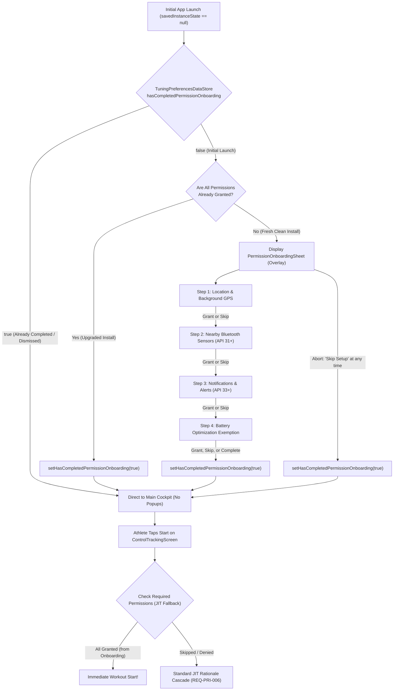

# Stage 1 Analysis: ATT-4455 - [Feature] Add abortable first-install permission onboarding flow on initial app launch

**Ticket**: [ATT-4455](https://rainerblind.atlassian.net/browse/ATT-4455)  
**Sub-task**: [ATT-4498](https://rainerblind.atlassian.net/browse/ATT-4498) (`[Analysis]`)  
**Parent Epic**: [ATT-2617](https://rainerblind.atlassian.net/browse/ATT-2617) (*Optimize first impression*)  
**Target Release**: `V4.9.40`  
**Active Sprint**: `2026-43.4`  
**Branch**: `feature/ATT-4455`  
**Author**: AI Agent 1 (Implementer)  
**Date**: 2026-10-21  

---

## 1. Problem Statement & Motivation

In **aTrainingTracker**, workout recording, GPS trajectory capture, continuous sensor telemetry, and audio cues require several critical Android runtime permissions and system exemptions:
- **Location** (`ACCESS_FINE_LOCATION`, `ACCESS_COARSE_LOCATION`) and **Background Location** (`ACCESS_BACKGROUND_LOCATION`): Required for recording accurate GPS tracks with cadence, distance, speed, and elevation when the screen is locked or the app is running in the background.
- **Nearby Devices / Bluetooth** (`BLUETOOTH_SCAN`, `BLUETOOTH_CONNECT` on Android 12+ / API 31+): Required for discovering and pairing BLE sensors (heart rate straps, cycling power meters, smart trainers, speed/cadence sensors).
- **Notifications** (`POST_NOTIFICATIONS` on Android 13+ / API 33+): Required for the active workout foreground service notification (`TrackerService`), lock-screen controls, sensor battery alerts, and background execution survival.
- **Battery Optimization Exemption** (`ACTION_REQUEST_IGNORE_BATTERY_OPTIMIZATIONS`): Required to prevent OEM battery-saving subsystems and Android Doze from killing the foreground service during long rides, runs, or hikes.

### The Problem Mechanism
Currently, permissions and battery optimization exemptions are evaluated purely **Just-in-Time (JIT)** when the athlete expresses tracking intent (tapping *Start* on `ControlTrackingScreen` or initiating BLE pairing on `DevicesTabbedScreen`).

During human verification of `ATT-3387` on a clean, initial installation, a severe usability friction was identified:
When a new athlete installs **aTrainingTracker** for the first time and taps the prominent **Start** button to begin their very first workout, they are ambushed by an overwhelming, multi-step cascade of permission rationale sheets, system permission dialogs, and external Android OS Settings redirects:
1. `RationaleStep.FOREGROUND` bottom sheet educating on Location & Bluetooth.
2. System runtime permission dialog for Location (`Precise` vs `Approximate`).
3. `RationaleStep.NOTIFICATION` bottom sheet educating on workout notifications.
4. System runtime permission dialog for Notifications.
5. `RationaleStep.BACKGROUND_LOCATION` bottom sheet educating on background recording.
6. Android OS Application Details / Location Permissions screen redirect (requiring manual navigation to select *"Allow all the time"* and pressing Back).
7. `RationaleStep.BATTERY_OPTIMIZATION` bottom sheet educating on Doze mode exemptions.
8. System battery optimization exemption confirmation dialog (`ACTION_REQUEST_IGNORE_BATTERY_OPTIMIZATIONS`).

### User Impact
An athlete who has just laced up their shoes or mounted their bike expecting to press Start and begin tracking is subjected to **4 consecutive educational sheets, 3 system dialogs, and an OS Settings context switch**. This creates immense cognitive friction, delays workout recording, and produces a jarring first impression.

### Expected Behavior
Introduce a dedicated, welcoming, and **abortable/skippable First-Install Permission Onboarding Flow** on initial application launch:
- Guides the athlete step-by-step through the core setup categories before they head out for a workout.
- Explains the athletic necessity of each permission clearly.
- Allows skipping any individual step ("Skip" / "Not Now") or aborting the entire setup flow ("Skip Setup") at any point so the user is never blocked from exploring the app.
- Persists completion/dismissal in `TuningPreferencesDataStore` so it only runs once on fresh installs (and automatically auto-skips for upgraded installs where permissions are already held).
- Retains existing Just-in-Time permission checks on `ControlTrackingScreen` and `DevicesTabbedScreen` as robust fallback guards.

---

## 2. Root Cause Analysis (Forensic Investigation)

### 2.1 The Architectural Origin of Pure JIT Permissions (`ATT-2075` & `REQ-PRI-003`)
In legacy versions of `aTrainingTracker`, `MainActivityWithNavigation.kt` invoked eager, blocking permission methods (`getPermissions()`, `showBackgroundLocationDialog()`) immediately in `onCreate()`. These legacy dialogs lacked educational rationale, blocked the UI, and were prone to crash loops.

To fix this, ticket `ATT-2075` established requirement `REQ-PRI-003` (*Contextual Just-in-Time Permission Flow, Zero-Friction Cold Start*), mandating that modal permission dialogs must not appear during cold start, and shifting all permission requests to contextual user actions:
- Start tracking $\rightarrow$ `ControlTrackingScreen.handleStartClick`
- Sensor scanning $\rightarrow$ `DevicesTabbedScreen`

In `ATT-3998` (`REQ-PRI-006`), the start cascade was further decoupled so that missing notifications or Bluetooth connect permissions would not be bypassed if location was already granted.

### 2.2 The Clean-Install Dilemma
While the pure JIT model works well for returning users or minor permission updates, it creates a pathological UX bottleneck on fresh installs:
- On a clean install, the user holds **zero** permissions.
- When tapping Start on `ControlTrackingScreen.kt`:
  ```kotlin
  val handleStartClick = {
      if (!checkHasLocation()) {
          ...
          rationaleStep = RationaleStep.FOREGROUND
      } else {
          proceedAfterPermissions()
      }
  }
  ```
- Because every permission check returns `false`, `proceedAfterPermissions()` advances sequentially through every single step:
  `FOREGROUND` $\rightarrow$ `NOTIFICATION` $\rightarrow$ `BACKGROUND_LOCATION` $\rightarrow$ `BATTERY_OPTIMIZATION` $\rightarrow$ `onStart()`.
- The user experiences the cumulative permission burden at the exact moment where minimum latency is desired.

### 2.3 Gap Analysis: What is Missing?
1. **No First-Launch Detection for Permissions**: `TuningPreferencesDataStore` tracks `hasSeenStopTrackingHintFlow` (`ATT-3387`) and `suppressAntMissingAdapterDialogFlow`, but has no preference key or state flow for initial permission onboarding completion or dismissal.
2. **No Modular Onboarding Wizard**: There is currently no multi-step wizard component that can walk a user through setup upfront with progress tracking (e.g. "Step 1 of 4") and an overall "Skip Setup" escape hatch.
3. **No Automatic Upgrade Auto-Skip**: There is no startup evaluator that verifies whether all essential permissions are already granted, which is necessary to ensure returning/upgraded users are never prompted.

---

## 3. User Scope Grounding (ATT-1250)

* **In-Scope Goals**:
  1. **First-Launch Permission Onboarding Flow**:
     - Introduce a dedicated, welcoming, and modular onboarding flow triggered on initial launch when onboarding has not been completed or dismissed.
     - Walk the athlete step-by-step through 4 core setup categories:
       1. **Location & Background Location**: GPS track recording with screen off (`ACCESS_FINE_LOCATION`, `ACCESS_COARSE_LOCATION`, `ACCESS_BACKGROUND_LOCATION`).
       2. **Nearby Devices / Bluetooth**: Sensor discovery & GATT connection for HRM, power meters, speed/cadence sensors (`BLUETOOTH_SCAN`, `BLUETOOTH_CONNECT` on Android 12+).
       3. **Notifications**: Foreground service status, split-lap announcements, and battery alerts (`POST_NOTIFICATIONS` on Android 13+).
       4. **Battery Optimization Exemption**: Uninterrupted background recording without OS Doze process kills (`ACTION_REQUEST_IGNORE_BATTERY_OPTIMIZATIONS`).
  2. **Abortable & Skippable at Any Time**:
     - Each step must offer a "Skip" / "Not Now" action to skip that specific permission and advance to the next step.
     - The overall flow must offer a prominent "Skip Setup" / "Abort" action at all times to dismiss the onboarding flow entirely without granting any permissions.
     - Under no circumstances should the user be locked or blocked from using or exploring the app.
  3. **DataStore Persistence & Upgraded User Auto-Skip**:
     - Add `hasCompletedPermissionOnboardingFlow` and `setHasCompletedPermissionOnboarding(Boolean)` to `TuningPreferencesDataStore`.
     - Automatically mark onboarding as completed (auto-skip) if all essential permissions are already granted (e.g. upgraded installs or restored backups).
     - Persist completion/dismissal immediately so subsequent cold starts never re-trigger the onboarding flow.
  4. **Preserve Just-in-Time Fallback Invariants**:
     - Keep all existing JIT checks in `ControlTrackingScreen.kt` and `DevicesTabbedScreen.kt` completely intact.
     - If the user skipped any permission during onboarding, the corresponding JIT rationale sheet will still trigger contextually when needed (e.g. on *Start* or *Pair Sensor*).
  5. **Modular Architecture & Localization Parity**:
     - Keep new Compose UI components in a dedicated modular file `< 400` lines (e.g., `PermissionOnboardingSheet.kt`).
     - Localize all user-facing strings across all 9 supported languages (EN, DE, ES, FR, IT, JA, NL, PL, PT) with 100% parity.

* **Out-of-Scope Non-Goals (Scope Bounding)**:
  1. **No Removal or Modification of JIT Fallbacks**: The existing JIT cascade in `ControlTrackingScreen` and sensor pairing in `DevicesTabbedScreen` must remain untouched as safety nets.
  2. **No Mandatory/Unskippable Walls**: The onboarding flow must not enforce mandatory permission grants. The athlete must be free to explore the app immediately.
  3. **No Direct Background Location Bypassing**: Respect Android 11+ requirements where background location must be requested after or separately from foreground location.
  4. **No Custom Battery Saver Algorithms**: Use standard Android platform intents (`ACTION_REQUEST_IGNORE_BATTERY_OPTIMIZATIONS`) with fail-safe `ActivityNotFoundException` handling.

---

## 4. Requirement Archaeology & Chesterton's Fence Audit

* **Original Requirement ID & Target**:
  - Refines and amends `REQ-PRI-003` (*Contextual Just-in-Time Permission Flow, Zero-Friction Cold Start, Background Location Escalation, Battery Optimization Exemption & Graceful Settings Return Handling*) and `REQ-PRI-006` (*Decoupled Multi-Permission Cascade for Workout Start*).
  - Target modules: `MainActivityWithNavigation.kt`, `ATrainingTrackerApp.kt`, `TuningPreferencesDataStore.kt`, `PermissionOnboardingSheet.kt`.
* **Historical Origin & Commit Trace**:
  - `ATT-2075` (Sprint `2026-40.16`, commits `009c8f49`, `4a12158e`, `6b53f065`): Retired eager blocking dialogs (`getPermissions()`) in `MainActivityWithNavigation` in favor of JIT rationale sheets.
  - `ATT-2621` (Sprint `2026-41.2`, commit `057d5583`): Decoupled proactive battery optimization warning.
  - `ATT-3998` (Sprint `2026-43.3`, commit `21f5c90e`): Decoupled start cascade for notifications and Bluetooth permissions.
  - Observed in human testing of `ATT-3387` (Sprint `2026-43.3`): Fresh clean install users experience an unexpected 4-step permission barrage upon tapping Start.
* **Root Reason for Existing Formulation**:
  - `REQ-PRI-003` was introduced to prevent the app from popping up unskippable modal system dialogs before the user even saw the dashboard.
  - However, pushing 100% of permission requests to the first tap of the *Start* button simply concentrated all setup friction at the worst possible moment—when the athlete is ready to start moving.
* **Preservation of Core Invariants**:
  1. *Zero-friction cold start for returning athletes*: Returning users who have already completed/dismissed onboarding or already hold permissions experience zero startup popups (`REQ-PRI-003`).
  2. *Strict Fine Location Requirement*: High-precision GPS tracking invariant (`REQ-PRI-004`) remains strictly enforced.
  3. *Android 11+ Two-Step Background Location Cascade*: Android security model invariants remain strictly honored.
  4. *Fail-safe Battery Intent Handling*: Handling `ActivityNotFoundException` without crash (`REQ-PRI-005`).
  5. *JIT Fallback Safety*: Athletes who skip onboarding steps are still protected by JIT prompts when attempting actions (`REQ-PRI-006`).
  6. *100% clean-room test suite pass rate*: All existing contract and unit tests continue to pass.

---

## 5. Architectural Strategy & High-Level Solution

### 5.1 Component Overview & Interaction Diagram



### 5.2 Persistence Layer (`TuningPreferencesDataStore.kt`)
Add the following preference definitions:
```kotlin
object TuningPreferencesDefaults {
    ...
    const val DEFAULT_HAS_COMPLETED_PERMISSION_ONBOARDING = false
}

// In TuningPreferencesKeys:
val KEY_HAS_COMPLETED_PERMISSION_ONBOARDING: Preferences.Key<Boolean> =
    booleanPreferencesKey("tuning_has_completed_permission_onboarding")

// In TuningPreferencesDataStore:
val hasCompletedPermissionOnboardingFlow: Flow<Boolean> = context.dataStore.data.map { prefs ->
    prefs[KEY_HAS_COMPLETED_PERMISSION_ONBOARDING] ?: TuningPreferencesDefaults.DEFAULT_HAS_COMPLETED_PERMISSION_ONBOARDING
}

suspend fun setHasCompletedPermissionOnboarding(completed: Boolean) {
    context.dataStore.edit { prefs ->
        prefs[KEY_HAS_COMPLETED_PERMISSION_ONBOARDING] = completed
    }
}
```

### 5.3 UI Architecture (`PermissionOnboardingSheet.kt`)
Create a dedicated composable file `app/src/main/java/com/atrainingtracker/trainingtracker/ui/onboarding/permission/PermissionOnboardingSheet.kt`:
- **File Length**: Strictly `< 400` lines.
- **Design Tokens**: Consumes Material 3 `ModalBottomSheet`, `BottomSheetDesign.SheetShape`, `BottomSheetDesign.SheetTonalElevation`, surface container colors, and typography tokens.
- **Step State Model**:
  ```kotlin
  enum class OnboardingStep {
      LOCATION,
      BLUETOOTH,
      NOTIFICATION,
      BATTERY_OPTIMIZATION
  }
  ```
- **UI Elements**:
  - **Header**: Step indicator (e.g. *"Schritt 1 von 4"* / *"Step 1 of 4"*), domain icon, and a prominent text button *"Skip Setup"* (*"Einrichtung überspringen"*) in the top-right.
  - **Content Body**: Card-based presentation explaining the athletic value of the capability (GPS track recording, sensor heart rate/power connectivity, foreground alerts, Doze mode defense).
  - **Action Footer**:
    - Primary button: *"Grant"* / *"Continue"* (triggers permission launcher / intent).
    - Secondary button: *"Skip Step"* / *"Not Now"* (advances to the next step without requesting).
- **Graceful Advance**: Upon granting or skipping a step, the wizard advances to the next step. If on Android version where a step is not applicable (e.g. Bluetooth on API < 31, Notifications on API < 33), that step is cleanly omitted or auto-advanced.
- **Finalization**: When the last step is handled, or when "Skip Setup" is tapped, `onFinish` is invoked, which marks `setHasCompletedPermissionOnboarding(true)`.

### 5.4 Host Integration (`ATrainingTrackerApp.kt` & `MainActivityWithNavigation.kt`)
- In `ATrainingTrackerApp.kt`:
  - Observe `hasCompletedPermissionOnboardingFlow.collectAsState(initial = true)` (initial `true` prevents transient sheet popups while DataStore initializes).
  - Helper function `checkAreAllPermissionsGranted(context)` verifies:
    - `ACCESS_FINE_LOCATION` granted.
    - Android 12+: `BLUETOOTH_SCAN` and `BLUETOOTH_CONNECT` granted.
    - Android 13+: `POST_NOTIFICATIONS` granted.
    - Battery optimization exemption granted.
  - When DataStore emits `false`:
    - If `checkAreAllPermissionsGranted(context)` is `true`: invoke `setHasCompletedPermissionOnboarding(true)` immediately without rendering UI.
    - If permissions are missing: present `PermissionOnboardingSheet`.
  - When the sheet triggers `onDismiss` or `onFinish`: launch coroutine to persist `setHasCompletedPermissionOnboarding(true)`.

### 5.5 Localization Parity (9 Languages)
New string resources required:
- `permission_onboarding_title`
- `permission_onboarding_step_format` ("Schritt %1$d von %2$d" / "Step %1$d of %2$d")
- `permission_onboarding_skip_setup` ("Einrichtung überspringen" / "Skip Setup")
- `permission_onboarding_skip_step` ("Diesen Schritt überspringen" / "Skip this step")
- `permission_onboarding_location_title` & `permission_onboarding_location_desc`
- `permission_onboarding_bluetooth_title` & `permission_onboarding_bluetooth_desc`
- `permission_onboarding_notification_title` & `permission_onboarding_notification_desc`
- `permission_onboarding_battery_title` & `permission_onboarding_battery_desc`
- `permission_onboarding_finish` ("Fertig" / "Finish")

All strings will be translated with 100% parity across `values/`, `values-de/`, `values-es/`, `values-fr/`, `values-it/`, `values-ja/`, `values-nl/`, `values-pl/`, `values-pt/`.

---

## 6. System Invariants & Risk Assessment

* **Core Invariants**:
  1. **Zero Cold-Start Regressions for Returning Users**: Once completed or dismissed, the onboarding flow MUST NEVER appear on subsequent launches (`REQ-PRI-003`).
  2. **Non-Blocking / Total Abortability**: The user MUST be able to skip any step or dismiss the entire flow at any time; app usage must never be blocked or locked.
  3. **Strict Preservation of JIT Fallbacks**: All existing permission checks on `ControlTrackingScreen` (Start button) and `DevicesTabbedScreen` (Pair Sensor) remain fully functional (`REQ-PRI-006`).
  4. **Strict Fine Location Requirement**: Coarse location alone must never satisfy workout tracking requirements (`REQ-PRI-004`).
  5. **Fail-Safe Platform Intent Safety**: Handling `ActivityNotFoundException` when firing external intents (`ACTION_REQUEST_IGNORE_BATTERY_OPTIMIZATIONS`, application details settings).
  6. **UI File Size Constraint**: `PermissionOnboardingSheet.kt` MUST remain strictly `< 400` lines.
  7. **9-Language Localization Parity**: 100% parity across all 9 supported locales with positional format specifiers (`%1$d`, `%2$d`).
  8. **Clean-Room Test Pass Rate**: Zero regressions across the full unit test suite.

* **Risk Rating**: **MEDIUM**
  - *Risk Justification*:
    - Modifying startup flow touches `MainActivityWithNavigation` and `ATrainingTrackerApp` lifecycle coordination.
    - Interacting with runtime permission launchers and battery optimization intents requires careful handling of activity results, lifecycle resumes, and Android version branches (API 26 to API 34+).
    - However, because the flow is completely abortable, non-blocking, and leaves all existing JIT fallbacks untouched, the blast radius is strictly contained.
