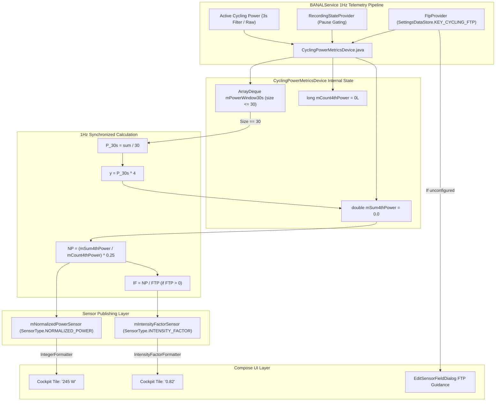

# Stage 3 Implementation Plan: ATT-1290 - Live Normalized Power (NP) and Intensity Factor (IF) calculations

**Ticket**: [ATT-1290](https://rainerblind.atlassian.net/browse/ATT-1290)  
**Sub-task**: [ATT-3637](https://rainerblind.atlassian.net/browse/ATT-3637) (`[Impl-Plan]`)  
**Parent Epic**: [ATT-235](https://rainerblind.atlassian.net/browse/ATT-235) (*UI Improvements & Visual Modernization*)  
**Target Release**: `V4.9.40`  
**Active Sprint**: `Sprint 2026-42.4`  
**Branch**: `feature/ATT-1290`  
**Requirement Mapping**: `REQ-TRK-020`  
**Test Mapping**: `TST-TRK-012`  
**Author**: AI Agent 1 (Implementer)  
**Reviewer / Auditor**: AI Agent 2 (Auditor)  
**Date**: 2026-10-15  

---

## 1. Architectural Overview & Component Decomposition (SWE.2)

---

## 2. Invariants, Numerical Precision & Guardrails

1. **Pause Gating Invariant (Numerator & Denominator Invariant)**:
   Calculations, buffer advancement, and cumulative accumulation MUST be strictly frozen whenever `mRecordingStateProvider.isRecordingSuspended()` returns `true`.
   *Critical Invariant Guarantee*: The sample/tick counter `mCount4thPower` (the denominator) MUST be gated by the exact same pause check as the `mSum4thPower` accumulator (the numerator). Neither counter nor sum advances when suspended. This ensures paused periods never dilute or skew the 30-second moving average or the 4th power cumulative sum.
2. **Numerical Precision & Floating-Point Stability Analysis**:
   - Standard IEEE 754 64-bit `double` provides 53 bits of exact integer significand precision ($2^{53} \approx 9.007 \times 10^{15}$, ~15–17 decimal digits).
   - In cycling, realistic instantaneous power ranges between $0\text{ W}$ and $2000\text{ W}$. For a world-class sprint effort at $1000\text{ W}$, $1000^4 = 1.0 \times 10^{12}$.
   - For an extreme ultra-endurance ride lasting 24 hours ($86,400\text{ s}$) at a sustained high average of $400\text{ W}$ ($400^4 = 2.56 \times 10^{10}$), the total accumulated sum is:
     $$\sum_{i=1}^{86400} y_i \approx 86400 \times 2.56 \times 10^{10} \approx 2.21 \times 10^{15}$$
     This total ($2.21 \times 10^{15}$) is strictly less than the $9.007 \times 10^{15}$ IEEE 754 exact precision ceiling.
   - Therefore, double-precision accumulation is mathematically immune to precision loss, numerical drift, or overflow across any real-world workout duration up to 24+ hours.
3. **Warm-up Window Integrity**:
   Until 30 consecutive active 1-second power samples have been ingested into the queue, Normalized Power and Intensity Factor are mathematically undefined and MUST emit `null`, displaying `"-- W"` and `"--"`.
4. **Coasting Policy (0 Watts)**:
   Coasting ($0\text{ W}$) is a genuine physiological recovery point in cycling. Zero-watt samples MUST be accepted into the 30-second rolling window and lower the rolling average accordingly.
5. **FTP Reactivity & Non-Blocking State Access**:
   - The `FtpProvider` access MUST be non-blocking. It queries the in-memory cached `SettingsDataStore.getInstance(context)` singleton.
   - The device re-evaluates the FTP value on each 1Hz tick. If an athlete updates their FTP mid-workout (e.g. in Zone Settings), the live `IF = NP / FTP` calculation reflects the new baseline immediately on the very next 1Hz tick without corrupting or restarting the accumulated `NP` session history.
6. **Thread Safety & Teardown**:
   All state updates inside `CyclingPowerMetricsDevice` are synchronized on the device monitor (`synchronized (this)`). The background scheduled executor is terminated via `shutdownNow()` in `shutDown()`.
7. **UI Consistency (Rule 23)**:
   Any UI prompts in `EditSensorFieldDialog.kt` adhere to existing Material 3 design tokens (`MaterialTheme.colorScheme.onSurfaceVariant`, `OutlinedButton`, `MaterialTheme.typography.bodySmall`).

---

## 3. Atomic Step Sequencing

### Step 1: Formatter Construction (`IntensityFactorFormatter.java`)
- **Action**: Implement `IntensityFactorFormatter` implementing `MyFormatter<Number>` in `com.atrainingtracker.banalservice.sensor.formater`.
- **Formatting Rule**: Returns `"--"` when null, NaN, infinite, or negative. Otherwise formats with exactly 2 decimal places (`0.00`, e.g. `0.85` or `1.02`) using locale decimal separators.
- **Test**: Create `IntensityFactorFormatterTest.kt`.
- **Target Verification**: `./gradlew testDebugUnitTest --tests "com.atrainingtracker.banalservice.sensor.formater.IntensityFactorFormatterTest"`

### Step 2: Sensor Type & Formatter Registration (`SensorType.java`)
- **Action**:
  - Add `NORMALIZED_POWER(R.string.normalized_power, R.string.normalized_power_short, R.string.units_power, SensorValueType.DOUBLE, new IntegerFormatter(), true)`.
  - Add `INTENSITY_FACTOR(R.string.intensity_factor, R.string.intensity_factor_short, R.string.units_intensity_factor, SensorValueType.DOUBLE, new IntensityFactorFormatter(), true)`.
  - Update icon mapping: `case POWER, POWER_TO_WEIGHT, NORMALIZED_POWER, INTENSITY_FACTOR -> R.drawable.ic_power;`.
- **Target Verification**: Clean compile.

### Step 3: Activity Type Integration (`ActivityType.java`)
- **Action**: Add `SensorType.NORMALIZED_POWER` and `SensorType.INTENSITY_FACTOR` to `ActivityType.BIKE_POWER`.
- **Target Verification**: Verify `ActivityTypeTest.kt`.

### Step 4: Sensor Filter Defaults (`SensorFilterDefaults.kt`)
- **Action**: Register `NORMALIZED_POWER` and `INTENSITY_FACTOR` with default `FilterType.INSTANTANEOUS` (1.0s direct).
- **Test**: Update `SensorFilterDefaultsTest.kt`.
- **Target Verification**: `./gradlew testDebugUnitTest --tests "com.atrainingtracker.banalservice.filters.SensorFilterDefaultsTest"`

### Step 5: Computed Metrics Engine Extension (`CyclingPowerMetricsDevice.java`)
- **Action**:
  - Add `FtpProvider` functional interface (`Integer getFtp(Context context)`).
  - Add sensors `mNormalizedPowerSensor` and `mIntensityFactorSensor`.
  - Maintain `ArrayDeque<Double> mPowerWindow30s` (capacity 30).
  - Maintain `double mSum4thPower = 0.0` and `long mCount4thPower = 0L`.
  - Implement 30s rolling calculation, 4th power weighting, cumulative average, 4th root, and FTP normalization in `calculateMetrics()`.
  - Ensure `mCount4thPower` and `mSum4thPower` are gated by identical pause checks.
  - Query `mFtpProvider` reactively on each tick.
- **Target Verification**: Pure mathematical and integration unit tests.

### Step 6: Standalone Math Unit Tests (`NormalizedPowerMathTest.kt`)
- **Action**: Create comprehensive unit test suite:
  - `testWarmupWindow_lessThan30Samples_returnsNull()`
  - `testSteadyStatePower_30Samples_equalsArithmeticMean()`
  - `testStochasticPower_surgeIntervals_npExceedsAveragePower()`
  - `testCoastingInclusion_zeroWattsAreIngested()`
  - `testIntensityFactor_validFtp_computesCorrectRatio()`
  - `testIntensityFactor_unconfiguredFtp_returnsNull()`
  - `testMidRideFtpChange_updatesIntensityFactorImmediatelyWithoutAffectingNp()`
  - `testLongDurationStability_simulated5Hours_accumulatesWithoutPrecisionLoss()`
- **Target Verification**: `./gradlew testDebugUnitTest --tests "com.atrainingtracker.banalservice.devices.NormalizedPowerMathTest"`

### Step 7: Cockpit Grid Fallback Guidance (`EditSensorFieldDialog.kt`)
- **Action**:
  - In `EditSensorFieldDialog.kt`, when `selectedSensorType == SensorType.INTENSITY_FACTOR`:
    - Read `dataStore.ftpFlow.collectAsState(initial = null)`.
    - If unconfigured, display contextual banner/button indicating FTP is needed and providing direct access to Zone Settings.

### Step 8: 9-Language Localization Parity
- **Action**: Add `normalized_power`, `normalized_power_short`, `intensity_factor`, `intensity_factor_short`, and `units_intensity_factor` to `strings.xml` across all 9 locales.
- **Target Verification**: `./gradlew testDebugUnitTest --tests "com.atrainingtracker.trainingtracker.TranslationParityTest"`

### Step 9: Gate 3 Review & Sign-Off
- Update `ATT-3637` description, transition to `in_review`, run Gate 3 review agent audit.
