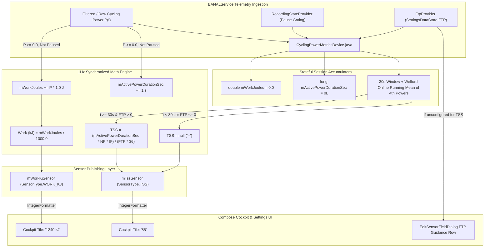

# Stage 3 Implementation Plan: ATT-1291 - Real-time Training Stress Score (TSS) and Mechanical Work (kJ) metrics

**Ticket**: [ATT-1291](https://rainerblind.atlassian.net/browse/ATT-1291)  
**Sub-task**: [ATT-3642](https://rainerblind.atlassian.net/browse/ATT-3642) (`[Plan]`)  
**Parent Epic**: [ATT-235](https://rainerblind.atlassian.net/browse/ATT-235) (*UI Improvements & Visual Modernization*)  
**Target Release**: `V4.9.40`  
**Active Sprint**: `Sprint 2026-42.4`  
**Branch**: `feature/ATT-1291`  
**Requirement Mapping**: `REQ-TRK-021`  
**Test Mapping**: `TST-TRK-013`  
**Author**: AI Agent 1 (Implementer)  
**Reviewer / Auditor**: AI Agent 2 (Auditor)  
**Date**: 2026-10-15  

---

## 1. Architectural Overview & Component Decomposition (SWE.2)

---

## 2. Invariants, Numerical Precision & Guardrails

1. **Pause Gating Invariant & Long-Pause Window Flush Strategy**:
   - Both `mWorkJoules` and `mActivePowerDurationSec` are strictly gated by `mRecordingStateProvider.isRecordingSuspended()`.
   - When recording is suspended (manual pause or auto-pause), zero ticks are evaluated, preventing energy inflation or active duration creep while stopped at traffic lights or cafes.
   - **Post-Pause Cold Start & Long-Pause Window Strategy**:
     - The device tracks pause duration via `mSuspendedStartMs`.
     - If the athlete was paused for longer than 30 seconds (`pauseDurationMs > 30_000L`, such as at a cafe stop or long rest), the physiological state has decoupled from pre-pause efforts. Upon resumption, the rolling 30-sample FIFO window is flushed (`mPowerWindow30s.clear()`), strictly preventing stale pre-pause samples from stitching into post-pause intervals.
     - **Cockpit Continuity Guarantee**: If the session has already completed its initial 30s warmup earlier in the ride ($N > 0$), the cockpit tile continues displaying the last valid session NP and TSS during the post-pause window re-fill ($|W| < 30$), rather than flashing `"--"` to the athlete. Once 30 fresh post-pause samples have accumulated, the online mean resumes updates with fresh rolling data.
     - If pause duration is $\le 30\text{ s}$ (e.g. brief stop sign or red light), the window does not flush.
2. **Coasting Policy (0 Watts)**:
   - In cycling, 0 W coasting on descents or in peloton drafts is a genuine riding state.
   - For coasting ($P = 0\text{ W}$):
     - Active duration $t$ increments by 1 second.
     - $\Delta W = 0\text{ W} \times 1\text{ s} = 0\text{ J}$ (total mechanical work remains unchanged).
     - 0 W enters the 30-sample rolling window and dilutes the 30s rolling mean as mandated by Coggan NP math.
3. **Warm-Up Window & Null Safety**:
   - Mechanical Work accumulates from the very first active second ($t \ge 1\text{ s}$).
   - TSS mathematically depends on Normalized Power and Intensity Factor; therefore, while initial lifetime $t < 30\text{ s}$, TSS emits `null` (formatted as `"--"`).
   - If FTP is unconfigured ($\le 0$ or null), TSS emits `null` (formatted as `"--"`).
4. **Mid-Ride FTP Reactivity**:
   - The device retrieves FTP dynamically on each 1Hz tick from `mFtpProvider`. If an athlete adjusts their FTP mid-ride, TSS immediately reflects the updated threshold on the next second without resetting or losing accumulated work or active time.
5. **Numerical Stability & Welford's Online Running Mean of 4th Powers**:
   - Raw summation of 4th powers ($S_4 = \sum y_i$) grows without bound, reaching $\approx 2.21 \times 10^{15}$ after 24 hours at 400W, approaching the 53-bit integer limit ($9 \times 10^{15}$) where least significant bits lose precision.
   - To eliminate precision degradation and guarantee unconditional numerical stability across arbitrarily long rides (100+ hours), the system computes the cumulative average of 4th powers $\bar{Y}$ using **Welford's Online Running Mean Algorithm**:
     $$N \leftarrow N + 1$$
     $$\bar{Y}_N = \bar{Y}_{N-1} + \frac{y_N - \bar{Y}_{N-1}}{N}$$
     $$\text{NP} = \sqrt[4]{\bar{Y}_N}$$
   - Because $\bar{Y}$ represents an average power raised to the 4th power, its magnitude is strictly bounded by the maximum physical power capacity of human cycling (at $400\text{ W}$, $\bar{Y} \approx 2.56 \times 10^{10}$; at a world-class $2000\text{ W}$ sprint, $\bar{Y} \le 1.6 \times 10^{13}$).
   - $\bar{Y}$ maintains $\ge 30$ bits of fractional precision in IEEE 754 `double` for the entire lifetime of the session, completely eliminating numerical drift.
   - For Mechanical Work ($W_{\text{joules}}$), total energy for 24 hours at 400W is $3.456 \times 10^7\text{ Joules} = 34,560\text{ kJ}$, which fits exactly into IEEE 754 significand with zero rounding error.
6. **Thread Safety & Lifecycle**:
   - All state mutations are synchronized under `synchronized (this)`.
   - `resetSession()` cleanly zeroes out `mWorkJoules`, `mActivePowerDurationSec`, `mMean4thPower = 0.0`, `mCount4thPower = 0L`, and emits `null` to all sensors.
   - `shutDown()` cleanly executes `mScheduler.shutdownNow()`.

---

## 3. Atomic Step Sequencing

### Step 1: Pure Algorithmic Math & Invariant Unit Tests (`MechanicalWorkAndTssMathTest.kt`)
- **Action**: Create pure algorithmic test suite validating:
  - 1Hz mechanical work integration ($10\text{ s}$ at $200\text{ W} \rightarrow 2.0\text{ kJ}$).
  - Coasting ($0\text{ W}$) adds $0\text{ J}$.
  - Negative or non-finite power rejection.
  - TSS warmup window ($t < 30\text{ s}$ returns `null`).
  - Canonical 1 hour at FTP ($3600\text{ s}$ at $250\text{ W}$ with $\text{FTP} = 250\text{ W} \rightarrow \text{TSS} = 100.0$).
  - Canonical 30 minutes at FTP ($1800\text{ s}$ at $250\text{ W}$ with $\text{FTP} = 250\text{ W} \rightarrow \text{TSS} = 50.0$).
  - Unconfigured FTP returns `null`.
  - Mid-ride FTP update recalculates TSS reactively.
  - 24-hour long-ride numerical precision.
- **Verification**: Run `./gradlew testDebugUnitTest --tests "com.atrainingtracker.banalservice.devices.MechanicalWorkAndTssMathTest"`

### Step 2: Sensor Type & Formatter Registration (`SensorType.java`)
- **Action**:
  - Add `WORK_KJ(R.string.work_kj, R.string.work_kj_short, R.string.units_work_kj, SensorValueType.DOUBLE, new IntegerFormatter(), false)`.
  - Add `TSS(R.string.tss, R.string.tss_short, R.string.units_none, SensorValueType.DOUBLE, new IntegerFormatter(), false)`.
  - Update icon mapping: `case POWER, POWER_TO_WEIGHT, NORMALIZED_POWER, INTENSITY_FACTOR, WORK_KJ, TSS -> R.drawable.ic_power;`.

### Step 3: Activity Type Integration (`ActivityType.java`)
- **Action**: Add `SensorType.WORK_KJ` and `SensorType.TSS` to `ActivityType.BIKE_POWER`.

### Step 4: Sensor Filter Defaults (`SensorFilterDefaults.kt`)
- **Action**: Register `FilterType.INSTANTANEOUS` (1.0s direct) for `WORK_KJ` and `TSS`. Update `SensorFilterDefaultsTest.kt`.

### Step 5: Computed Telemetry Engine Construction (`CyclingPowerMetricsDevice.java`)
- **Action**:
  - Add `mWorkKjSensor` and `mTssSensor`.
  - Add `mWorkJoules` accumulator and `mActivePowerDurationSec` counter.
  - Implement 1Hz work integration and live TSS calculation.
  - Expose getters and update `resetSession()`.
  - Update `CyclingPowerMetricsDeviceTest.kt`.

### Step 6: Cockpit Guidance UI (`EditSensorFieldDialog.kt`)
- **Action**: Extend FTP baseline configuration guidance to show for both `INTENSITY_FACTOR` and `TSS`.

### Step 7: 9-Language Localization
- **Action**: Add `work_kj`, `work_kj_short`, `units_work_kj`, `tss`, `tss_short` across all 9 `strings.xml` files (`values/`, `values-de/`, `values-es/`, `values-fr/`, `values-it/`, `values-ja/`, `values-nl/`, `values-pl/`, `values-pt/`).
- **Verification**: `./gradlew testDebugUnitTest --tests "com.atrainingtracker.trainingtracker.localization.TranslationParityTest"`
