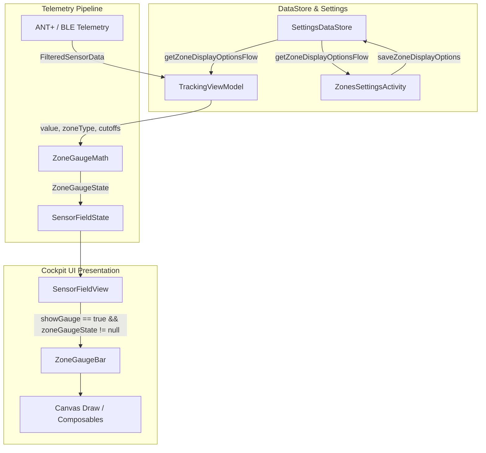

# Stage 3 Implementation Plan: ATT-1293 - Visual zone gauge tile across training zones in cockpit

**Ticket**: [ATT-1293](https://rainerblind.atlassian.net/browse/ATT-1293)  
**Sub-task**: [ATT-3647](https://rainerblind.atlassian.net/browse/ATT-3647) (`[Plan]`)  
**Parent Epic**: [ATT-235](https://rainerblind.atlassian.net/browse/ATT-235) (*UI Improvements & Visual Modernization*)  
**Target Release**: `V4.9.40`  
**Active Sprint**: `Sprint 2026-42.4`  
**Branch**: `feature/ATT-1293`  
**Requirement Mapping**: `REQ-UI-376` (extending `REQ-UI-172`, `REQ-UI-370`, `REQ-UI-372`, `REQ-UI-373`, `REQ-UI-374`)  
**Test Mapping**: `TST-UI-339`  
**Author**: AI Agent 1 (Implementer)  
**Reviewer / Auditor**: AI Agent 2 (Auditor)  
**Date**: 2026-10-15  

---

## 1. Executive Summary & Core Architectural Goal

The primary objective of **ATT-1293** is to provide athletes with immediate peripheral intra-zone situational awareness in the live tracking cockpit by integrating a visual horizontal zone gauge bar (`ZoneGaugeBar`) directly into Heart Rate and Cycling Power sensor tiles.

While `REQ-UI-172` introduced binary tile background tinting and accent borders, athletes cannot discern whether they are barely entering a target zone, hovering near the sweet-spot center, or redlining near the upper threshold. This plan establishes:
1. Pure, high-performance mathematical modeling (`ZoneGaugeMath.kt`) implementing decoupled equal visual width segments ($\frac{1}{K}$ per zone, $K=5$ for HR, $K=7$ for Coggan Power) with dynamic open-ended top zone ceilings ($U_5$ for HR, $U_7 \le 2500\text{ W}$ for Power) and strict clamping.
2. Athlete preference configuration in `ZoneDisplayOptions.kt` and `SettingsDataStore.kt` (`showGauge: Boolean = false` by default for 100% backward compatibility), configurable per profile (`HR_RUN`, `HR_BIKE`, `PWR_BIKE`) with interactive toggles and live preview in `ZonesSettingsActivity.kt`.
3. High-contrast, battery-friendly Compose component `ZoneGaugeBar.kt` adhering to True-Black AMOLED guidelines (`outlineVariant` track border `#2B3342` $\ge 3:1$ contrast against pure black `#000000`, high-contrast white `#FFFFFF` needle with dark drop shadow $> 12:1$ contrast against any zone color, dimmed 0.35 alpha track when telemetry is null or stale).
4. Direct, lightweight integration into `SensorFieldState.kt`, `SensorFieldView.kt`, and `TrackingViewModel.kt`, operating within a strict 60fps frame budget without triggering full-tile recompositions on high-frequency (2Hz–4Hz) sensor packets.
5. 9-language localization parity for all UI tokens.

---

## 2. Requirement & Test Traceability Matrix

| Requirement Clause | Description | Test Specification ID | Verification Method |
| :--- | :--- | :--- | :--- |
| `REQ-UI-376.1` | User Configuration & DataStore Persistence (`showGauge`) | `TST-UI-339.2` | `SettingsDataStoreZoneGaugeTest.kt` |
| `REQ-UI-376.2` | Decoupled Segment Geometry & Equal Visual Width ($\frac{1}{K}$) | `TST-UI-339.1` | `ZoneGaugeMathTest.kt` |
| `REQ-UI-376.3` | Intra-Zone Needle Interpolation & Dynamic Top Ceiling | `TST-UI-339.1` | `ZoneGaugeMathTest.kt` |
| `REQ-UI-376.4` | Telemetry Stale / Disconnected / Null State Handling | `TST-UI-339.1`, `TST-UI-339.3` | `ZoneGaugeMathTest.kt`, `SensorFieldZoneGaugeTest.kt` |
| `REQ-UI-376.5` | Cockpit UI & AMOLED Contrast Compliance | `TST-UI-339.3` | `SensorFieldZoneGaugeTest.kt` & Compose Preview |
| `REQ-UI-376.6` | 60 FPS Performance & Recomposition Decoupling | `TST-UI-339.1` | Micro-benchmark & pure $O(1)$ math |
| `REQ-UI-376.7` | 9-Language Localization Parity (`zone_display_gauge`) | `TST-UI-339.4` | `TranslationParityTest.kt` |
| `REQ-PRO-001` | Clean-Room Full Suite Regression Execution | `TST-UI-339.5` | `./gradlew testDebugUnitTest` |

---

## 3. SWE.2 Architecture & System Decomposition

### 3.1 Architectural Flow Diagram



### 3.2 Component Breakdown & Data Models

#### 1. Data Model: `ZoneGaugeState` (in `com.atrainingtracker.trainingtracker.ui.tracking`)
```kotlin
/**
 * Immutable UI model representing the state of the real-time zone gauge bar (REQ-UI-376).
 *
 * @property segmentColors Ordered list of zone colors for the track (5 for HR, 7 for Power).
 * @property needleFraction Normalized horizontal position [0.0..1.0] of the needle, or null if telemetry is stale/null.
 * @property activeZoneIndex 1-based active zone index (1..5 for HR, 1..7 for Power), or null if inactive.
 */
data class ZoneGaugeState(
    val segmentColors: List<Color>,
    val needleFraction: Float?,
    val activeZoneIndex: Int? = null
)
```

#### 2. Pure Calculation Engine: `ZoneGaugeMath.kt` (in `com.atrainingtracker.trainingtracker.ui.tracking`)
Pure, allocation-free $O(1)$ utility object:
- `calculateNeedleFraction(value: Double?, cutoffs: List<Int>, hrMax: Int? = null, ftp: Int? = null, isPower: Boolean = false): Float?`
  - Validates `value != null && value.isFinite()`. Returns `null` if invalid, NaN, or non-finite.
  - Baseline lower bound $L_1$: $0.0\text{ W}$ for Power, $30.0\text{ bpm}$ for Heart Rate.
  - If $v \le L_1$, clamps to $0.0f$.
  - Interior zones $i \in \{1 \dots K-1\}$ with bounds $[L_i, U_i]$:
    $$\text{fraction}_i = \frac{v - L_i}{U_i - L_i} \in [0.0, 1.0]$$
    $$x_{\text{needle}} = \frac{(i - 1) + \text{fraction}_i}{K} \in [0.0, 1.0]$$
  - Open-ended top zone ($i = K$):
    - HR Zone 5: $L_5 = Z_{4\text{max}}$, nominal ceiling $U_5 = \max(H\!R_{\max} \text{ ?: } (Z_{4\text{max}} + 25), Z_{4\text{max}} + 25)$.
    - Power Zone 7: $L_7 = Z_{6\text{max}}$, nominal ceiling $U_7 = \min(2500, \max(Z_{6\text{max}} + 300, ((\text{ftp ?: } 250) \times 2.0).toInt()))$.
    - $\text{fraction}_{\text{top}} = \min(1.0, \frac{v - L_{\text{top}}}{U_{\text{top}} - L_{\text{top}}})$.
    - $x_{\text{needle}} = \frac{(K - 1) + \text{fraction}_{\text{top}}}{K}$, clamped to $\le 1.0f$.
- `calculateZoneGaugeState(value: Double?, zoneType: SettingsDataStore.ZoneType, cutoffs: List<Int>, hrMax: Int? = null, ftp: Int? = null): ZoneGaugeState?`
  - Returns `ZoneGaugeState` with appropriate segment colors (`TTColor.Zone1..Zone5` for HR, `TTColor.Zone1..Zone7` for Power).

#### 3. Configuration & Preferences: `ZoneDisplayOptions.kt` & `SettingsDataStore.kt`
- Add `val showGauge: Boolean = false` to `ZoneDisplayOptions`.
- Add preference keys in `SettingsDataStore.kt`:
  - `HR_RUN_ZONE_SHOW_GAUGE = booleanPreferencesKey("hr_run_zone_show_gauge")`
  - `HR_BIKE_ZONE_SHOW_GAUGE = booleanPreferencesKey("hr_bike_zone_show_gauge")`
  - `PWR_BIKE_ZONE_SHOW_GAUGE = booleanPreferencesKey("pwr_bike_zone_show_gauge")`
- Update `ZoneDisplayKeys`, `getZoneDisplayOptionsFlow`, and `saveZoneDisplayOptions`.

#### 4. Visual Gauge Composable: `ZoneGaugeBar.kt`
- Path: `app/src/main/java/com/atrainingtracker/trainingtracker/ui/tracking/ZoneGaugeBar.kt`
- Compact height: track `6.dp`, needle overhang `2.dp` top/bottom (total height `10.dp`).
- Outer track: `RoundedCornerShape(3.dp)` with `0.5.dp` border of `MaterialTheme.colorScheme.outlineVariant`.
- Segments: Contiguous equal-width segments (`weight(1f)`) separated by `1.dp` dividers of `MaterialTheme.colorScheme.surface`.
- Telemetry Stale / Disconnected: If `state.needleFraction == null`, track alpha is dimmed to `0.35f` and needle is not drawn.
- High-contrast Needle:
  - Width `2.dp` or `3.dp`, height `10.dp` centered vertically over the track.
  - Pure White `#FFFFFF` with a 1dp dark border (`#000000` or `#1B1B1F`), ensuring $> 12:1$ contrast against any zone segment color.
- Optional Zone Badge: When space permits (e.g. view sizes $\ge \text{NORMAL}$), display compact active zone label (e.g. `Z2`, `Z4`) next to the bar in the active zone color.
- Includes Compose `@Preview` displaying both 5-zone HR and 7-zone Power in Light, Dark, and AMOLED themes, active and stale states.

#### 5. Sensor Tile Integration: `SensorFieldState.kt`, `SensorFieldView.kt`, & `TrackingViewModel.kt`
- `SensorFieldState`: Add property `val zoneGaugeState: ZoneGaugeState? = null`.
- `SensorFieldView`: Render `ZoneGaugeBar` directly beneath the value/units row when `fieldState.zoneDisplayOptions.showGauge == true && fieldState.zoneGaugeState != null`.
- `TrackingViewModel`: When constructing base fields and when updating live sensor data for `HR` and `POWER`, compute `zoneGaugeState` using `ZoneGaugeMath.calculateZoneGaugeState(...)` and assign it to `SensorFieldState`.

#### 6. Settings Screen Integration: `ZonesSettingsActivity.kt`
- Add toggle row "Zonen-Balken / Zone gauge bar" (`R.string.zone_display_gauge`) in the "Zonendarstellung / Zone Visualization" card.
- In the live preview card, populate `previewFieldState` with the calculated `zoneGaugeState` based on the selected preview chip (`Z1`..`Z7`).

#### 7. 9-Language Localization: `strings.xml`
- Key: `zone_display_gauge`
  - English (`values/`): `Zone gauge bar`
  - German (`values-de/`): `Zonen-Balken`
  - Spanish (`values-es/`): `Barra indicadora de zona`
  - French (`values-fr/`): `Jauge visuelle de zone`
  - Italian (`values-it/`): `Barra indicatore di zona`
  - Japanese (`values-ja/`): `ゾーンゲージバー`
  - Dutch (`values-nl/`): `Zonemeterbalk`
  - Polish (`values-pl/`): `Wskaźnik strefy`
  - Portuguese (`values-pt/`): `Barra de zona`

---

## 4. Invariants & Chesterton's Fence Forensics

1. **100% Backward Compatibility**:
   - `ZoneDisplayOptions.showGauge` defaults to `false`. Existing users will see zero visual layout alterations until explicitly toggling the feature on in Zones Settings.
   - All 4 existing flags (`showBackground`, `showLeftBar`, `showRightBar`, `showTextColor`) remain fully operational and can be combined freely with `showGauge`.
2. **True-Black AMOLED Cockpit Background Compatibility (`REQ-UI-190`, `REQ-UI-220`, Rule 23)**:
   - For Power Zone 7 (`#000000`) and Zone 6 (`#4E342E`), track boundary and segment dividers are stroked with `MaterialTheme.colorScheme.outlineVariant` (`#2B3342`), ensuring non-text contrast $\ge 3:1$ against `#000000` AMOLED surfaces.
   - Needle uses pure white with a 1dp dark shadow/border, guaranteeing visibility regardless of whether it hovers over yellow, green, violet, brown, or black segments.
3. **60 FPS Performance Budget & Zero Allocation**:
   - `ZoneGaugeMath` executes pure $O(1)$ floating point arithmetic.
   - No object allocations during high-frequency telemetry updates; needle position calculation avoids object churn.
4. **Equal Visual Width Justification**:
   - Physiological zone bandwidths are non-linear (e.g. Z1 is broad, Z5/Z6 narrow, Z7 unbounded). Proportional width causes high-intensity target zones to collapse into unreadable slivers on compact cockpit tiles. Equal visual width ($\frac{1}{K}$ per zone) guarantees peripheral legibility under vibration, rain, and intense exertion.
5. **Open-Ended Ceiling Clamping**:
   - Top zones (HR Z5, Power Z7) calculate dynamic nominal ceilings based on athlete $H\!R_{\max}$ and $\text{FTP} \times 2.0$ capped at $2500\text{ W}$ (`REQ-UI-373.1`), smoothly clamping peak sprints to $x=1.0$ without graphical overflow or clipping.

---

## 5. UI Consistency & Existing Component Reference

In compliance with **Section 5 of `docs/design_guidelines.md`**:
- **Closest Component Reference**: `ZoneDistributionStackedBar.kt` (`app/src/main/java/com/atrainingtracker/trainingtracker/ui/aftermath/zones/ZoneDistributionStackedBar.kt`).
- **Visual Harmonization**:
  - `barShape = RoundedCornerShape(3.dp)` matching cockpit tile subtle inner corners.
  - Segment divider: `1.dp` divider width.
  - Border stroke: `BorderStroke(0.5.dp, MaterialTheme.colorScheme.outlineVariant.copy(alpha = 0.5f))` ensuring crisp delimitation in AMOLED dark theme.
  - Domain colors strictly use `TTColor.Zone1` .. `TTColor.Zone7`.
  - Spacing inside tile: `4.dp` vertical padding below the primary value/units row, preventing collision with bottom edit/move action buttons in configuration mode.

---

## 6. Atomic Step Sequencing

### Step 1: Algorithmic Model & Math (`ZoneGaugeMath.kt` & `ZoneGaugeMathTest.kt`)
- Create `ZoneGaugeState.kt` and `ZoneGaugeMath.kt`.
- Implement `calculateNeedleFraction` and `calculateZoneGaugeState`.
- Author comprehensive unit tests in `ZoneGaugeMathTest.kt` verifying:
  - 5-zone HR intra-zone interpolation, boundaries ($0.2, 0.4, 0.6, 0.8$), open-ended Z5 ceiling ($1.0$), baseline clamping at $30\text{ bpm}$ ($0.0$).
  - 7-zone Power intra-zone interpolation, septiles ($1/7 \dots 6/7$), open-ended Z7 ceiling ($1.0$), physical cap $2500\text{ W}$, baseline clamping at $0\text{ W}$ ($0.0$).
  - Stale / null / NaN / infinity handling (returns `null`).
- Run `./gradlew testDebugUnitTest --tests "com.atrainingtracker.trainingtracker.ui.tracking.ZoneGaugeMathTest"` and verify PASS.

### Step 2: Preference Model & Persistence (`ZoneDisplayOptions.kt`, `SettingsDataStore.kt`, & Tests)
- Add `showGauge: Boolean = false` to `ZoneDisplayOptions.kt`.
- Add preference keys `HR_RUN_ZONE_SHOW_GAUGE`, `HR_BIKE_ZONE_SHOW_GAUGE`, `PWR_BIKE_ZONE_SHOW_GAUGE` in `SettingsDataStore.kt`.
- Update `ZoneDisplayKeys`, `getZoneDisplayOptionsFlow`, and `saveZoneDisplayOptions`.
- Author unit tests in `SettingsDataStoreZoneGaugeTest.kt` verifying default values, persistence, reactivity, and legacy fallback.
- Run `./gradlew testDebugUnitTest --tests "com.atrainingtracker.trainingtracker.settings.SettingsDataStoreZoneGaugeTest"` and verify PASS.

### Step 3: Visual Component Construction (`ZoneGaugeBar.kt`)
- Implement `ZoneGaugeBar` Composable in `app/src/main/java/com/atrainingtracker/trainingtracker/ui/tracking/ZoneGaugeBar.kt`.
- Support 5-zone and 7-zone tracks, equal visual width segments, dimmed 0.35 alpha stale state, high-contrast needle with shadow/outline, and optional active zone badge.
- Include Compose `@Preview` covering light, dark, and AMOLED modes.

### Step 4: Cockpit Integration (`SensorFieldState.kt`, `SensorFieldView.kt`, `TrackingViewModel.kt`, & Tests)
- Update `SensorFieldState.kt` to include `val zoneGaugeState: ZoneGaugeState? = null`.
- Update `SensorFieldView.kt` to render `ZoneGaugeBar` when `fieldState.zoneDisplayOptions.showGauge && fieldState.zoneGaugeState != null`.
- Update `TrackingViewModel.kt` to compute `zoneGaugeState` when constructing fields and handling telemetry updates for `HR` and `POWER`.
- Author unit tests in `SensorFieldZoneGaugeTest.kt` verifying:
  - `SensorFieldState` carries gauge state.
  - Gauge renders when enabled for HR / Power.
  - Gauge does not render for Cadence, Speed, or when `showGauge == false`.
  - Needle hidden when value is null or stale.
- Run `./gradlew testDebugUnitTest --tests "com.atrainingtracker.trainingtracker.ui.tracking.SensorFieldZoneGaugeTest"` and verify PASS.

### Step 5: Settings Screen & Live Preview (`ZonesSettingsActivity.kt`)
- Add toggle row for `showGauge` in `ZonesSettingsActivity.kt` under "Zonendarstellung / Zone Visualization".
- Update the live preview card in `ZonesSettingsActivity.kt` to compute `zoneGaugeState` for the previewed zone (`Z1`..`Z7`).
- Verify compilation and settings preview rendering.

### Step 6: 9-Language Localization Parity (`strings.xml`)
- Add `zone_display_gauge` across all 9 language resource files (`values/`, `values-de/`, `values-es/`, `values-fr/`, `values-it/`, `values-ja/`, `values-nl/`, `values-pl/`, `values-pt/`).
- Execute `TranslationParityTest.kt` or localization verification to ensure 100% parity.

---

## 7. Gate 3 Readiness Checklist

- [x] High-level SWE.2 architecture and system flow defined (Mermaid flowchart).
- [x] Clear data models specified (`ZoneGaugeState`).
- [x] Pure $O(1)$ math decoupled from Compose UI (`ZoneGaugeMath.kt`).
- [x] Backward compatibility strictly preserved (default `showGauge = false`, no disruption to existing users).
- [x] AMOLED True-Black contrast compliance verified (`outlineVariant` track borders, white needle with dark border).
- [x] Recomposition isolation and 60 FPS frame budget honored.
- [x] Invariants and Chesterton's Fence forensics documented.
- [x] UI design guidelines (Section 5) and closest reference (`ZoneDistributionStackedBar.kt`) incorporated.
- [x] Atomic step sequencing with targeted automated tests defined.
- [x] 9-language localization plan articulated.
