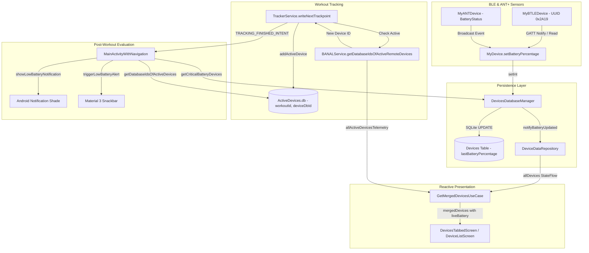

# Stage 3: Implementation Plan - ATT-3312: Persist sensor battery state continuously during workout and reflect live battery levels in sensors list

**Ticket**: [ATT-3312](https://rainerblind.atlassian.net/browse/ATT-3312)  
**Sub-task**: [ATT-3409](https://rainerblind.atlassian.net/browse/ATT-3409) (`[Impl-Plan]`)  
**Parent Epic**: [ATT-355](https://rainerblind.atlassian.net/browse/ATT-355) (*Good and consistent UI*)  
**Target Release**: `Sprint 2026-42.1`  
**Active Sprint**: `Sprint 2026-42.1`  
**Requirement Mapping**: `REQ-CON-007` (extended & refined)  
**Test Mapping**: `TST-CON-010` (extended & refined)  
**Branch**: `feature/ATT-3312`  
**Author**: AI Agent 1 (Software Construction Architect)  
**Date**: 2026-10-13  

---

### Requirement Archaeology & Chesterton's Fence Audit

1. **Original Requirement ID & Target**:
   - `REQ-CON-007` (*Modernized Post-Workout Low Sensor Battery Alerting (In-App Snackbar & System Notification)*), targeting `MainActivityWithNavigation.kt`, `TrackerService.java`, `ActiveDevicesDbHelper.java`, `DevicesDatabaseManager.java`, `MyDevice.java`, `MyBTLEDevice.java`, `GetMergedDevicesUseCase.kt`, and `DeviceDataRepository.kt`.
2. **Historical Origin & Commit Trace**:
   - Baseline ASPICE import `ac493d2bdf652746b9177a2c574b220285b3bf8b`.
   - Sprint 2026-40.16 (`ATT-2192`): Replaced blocking modal `AlertDialog` with dual-channel notification & M3 snackbar, and introduced session-aware active device tracking via `ActiveDevicesDbHelper`.
   - Sprint 2026-41.9 (`ATT-3166`, `ATT-3167`, `ATT-3178`): Added multi-dimensional sensor filtering by battery health, edge-to-edge snackbar padding, and GATT Battery Service replay simulation.
3. **Root Reason for Existing Formulation**:
   - In ATT-2192, `ActiveDevicesDbHelper` was populated exclusively within `TrackerService.java:endWorkout()` by querying `mBanalService.getDatabaseIdsOfActiveRemoteDevices()`.
   - This assumed that all devices active during the workout would still be connected and receiving data at the exact second the athlete pressed "Stop".
   - Furthermore, `MyBTLEDevice.java` only scheduled a periodic poll every 5 minutes (`READ_BATTERY_PERCENTAGE_PERIOD = 300000`) without registering for GATT characteristic notifications on Battery Level (0x2A19).
   - In the presentation layer, `GetMergedDevicesUseCase.kt` mapped incoming `DeviceTelemetry` onto `DeviceUiData` but omitted `telemetry.batteryPercentage`, retaining only the initial static database snapshot.
4. **Preservation of Core Invariants**:
   - Critical Threshold: Sensor battery level $\le 20\%$ (`CRITICAL_BATTERY_LEVEL = 20`) strictly preserved.
   - Dual-Channel Alerting: Non-blocking system notification (`NOTIFICATION_ID_SENSOR_BATTERY = 4300`) and M3 snackbar upon workout stop.
   - Normal Battery Neutrality: Sensors $> 20\%$ remain silent.
   - Thread Confinement: All SQLite persistence operations confined to background dispatchers (`Dispatchers.IO` / BANAL IPC threads).
   - 100% 9-Language Localization Parity: All 9 supported locales (EN, DE, ES, FR, IT, JA, NL, PL, PT) maintained.
   - Full Suite Test Pass Rate: 100% clean-room test pass rate across all modules.

---

## 1. Architectural Design & SWE.2 Component Breakdown

### Component Roles:
1. `ActiveDevicesDbHelper.java`: Added `addActiveDevice(workoutId, deviceDbId)` with duplicate check to support continuous incremental registration.
2. `TrackerService.java`: Tracks session devices via `mActiveSessionDeviceIds` set and invokes `addActiveDevice()` continuously as devices connect or transmit data.
3. `MyBTLEDevice.java`: Registers GATT notifications on Battery Level characteristic (0x2A19) and writes CCCD (0x2902).
4. `DeviceDataRepository.kt`: Provides `notifyBatteryUpdated(deviceId, percentage)` to reactively update in-memory `_allDevices` flow.
5. `DevicesDatabaseManager.java`: Dispatches to `DeviceDataRepository.notifyBatteryUpdated` upon persisting `LAST_BATTERY_PERCENTAGE`.
6. `GetMergedDevicesUseCase.kt`: Uses `telemetry.batteryPercentage` when available ($\ge 0$) to construct `DeviceUiData`.

---

## 2. Atomic Implementation Step Sequence

### Step 1: Incremental Persistence in `ActiveDevicesDbHelper.java`
- File: `app/src/main/java/com/atrainingtracker/trainingtracker/database/ActiveDevicesDbHelper.java`
- Implementation: Add `public synchronized void addActiveDevice(long workoutId, long deviceDbId)`. Check if row exists; if not, insert.
- Verification: Create `ActiveDevicesDbHelperTest.kt` verifying insert and query behavior.

### Step 2: Continuous Session Device Tracking in `TrackerService.java`
- File: `app/src/main/java/com/atrainingtracker/trainingtracker/tracker/TrackerService.java`
- Implementation:
  - Add `mActiveSessionDeviceIds = Collections.synchronizedSet(new HashSet<>());`
  - In `startTracking()`: clear `mActiveSessionDeviceIds`.
  - In `writeNextTrackpoint()` and `endWorkout()`: iterate over `mBanalService.getDatabaseIdsOfActiveRemoteDevices()`, and if `mActiveSessionDeviceIds.add(deviceDbId)`, call `new ActiveDevicesDbHelper(this).addActiveDevice(mWorkoutID, deviceDbId)`.
- Verification: Unit test simulating active device registration during tracking.

### Step 3: GATT Battery Notifications in `MyBTLEDevice.java`
- File: `app/src/main/java/com/atrainingtracker/banalservice/devices/bluetooth_le/MyBTLEDevice.java`
- Implementation:
  - In `onServicesDiscovered` when `UUID_CHARACTERISTIC_BATTERY_LEVEL` is discovered:
    - If `(btGattChar.getProperties() & BluetoothGattCharacteristic.PROPERTY_NOTIFY) != 0`, call `gatt.setCharacteristicNotification(btGattChar, true)` and write descriptor `UUID_CHARACTERISTIC_CLIENT_CONFIG` with `ENABLE_NOTIFICATION_VALUE`.
- Verification: BLE GATT mock unit test verifying notification registration.

### Step 4: Reactive Cache Invalidation in `DeviceDataRepository.kt` & `DevicesDatabaseManager.java`
- Files:
  - `app/src/main/java/com/atrainingtracker/banalservice/ui/devices/devicedata/DeviceDataRepository.kt`
  - `app/src/main/java/com/atrainingtracker/banalservice/database/DevicesDatabaseManager.java`
- Implementation:
  - In `DeviceDataRepository.kt`: Add `notifyBatteryUpdated(deviceId: Long, percentage: Int)`.
  - In `DevicesDatabaseManager.java:setInt()`: Call `DeviceDataRepository.Companion.notifyBatteryUpdated(deviceID, value)` when key is `LAST_BATTERY_PERCENTAGE`.
- Verification: `DeviceDataRepositoryBatteryTest.kt` testing reactive cache update.

### Step 5: Live Telemetry Merging in `GetMergedDevicesUseCase.kt`
- File: `app/src/main/java/com/atrainingtracker/banalservice/ui/devices/GetMergedDevicesUseCase.kt`
- Implementation:
  - Map `batteryPercentage = if (telemetry != null && telemetry.batteryPercentage >= 0) telemetry.batteryPercentage else knownDevice.batteryPercentage`.
- Verification: `GetMergedDevicesUseCaseTest.kt` verifying live battery update on telemetry emission.

---

## 3. UI Consistency Audit (Rule 23)

- **Reference Screen**: `DevicesTabbedScreen.kt` and `DeviceListScreen.kt` ("Meine Sensoren").
- **Reused Components**: Material 3 `DeviceCard`, `BatteryIconBadge` / standard sensor list card items.
- **Theme Tokens**: Standard `MaterialTheme.colorScheme` and `TTColor` tokens for battery warning severity ($\le 20\%$ warning color, $> 20\%$ standard content color).
- **One-off Styles**: Zero new or non-standard styles.

---

## 4. Invariants, Concurrency & Rollback Safety

1. **Thread Confinement**:
   - `ActiveDevicesDbHelper.addActiveDevice()` is thread-safe (`synchronized`) and called from background service workers.
   - `DeviceDataRepository.notifyBatteryUpdated()` dispatches onto `MutableSharedFlow` / Main thread safely via non-blocking `tryEmit()`.
2. **Backward Compatibility**:
   - Zero SQLite schema alterations required (tables `DEVICES` and `ActiveDevices` already define the necessary columns).
3. **Rollback Safety**:
   - All changes isolated on `feature/ATT-3312`. Atomic git reset restores baseline if any regression is observed.
