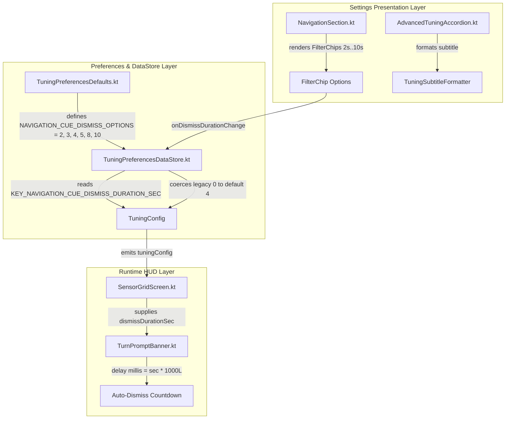

# Stage 3: Implementation Plan - ATT-3325: Replace persistent option with 10s option for navigation cue dismiss duration

**Ticket**: [ATT-3325](https://rainerblind.atlassian.net/browse/ATT-3325)  
**Sub-task**: [ATT-3369](https://rainerblind.atlassian.net/browse/ATT-3369) (`[Impl-Plan]`)  
**Parent Epic**: [ATT-2564](https://rainerblind.atlassian.net/browse/ATT-2564) (*Navigation: Turn-by-Turn Guidance & Cockpit Prompts*)  
**Target Release**: `Sprint 2026-42.1`  
**Active Sprint**: `Sprint 2026-42.1`  
**Requirement Mapping**: `REQ-UI-287` (amending Clauses 1, 2, 3)  
**Test Mapping**: `TST-UI-247` (amending Clauses 1, 2, 3)  
**Branch**: `feature/ATT-3325`  
**Author**: AI Agent 1 (Implementer)  
**Date**: 2026-10-13  

---

## 1. Architectural Overview & Component Decomposition (SWE.2)

### Component Boundaries
1. **`TuningPreferencesDefaults` (`TuningPreferencesDataStore.kt`)**: Defines `NAVIGATION_CUE_DISMISS_OPTIONS = listOf(2, 3, 4, 5, 8, 10)`.
2. **`TuningPreferencesDataStore`**: Validates options upon read and write, ensuring legacy `0` safely coerces to `DEFAULT_NAVIGATION_CUE_DISMISS_DURATION_SEC` (4).
3. **`NavigationSection`**: Renders `FlowRow` chips with uniform `"${sec}s"` formatting and header value display without special-casing `sec == 0`.
4. **`AdvancedTuningAccordion` (`TuningSubtitleFormatter`)**: Formats navigation subtitle as `"${effectiveDismiss}s, ${radiusStr}"`.
5. **Localization Resources (`res/values-*/strings.xml`)**: Excises obsolete `tuning_nav_cue_dismiss_persistent` across all 9 supported locales.

---

## 2. Atomic Step Sequencing

### Step 1: Update Options Constant in `TuningPreferencesDataStore.kt`
* **File**: `app/src/main/java/com/atrainingtracker/trainingtracker/settings/TuningPreferencesDataStore.kt`
* **Action**: Update `NAVIGATION_CUE_DISMISS_OPTIONS` to `listOf(2, 3, 4, 5, 8, 10)`. Verify that `read`, `save`, and `updateNavigationCueDismissDurationSec` continue to guard with `in TuningPreferencesDefaults.NAVIGATION_CUE_DISMISS_OPTIONS`.

### Step 2: Simplify Navigation Tuning UI in `NavigationSection.kt`
* **File**: `app/src/main/java/com/atrainingtracker/trainingtracker/ui/settings/tuning/categories/NavigationSection.kt`
* **Action**:
  * Line 116–120: Simplify header value display to `"${navigationCueDismissDurationSec}s"`.
  * Line 145–149: Simplify chip label to `Text("${sec}s")`.

### Step 3: Align Subtitle Formatter in `AdvancedTuningAccordion.kt`
* **File**: `app/src/main/java/com/atrainingtracker/trainingtracker/ui/settings/tuning/AdvancedTuningAccordion.kt`
* **Action**: In `formatNavigationSubtitle`, ensure `effectiveDismiss` evaluates to `if (dismissSec in TuningPreferencesDefaults.NAVIGATION_CUE_DISMISS_OPTIONS) dismissSec else TuningPreferencesDefaults.DEFAULT_NAVIGATION_CUE_DISMISS_DURATION_SEC` and formats `"${effectiveDismiss}s, $radiusStr"`.

### Step 4: Excises Obsolete Strings Across All 9 Locales
* **Files**:
  * `app/src/main/res/values/strings.xml`
  * `app/src/main/res/values-de/strings.xml`
  * `app/src/main/res/values-es/strings.xml`
  * `app/src/main/res/values-fr/strings.xml`
  * `app/src/main/res/values-it/strings.xml`
  * `app/src/main/res/values-ja/strings.xml`
  * `app/src/main/res/values-nl/strings.xml`
  * `app/src/main/res/values-pl/strings.xml`
  * `app/src/main/res/values-pt/strings.xml`
* **Action**: Remove `tuning_nav_cue_dismiss_persistent`.

### Step 5: Update Existing Tests & Author Targeted Tests
* **Files**:
  * `app/src/test/java/com/atrainingtracker/trainingtracker/settings/TuningConfigTest.kt`: Update expected list to `[2, 3, 4, 5, 8, 10]`.
  * `app/src/test/java/com/atrainingtracker/trainingtracker/ui/settings/tuning/AdvancedTuningAccordionTest.kt`: Update test to assert `10s` and fallback of `0`.
  * `app/src/test/java/com/atrainingtracker/trainingtracker/settings/TuningPreferencesDataStoreDismissDurationTest.kt`: Add unit tests for DataStore read/write, legacy `0` fallback, and 10s persistence.

### Step 6: Verify Regression Suite & Localization Parity
* **Commands**:
  * `./gradlew testDebugUnitTest --tests "*TranslationParityTest*"`
  * `./gradlew testDebugUnitTest`

---

## 3. UI Consistency & Design Guidelines (§ 5)

* **Reference Screen**: `NavigationSection.kt` inside `AdvancedTuningDialog.kt`.
* **Components Reused**: Material 3 `FilterChip`, `FlowRow`, `Text` typography tokens (`bodyMedium`, `labelSmall`).
* **Design Tokens**: Uniform `"${sec}s"` formatting matching adjacent chip groups (e.g. altitude filter window chips, sensor timeout chips).
* **Glanceability**: Replacing the verbose string "Dauerhaft" with "10s" maintains uniform compact chip dimensions and eliminates awkward wrapping on narrow screens.

---

## 4. Invariant Protection & Rollback Safety

1. **Legacy Compatibility**: Any user profile with `0` stored in DataStore seamlessly coerces to `4` (default) on first read without data loss or exceptions.
2. **Deterministic Durations**: Every allowed option ($2, 3, 4, 5, 8, 10$) is strictly positive, ensuring turn banners always dismiss automatically without occluding the cockpit.
3. **DataStore Single Source of Truth**: Preference reads and writes are fully validated against `NAVIGATION_CUE_DISMISS_OPTIONS`.
4. **Clean-Room Regression**: 100% test pass rate across all modules.
