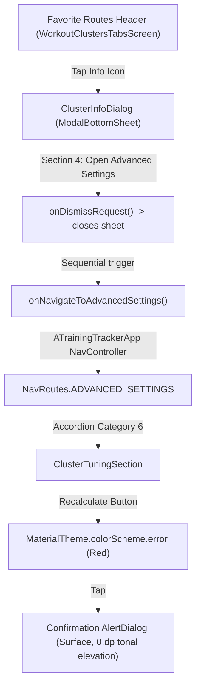

# Stage 3: Implementation Plan - ATT-3492: Style cluster recalculate button in red and add direct Advanced Settings deep-link to Favorite Routes info

**Ticket**: [ATT-3492](https://atrainingtracker.atlassian.net/browse/ATT-3492)  
**Sub-task**: [ATT-3507](https://atrainingtracker.atlassian.net/browse/ATT-3507) (`[Impl-Plan]`)  
**Parent Epic**: [ATT-355](https://atrainingtracker.atlassian.net/browse/ATT-355) (*Good and consistent UI*)  
**Target Release**: `V4.9.40`  
**Active Sprint**: `Sprint 2026-42.3`  
**Requirement Mapping**: `REQ-SET-076` (*Red Cluster Recalculate Button and Direct Advanced Settings Deep-Link from Favorite Routes*), amending `REQ-SET-075` and `REQ-UI-149`  
**Test Spec ID**: `TST-SET-076`  
**Branch**: `feature/ATT-3492`  
**Author**: AI Agent 1 (Implementer)  
**Date**: 2026-10-14  

---

## 1. Executive Summary & Architecture Overview (SWE.2)

### 1.1 Architectural Context
ATT-3492 executes two user-experience and safety refinements for workout route clustering:
1. **Red Destructive Styling for Recalculation**: In `ClusterTuningSection.kt`, the "Alle Cluster neu berechnen" action button wipes existing cluster groupings and centroids from SQLite history before re-clustering. To visually alert athletes of its destructive nature prior to tapping, the button styling is upgraded to Material 3 error tokens (`containerColor = MaterialTheme.colorScheme.error`, `contentColor = MaterialTheme.colorScheme.onError`), with accessible disabled states (`disabledContainerColor = MaterialTheme.colorScheme.error.copy(alpha = 0.6f)`, `disabledContentColor = MaterialTheme.colorScheme.onError`) and matching circular progress indicator colors (`color = MaterialTheme.colorScheme.onError`).
2. **Favorite Routes Educational Deep-Link**: In `ClusterInfoDialog.kt`, Section 4 ("Sensitivity & Parameter Tuning") is updated to explain that clustering tolerances and recalculation reside in Advanced Settings (*Erweiterte Einstellungen*). A direct deep-link button (`R.string.cluster_info_open_advanced_tuning`) is introduced.
3. **Pure Navigation Delegation (Single Source of Truth)**: `ClusterInfoDialog` delegates navigation cleanly to its caller via `onNavigateToAdvancedSettings: () -> Unit`. When clicked, it executes a strict two-step state transition: `onDismissRequest()` to teardown dialog state, followed immediately by `onNavigateToAdvancedSettings()`, avoiding backstack flicker and preventing any Activity-level casting anti-patterns in composables.



---

## 2. Step-by-Step Atomic Implementation Steps

### Step 1: Localization String Parity Across 9 Locales (`strings.xml`)
* **Files**:
  - `app/src/main/res/values/strings.xml`
  - `app/src/main/res/values-de/strings.xml`
  - `app/src/main/res/values-es/strings.xml`
  - `app/src/main/res/values-fr/strings.xml`
  - `app/src/main/res/values-it/strings.xml`
  - `app/src/main/res/values-ja/strings.xml`
  - `app/src/main/res/values-nl/strings.xml`
  - `app/src/main/res/values-pl/strings.xml`
  - `app/src/main/res/values-pt/strings.xml`
* **Changes**:
  1. Add string token `cluster_info_open_advanced_tuning`:
     - `values`: `Open Advanced Settings`
     - `values-de`: `Zu den erweiterten Einstellungen`
     - `values-es`: `Abrir ajustes avanzados`
     - `values-fr`: `Ouvrir les paramètres avancés`
     - `values-it`: `Apri impostazioni avanzate`
     - `values-ja`: `高度な設定を開く`
     - `values-nl`: `Geavanceerde instellingen openen`
     - `values-pl`: `Otwórz ustawienia zaawansowane`
     - `values-pt`: `Abrir configurações avançadas`
  2. Update string token `cluster_info_tuning_desc`:
     - `values`: Update to state that cluster tolerances and recalculation are configured in Advanced Settings.
     - `values-de`: Update to state that cluster tolerances and recalculation are configured in Advanced Settings.
     - `values-es`: Update with accurate Spanish translation.
     - `values-fr`: Update with accurate French translation.
     - `values-it`: Update with accurate Italian translation.
     - `values-ja`: Update with accurate Japanese translation.
     - `values-nl`: Update with accurate Dutch translation.
     - `values-pl`: Update with accurate Polish translation.
     - `values-pt`: Update with accurate Portuguese translation.
* **Invariant**: 100% 9-language translation parity maintained.

---

### Step 2: Red Destructive Styling in `ClusterTuningSection.kt`
* **File**: `app/src/main/java/com/atrainingtracker/trainingtracker/ui/settings/tuning/categories/ClusterTuningSection.kt`
* **Changes**:
  - Update `Button` around line 105:
    ```kotlin
    Button(
        onClick = { showRecalculateDialog = true },
        enabled = !isRecalculating,
        colors = ButtonDefaults.buttonColors(
            containerColor = MaterialTheme.colorScheme.error,
            contentColor = MaterialTheme.colorScheme.onError,
            disabledContainerColor = MaterialTheme.colorScheme.error.copy(alpha = 0.6f),
            disabledContentColor = MaterialTheme.colorScheme.onError
        ),
        modifier = Modifier.fillMaxWidth()
    ) {
        if (isRecalculating) {
            CircularProgressIndicator(
                modifier = Modifier.size(16.dp),
                color = MaterialTheme.colorScheme.onError,
                strokeWidth = 2.dp
            )
            Spacer(modifier = Modifier.width(8.dp))
            Text(stringResource(R.string.cluster_tuning_recalculating))
        } else {
            Text(stringResource(R.string.cluster_tuning_recalculate_button))
        }
    }
    ```
* **Invariant**: Modularity constraint (< 400 lines) preserved (current lines: 172).

---

### Step 3: Deep-Link Action & Navigation Delegation in `ClusterInfoDialog.kt`
* **File**: `app/src/main/java/com/atrainingtracker/trainingtracker/ui/clusters/ClusterInfoDialog.kt`
* **Changes**:
  - Update Composable signature to require `onNavigateToAdvancedSettings: () -> Unit`:
    ```kotlin
    @OptIn(ExperimentalMaterial3Api::class)
    @Composable
    fun ClusterInfoDialog(
        onDismissRequest: () -> Unit,
        onNavigateToAdvancedSettings: () -> Unit
    )
    ```
  - In Section 4 (lines 142-154), after the description `Text`, append a direct action button:
    ```kotlin
    Spacer(modifier = Modifier.height(12.dp))
    Button(
        onClick = {
            onDismissRequest()
            onNavigateToAdvancedSettings()
        },
        modifier = Modifier.fillMaxWidth()
    ) {
        Icon(
            imageVector = Icons.Default.Tune,
            contentDescription = null,
            modifier = Modifier.size(18.dp)
        )
        Spacer(modifier = Modifier.width(8.dp))
        Text(stringResource(R.string.cluster_info_open_advanced_tuning))
    }
    ```
* **Invariant**: Modularity constraint (< 400 lines) preserved (current lines: 171). Zero Activity casts. Strict invocation order: `onDismissRequest()` before `onNavigateToAdvancedSettings()`.

---

### Step 4: Propagate Callback in Navigation Callers
* **Files**:
  - `app/src/main/java/com/atrainingtracker/trainingtracker/ui/clusters/WorkoutClustersTabsScreen.kt`
    - Add `onNavigateToAdvancedSettings: () -> Unit` parameter to `WorkoutClustersTabsScreen`.
    - Pass `onNavigateToAdvancedSettings = onNavigateToAdvancedSettings` to `ClusterInfoDialog`.
  - `app/src/main/java/com/atrainingtracker/trainingtracker/ui/clusters/WorkoutClustersScreen.kt`
    - Add `onNavigateToAdvancedSettings: () -> Unit` parameter to `WorkoutClustersScreen`.
    - Pass to `WorkoutClustersTabsScreen`.
  - `app/src/main/java/com/atrainingtracker/trainingtracker/ui/navigation/ATrainingTrackerApp.kt`
    - In destination for `NavRoutes.FAVORITE_ROUTES` / `WorkoutClustersScreen`, supply:
      `onNavigateToAdvancedSettings = { navController.navigate(NavRoutes.ADVANCED_SETTINGS) }`.
  - `app/src/main/java/com/atrainingtracker/trainingtracker/fragments/WorkoutClustersFragment.kt`
    - In `WorkoutClustersScreen` composable call, supply:
      `onNavigateToAdvancedSettings = { (activity as? MainActivityWithNavigation)?.navigateToDrawerItem(R.id.drawer_advanced_tuning) }`.
  - `app/src/main/java/com/atrainingtracker/trainingtracker/ui/clusters/ClusterTuningScreen.kt`
    - Pass `onNavigateToAdvancedSettings = { showInfoDialog = false }`.

---

### Step 5: Unit & Contract Tests
* **Files**:
  - `app/src/test/java/com/atrainingtracker/trainingtracker/ui/settings/tuning/ClusterTuningContractTest.kt`:
    - Add test verifying `ClusterTuningSection.kt` configures `containerColor = MaterialTheme.colorScheme.error`, `contentColor = MaterialTheme.colorScheme.onError`, `disabledContainerColor`, and `disabledContentColor`.
    - Add test verifying `CircularProgressIndicator` uses `color = MaterialTheme.colorScheme.onError`.
  - `app/src/test/java/com/atrainingtracker/trainingtracker/ui/clusters/ClusterInfoDialogTest.kt`:
    - Add `cluster_info_open_advanced_tuning` to `requiredStringKeys`.
    - Verify 9-language translation parity.
  - `app/src/test/java/com/atrainingtracker/trainingtracker/ui/clusters/ClusterInfoDialogContractTest.kt`:
    - Verify `ClusterInfoDialog` requires `onNavigateToAdvancedSettings: () -> Unit`.
    - Verify Section 4 renders button referencing `R.string.cluster_info_open_advanced_tuning` with `Icons.Default.Tune`.
    - Verify `onDismissRequest()` executes strictly before `onNavigateToAdvancedSettings()`.
    - Verify zero Activity casts inside `ClusterInfoDialog.kt`.

---

## 3. Verification & Test Strategy

| Test Identifier | Level | Command / Target | Success Criteria |
| :--- | :--- | :--- | :--- |
| `TST-SET-076.1` | Unit/Contract | `./gradlew testDebugUnitTest --tests "*ClusterTuningContractTest*"` | Error colors and contrast asserted on recalculate button and progress indicator |
| `TST-SET-076.2` | Localization | `./gradlew testDebugUnitTest --tests "*ClusterInfoDialogTest*"` | 100% 9-language coverage with non-blank translations |
| `TST-SET-076.3` | Contract | `./gradlew testDebugUnitTest --tests "*ClusterInfoDialogContractTest*"` | Strict order of operations and pure navigation delegation asserted |
| `TST-SET-076.4` | Modularity | `./gradlew testDebugUnitTest --tests "*AdvancedTuningModularityTest*"` | All modified tuning and cluster files remain < 400 lines |
| `TST-SET-076.5` | Clean-room Regression | `./gradlew testDebugUnitTest` | 100% test pass rate across entire project suite |

---

## 4. Risk Analysis & Mitigation

1. **Risk: Dialog / Navigation Race Condition or UI Backstack Flicker**
   - *Mitigation*: Strictly call `onDismissRequest()` to teardown sheet state before invoking `onNavigateToAdvancedSettings()`.
2. **Risk: Accessibility & Contrast Degradation during Recalculation**
   - *Mitigation*: Explicitly set `disabledContentColor = MaterialTheme.colorScheme.onError` and `disabledContainerColor = MaterialTheme.colorScheme.error.copy(alpha = 0.6f)`, guaranteeing high-contrast legibility for `CircularProgressIndicator` and status text.
3. **Risk: Modularity Limit Violation**
   - *Mitigation*: `ClusterTuningSection.kt` (172 lines) and `ClusterInfoDialog.kt` (171 lines) are well below the 400-line ceiling, leaving over 200 lines of safety headroom.

---

## 5. Traceability Matrix

| Requirement | Implementation Step | Test Case | Status |
| :--- | :--- | :--- | :--- |
| `REQ-SET-076` (Error Styling & Accessibility) | Step 2 | `TST-SET-076.1` | Planned |
| `REQ-SET-076` (9-Language Parity) | Step 1 | `TST-SET-076.2` | Planned |
| `REQ-SET-076` (Direct Deep-Link & Clean Delegation) | Step 3, 4 | `TST-SET-076.3` | Planned |
| `REQ-SET-076` (Modularity < 400 lines) | Step 2, 3 | `TST-SET-076.4` | Planned |
| `REQ-PRO-001` (Clean-Room Zero Regressions) | Steps 1-5 | `TST-SET-076.5` | Planned |
