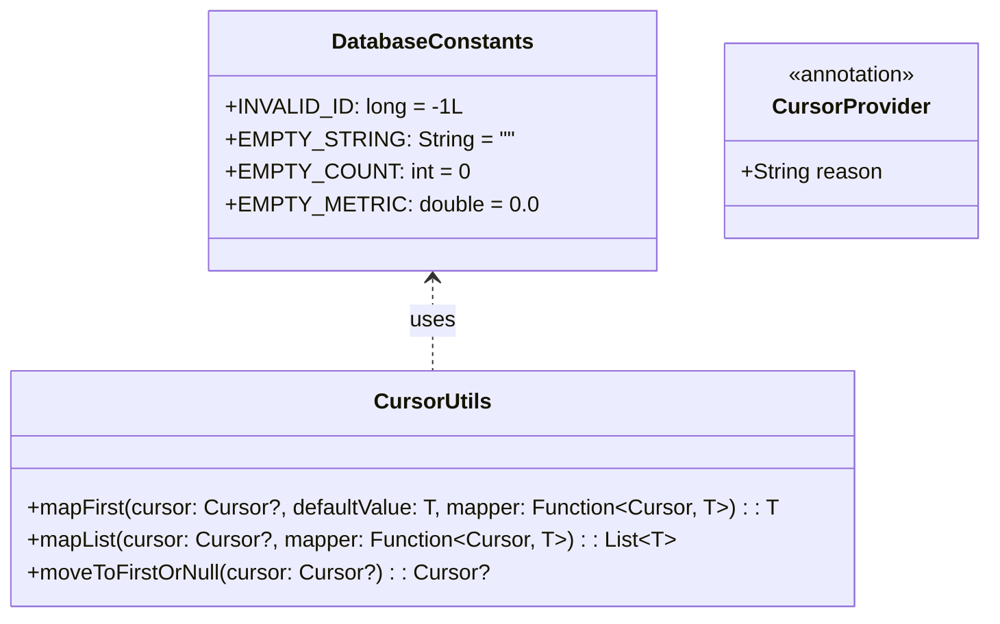

# Stage 3 Implementation Plan: ATT-3550 - Enforce Try-With-Resources and Cursor Bounds Checks Across Legacy Java Database Managers

**Ticket**: [ATT-3550](https://rainerblind.atlassian.net/browse/ATT-3550)  
**Sub-task**: [ATT-3667](https://rainerblind.atlassian.net/browse/ATT-3667) (`[Implementation Plan]`)  
**Parent Epic**: [ATT-431](https://rainerblind.atlassian.net/browse/ATT-431) (*Clean Code*)  
**Target Release**: `V4.9.40`  
**Active Sprint**: `Sprint 2026-42.4`  
**Branch**: `feature/ATT-3550`  
**Requirement Mapping**: `REQ-DAT-001` (*Deterministic Resource Management via Try-With-Resources and Bounds Checking on SQLite Cursors Across Legacy Database Managers*)  
**Test Mapping**: `TST-DAT-001`  
**Author**: AI Agent 1 (Implementer)  
**Reviewer / Auditor**: AI Agent 2 (Auditor)  
**Date**: 2026-10-15  

---

## 1. Executive Summary & SWE.2 Architecture

To eliminate cursor resource leaks and `CursorIndexOutOfBoundsException` systematically across the legacy Java database managers, ATT-3550 introduces a standardized architectural model combining centralized sentinel constants, functional cursor navigation helpers, convention-based provider detection, and automated static audits.

### Key Architectural Pillars
1. **Centralized Sentinel Constants (`DatabaseConstants.java`)**:
   - Defines canonical empty-state sentinels (`INVALID_ID = -1L`, `EMPTY_STRING = ""`, `EMPTY_COUNT = 0`, `EMPTY_METRIC = 0.0`) to avoid magic literals and prevent sentinel drift across managers.
2. **Functional Cursor Helper (`CursorUtils.java`)**:
   - Provides reusable, null-safe navigation primitives:
     - `mapFirst(Cursor cursor, T defaultValue, CursorMapper<T> mapper)`: Safely checks `if (cursor != null && cursor.moveToFirst())`, extracts and returns `mapper.map(cursor)`, or returns `defaultValue` if empty, ensuring zero `CursorIndexOutOfBoundsException`.
     - `mapList(Cursor cursor, CursorMapper<T> mapper)`: Safely iterates `while (cursor.moveToNext())`, returning an immutable or empty list.
   - Works cleanly inside standard Java `try (Cursor cursor = ...)` blocks.
3. **Provider Method Naming & Annotation Convention (`@CursorProvider`)**:
   - Methods that legitimately return an open `Cursor` to external components (e.g. `CursorAdapter`) must be annotated with `@CursorProvider` or end with `Cursor` (e.g. `getDeviceCursor`, `getCursorForAllDevices`).
   - The static audit parser detects `@CursorProvider` and `*Cursor` method signatures automatically rather than relying on an open-ended manual whitelist.
4. **Deterministic Resource Management (`try-with-resources`)**:
   - Every internally consumed `Cursor` is allocated in a `try (Cursor cursor = ...)` block. All legacy manual `cursor.close()` calls on local cursors are removed.

---

## 2. Call-Site Inventory & Migration Scope

| File | Query Methods / Lines | Pattern & Helper Applied | Sentinel Value |
| :--- | :--- | :--- | :--- |
| **`ExportStatusDatabaseManager.java`** | `getExportStatus(long, FileFormat)` (L198) `hasPendingExports()` (L269) `getRecentExports()` (L300) `isExported(long, FileFormat)` (L328) | `try (Cursor cursor = ...)` + `CursorUtils.mapFirst` / `mapList` | `null` `false` `Collections.emptyList()` `false` |
| **`ExportManager.java`** | `processExport(...)` (L393) | `try (Cursor cursor = ...)` + `CursorUtils.mapFirst` | `false` / early exit |
| **`BaseFileWriter.java`** | `writeWorkoutSummary(...)` (L71) | `try (Cursor cursor = ...)` + `CursorUtils.mapFirst` | early return |
| **`GPXFileWriter.java`** | `writeLaps(...)` (L133) | `try (Cursor cursor = ...)` + `while (cursor.moveToNext())` | early return |
| **`DevicesDatabaseManager.java`** | `getDeviceName(long)` (L169) `getDeviceAddress(long)` (L189) `getDeviceType(long)` (L209) `getProtocol(long)` (L230) `getDeviceKey(long)` (L249) `isDevicePaired(long)` (L305) `getCalibrationFactor(long)` (L502) `isPaired(long)` (L528) `getBikePowerSensorFlags(long)` (L607) `upgradeToV4/V5` migrations (L1092, L1143, L1159) | `try (Cursor cursor = ...)` + `CursorUtils.mapFirst` / `while (cursor.moveToNext())` Annotate `getDeviceCursor` and `getCursorForAllDevices` with `@CursorProvider` | `DatabaseConstants.EMPTY_STRING` `DatabaseConstants.EMPTY_STRING` `null` `null` `DatabaseConstants.EMPTY_STRING` `false` `1.0f` `false` `DatabaseConstants.EMPTY_COUNT` migration completion |
| **`SportTypeDatabaseManager.java`** | `getName(long)` (L110) `getShortName(long)` (L127) `getDefaultSportTypeId()` (L217) `getSportType(long)` (L243) `getSpeedThreshold(long)` (L306) `getAutoPause(long)` (L321) `getHeartRateZones(long)` (L345) `getPowerZones(long)` (L371) `getSpeedZones(long)` (L395) `getAllSportTypes()` (L468) `getSportTypeByName(String)` (L507) | `try (Cursor cursor = ...)` + `CursorUtils.mapFirst` / `mapList` | `DatabaseConstants.EMPTY_STRING` `DatabaseConstants.EMPTY_STRING` `DatabaseConstants.INVALID_ID` `null` `DatabaseConstants.EMPTY_METRIC` `false` `null` `null` `null` `Collections.emptyList()` `null` |
| **`TrackingViewsDatabaseManager.java`** | `getViewSize(long)` (L234) `getSensorFieldCount(long)` (L348) `getLayout(long)` (L418) `getPageCount()` (L451) `getPageName(int)` (L477) `getPageLayout(int)` (L497) `getAllViews()` (L572) `upgradeViews()` (L969) | `try (Cursor cursor = ...)` + `CursorUtils.mapFirst` / `mapList` | `ViewSize.NORMAL` `DatabaseConstants.EMPTY_COUNT` `null` `DatabaseConstants.EMPTY_COUNT` `DatabaseConstants.EMPTY_STRING` `null` `Collections.emptyList()` migration completion |
| **`SegmentsDatabaseManager.java`** | `getSegmentById(long)` (L218) | `try (Cursor cursor = ...)` + `CursorUtils.mapFirst` | `null` |
| **`WorkoutSamplesDatabaseManager.java`**| `getSampleCount(long)` (L172) | `try (Cursor cursor = ...)` + `CursorUtils.mapFirst` | `DatabaseConstants.EMPTY_COUNT` |
| **`ActiveDevicesDbHelper.java`** | `getActiveDevice(long)` (L72) `getAllActiveDevices()` (L105) | `try (Cursor cursor = ...)` + `CursorUtils.mapFirst` / `mapList` | `null` `Collections.emptyList()` |
| **`EquipmentDbHelper.java`** | `migrateLegacyEquipment()` (L664) | `try (Cursor cursor = ...)` + `while (cursor.moveToNext())` | migration completion |
| **`PebbleDatabaseManager.java`** | `getView(long)` (L93) `getRows(long)` (L220) `getAllViews()` (L397) | `try (Cursor cursor = ...)` + `CursorUtils.mapFirst` / `mapList` Annotate `getViewsCursor` with `@CursorProvider` | `null` `Collections.emptyList()` `Collections.emptyList()` |

---

## 3. Architecture Guard & Static Linter Design

### Convention-Based Provider Detection Strategy
1. **`@CursorProvider` Annotation**:
   - Location: `app/src/main/java/com/atrainingtracker/database/CursorProvider.java`.
   - Targets methods intended to supply open cursors to external UI/framework layers.
2. **Automated Architecture Test (`TryWithResourcesCursorAuditTest.kt`)**:
   - Parses Java source files in database and exporter packages.
   - Detects all local declarations `Cursor <var> =`.
   - Verifies each local assignment is enclosed within a `try (...)` header.
   - Automatically skips methods annotated with `@CursorProvider` or whose return type is `Cursor` and method name ends in `Cursor`.
3. **CLI Linter (`tools/lint_cursor_safety.py`)**:
   - Python static analysis script implementing identical `@CursorProvider` and `*Cursor` naming rules, returning non-zero exit code on any unshielded local cursor allocation.

---

## 4. Atomic Implementation Steps

### Step 1: Implement Centralized Infrastructure & Architecture Guards
- Create `DatabaseConstants.java` (`INVALID_ID`, `EMPTY_STRING`, `EMPTY_COUNT`, `EMPTY_METRIC`).
- Create `CursorProvider.java` annotation.
- Create `CursorUtils.java` (`mapFirst`, `mapList`, `moveToFirstOrNull`).
- Create unit tests for `CursorUtilsTest.kt`.
- Create `tools/lint_cursor_safety.py` and `TryWithResourcesCursorAuditTest.kt`.

### Step 2: Migrate Exporters and File Writers
- Refactor `ExportStatusDatabaseManager.java`, `ExportManager.java`, `BaseFileWriter.java`, `GPXFileWriter.java`.
- Eliminate manual `cursor.close()` calls, adopt `try-with-resources`, and route row reads through `CursorUtils`.

### Step 3: Migrate Hardware & Device Managers
- Refactor `DevicesDatabaseManager.java` and `ActiveDevicesDbHelper.java`.
- Annotate `getDeviceCursor` and `getCursorForAllDevices` with `@CursorProvider`.
- Migrate all local queries to `try-with-resources` + `CursorUtils`.

### Step 4: Migrate SportType and TrackingViews Managers
- Refactor `SportTypeDatabaseManager.java` and `TrackingViewsDatabaseManager.java`.
- Migrate all queries to `try-with-resources` + `CursorUtils`.

### Step 5: Migrate Segments, Samples, Equipment, and Pebble Managers
- Refactor `SegmentsDatabaseManager.java`, `WorkoutSamplesDatabaseManager.java`, `EquipmentDbHelper.java`, and `PebbleDatabaseManager.java`.
- Annotate `getViewsCursor` with `@CursorProvider`.

### Step 6: Runtime & Static Verification
- Author `DatabaseEmptyCursorSentinelTest.kt` verifying that every database manager returns the canonical sentinel when queried on empty tables.
- Run `python3 tools/lint_cursor_safety.py`.
- Run `./gradlew testDebugUnitTest --tests "com.atrainingtracker.architecture.TryWithResourcesCursorAuditTest"` and `CursorUtilsTest`.

### Step 7: Clean-Room Regression & Gate Progression
- Run full suite `./gradlew testDebugUnitTest` (2932+ tests).
- Author Stage 5 walkthrough and advance living docs to `Verified`.
