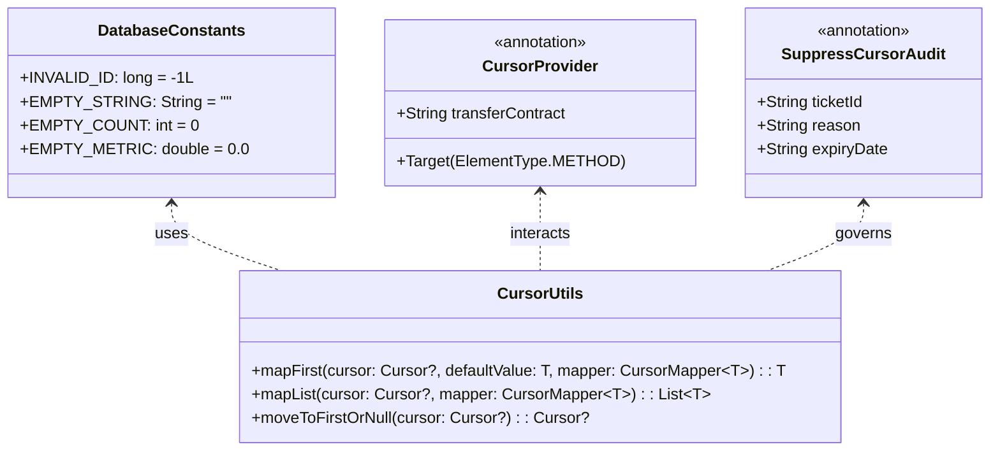

# Stage 3 Implementation Plan: ATT-3550 - Enforce Try-With-Resources and Cursor Bounds Checks Across Legacy Java Database Managers

**Ticket**: [ATT-3550](https://rainerblind.atlassian.net/browse/ATT-3550)  
**Sub-task**: [ATT-3667](https://rainerblind.atlassian.net/browse/ATT-3667) (`[Implementation Plan]`)  
**Parent Epic**: [ATT-431](https://rainerblind.atlassian.net/browse/ATT-431) (*Clean Code*)  
**Target Release**: `V4.9.40`  
**Active Sprint**: `Sprint 2026-42.4`  
**Branch**: `feature/ATT-3550`  
**Requirement Mapping**: `REQ-DAT-001` (*Deterministic Resource Management via Try-With-Resources and Bounds Checking on SQLite Cursors Across Legacy Database Managers*)  
**Test Mapping**: `TST-DAT-001`  
**Author**: AI Agent 1 (Implementer)  
**Reviewer / Auditor**: AI Agent 2 (Auditor)  
**Date**: 2026-10-15  

---

## 1. Executive Summary & SWE.2 Architecture

To eliminate cursor resource leaks and `CursorIndexOutOfBoundsException` systematically across legacy Java database managers, ATT-3550 introduces a production-grade architectural framework combining centralized sentinel constants, functional cursor navigation helpers, hardened governance annotations with expiration dates, chained-call detection, and automated negative-tested CI/CD blocking gates.



### Key Architectural Pillars

1. **Centralized Sentinel Constants (`DatabaseConstants.java`)**:
   - Location: `app/src/main/java/com/atrainingtracker/database/DatabaseConstants.java`.
   - Defines canonical empty-state sentinels (`INVALID_ID = -1L`, `EMPTY_STRING = ""`, `EMPTY_COUNT = 0`, `EMPTY_METRIC = 0.0`) eliminating magic literals and preventing sentinel drift across managers.

2. **Functional Cursor Helper (`CursorUtils.java`)**:
   - Location: `app/src/main/java/com/atrainingtracker/util/CursorUtils.java`.
   - Null-safe navigation primitives:
     - `mapFirst(Cursor cursor, T defaultValue, CursorMapper<T> mapper)`: Safely checks `if (cursor != null && cursor.moveToFirst())`, extracts and returns `mapper.map(cursor)`, or returns `defaultValue` if empty, guaranteeing zero `CursorIndexOutOfBoundsException`.
     - `mapList(Cursor cursor, CursorMapper<T> mapper)`: Safely iterates `while (cursor.moveToNext())`, returning an unmodifiable or empty list.
   - Operates inside standard Java `try (Cursor cursor = ...)` blocks.

3. **Exception Propagation & Telemetry Contract**:
   - `CursorUtils` **NEVER** swallows `SQLException`, `SQLiteException`, or `RuntimeException`. All exceptions thrown during mapping or cursor navigation are propagated cleanly to the caller.
   - The `try-with-resources` block guarantees that `cursor.close()` is invoked deterministically during stack unwind, even when exceptions are thrown mid-iteration.
   - In database managers with existing fallback API contracts, query blocks catch `SQLiteException` explicitly, log high-severity diagnostics with `Log.e(TAG, "Query execution failed on table ...", e)`, and return the canonical sentinel, guaranteeing observability in Crashlytics and Logcat.

4. **Hardened Annotation Governance & Transfer of Ownership Contract**:
   - **`@CursorProvider`**:
     - Strict contract: *Targeted solely to methods (`@Target(ElementType.METHOD)`). Any method annotated with `@CursorProvider` transfers the responsibility of closing the `Cursor` to the caller. Callers consuming this method MUST close the cursor via `try-with-resources` or pass ownership to an Android framework lifecycle component (e.g. `CursorAdapter`, `Loader`). Fields and constructors are strictly prohibited from holding untracked cursor references.*
     - Location: `app/src/main/java/com/atrainingtracker/database/CursorProvider.java`.
   - **`@SuppressCursorAudit` with Mandatory Expiration**:
     - Hardened governance: Requires mandatory `ticketId`, `reason`, and ISO `expiryDate` (`YYYY-MM-DD`):
       ```java
       @Target(ElementType.METHOD)
       @Retention(RetentionPolicy.SOURCE)
       public @interface SuppressCursorAudit {
           String ticketId();
           String reason();
           String expiryDate(); // e.g. "2026-12-31"
       }
       ```
     - The CI/CD linter automatically validates that `ticketId` matches `ATT-\\d+` and that the current date does not exceed `expiryDate`, failing the build if a suppression has expired to prevent permanent technical debt.

5. **AST & Token-Based Static Analysis & Chained-Call Detection**:
   - `tools/lint_cursor_safety.py` and `TryWithResourcesCursorAuditTest.kt` inspect method bodies for:
     1. Any unshielded invocation of `.query(` or `.rawQuery(` on database objects not enclosed in a `try (` header.
     2. **Chained Calls**: Any occurrence of `db.query(...).` or `db.rawQuery(...).` (e.g., `db.query(...).moveToFirst()`) is flagged as a fatal violation, as chained calls instantiate anonymous cursors that leak native memory and file descriptors.
     3. **Expired Suppressions**: Any `@SuppressCursorAudit` whose `expiryDate` has passed triggers a build failure.

6. **Negative Testing ("Poison Pill" Test)**:
   - `TryWithResourcesCursorAuditTest.kt` includes an explicit negative test suite (`testPoisonPill_unshieldedAllocationFails`, `testPoisonPill_chainedCallFails`, `testPoisonPill_expiredSuppressionFails`) verifying that the static guard actively detects and blocks all prohibited patterns.

---

## 2. Call-Site Inventory & Migration Scope

| File | Target Query Methods / Lines | Pattern & Helper Applied | Sentinel Value |
| :--- | :--- | :--- | :--- |
| **`ExportStatusDatabaseManager.java`** | `getExportStatus(long, FileFormat)` (L198)<br>`hasPendingExports()` (L269)<br>`getRecentExports()` (L300)<br>`isExported(long, FileFormat)` (L328) | `try (Cursor cursor = ...)` + `CursorUtils.mapFirst` / `mapList` | `null`<br>`false`<br>`Collections.emptyList()`<br>`false` |
| **`ExportManager.java`** | `processExport(...)` (L393) | `try (Cursor cursor = ...)` + `CursorUtils.mapFirst` | `false` / early exit |
| **`BaseFileWriter.java`** | `writeWorkoutSummary(...)` (L71) | `try (Cursor cursor = ...)` + `CursorUtils.mapFirst` | early return |
| **`GPXFileWriter.java`** | `writeLaps(...)` (L133) | `try (Cursor cursor = ...)` + `while (cursor.moveToNext())` | early return |
| **`DevicesDatabaseManager.java`** | `getDeviceName(long)` (L169)<br>`getDeviceAddress(long)` (L189)<br>`getDeviceType(long)` (L209)<br>`getProtocol(long)` (L230)<br>`getDeviceKey(long)` (L249)<br>`isDevicePaired(long)` (L305)<br>`getCalibrationFactor(long)` (L502)<br>`isPaired(long)` (L528)<br>`getBikePowerSensorFlags(long)` (L607)<br>`upgradeToV4/V5` migrations (L1092, L1143, L1159) | `try (Cursor cursor = ...)` + `CursorUtils.mapFirst` / `while (cursor.moveToNext())`<br>Annotate `getDeviceCursor` and `getCursorForAllDevices` with `@CursorProvider` | `DatabaseConstants.EMPTY_STRING`<br>`DatabaseConstants.EMPTY_STRING`<br>`null`<br>`null`<br>`DatabaseConstants.EMPTY_STRING`<br>`false`<br>`1.0f`<br>`false`<br>`DatabaseConstants.EMPTY_COUNT`<br>migration completion |
| **`SportTypeDatabaseManager.java`** | `getName(long)` (L110)<br>`getShortName(long)` (L127)<br>`getDefaultSportTypeId()` (L217)<br>`getSportType(long)` (L243)<br>`getSpeedThreshold(long)` (L306)<br>`getAutoPause(long)` (L321)<br>`getHeartRateZones(long)` (L345)<br>`getPowerZones(long)` (L371)<br>`getSpeedZones(long)` (L395)<br>`getAllSportTypes()` (L468)<br>`getSportTypeByName(String)` (L507) | `try (Cursor cursor = ...)` + `CursorUtils.mapFirst` / `mapList` | `DatabaseConstants.EMPTY_STRING`<br>`DatabaseConstants.EMPTY_STRING`<br>`DatabaseConstants.INVALID_ID`<br>`null`<br>`DatabaseConstants.EMPTY_METRIC`<br>`false`<br>`null`<br>`null`<br>`null`<br>`Collections.emptyList()`<br>`null` |
| **`TrackingViewsDatabaseManager.java`** | `getViewSize(long)` (L234)<br>`getSensorFieldCount(long)` (L348)<br>`getLayout(long)` (L418)<br>`getPageCount()` (L451)<br>`getPageName(int)` (L477)<br>`getPageLayout(int)` (L497)<br>`getAllViews()` (L572)<br>`upgradeViews()` (L969) | `try (Cursor cursor = ...)` + `CursorUtils.mapFirst` / `mapList` | `ViewSize.NORMAL`<br>`DatabaseConstants.EMPTY_COUNT`<br>`null`<br>`DatabaseConstants.EMPTY_COUNT`<br>`DatabaseConstants.EMPTY_STRING`<br>`null`<br>`Collections.emptyList()`<br>migration completion |
| **`SegmentsDatabaseManager.java`** | `getSegmentById(long)` (L218) | `try (Cursor cursor = ...)` + `CursorUtils.mapFirst` | `null` |
| **`WorkoutSamplesDatabaseManager.java`**| `getSampleCount(long)` (L172) | `try (Cursor cursor = ...)` + `CursorUtils.mapFirst` | `DatabaseConstants.EMPTY_COUNT` |
| **`ActiveDevicesDbHelper.java`** | `getActiveDevice(long)` (L72)<br>`getAllActiveDevices()` (L105) | `try (Cursor cursor = ...)` + `CursorUtils.mapFirst` / `mapList` | `null`<br>`Collections.emptyList()` |
| **`EquipmentDbHelper.java`** | `migrateLegacyEquipment()` (L664) | `try (Cursor cursor = ...)` + `while (cursor.moveToNext())` | migration completion |
| **`PebbleDatabaseManager.java`** | `getView(long)` (L93)<br>`getRows(long)` (L220)<br>`getAllViews()` (L397) | `try (Cursor cursor = ...)` + `CursorUtils.mapFirst` / `mapList`<br>Annotate `getViewsCursor` with `@CursorProvider` | `null`<br>`Collections.emptyList()`<br>`Collections.emptyList()` |

---

## 3. Architecture Guard & Static Linter Design

### Detection & Exclusion Rules
1. **Scope Bounding**:
   - Strictly scans Java source files within database, helper, and exporter packages under `app/src/main/java`.
2. **Identification of Query Invocations & Chained Calls**:
   - Matches any invocation of `.query(` or `.rawQuery(`.
   - Enforces that each call is either within a `try (...)` resource specification or in an authorized `@CursorProvider` method.
   - Detects chained calls (`.query(...).` or `.rawQuery(...).`) and rejects them unconditionally.
3. **Governance & Expiration**:
   - Rejects any `@SuppressCursorAudit` where `expiryDate` is before the current system date or missing.
4. **CI/CD Integration**:
   - `tools/lint_cursor_safety.py`: Command-line script exiting with code 1 upon any violation.
   - `TryWithResourcesCursorAuditTest.kt`: Blocking JUnit test executed on every `./gradlew testDebugUnitTest` run.

---

## 4. Atomic Implementation Steps

### Step 1: Centralized Architecture Infrastructure
- Create `DatabaseConstants.java`.
- Create `@CursorProvider` (annotated for methods only with Transfer of Ownership Javadoc).
- Create `@SuppressCursorAudit` (with mandatory `ticketId`, `reason`, `expiryDate`).
- Create `CursorUtils.java` (`mapFirst`, `mapList`, `moveToFirstOrNull`).
- Create unit test `CursorUtilsTest.kt` verifying mapping, exception propagation, and sentinel fallbacks.
- Create `tools/lint_cursor_safety.py` and `TryWithResourcesCursorAuditTest.kt` including negative poison pill test cases.

### Step 2: Migrate Exporter and Writer Classes
- Refactor `ExportStatusDatabaseManager.java`, `ExportManager.java`, `BaseFileWriter.java`, `GPXFileWriter.java`.
- Enclose queries in `try-with-resources` and use `CursorUtils`.

### Step 3: Migrate Hardware & Device Managers
- Refactor `DevicesDatabaseManager.java` and `ActiveDevicesDbHelper.java`.
- Annotate `getDeviceCursor` and `getCursorForAllDevices` with `@CursorProvider`.
- Enclose all local queries in `try-with-resources` + `CursorUtils`.

### Step 4: Migrate SportType and TrackingViews Managers
- Refactor `SportTypeDatabaseManager.java` and `TrackingViewsDatabaseManager.java`.
- Enclose all queries in `try-with-resources` + `CursorUtils`.

### Step 5: Migrate Segments, Samples, Equipment, and Pebble Managers
- Refactor `SegmentsDatabaseManager.java`, `WorkoutSamplesDatabaseManager.java`, `EquipmentDbHelper.java`, and `PebbleDatabaseManager.java`.
- Annotate `getViewsCursor` with `@CursorProvider`.

### Step 6: Runtime & Static Verification
- Author `DatabaseEmptyCursorSentinelTest.kt` verifying that database managers return canonical sentinels on empty tables and that `CursorUtils` propagates exceptions during iteration while closing cursors.
- Run poison pill tests in `TryWithResourcesCursorAuditTest.kt` to verify that chained calls, unshielded allocations, and expired suppressions are actively blocked.
- Run `python3 tools/lint_cursor_safety.py`.
- Run `./gradlew testDebugUnitTest --tests "com.atrainingtracker.architecture.TryWithResourcesCursorAuditTest"` and `CursorUtilsTest`.

### Step 7: Clean-Room Regression & Gate Progression
- Run full suite `./gradlew testDebugUnitTest` (2932+ tests).
- Author Stage 5 walkthrough and update living documentation to `Verified`.
