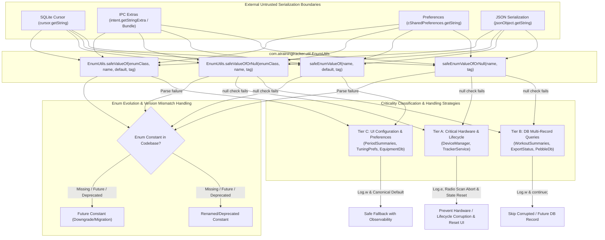

# Stage 3 Implementation Plan: ATT-3562 - Replace Unguarded Enum.valueOf Calls on Cursors, Intents, and Preferences with Safe Deserialization

**Ticket**: [ATT-3562](https://rainerblind.atlassian.net/browse/ATT-3562)  
**Sub-task**: [ATT-3657](https://rainerblind.atlassian.net/browse/ATT-3657) (`[Impl-Plan]`)  
**Parent Epic**: [ATT-235](https://rainerblind.atlassian.net/browse/ATT-235) (*No crashes*)  
**Target Release**: `V4.9.40`  
**Active Sprint**: `Sprint 2026-42.4`  
**Branch**: `feature/ATT-3562`  
**Requirement Mapping**: `REQ-ARC-001`  
**Test Mapping**: `TST-ARC-001`  
**Author**: AI Agent 1 (Implementer)  
**Reviewer / Auditor**: AI Agent 2 (Auditor)  
**Date**: 2026-10-15  

---

## 1. Architectural Overview & Component Decomposition (SWE.2)



---

## 2. Invariants, Criticality Tiers & Guardrails

1. **Zero Uncaught Exception Invariant & Total Exception Safety**:
   Deserialization of external strings (cursor values, intent extras, JSON keys, SharedPreferences) MUST NEVER terminate the process with `NullPointerException`, `IllegalArgumentException`, `ClassCastException`, or reflection errors. Inside `EnumUtils`, all string operations and reflective lookups are guarded against all `Throwable` conditions.
2. **Uniform Null / Blank Invariant**:
   Behavior for `null`, empty string `""`, and whitespace-only strings is strictly unified across all tiers: any input satisfying `name.isNullOrBlank()` is treated as missing and resolves immediately to either the fallback constant or `null` without invoking `Enum.valueOf`.
3. **Hardware State Safety & Recovery Path Invariant (Tier A)**:
   In `DeviceManager` (`Protocol`, `DeviceType`), unparseable or null enum strings MUST trigger `Log.e(TAG, ...)` and gracefully abort before starting radio operations (BLE scanner / ANT channels remain untouched to prevent unmanaged driver locks or radio battery leaks). Furthermore, `DeviceManager` updates its search state to idle and notifies the UI/receiver (via search failure broadcast / state reset) so the athlete is not left in an indefinite "Searching..." UI hang.
4. **Database Multi-Record Data Integrity Invariant (Tier B)**:
   In SQLite query loops (`WorkoutSummariesDatabaseManager`, `ExportStatusDatabaseManager`, `PebbleDatabaseManager`), rows containing unparseable or null enum strings MUST emit `Log.w(TAG, ...)` and be skipped (`continue;`) rather than injecting ghost records or synthetic defaults into athlete stats or workout history.
5. **UI & Configuration Observability Invariant (Tier C)**:
   For UI configuration, dialog arguments, and user preferences (`PeriodSummariesDatabaseManager`, `EquipmentDbHelper`, `TrainingApplication`, `TuningPreferencesDataStore`), invalid or missing strings MUST log `Log.w(TAG, ...)` and fall back to canonical defaults (`PeriodType.WEEK`, `BSportType.UNKNOWN`, `ViewSize.NORMAL`, `MyUnits.METRIC`).
6. **Dual Architectural Guard (CI & Unit Test)**:
   Enforcement is guaranteed through two independent layers:
   - Compile-time / Build Guard: `tools/lint_safe_enum.py` CLI linter script hooked into static analysis.
   - Comprehensive JVM Static Audit: `SafeEnumDeserializationAuditTest.kt` scanning all Java and Kotlin production sources in `app/src/main` for direct `valueOf(cursor.getString...)`, `valueOf(intent.getStringExtra...)`, `valueOf(arguments.getString...)`, `valueOf(sharedPreferences.getString...)`, and Kotlin `enumValueOf<T>()` invocations on external sources.
7. **UI Consistency (Rule 23)**:
   No UI additions, user-facing layout changes, or style modifications are introduced in this architectural crash-proofing task.

---

## 3. Enum Evolution Policy & Version Mismatch Handling

In production deployments, external data boundaries encounter two critical version mismatch scenarios:

### 3.1 Forward Compatibility (New Constant in Future Release / Downgrade)
- **Scenario**: Athlete restores a cloud backup or shared database created by a newer version (e.g. `V4.9.45` containing a newly introduced `SensorType.RADAR_DETECTION`) on an older build (e.g. `V4.9.40`).
- **Policy**: The older build MUST NOT crash or consider the database corrupted. It treats the future constant as an unrecognized token (`safeValueOfOrNull` returns `null`), logs `Log.w(TAG, "Unrecognized enum constant 'RADAR_DETECTION' for SensorType (possible newer app version data)")`, and safely ignores/skips the record in collection queries.

### 3.2 Backward Compatibility (Deprecated or Renamed Constant)
- **Scenario**: An enum constant is renamed or deprecated across schema versions (e.g. `BSportType.NORDIC_SKI` renamed to `BSportType.CROSS_COUNTRY_SKI`).
- **Policy**: If an older persisted row contains the legacy name, the deserializer catches the mismatch gracefully. In Tier C, it maps to `BSportType.UNKNOWN` or an alias mapping if defined, logging a structured telemetry warning. Athlete history is preserved without crashing.

---

## 4. Atomic Step Sequencing

### Step 1: Implement Canonical Deserialization Utility (`EnumUtils.kt`)
- **Action**: Create `app/src/main/java/com/atrainingtracker/util/EnumUtils.kt`:
  ```kotlin
  package com.atrainingtracker.util

  import android.util.Log

  object EnumUtils {
      private const val DEFAULT_TAG = "EnumUtils"

      @JvmStatic
      @JvmOverloads
      fun <T : Enum<T>> safeValueOf(
          enumClass: Class<T>,
          name: String?,
          defaultValue: T,
          tag: String = DEFAULT_TAG
      ): T {
          if (name.isNullOrBlank()) {
              Log.w(tag, "Enum string is null or blank for ${enumClass.simpleName}; defaulting to $defaultValue")
              return defaultValue
          }
          val trimmed = name.trim()
          return try {
              java.lang.Enum.valueOf(enumClass, trimmed)
          } catch (t: Throwable) {
              Log.w(tag, "Unrecognized or evolved enum constant '$trimmed' for ${enumClass.simpleName}; defaulting to $defaultValue", t)
              defaultValue
          }
      }

      @JvmStatic
      @JvmOverloads
      fun <T : Enum<T>> safeValueOfOrNull(
          enumClass: Class<T>,
          name: String?,
          tag: String = DEFAULT_TAG
      ): T? {
          if (name.isNullOrBlank()) return null
          val trimmed = name.trim()
          return try {
              java.lang.Enum.valueOf(enumClass, trimmed)
          } catch (t: Throwable) {
              Log.w(tag, "Unrecognized or evolved enum constant '$trimmed' for ${enumClass.simpleName}; returning null", t)
              null
          }
      }
  }

  inline fun <reified T : Enum<T>> safeEnumValueOf(
      name: String?,
      default: T,
      tag: String = "EnumUtils"
  ): T = EnumUtils.safeValueOf(T::class.java, name, default, tag)

  inline fun <reified T : Enum<T>> safeEnumValueOfOrNull(
      name: String?,
      tag: String = "EnumUtils"
  ): T? = EnumUtils.safeValueOfOrNull(T::class.java, name, tag)
  ```
- **Target Verification**: Clean compile.

### Step 2: Comprehensive Unit Tests & Enum Evolution Tests (`EnumUtilsTest.kt`)
- **Action**: Create `app/src/test/java/com/atrainingtracker/util/EnumUtilsTest.kt`:
  - Valid constant parsing.
  - Case-sensitivity and whitespace trimming.
  - Uniform handling of `null`, empty `""`, and whitespace `"   "`.
  - Negative Testing: Future / Evolution constant (`"FUTURE_UNKNOWN_SPORT"`) -> returns fallback/null.
  - Negative Testing: Deprecated / Renamed constant (`"LEGACY_SPORT"`) -> returns fallback/null.
  - Generic type safety: Verifying strictly bound `Class<T>` and `defaultValue: T`.
  - Kotlin reified inline extensions `safeEnumValueOf` and `safeEnumValueOfOrNull`.
- **Target Verification**: `./gradlew testDebugUnitTest --tests "com.atrainingtracker.util.EnumUtilsTest"`

### Step 3: Tier A Refactoring (Hardware & Lifecycle State)
- **Action**:
  - `DeviceManager.java`:
    - Replace `Protocol.valueOf(intent.getStringExtra(BANALService.PROTOCOL))` with `EnumUtils.safeValueOfOrNull`.
    - Replace `DeviceType.valueOf(intent.getStringExtra(BANALService.DEVICE_TYPE))` with `EnumUtils.safeValueOfOrNull`.
    - If `protocol == null` or `deviceType == null`:
      - Emit `Log.e(TAG, "Cannot start device search: invalid or missing Protocol / DeviceType in intent extra")`.
      - Reset search state and broadcast `BANALService.SEARCH_STOPPED` or notify caller.
      - Return immediately (graceful abort, radio hardware untouched).
  - `TrackerService.java`:
    - Replace `StartType.valueOf(intent.getStringExtra(START_TYPE))` with `EnumUtils.safeValueOf(StartType.class, intent.getStringExtra(START_TYPE), StartType.NORMAL, TAG)`.
- **Target Verification**: Targeted unit tests and clean compile.

### Step 4: Tier B Refactoring (Database Multi-Record Queries)
- **Action**:
  - `WorkoutSummariesDatabaseManager.java`:
    - Parse `SensorType` and `ExtremaType` via `EnumUtils.safeValueOfOrNull`.
    - If either is null: log `Log.w(TAG, "Skipping corrupted or future extrema record at row " + cursor.getPosition())` and `continue;`.
  - `ExportStatusDatabaseManager.java`:
    - Parse `ExportStatus`, `ExportType`, `FileFormat` via `EnumUtils.safeValueOfOrNull`.
    - Skip row if null.
  - `PebbleDatabaseManager.java`:
    - Parse `ActivityType` and `SensorType` via `EnumUtils.safeValueOfOrNull`.
    - Skip row if null.
- **Target Verification**: Database unit tests asserting skipping behavior.

### Step 5: Tier C Refactoring (UI Configuration, Dialogs & Preferences)
- **Action**:
  - `PeriodSummariesDatabaseManager.kt`: Use `safeEnumValueOf` with `PeriodType.WEEK` and `BSportType.UNKNOWN`.
  - `WorkoutClusterDatabaseManager.kt` & `WorkoutClusterEngine.kt`: Use `safeEnumValueOf` for `BSportType`.
  - `EquipmentDbHelper.java`: Use `EnumUtils.safeValueOf` for `BSportType`.
  - `TrackingViewsDatabaseManager.java`: Use `EnumUtils.safeValueOf` for `ActivityType`.
  - `DevicesDatabaseManager.java`: Use `EnumUtils.safeValueOf` for `DeviceType` and `Protocol`.
  - `SportTypeDatabaseManager.java`: Use `EnumUtils.safeValueOf` for `BSportType` and `TTSportType`.
  - `PebbleService.java`: Use `EnumUtils.safeValueOf` for `SensorType`.
  - `SelectSportTypeDialog.java`: Use `EnumUtils.safeValueOf` for `BSportType`.
  - `ConfigViewsFragment.java`: Use `EnumUtils.safeValueOf` for `ActivityType`.
  - `TrackingTabsFragment.kt`: Use `safeEnumValueOf` for `ActivityType`.
  - `DevicesTabbedContainerFragment.kt`: Use `safeEnumValueOf` for `DeviceType`.
  - `TrainingApplication.java`: Use `EnumUtils.safeValueOf` for `Watchapp` and `MyUnits`.
  - `ExportInfo.kt`: Use `safeEnumValueOf` for `FileFormat` and `ExportType`.
  - `StravaUploader.kt`: Use `safeEnumValueOfOrNull` for `BSportType`.
  - `TuningPreferencesDataStore.kt`: Use `safeEnumValueOf` for `ProfileXAxisDomain`, `CockpitFontFamily`, `CockpitFontWeight`.
  - `WorkoutFilterCriteria.kt`: Use `safeEnumValueOfOrNull` for `WorkoutSource`.
- **Target Verification**: Clean compile across all modules.

### Step 6: Dual Static Architectural Guard & Linter Script
- **Action**:
  - Create `tools/lint_safe_enum.py`: Scans git diff and repository for unguarded `\.valueOf\(` on cursor/intent/preference strings, returning exit code 1 if detected.
  - Create `app/src/test/java/com/atrainingtracker/architecture/SafeEnumDeserializationAuditTest.kt`:
    - Scans all Kotlin and Java files under `app/src/main`.
    - Detects unshielded `valueOf(cursor.getString...)`, `valueOf(intent.getStringExtra...)`, `valueOf(arguments.getString...)`, `valueOf(sharedPreferences.getString...)`, and `enumValueOf<T>()` calls on external sources.
    - Asserts 0 violations.
- **Target Verification**: `./gradlew testDebugUnitTest --tests "com.atrainingtracker.architecture.SafeEnumDeserializationAuditTest"`

### Step 7: Clean-Room Full Suite Regression Execution
- **Action**: Execute `./gradlew testDebugUnitTest` asserting 100% test pass rate with zero regressions.

### Step 8: Gate 3 Review & Sign-Off
- Update `ATT-3657` description, transition to `in_review`, run Gate 3 review agent audit.
