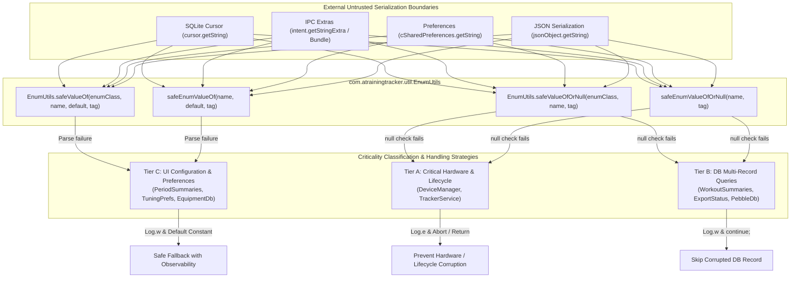

# Stage 3 Implementation Plan: ATT-3562 - Replace Unguarded Enum.valueOf Calls on Cursors, Intents, and Preferences with Safe Deserialization

**Ticket**: [ATT-3562](https://rainerblind.atlassian.net/browse/ATT-3562)  
**Sub-task**: [ATT-3657](https://rainerblind.atlassian.net/browse/ATT-3657) (`[Impl-Plan]`)  
**Parent Epic**: [ATT-235](https://rainerblind.atlassian.net/browse/ATT-235) (*No crashes*)  
**Target Release**: `V4.9.40`  
**Active Sprint**: `Sprint 2026-42.4`  
**Branch**: `feature/ATT-3562`  
**Requirement Mapping**: `REQ-ARC-001`  
**Test Mapping**: `TST-ARC-001`  
**Author**: AI Agent 1 (Implementer)  
**Reviewer / Auditor**: AI Agent 2 (Auditor)  
**Date**: 2026-10-15  

---

## 1. Architectural Overview & Component Decomposition (SWE.2)

---

## 2. Invariants, Criticality Tiers & Guardrails

1. **Zero Uncaught Exception Invariant**:
   Deserialization of external strings (cursor values, intent extras, JSON keys, SharedPreferences) MUST NEVER terminate the process with `NullPointerException` or `IllegalArgumentException`.
2. **Hardware State Safety Invariant (Tier A)**:
   In `DeviceManager` (`Protocol`, `DeviceType`) and `TrackerService` (`StartType`), unparseable or null enum strings MUST trigger `Log.e(TAG, ...)` and gracefully abort rather than defaulting to arbitrary protocols or device types that would trigger invalid radio/hardware operations.
3. **Database Multi-Record Data Integrity Invariant (Tier B)**:
   In SQLite query loops (`WorkoutSummariesDatabaseManager`, `ExportStatusDatabaseManager`, `PebbleDatabaseManager`), rows containing unparseable or null enum strings MUST emit `Log.w(TAG, ...)` and be skipped (`continue;`) rather than injecting ghost records into athlete stats or history.
4. **UI & Configuration Observability Invariant (Tier C)**:
   For UI configuration, dialog arguments, and user preferences (`PeriodSummariesDatabaseManager`, `EquipmentDbHelper`, `TrainingApplication`, `TuningPreferencesDataStore`), invalid or missing strings MUST log `Log.w(TAG, ...)` and fall back to canonical defaults (`PeriodType.WEEK`, `BSportType.UNKNOWN`, `ViewSize.NORMAL`, `MyUnits.METRIC`).
5. **Architectural Guard Invariant**:
   `SafeEnumDeserializationAuditTest.kt` MUST be added to enforce statically that 0 unguarded `Enum.valueOf(cursor.getString...)`, `Enum.valueOf(intent.getStringExtra...)`, etc. exist in production code.
6. **UI Consistency (Rule 23)**:
   No UI additions, user-facing layout changes, or style modifications are introduced in this architectural crash-proofing task.

---

## 3. Atomic Step Sequencing

### Step 1: Implement Canonical Deserialization Utility (`EnumUtils.kt`)
- **Action**: Create `app/src/main/java/com/atrainingtracker/util/EnumUtils.kt`:
  - `EnumUtils.safeValueOf(enumClass, name, defaultValue, tag)`
  - `EnumUtils.safeValueOfOrNull(enumClass, name, tag)`
  - Kotlin extensions `safeEnumValueOf(name, default, tag)` and `safeEnumValueOfOrNull(name, tag)`.
  - Provide whitespace trimming and structured logging (`Log.w`).
- **Target Verification**: Clean compile.

### Step 2: Central Utility Unit Tests (`EnumUtilsTest.kt`)
- **Action**: Create `app/src/test/java/com/atrainingtracker/util/EnumUtilsTest.kt`:
  - Valid constants matching.
  - Whitespace trimming verification.
  - Null input handling (fallback and null).
  - Empty and blank string handling.
  - Unrecognized constant handling.
  - Kotlin inline reified extensions verification.
- **Target Verification**: `./gradlew testDebugUnitTest --tests "com.atrainingtracker.util.EnumUtilsTest"`

### Step 3: Tier A Refactoring (Critical Hardware & Lifecycle State)
- **Action**:
  - `DeviceManager.java`: Replace `Protocol.valueOf(...)` and `DeviceType.valueOf(...)` with `EnumUtils.safeValueOfOrNull`. If null, log `Log.e(TAG, "...")` and abort early.
  - `TrackerService.java`: Replace `StartType.valueOf(...)` with `EnumUtils.safeValueOf(StartType.class, ..., StartType.NORMAL, TAG)`.
- **Target Verification**: Targeted unit tests and clean compile.

### Step 4: Tier B Refactoring (Database Multi-Record Queries)
- **Action**:
  - `WorkoutSummariesDatabaseManager.java`: Replace `SensorType.valueOf(...)` and `ExtremaType.valueOf(...)` with `EnumUtils.safeValueOfOrNull`. If either is null, log warning and `continue;` to skip row.
  - `ExportStatusDatabaseManager.java`: Replace `ExportStatus.valueOf`, `ExportType.valueOf`, `FileFormat.valueOf` with safe deserialization and row skip if corrupt.
  - `PebbleDatabaseManager.java`: Replace `ActivityType.valueOf`, `SensorType.valueOf` with safe deserialization and row skip if corrupt.
- **Target Verification**: Targeted database unit tests.

### Step 5: Tier C Refactoring (UI Configuration, Dialogs & Preferences)
- **Action**:
  - `PeriodSummariesDatabaseManager.kt`: Use `safeEnumValueOf` for `BSportType` and `PeriodType`.
  - `WorkoutClusterDatabaseManager.kt` & `WorkoutClusterEngine.kt`: Use `safeEnumValueOf` for `BSportType`.
  - `EquipmentDbHelper.java`: Use `EnumUtils.safeValueOf` for `BSportType`.
  - `TrackingViewsDatabaseManager.java`: Use `EnumUtils.safeValueOf` for `ActivityType`.
  - `DevicesDatabaseManager.java`: Use `EnumUtils.safeValueOf` for `DeviceType` and `Protocol`.
  - `SportTypeDatabaseManager.java`: Use `EnumUtils.safeValueOf` for `BSportType` and `TTSportType`.
  - `PebbleService.java`: Use `EnumUtils.safeValueOf` for `SensorType`.
  - `SelectSportTypeDialog.java`: Use `EnumUtils.safeValueOf` for `BSportType`.
  - `ConfigViewsFragment.java`: Use `EnumUtils.safeValueOf` for `ActivityType`.
  - `TrackingTabsFragment.kt`: Use `safeEnumValueOf` for `ActivityType`.
  - `DevicesTabbedContainerFragment.kt`: Use `safeEnumValueOf` for `DeviceType`.
  - `TrainingApplication.java`: Use `EnumUtils.safeValueOf` for `Watchapp` and `MyUnits`.
  - `ExportInfo.kt`: Use `safeEnumValueOf` for `FileFormat` and `ExportType`.
  - `StravaUploader.kt`: Use `safeEnumValueOfOrNull` for `BSportType`.
  - `TuningPreferencesDataStore.kt`: Use `safeEnumValueOf` for `ProfileXAxisDomain`, `CockpitFontFamily`, `CockpitFontWeight`.
  - `WorkoutFilterCriteria.kt`: Use `safeEnumValueOfOrNull` for `WorkoutSource`.
- **Target Verification**: Clean compile.

### Step 6: Static Architecture Audit Guard (`SafeEnumDeserializationAuditTest.kt`)
- **Action**: Create `app/src/test/java/com/atrainingtracker/architecture/SafeEnumDeserializationAuditTest.kt`:
  - Scans `app/src/main/java` and `app/src/main/kotlin` for unguarded `valueOf(cursor.getString`, `valueOf(intent.getStringExtra`, `valueOf(arguments.getString`, `valueOf(sharedPreferences.getString`.
  - Asserts 0 violations exist.
- **Target Verification**: `./gradlew testDebugUnitTest --tests "com.atrainingtracker.architecture.SafeEnumDeserializationAuditTest"`

### Step 7: Clean-Room Full Suite Regression Execution
- **Action**: Execute `./gradlew testDebugUnitTest` asserting 100% test pass rate with zero regressions.

### Step 8: Gate 3 Review & Sign-Off
- Update `ATT-3657` description, transition to `in_review`, run Gate 3 review agent audit.
