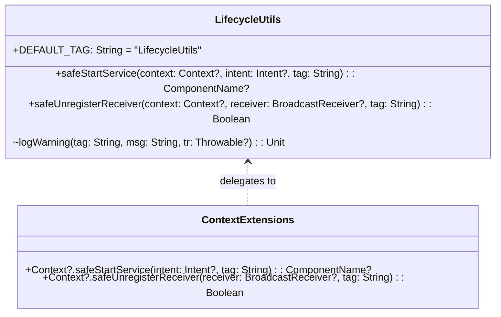

# Stage 3 Implementation Plan: ATT-3563 - Harden Service Launches and BroadcastReceiver Unregistration Against Android Lifecycle Exceptions

**Ticket**: [ATT-3563](https://rainerblind.atlassian.net/browse/ATT-3563)  
**Sub-task**: [ATT-3662](https://rainerblind.atlassian.net/browse/ATT-3662) (`[Implementation Plan]`)  
**Parent Epic**: [ATT-235](https://rainerblind.atlassian.net/browse/ATT-235) (*No crashes*)  
**Target Release**: `V4.9.40`  
**Active Sprint**: `Sprint 2026-42.4`  
**Branch**: `feature/ATT-3563`  
**Requirement Mapping**: `REQ-STB-016` (*Guarded Service Launches and Idempotent BroadcastReceiver Teardown Across Lifecycle Boundaries*)  
**Test Mapping**: `TST-STB-016`  
**Author**: AI Agent 1 (Implementer)  
**Reviewer / Auditor**: AI Agent 2 (Auditor)  
**Date**: 2026-10-15  

---

## 1. Executive Summary & SWE.2 Architecture

The objective of ATT-3563 is to eliminate lifecycle race conditions and background service start exceptions across the Android runtime. We introduce a centralized, high-reliability utility `com.atrainingtracker.util.LifecycleUtils`:

### Architectural Guarantees
1. **Crash Immunity**:
   - `safeStartService` encapsulates `context.startService(intent)` inside `try-catch` catching `IllegalStateException` (including `BackgroundServiceStartNotAllowedException`), `ForegroundServiceStartNotAllowedException`, `SecurityException`, and general `Throwable`. Returns `null` if the OS rejects the start.
   - `safeUnregisterReceiver` encapsulates `context.unregisterReceiver(receiver)` catching `IllegalArgumentException` ("Receiver not registered"), `IllegalStateException`, and general `Throwable`. Returns `false` if not registered or failed.
2. **Observability & Diagnostics**:
   - Both methods log at `WARN` (`Log.w`) severity with structured details (caller tag, target receiver runtime class name, and exception message).
   - Logging is wrapped in a defensive helper that safely falls back when `android.util.Log` is unmocked in local JVM unit test runners.
3. **Null-Safety & Nullability Contract**:
   - `safeStartService` returns `@Nullable ComponentName?`. All callers discard the return value, guaranteeing zero downstream `NullPointerException`.
   - `safeUnregisterReceiver` returns `Boolean` (`true` on success, `false` on skip or exception).

---

## 2. Call-Site Inventory & Migration Scope

### A. Service Launches (4 Sites)
| File | Line | Current Unshielded Call | Migrated Implementation |
| :--- | :--- | :--- | :--- |
| `MainActivityWithNavigation.kt` | 629 | `startService(banalServiceIntent)` | `safeStartService(banalServiceIntent)` |
| `BANALServiceRepository.kt` | 257 | `appContext.startService(intent)` | `appContext.safeStartService(intent)` |
| `TrainingApplication.java` | 356 | `startService(new Intent(this, PebbleServiceBuildIn.class))` | `LifecycleUtils.safeStartService(this, new Intent(this, PebbleServiceBuildIn.class), TAG)` |
| `TrainingApplication.java` | 361 | `startService(new Intent(this, PebbleService.class))` | `LifecycleUtils.safeStartService(this, new Intent(this, PebbleService.class), TAG)` |

### B. BroadcastReceiver Unregistration (35+ Sites)
| Component Category | File | Line | Receivers Handled |
| :--- | :--- | :--- | :--- |
| **Activities & Fragments** | `MainActivityWithNavigation.kt` | 764–785 | `mStartTrackingReceiver`, `mPauseTrackingReceiver`, `mStopTrackingReceiver`, `mTrackingStoppedReceiver`, `mAntDependencyReceiver`, `mAntAdapterMissingReceiver` |
| | `EquipmentFragment.kt` | 106 | `syncReceiver` |
| | `ConfigViewsFragment.java` | 258 | `mNameChangedReceiver` |
| **Services & App** | `TrainingApplication.java` | 1560–1566 | `mStopTrackingReceiver`, `mStartTrackingReceiver`, `mTrackingStartedReceiver`, `mTrackingStoppedReceiver`, `mSearchingFinishedReceiver`, `mSearchingStartedReceiver` |
| | `TrackerService.java` | 733–736 | `mSearchingFinishedReceiver`, `mAltitudeCorrectionReceiver`, `mLapSummaryReceiver`, `mUserSelectedSportTypeChangedReceiver` |
| | `BANALService.java` | 521–522 | `mNewLapReceiver`, `mStartSearchForPairedDevices` |
| | `PebbleService.java` | 398–406, 550–560 | `mConfigurePebbleWatchAppReceiver`, `mUpdatePebbleReceiver`, `mPebbleConnectedReceiver`, `mPauseReceiver`, `mResumeReceiver`, `mLapSummaryReceiver`, `mStartSearchingReceiver`, `mEndSearchingReceiver`, `mPebbleDataReceiver`, `pebbleAckReceiver`, `pebbleNackReceiver` |
| | `PebbleServiceBuildIn.java` | 149–150 | `mUpdatePebbleReceiver`, `mSearchingFinishedReceiver` |
| **Device & Sensor Classes**| `DeviceManager.java` | 445–449 | `mPairingChangedReceiver`, `mSearchingStoppedForOneReceiver`, `mStartSearchingForNewDevicesReceiver`, `mStopSearchingForNewDevicesReceiver` |
| | `MyDevice.java` | 236 | `resetAccumulatorsReceiver` |
| | `BatteryDevice.java` | 351, 355 | `mBatteryReceiver`, `mTimeEventReceiver` |
| | `MyRemoteDevice.java` | 104 | `mCalibrationFactorChangedReceiver` |
| | `AltitudeFromPressureDevice.java`| 120 | `mGPSProviderEnabledReceiver` |
| | `FilterManager.java` | 169, 175 | `mSensorsChangedReceiver`, `mResetAccumulatorsReceiver` |
| **ViewModels / Repos** | `DevicesTabbedViewModel.kt` | 237 | `deviceDiscoveryReceiver` |
| | `ExportStatusRepository.kt` | 112 | `receiver` |
| | `SensorGridScreen.kt` | 206 | `receiver` |

---

## 3. Atomic Implementation Steps

### Step 1: Core Engine Implementation (`LifecycleUtils.kt`)
- File: `app/src/main/java/com/atrainingtracker/util/LifecycleUtils.kt`
- Implements:
  - `safeStartService(context: Context?, intent: Intent?, tag: String = DEFAULT_TAG): ComponentName?`
  - `safeUnregisterReceiver(context: Context?, receiver: BroadcastReceiver?, tag: String = DEFAULT_TAG): Boolean`
  - Kotlin extension functions on `Context?`.
  - Resilient `logWarning` helper catching unmocked `Log.w` exceptions during local JVM tests.

### Step 2: Unit Test Suite (`LifecycleUtilsTest.kt`)
- File: `app/src/test/java/com/atrainingtracker/util/LifecycleUtilsTest.kt`
- Tests:
  - Normal successful `startService` and `unregisterReceiver`.
  - Null inputs for context, intent, and receiver.
  - Mocked exceptions: `IllegalStateException`, `SecurityException`, `IllegalArgumentException`.
  - Verification of `Log.w` dispatches.

### Step 3: Static Architecture Contract Guard & CLI Linter
- File 1: `tools/lint_lifecycle_safety.py`
  - Scans `app/src/main` for regex `(?<!safe)unregisterReceiver\s*\(` and `(?<!safe)startService\s*\(` outside `LifecycleUtils.kt`.
- File 2: `app/src/test/java/com/atrainingtracker/architecture/LifecycleServiceReceiverSafetyAuditTest.kt`
  - JUnit test asserting 0 unshielded call sites exist in `app/src/main`.

### Step 4: Call-Site Migration
- Migrate all 4 `startService` sites using `LifecycleUtils.safeStartService` (or extension).
- Migrate all 35+ `unregisterReceiver` sites using `LifecycleUtils.safeUnregisterReceiver` (or extension).

### Step 5: Verification & Full Clean-Room Regression
- Execute targeted tests:
  `./gradlew testDebugUnitTest --tests "com.atrainingtracker.util.LifecycleUtilsTest" --tests "com.atrainingtracker.architecture.LifecycleServiceReceiverSafetyAuditTest"`
- Execute CLI linter:
  `python3 tools/lint_lifecycle_safety.py`
- Execute full regression suite:
  `./gradlew testDebugUnitTest`

---

## 4. Invariants & Safety Measures

1. **Non-Regressive Bounded Operations**: `BANALService` bounded connectivity via `bindService(..., BIND_AUTO_CREATE)` remains fully operational even if `safeStartService` returns null due to background OS policy.
2. **Idempotence**: Receiver teardown can be executed repeatedly or on uninitialized components without risk of process crash.
3. **Strict CI/CD Enforcement**: The architecture contract test is integrated directly into the standard `./gradlew testDebugUnitTest` suite.
