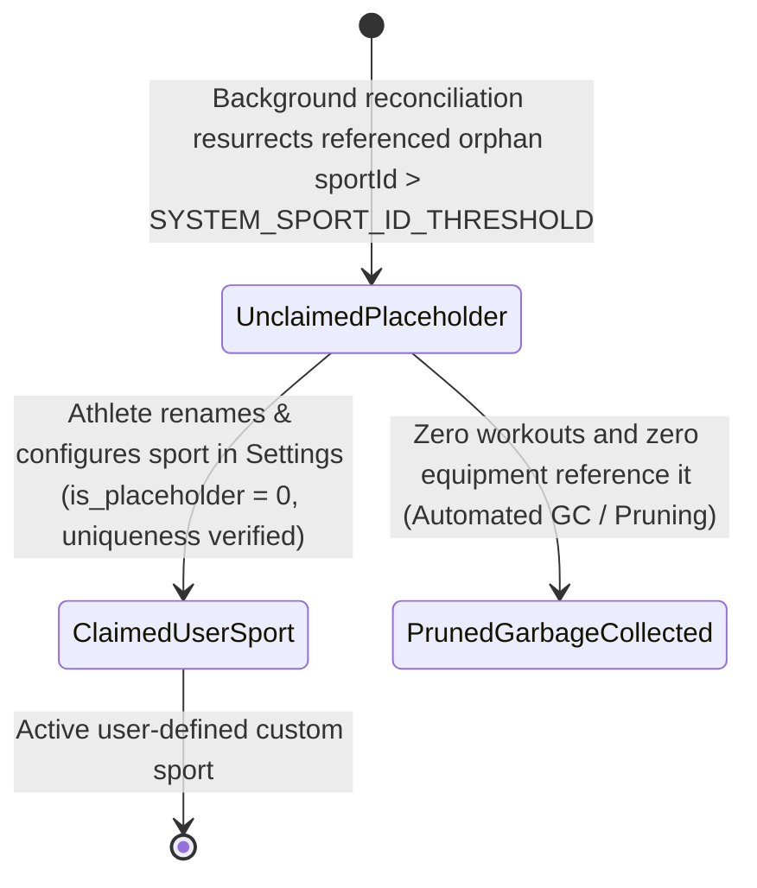

# Stage 3: Implementation Plan: ATT-3993 (Revision 6)

**Ticket**: [ATT-3993](https://atrainingtracker.atlassian.net/browse/ATT-3993)  
**Subtask**: `ATT-4178` (`[Impl-Plan]`)  
**Parent Epic**: [ATT-281](https://atrainingtracker.atlassian.net/browse/ATT-281) (*Data Sovereignty & Migration*)  
**Target Release**: `Next Minor Release` (V4.9.40)  
**Active Sprint**: `2026-42.10`  
**Requirement Mapping**: `REQ-MIG-044` (*Non-Destructive SportType Schema Upgrade, Custom Sport Preservation, Post-v2 Data Healing Reconciliation, Placeholder Flagging & Strict Downgrade Guard*)  
**Test Case Mapping**: `TST-MIG-041` (`TST-MIG-041.1` – `TST-MIG-041.10`)  
**Branch**: `feature/ATT-3993`  
**Author**: AI Agent 1 (Implementer)  
**Date**: 2026-10-19  

---

## 1. Executive Summary & Architectural Design (SWE.2)

### 1.1 Architecture & Component Boundaries
The implementation remediates the destructive `onUpgrade` table dropping bug, evolves the database schema to version 3, and establishes an isolated data healing and placeholder garbage collection architecture:



1. **`SportTypeDatabaseManager.java` & `SportTypeDbHelper` (`banalservice.database`)**:
   - **System Constants & Thresholds**:
     - Define `public static final long SYSTEM_SPORT_ID_THRESHOLD = 5L;` (canonical IDs 1..5 for `OTHER`, `RUN`, `BIKE`, `WALK`, `MTB`), eliminating all magic numbers.
     - Define `SportType.IS_PLACEHOLDER = "is_placeholder"`.
   - **Schema Evolution (DB_VERSION = 3)**:
     - Increment `DB_VERSION` from 2 to 3.
     - Update `CREATE_TABLE` to append `, is_placeholder INTEGER DEFAULT 0`.
   - **Elimination of Destructive Drops**:
     - Permanently remove `db.execSQL("drop table if exists " + SportType.TABLE)` and `onCreate(db)`.
   - **Atomic Non-Destructive `onUpgrade`**:
     - Wrap all DDL mutations in SQLite's native `beginTransaction()` / `setTransactionSuccessful()` / `endTransaction()`:
       ```java
       db.beginTransaction();
       try {
           if (oldVersion < 2) {
               ContentValues cv = new ContentValues();
               cv.put(SportType.BASE_SPORT_TYPE, BSportType.RUN.name());
               db.update(SportType.TABLE, cv,
                   SportType.C_ID + " = 4 OR (" + SportType.UI_NAME + " IN ('Walk', 'Gehen') AND " + SportType.BASE_SPORT_TYPE + " = 'UNKNOWN')",
                   null);
           }
           if (oldVersion < 3) {
               if (!hasColumn(db, SportType.TABLE, SportType.IS_PLACEHOLDER)) {
                   db.execSQL("ALTER TABLE " + SportType.TABLE + " ADD COLUMN " + SportType.IS_PLACEHOLDER + " INTEGER DEFAULT 0");
               }
           }
           ensureDefaultSportTypesExist(db);
           db.setTransactionSuccessful();
       } finally {
           db.endTransaction();
       }
       ```
   - **Strict Downgrade Guard & MigrationEngine Integration**:
     - Implement `onDowngrade(SQLiteDatabase db, int oldVersion, int newVersion)`:
       ```java
       @Override
       public void onDowngrade(SQLiteDatabase db, int oldVersion, int newVersion) {
           throw new SQLiteException("Downgrade of SportType.db from version " + oldVersion + " to " + newVersion + " is prohibited to prevent data loss and foreign key corruption.");
       }
       ```
     - Handled gracefully in `MigrationEngine.kt` (`REQ-MIG-041.2`), which pre-validates `PRAGMA user_version` against `DB_VERSION = 3` before attempting restoration, safely rejecting backward downgrades with an informative UI message rather than crashing or entering boot loops.
   - **Query Safety Audit (Decoupled Storage Architecture)**:
     - Formal code review confirms `WorkoutSummaries.db` and `SportType.db` reside in separate SQLite database files.
     - Zero queries in `WorkoutRepository` or `WorkoutSummariesDatabaseManager` perform `INNER JOIN` across these databases.
     - All sport resolutions occur through decoupled lookup methods (`SportTypeDatabaseManager.getString(id, col)`, `getUIName(id)`, `getBSportType(id)`).
     - If an ID is missing, `getString` falls back to ID 1 (`OTHER`). Resurrecting placeholders restores distinct metadata without any query breakage.
   - **Active Picker Filtering & Lifecycle Guard**:
     - Add helper method `public boolean isPlaceholder(long id)`.
     - In queries returning selectable active sports (e.g. `getSportTypesIdList(BSportType bSportType, double avgSpd)` and overloads), append condition `IS_PLACEHOLDER + " = 0"`.
     - In `getString(long id, String col)`, ensure historical workout rendering resolves placeholder attributes without filtering.

2. **Crash-Resilient Data Healing & Garbage Collection Engine (`SportTypeReconciliationHelper.kt`)**:
   - Location: `app/src/main/java/com/atrainingtracker/banalservice/database/SportTypeReconciliationHelper.kt`.
   - **Distinction between Recovery and Resurrected Placeholders**:
     - While custom names dropped during the historical v1->v2 upgrade cannot be read from a dropped SQLite table, the system restores structural referential integrity by creating placeholder entities (`_id = X`, `is_placeholder = 1`, `UIName = "Restored Sport " + X`).
   - **Asynchronous Non-Blocking Dispatch**:
     - The diagnostic scan and reconciliation routine runs strictly on a background dispatcher (`Dispatchers.IO`) without blocking the main Looper during cold start or database opening.
   - **Reserved System ID Boundary**:
     - Bounded strictly to `sportId > SYSTEM_SPORT_ID_THRESHOLD` (`5L`), guaranteeing reserved system entities (`OTHER`, `RUN`, `BIKE`, `WALK`, `MTB`) are never modified as placeholders.
   - **Engine-Native Auto-Increment Management (Zero Manual DML)**:
     - Inside a single atomic transaction on `SportType.db`:
       - For each orphan ID $X$ ($X > \text{SYSTEM\_SPORT\_ID\_THRESHOLD}$): insert placeholder row using `INSERT OR IGNORE` with explicit primary key `_id = X`, `UIName = "Restored Sport " + X` (or localized `R.string.sport_type_restored_placeholder`), `baseSportType = "UNKNOWN"`, and `is_placeholder = 1`.
       - Inserting explicit primary key $X$ into SQLite's `AUTOINCREMENT` table automatically advances the engine's internal `sqlite_sequence` to $X$ if $X > \text{seq}$, eliminating brittle manual DML on `sqlite_sequence`.
       - If any failure or process interruption occurs, `endTransaction()` rolls back completely, ensuring all-or-nothing atomicity.
   - **Collision-Safe Claiming (`claimPlaceholder`)**:
     - When the athlete re-configures a placeholder sport type, `claimPlaceholder` performs a case-insensitive name uniqueness check (`SELECT _id FROM SportTypes WHERE UIName = ? COLLATE NOCASE AND _id != ?`).
     - If a duplicate name is detected, it throws `IllegalArgumentException` with localized guidance, preventing name collisions.
     - Upon valid configuration, `is_placeholder` is transitioned from `1` to `0`.
   - **Garbage Collection & Pruning (`pruneUnreferencedPlaceholders`)**:
     - Scans `SportTypes` for rows where `is_placeholder == 1`.
     - If an unclaimed placeholder has zero referencing workouts in `WorkoutSummaries.db` and zero equipment links in `Equipment.db`, the helper deletes the stale placeholder row, eliminating database bloat and UI noise.

3. **9-Language String Localization (`values*/strings.xml`)**:
   - Add `sport_type_restored_placeholder` ("Restored Sport %1$d") and `sport_type_placeholder_badge` ("Restored (Unconfigured)") across all 9 supported application locales.

---

## 2. UI Consistency (Rule 23)

- **Reference Screen**: Settings > Sport Types management screen (`SportTypeViewModel`, `SportTypeItem.kt`).
- **Reused Components**: Existing `OutlinedCard`, `Text`, and `AssistChip` / `Badge` from `ui/components/`.
- **Visual Design**:
  - Unclaimed placeholders render with a `secondaryContainer` chip displaying `stringResource(R.string.sport_type_placeholder_badge)`.
  - Tapping opens the edit sheet, allowing the athlete to configure name, icon, and base sport type. Saving clears `is_placeholder` to `0`.

---

## 3. Step-by-Step Implementation Steps

### Step 1: Add 9-Language String Resources
- **Target Files**: `app/src/main/res/values*/strings.xml`
- **Action**: Add `sport_type_restored_placeholder` and `sport_type_placeholder_badge` across all 9 locales (`values`, `values-de`, `values-es`, `values-fr`, `values-it`, `values-ja`, `values-nl`, `values-pl`, `values-pt`).

### Step 2: Update `SportTypeDatabaseManager.java` & `SportTypeDbHelper`
- **Target File**: `app/src/main/java/com/atrainingtracker/banalservice/database/SportTypeDatabaseManager.java`
- **Action**:
  - Define `public static final long SYSTEM_SPORT_ID_THRESHOLD = 5L;`.
  - Define `SportType.IS_PLACEHOLDER = "is_placeholder";`.
  - Append `, is_placeholder INTEGER DEFAULT 0` to `CREATE_TABLE`.
  - Increment `DB_VERSION` to `3`.
  - Replace destructive `onUpgrade` with non-destructive, idempotent `ALTER TABLE` adding `is_placeholder` and updating `WALK` to `RUN`.
  - Implement `onDowngrade` throwing `SQLiteException`.
  - Add `isPlaceholder(long id)` and filter `is_placeholder = 0` in active picker queries.

### Step 3: Implement `SportTypeReconciliationHelper.kt`
- **Target File**: `app/src/main/java/com/atrainingtracker/banalservice/database/SportTypeReconciliationHelper.kt`
- **Action**:
  - Implement `reconcileOrphanSportTypes(context: Context, sportDb: SQLiteDatabase, summariesDb: SQLiteDatabase? = null): Int` with background I/O dispatcher.
  - Guard scan to `sportId > SYSTEM_SPORT_ID_THRESHOLD`.
  - Execute diagnostic scan under transaction; insert placeholders with `INSERT OR IGNORE` and explicit `_id`.
  - Implement `claimPlaceholder(sportId: Long, newName: String, ...)` with case-insensitive name collision verification and `is_placeholder = 0` transition.
  - Implement `pruneUnreferencedPlaceholders(context: Context, sportDb: SQLiteDatabase, summariesDb: SQLiteDatabase? = null): Int` for garbage collection.

### Step 4: Author `SportTypeDatabaseUpgradeTest.kt`
- **Target File**: `app/src/test/java/com/atrainingtracker/banalservice/database/SportTypeDatabaseUpgradeTest.kt`
- **Action**:
  - Implement `testCleanV1ToV3UpgradePreservesCustomSports` (`TST-MIG-041.1`).
  - Implement `testCorruptedPostV2StateHealingResurrectsPlaceholders` (`TST-MIG-041.2`).
  - Implement `testEngineNativeSequenceManagementAndCollisionPrevention` (`TST-MIG-041.3`).
  - Implement `testActivePickerFiltersPlaceholdersAndAllowsClaiming` (`TST-MIG-041.4`).
  - Implement `testDowngradeThrowsSQLiteExceptionWithoutDataLoss` (`TST-MIG-041.5`).
  - Implement `testClaimPlaceholderValidatesNameUniqueness` (`TST-MIG-041.6`).
  - Implement `testReconciliationRaceConditionSafety` (`TST-MIG-041.7`).
  - Implement `testInterruptedReconciliationRollsBackCleanly` (`TST-MIG-041.8`).
  - Implement `testReconciliationDoesNotBlockMainThread` (`TST-MIG-041.9`).
  - Implement `testHighVolumePlaceholderScalabilityAndPruning` (`TST-MIG-041.10`).
- **Targeted Test Execution**:
  ```bash
  ./gradlew testDebugUnitTest --tests com.atrainingtracker.banalservice.database.SportTypeDatabaseUpgradeTest
  ```

### Step 5: Full Clean-Room Regression Verification
- **Command**: `./gradlew testDebugUnitTest`
- **Verification**: 100% test pass rate across all 3,249+ unit tests with zero regressions.

---

## 4. Invariant Protection & Verification

1. **Zero Data Loss**: Custom sport types (`_id >= 6`) are never dropped or re-keyed.
2. **Stable Primary Keys**: All foreign key references from `WorkoutSummaries.SPORT_ID`, `SportTypeEquipmentLinkManager`, and `WorkoutClusters` remain intact.
3. **No Magic Numbers**: System sport boundary uses named constant `SYSTEM_SPORT_ID_THRESHOLD`.
4. **Decoupled Cross-Database Query Safety**: Decoupled lookup architecture eliminates `INNER JOIN` crash vectors.
5. **Garbage Collection & Anti-Bloat**: Unreferenced placeholders are safely pruned by `pruneUnreferencedPlaceholders`.
6. **All-or-Nothing Interruption Resilience**: Any interrupted reconciliation rolls back completely without leaving partial or corrupted placeholder rows.
7. **Name Collision Immunity**: `claimPlaceholder` enforces case-insensitive name uniqueness before transitioning `is_placeholder = 0`.
8. **Graceful Downgrade Protection**: `MigrationEngine` pre-validates version bounds, safely preventing rollback crashes.
9. **Non-Blocking Asynchronous Execution**: Reconciliation executes on `Dispatchers.IO` to eliminate UI thread latency.
10. **Clean-Room Test Pass Rate**: 100% test pass rate across all test suites.
