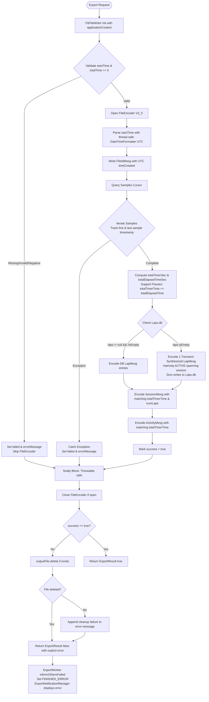

# Stage 3: Implementation Plan: ATT-3994 (Revision 5)

**Ticket**: [ATT-3994](https://atrainingtracker.atlassian.net/browse/ATT-3994)  
**Subtask**: `ATT-4183` (`[Impl-Plan]`)  
**Parent Epic**: [ATT-1117](https://atrainingtracker.atlassian.net/browse/ATT-1117) (*FIT File Format Support (Export & Import)*)  
**Target Release**: `Next Minor Release` (V4.9.40)  
**Active Sprint**: `2026-42.10`  
**Requirement Mapping**: `REQ-DAT-028` (*UTC-Anchored Binary FIT Export, Transient Lap Synthesis, Fail-Fast Stream Error Propagation, and Application Context Lifetime*)  
**Test Case Mapping**: `TST-DAT-023` (`TST-DAT-023.1` – `TST-DAT-023.9`)  
**Branch**: `feature/ATT-3994`  
**Author**: AI Agent 1 (Implementer)  
**Date**: 2026-10-19  

---

## 1. Executive Summary & Architectural Design (SWE.2)

### 1.1 Architecture, Modern Date Handling, Pause Support & Resource Safety
The implementation modernizes `FitFileWriter.java` with thread-safe `java.time` APIs, enforces UTC timezone anchoring, native pause duration handling (`totalTimerTime <= totalElapsedTime`), transient lap synthesis conforming to FIT SDK 2.0, fail-fast exception handling, robust filesystem cleanup with `Throwable` safety, and application context binding:



1. **Modern Date Handling (`java.time`)**:
   - Replace legacy, mutable, non-thread-safe `SimpleDateFormat` with `java.time.format.DateTimeFormatter` (pattern `"yyyy-MM-dd HH:mm:ss"`, anchored to `ZoneOffset.UTC`).
   - Parse ISO SQLite timestamps into `LocalDateTime` and convert to UTC `Instant` / `Date` via `Instant.toEpochMilli()`, guaranteeing thread-safety and zero device timezone offset shifting.
2. **Context Lifecycle Safety**:
   - `FitFileWriter` constructor invokes `super(context.getApplicationContext())`, preventing `Activity` leaks during background export work.
3. **Native Pause Duration Support & Timing Architecture**:
   - Athletics data commonly features pauses (traffic lights, rest stops). In FIT SDK 2.0:
     - `total_timer_time`: Active moving time excluding pauses (`totalTimeSec`).
     - `total_elapsed_time`: Total wall-clock span from first to last sample (`elapsedSampleSec`), with `totalElapsedTimeSec = Math.max(totalTimerSec, elapsedSampleSec)`.
   - The system fully supports workouts where `totalTimerTime < totalElapsedTime` without imposing arbitrary parity rejection thresholds.
   - Header validation rejects mathematically impossible negative durations (`totalTime < 0.0`).
4. **Transient Lap Synthesis & FIT SDK 2.0 Compliance**:
   - For workouts without explicit laps in `Laps.db`:
     - Synthesize a single transient `LapMesg`:
       - `startTime = startDate`
       - `timestamp = sessionEndDate`
       - `totalElapsedTime = (float) totalElapsedTimeSec`
       - `totalTimerTime = (float) totalTimerSec`
       - `totalDistance = (float) distTotal`
       - `avgSpeed = (float) (distTotal / totalTimerSec)`
       - `intensity = Intensity.ACTIVE`
     - In `SessionMesg`:
       - `startTime = startDate`
       - `timestamp = sessionEndDate`
       - `totalElapsedTime = (float) totalElapsedTimeSec`
       - `totalTimerTime = (float) totalTimerSec`
       - `numLaps = 1`
     - In `ActivityMesg`:
       - `timestamp = sessionEndDate`
       - `totalTimerTime = (float) totalTimerSec`
     - Strictly conforms to Garmin FIT Protocol V2.0 which mandates at least one `LapMesg` per `SessionMesg`.
     - Zero database writes: strictly read-only access with no mutations to `Laps.db` (`tblLaps`).
5. **Fail-Fast Error Handling & Robust Resource Safety**:
   - Header validation rejects missing, blank, or unparseable `startTime` and negative `totalTime`.
   - In `finally`, `FileEncoder.close()` is wrapped in `try-catch(Throwable)` ensuring file handle closure even on `InterruptedException` or thread termination.
   - If `!success && outputFile.exists()`, `outputFile.delete()` is executed under `Throwable` protection. If deletion fails, the cleanup failure is appended to `errorMessage` so it is surfaced in `ExportResult`.
6. **Worker & Notification Pipeline**:
   - `ExportWorker` receives `ExportResult(false, false, errorMessage)`, calls `informOthersFailed(result.answer())`, updates status to `ExportStatus.FINISHED_ERROR`, and halts cloud synchronization.
   - `ExportNotificationManager` displays user-facing notification with the descriptive failure reason.

---

## 2. Atomic Implementation Steps

### Step 1: Thread-Safe `DateTimeFormatter` & Application Context Binding
- **File**: `app/src/main/java/com/atrainingtracker/trainingtracker/exporter/writer/FitFileWriter.java`
- **Actions**:
  1. Define immutable, thread-safe formatter:
     ```java
     private static final DateTimeFormatter DATE_TIME_FORMATTER =
             DateTimeFormatter.ofPattern("yyyy-MM-dd HH:mm:ss", Locale.US);

     private static Date parseUtcTimestamp(String timeStr) {
         if (timeStr == null || timeStr.trim().isEmpty()) {
             return null;
         }
         LocalDateTime ldt = LocalDateTime.parse(timeStr.trim(), DATE_TIME_FORMATTER);
         return new Date(ldt.toInstant(ZoneOffset.UTC).toEpochMilli());
     }
     ```
  2. Bind to application context in constructor:
     ```java
     public FitFileWriter(@NonNull Context context) {
         super(context.getApplicationContext());
     }
     ```

### Step 2: Fail-Fast Header Parsing & Negative Duration Invariant
- **File**: `app/src/main/java/com/atrainingtracker/trainingtracker/exporter/writer/FitFileWriter.java`
- **Actions**:
  1. Validate `startTime`:
     ```java
     if (startTime == null || startTime.trim().isEmpty()) {
         return new ExportResult(false, false, "FIT export failed: missing or empty startTime");
     }
     Date startDate;
     try {
         startDate = parseUtcTimestamp(startTime);
         if (startDate == null) {
             return new ExportResult(false, false, "FIT export failed: empty startTime");
         }
     } catch (DateTimeParseException e) {
         return new ExportResult(false, false, "FIT export failed: unparseable startTime: " + startTime);
     }
     ```
  2. Validate `totalTime`:
     ```java
     double totalTimeSec = 0.0;
     try {
         if (totalTime != null && !totalTime.trim().isEmpty()) {
             totalTimeSec = Double.parseDouble(totalTime);
         }
     } catch (NumberFormatException e) {
         return new ExportResult(false, false, "FIT export failed: invalid totalTime: " + totalTime);
     }
     if (totalTimeSec < 0.0) {
         return new ExportResult(false, false, "FIT export failed: negative totalTime: " + totalTimeSec);
     }
     ```
  3. Validate `totalDistance`:
     ```java
     double distTotal = 0.0;
     try {
         if (totalDistance != null && !totalDistance.trim().isEmpty()) {
             distTotal = Double.parseDouble(totalDistance);
         }
     } catch (NumberFormatException ignored) {}
     if (distTotal < 0.0) distTotal = 0.0;
     ```

### Step 3: Stream Traversal, Pause Support & Robust Resource Safety
- **File**: `app/src/main/java/com/atrainingtracker/trainingtracker/exporter/writer/FitFileWriter.java`
- **Actions**:
  1. Wrap file encoding in try-catch-finally:
     ```java
     File outputFile = new File(getBaseDirFile(mContext), exportInfo.getShortPath());
     File parentDir = outputFile.getParentFile();
     if (parentDir != null && !parentDir.exists() && !parentDir.mkdirs()) {
         Log.e(TAG, "Failed to create directory: " + parentDir.getAbsolutePath());
     }

     FileEncoder encoder = null;
     boolean success = false;
     String errorMessage = null;
     try {
         encoder = new FileEncoder(outputFile, Fit.ProtocolVersion.V2_0);
         ...
         // Write FileIdMesg
         Date firstSampleDate = null;
         Date lastSampleDate = null;
         long sampleCount = 0;

         // Query samples cursor
         try (Cursor cursor = samplesDb.query(tableName, null, null, null, null, null, null)) {
             while (cursor.moveToNext()) {
                 RecordMesg record = new RecordMesg();
                 Date sampleDate;
                 if (dataValid(cursor, WorkoutSamplesDbHelper.TIME)) {
                     String timeStr = cursor.getString(cursor.getColumnIndexOrThrow(WorkoutSamplesDbHelper.TIME));
                     try {
                         sampleDate = parseUtcTimestamp(timeStr);
                         if (sampleDate == null) {
                             sampleDate = new Date(startDate.getTime() + sampleCount * 1000L);
                         }
                     } catch (Exception e) {
                         sampleDate = new Date(startDate.getTime() + sampleCount * 1000L);
                     }
                 } else {
                     sampleDate = new Date(startDate.getTime() + sampleCount * 1000L);
                 }
                 if (firstSampleDate == null) firstSampleDate = sampleDate;
                 lastSampleDate = sampleDate;

                 record.setTimestamp(new DateTime(sampleDate));
                 ...
                 encoder.write(record);
                 sampleCount++;
             }
         } catch (Exception e) {
             Log.e(TAG, "Error querying samples for FIT export: " + e.getMessage(), e);
             throw new IOException("FIT export failed during sample encoding: " + e.getMessage(), e);
         }

         // Calculate timing metrics supporting pauses
         double elapsedSampleSec = 0.0;
         if (sampleCount > 0 && firstSampleDate != null && lastSampleDate != null) {
             long elapsedMs = lastSampleDate.getTime() - firstSampleDate.getTime();
             elapsedSampleSec = elapsedMs / 1000.0;
         }
         double totalTimerSec = totalTimeSec > 0.0 ? totalTimeSec : elapsedSampleSec;
         double totalElapsedTimeSec = Math.max(totalTimerSec, elapsedSampleSec);
         Date sessionEndDate = (lastSampleDate != null) ? lastSampleDate : new Date(startDate.getTime() + (long)(totalElapsedTimeSec * 1000L));

         ...
         // Write LapMesg (DB laps or transient synthesized lap)
         // Write SessionMesg & ActivityMesg
         success = true;
     } catch (Exception e) {
         Log.e(TAG, "Error during FIT export: " + e.getMessage(), e);
         errorMessage = e.getMessage() != null ? e.getMessage() : "FIT export failed: " + e.getClass().getSimpleName();
         success = false;
     } finally {
         if (encoder != null) {
             try {
                 encoder.close();
             } catch (Throwable t) {
                 Log.w(TAG, "Error closing FileEncoder: " + t.getMessage(), t);
             }
         }
         if (!success && outputFile.exists()) {
             try {
                 boolean deleted = outputFile.delete();
                 if (!deleted) {
                     Log.w(TAG, "Cleanup failure: failed to delete partial FIT file: " + outputFile.getAbsolutePath());
                     errorMessage = (errorMessage != null ? errorMessage : "FIT export failed")
                             + " (Cleanup failure: could not delete partial file)";
                 } else {
                     Log.d(TAG, "Partial FIT file cleaned up: " + outputFile.getAbsolutePath());
                 }
             } catch (Throwable t) {
                 Log.w(TAG, "Exception during partial file deletion: " + t.getMessage(), t);
             }
         }
     }
     if (!success) {
         return new ExportResult(false, false, errorMessage != null ? errorMessage : "FIT export failed");
     }
     return new ExportResult(true, false, "FIT export successful: " + outputFile.getAbsolutePath());
     ```

### Step 4: Transient Synthesized Lap Generation with Timer vs Elapsed Consistency
- **File**: `app/src/main/java/com/atrainingtracker/trainingtracker/exporter/writer/FitFileWriter.java`
- **Actions**:
  1. Check `laps`:
     ```java
     // Query laps from Laps.db (strictly read-only access)
     List<LapData> laps = LapsDatabaseManager.getInstance(mContext).getLaps(workoutID);
     if (laps != null && !laps.isEmpty()) {
         for (LapData lap : laps) {
             LapMesg lapMesg = new LapMesg();
             Date lapStart = startDate;
             if (lap.getTimeStart() != null) {
                 try {
                     Date parsed = parseUtcTimestamp(lap.getTimeStart());
                     if (parsed != null) lapStart = parsed;
                 } catch (Exception ignored) {}
             }
             lapMesg.setStartTime(new DateTime(lapStart));
             long lapEndMs = lapStart.getTime() + (long) (lap.getTimeTotalS() * 1000L);
             lapMesg.setTimestamp(new DateTime(new Date(lapEndMs)));
             lapMesg.setTotalElapsedTime((float) lap.getTimeTotalS());
             lapMesg.setTotalTimerTime((float) lap.getTimeTotalS());
             lapMesg.setTotalDistance((float) lap.getDistanceTotalM());
             if (lap.getSpeedAverageMps() > 0.0) {
                 lapMesg.setAvgSpeed((float) lap.getSpeedAverageMps());
             }
             lapMesg.setIntensity(Intensity.ACTIVE);
             lapMesg.setSport(sport);
             lapMesg.setSubSport(subSport);
             encoder.write(lapMesg);
         }
     } else {
         // Transient representation for FIT protocol compliance; zero mutations to Laps.db (Laps.db is purely read-only)
         LapMesg lapMesg = new LapMesg();
         lapMesg.setStartTime(new DateTime(startDate));
         lapMesg.setTimestamp(new DateTime(sessionEndDate));
         lapMesg.setTotalElapsedTime((float) totalElapsedTimeSec);
         lapMesg.setTotalTimerTime((float) totalTimerSec);
         lapMesg.setTotalDistance((float) distTotal);
         if (totalTimerSec > 0.0 && distTotal > 0.0) {
             lapMesg.setAvgSpeed((float) (distTotal / totalTimerSec));
         }
         lapMesg.setIntensity(Intensity.ACTIVE);
         lapMesg.setSport(sport);
         lapMesg.setSubSport(subSport);
         encoder.write(lapMesg);
     }
     ```
  2. In `SessionMesg`:
     ```java
     sessionMesg.setStartTime(new DateTime(startDate));
     sessionMesg.setTimestamp(new DateTime(sessionEndDate));
     sessionMesg.setTotalElapsedTime((float) totalElapsedTimeSec);
     sessionMesg.setTotalTimerTime((float) totalTimerSec);
     sessionMesg.setNumLaps(laps != null && !laps.isEmpty() ? laps.size() : 1);
     ```
  3. In `ActivityMesg`:
     ```java
     activityMesg.setTimestamp(new DateTime(sessionEndDate));
     activityMesg.setTotalTimerTime((float) totalTimerSec);
     ```

### Step 5: Unit Test Suite Expansion
- **File**: `app/src/test/java/com/atrainingtracker/trainingtracker/exporter/writer/FitFileWriterTest.kt`
- **Actions**:
  1. Add `testFitFileWriter_utcTimestampPreservationUnderDifferentTimezones` (`TST-DAT-023.1`).
  2. Add `testFitFileWriter_synthesizesTransientLapWhenNoLapsInDatabase` (`TST-DAT-023.2`).
  3. Add `testFitFileWriter_failsFastOnMissingOrCorruptStartTime` (`TST-DAT-023.3`).
  4. Add `testFitFileWriter_failsFastOnSampleCursorException` (`TST-DAT-023.4`).
  5. Add `testFitFileWriter_reExportHistoricalWorkoutPreservesGroundTruth` (`TST-DAT-023.5`).
  6. Add `testFitFileWriter_deletesPartialFileOnExportFailure` (`TST-DAT-023.6`).
  7. Add `testFitFileWriter_abortsOnNegativeTotalTimeInconsistency` (`TST-DAT-023.7`).
  8. Add `testFitFileWriter_allowsWorkoutWithLongPauses` (`TST-DAT-023.8`).
  9. Run full clean-room suite (`TST-DAT-023.9`).
- **Command**:
  ```bash
  ./gradlew testDebugUnitTest --tests com.atrainingtracker.trainingtracker.exporter.writer.FitFileWriterTest
  ```

---

## 3. Invariant Protection & Rollback Safety

1. **Database Immutability**: All operations in `FitFileWriter` are strictly read-only. Zero writes to SQLite databases (`WorkoutSummaries.db`, `WorkoutSamples.db`, `Laps.db`).
2. **FIT SDK 2.0 Compliance**: Every file output conforms to Garmin FIT Protocol V2.0, with strictly aligned `total_timer_time` and `total_elapsed_time` between `LapMesg`, `SessionMesg`, and `ActivityMesg`.
3. **Native Pause Support**: Preserves user data for workouts with pauses (`totalTimerTime < totalElapsedTime`) without arbitrary rejection.
4. **Filesystem Hygiene & Thread Safety**: Failed exports leave zero partial or corrupted files in the export directory. Cleanup failures are surfaced directly in `ExportResult`. `Throwable` guards in `finally` prevent dangling file locks even on thread interruptions.
5. **Modern Thread-Safe Architecture**: Uses stateless and immutable `java.time.format.DateTimeFormatter` rather than mutable legacy `SimpleDateFormat`.
6. **No UI Regressions**: Does not modify Jetpack Compose UI. Uses existing `ExportNotificationManager` for error states.
7. **100% Clean-Room Regression**: `./gradlew testDebugUnitTest` must maintain 100% pass rate across all modules.
