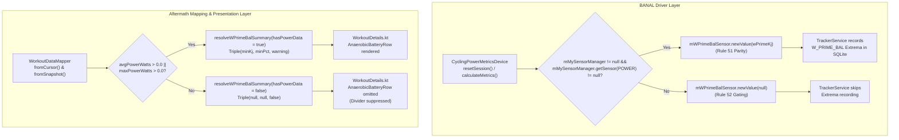

# Stage 3: Implementation Plan - ATT-4368: [Bug] Hide W'bal row in Workout Summary when workout has no recorded power data

**Ticket**: [ATT-4368](https://rainerblind.atlassian.net/browse/ATT-4368)  
**Sub-task**: [ATT-4414](https://rainerblind.atlassian.net/browse/ATT-4414) (`[Impl-Plan]`)  
**Parent Epic**: [ATT-355](https://rainerblind.atlassian.net/browse/ATT-355) (*Good and consistent UI*)  
**Target Release**: `V4.9.40`  
**Active Sprint**: `2026-43.2`  
**Requirement Mapping**: `REQ-TRK-038` (*Constructor State Seeding Parity (Rule 51), Sensor-Presence Gating (Rule 52), Stationary/Paused W/kg Telemetry Alignment, and Workout Summary Presentation Defense*)  
**Test Mapping**: `TST-TRK-031`  
**Branch**: `feature/ATT-4368`  
**Author**: AI Agent 1 (Implementer)  
**Date**: 2026-10-20  

---

## 1. Problem Description & Background

During Sprint 2026-43.1 physical device verification on a Google Pixel 10 (ticket `ATT-4292`), workouts recorded without power telemetry (such as walks, runs, swims, or cycling without a paired power meter) displayed a phantom Anaerobic Battery row in the Workout Summary card and `WorkoutDetails` section:
```text
W'bal: Min 20.0 kJ (100%)
```

Dr. Philip Skiba's Anaerobic Work Capacity balance ($W'_{\text{bal}}$) is strictly a cycling power metric derived from active power output relative to Critical Power ($CP$). Displaying full anaerobic battery capacity for a foot walk or non-power activity confuses athletes, clutters the overview card, and violates domain modeling standards (`docs/coding_standards.md` Section 1.8, Rules 51 & 52).

A forensic root-cause analysis identified two contributing failure mechanisms:
1. **Driver Layer (`CyclingPowerMetricsDevice.java`)**:
   In `ATT-4283` (Rule 51 / `REQ-TRK-038.1`), constructor state seeding was implemented so that a power-meter workout displays 100% full capacity from second zero before the first power packet arrives. However, `resetSession()` and suspended `calculateMetrics()` called `mWPrimeBalSensor.newValue((double) wPrimeKj)` unconditionally without checking if a `SensorType.POWER` sensor was registered in `MySensorManager`. Because fallback $CP$ (200W) and fallback $W'$ (20.0 kJ) are always non-zero, `mWPrimeBalSensor` published `20.0 kJ` on non-power workouts, causing `TrackerService` to persist phantom `W_PRIME_BAL` minimum extrema (`20.0 kJ`) in SQLite for every recorded activity.
2. **Mapper Layer (`WorkoutDataMapper.kt`)**:
   `resolveWPrimeBalSummary()` evaluated `rawMinWPrimeBal` without checking whether the workout actually contained recorded power data (`avgPower != null || maxPower != null`). Consequently, `minWPrimeBalKj = 20.0` and `minWPrimeBalPct = 100.0%` were forwarded to `WorkoutDetails.kt`, which rendered `AnaerobicBatteryRow`. Even after fixing `CyclingPowerMetricsDevice`, historical workouts already stored in SQLite would continue displaying the phantom row unless guarded at the mapper layer.

---

## 2. Traceability & Requirements Mapping

* **Requirement**: `REQ-TRK-038` (*Constructor State Seeding Parity (Rule 51), Sensor-Presence Gating (Rule 52), Stationary/Paused W/kg Telemetry Alignment, and Workout Summary Presentation Defense*)
  - `REQ-TRK-038.1`: Driver constructor baseline capacity seeding (Rule 51) paired with sensor-presence gating (Rule 52).
  - `REQ-TRK-038.2`: Stationary and paused W/kg alignment.
  - `REQ-TRK-038.3`: Transient dropout resilience for W'bal and cumulative metrics.
  - `REQ-TRK-038.4`: Cumulative metric pause invariants and suspended W'bal reconstitution gating (Rule 52).
  - `REQ-TRK-038.5`: Aftermath presentation defense in `WorkoutDataMapper.kt` and `WorkoutDetails.kt` (Rule 20 & Rule 52).
  - `REQ-TRK-038.6`: 9-language localization & format parity.
* **Test Mapping**: `TST-TRK-031` (*CyclingPowerMetricsDevice Constructor Seeding, Sensor-Presence Gating (Rule 52), Stationary/Paused W/kg Alignment, and Workout Summary Presentation Defense Verification Suite*)
  - `TST-TRK-031.1`: Sensor-presence gating in driver when power sensor is absent (`CyclingPowerMetricsDeviceTest.kt`).
  - `TST-TRK-031.2`: Constructor capacity seeding when power sensor is present (`CyclingPowerMetricsDeviceTest.kt`).
  - `TST-TRK-031.3`: Stationary and paused W/kg emission test (`CyclingPowerMetricsDeviceTest.kt`).
  - `TST-TRK-031.4`: Transient power dropout resilience test (`CyclingPowerMetricsDeviceTest.kt`).
  - `TST-TRK-031.5`: Unconfigured athlete weight fallback test (`CyclingPowerMetricsDeviceTest.kt`).
  - `TST-TRK-031.6`: `WorkoutDataMapper` power gating & legacy historical defense symmetry test (`WorkoutDataMappingSymmetryTest.kt`).
  - `TST-TRK-031.7`: `WorkoutDetails` row omission & modularity budget (< 500 lines) contract test (`WorkoutDetailsLayoutTest.kt`).
  - `TST-TRK-031.8`: 9-language localization parity audit (`TranslationParityTest.kt`).
  - `TST-TRK-031.9`: Full clean-room test suite execution (`./gradlew testDebugUnitTest`).

---

## 3. System Invariants & Preserved Behavior

1. **Zero Unintended Regressions in Power Workouts**: Workouts with a paired power meter must continue to compute, record, and display $W'_{\text{bal}}$ telemetry across live cockpit tiles, aftermath summaries, and route map graphs with identical numerical accuracy.
2. **Rule 51 Constructor State Seeding Parity**: The internal accumulator `mCurrentWPrimeBalJoules` must remain seeded to `wPrimeKj * 1000.0` in both constructor and `resetSession()` so that when a power meter connects, initial capacity is ready immediately at 100%.
3. **Rule 52 Sensor-Presence Gating**: Virtual metric devices MUST NOT call `MySensor.newValue(...)` unless the underlying physical/source sensor (`SensorType.POWER`) is registered and available in `MySensorManager`, and `WorkoutDataMapper` MUST gate derived summary rows on recorded source telemetry.
4. **Rule 20 DTO Mapping Symmetry**: Both single-item `fromCursor()` and batch `fromSnapshot()` pathways in `WorkoutDataMapper.kt` must resolve `hasPowerData` and map `minWPrimeBalKj` / `minWPrimeBalPct` identically.
5. **Modularity Budget**: `WorkoutDetails.kt` must remain strictly `< 500` lines (currently 494 lines).
6. **Thread Safety & Dispatcher Affinity**: Sensor telemetry operations remain synchronous to the single-thread BANAL executor service; database queries remain confined to background worker threads.
7. **Parent Human Gate Invariance**: Terminal transition of parent ticket `ATT-4368` to `Erledigt` is reserved exclusively for the human user (`Core Rule 3`).

---

## 4. Proposed Architectural Changes



### Component 1: `CyclingPowerMetricsDevice.java` (Driver Layer)
- In `resetSession()`:
  - Keep internal accumulator initialization: `mCurrentWPrimeBalJoules = wPrimeKj * 1000.0;` (Rule 51).
  - Gate publication to `mWPrimeBalSensor`:
    ```java
    boolean hasPowerSensor = (mMySensorManager != null && mMySensorManager.getSensor(SensorType.POWER) != null);
    if (mWPrimeBalSensor != null) {
        mWPrimeBalSensor.newValue(hasPowerSensor ? (double) wPrimeKj : null);
    }
    ```
- In `calculateMetrics()` when `isSuspended`:
  - Gate suspended $W'_{\text{bal}}$ reconstitution and publication:
    ```java
    boolean hasPowerSensor = (mMySensorManager != null && mMySensorManager.getSensor(SensorType.POWER) != null);
    if (hasPowerSensor && mCurrentWPrimeBalJoules != null) {
        Integer cp = resolveEffectiveCpWatts();
        float wPrimeKj = mWPrimeKjProvider.getWPrimeKj(mContext);
        if (cp != null && cp > 0 && wPrimeKj > 0.0f) {
            mCurrentWPrimeBalJoules = PowerPhysiologyCalculator.INSTANCE.stepWPrimeBalanceJoules(
                    mCurrentWPrimeBalJoules, 0.0, cp.doubleValue(), wPrimeKj * 1000.0, 1.0);
            if (mWPrimeBalSensor != null) {
                mWPrimeBalSensor.newValue(mCurrentWPrimeBalJoules / 1000.0);
            }
        }
    }
    ```

### Component 2: `WorkoutDataMapper.kt` (Mapper & Presentation Defense Layer)
- In `resolveWPrimeBalSummary`:
  - Add parameter `hasPowerData: Boolean = false`.
  - Check `if (!hasPowerData) return Triple(null, null, false)`.
- In `fromCursor(cursor: Cursor)`:
  - Query `avgPowerWattsVal` and `maxPowerWattsVal`.
  - Evaluate `val hasPowerData = (avgPowerWattsVal != null && avgPowerWattsVal > 0.0) || (maxPowerWattsVal != null && maxPowerWattsVal > 0.0)`.
  - Pass `hasPowerData = hasPowerData` into `resolveWPrimeBalSummary(rawMinWPrimeBal, hasPowerData = hasPowerData)`.
- In `fromSnapshot(snapshot: RawCursorSnapshot, batch: BatchMetadata)`:
  - Retrieve `avgPowerWattsBatch` and `maxPowerWattsBatch`.
  - Evaluate `val hasPowerData = (avgPowerWattsBatch != null && avgPowerWattsBatch > 0.0) || (maxPowerWattsBatch != null && maxPowerWattsBatch > 0.0)`.
  - Pass `hasPowerData = hasPowerData` into `resolveWPrimeBalSummary(rawMinWPrimeBal, hasPowerData = hasPowerData)`.
  - Guarantees 100% Rule 20 mapping symmetry between single and batch queries.

### Component 3: `WorkoutDetails.kt` (Presentation Layer)
- `buildVisibleWorkoutDetailSections()` line 152 already gates:
  ```kotlin
  if (enableCriticalPowerModel && showCriticalPowerInWorkoutSummary && data.minWPrimeBalKj != null && data.minWPrimeBalPct != null) {
      add { AnaerobicBatteryRow(data = data) }
  }
  ```
- Because `WorkoutDataMapper` maps `minWPrimeBalKj = null` and `minWPrimeBalPct = null` on non-power workouts, `AnaerobicBatteryRow` is safely omitted.
- The preceding `HorizontalDivider` is controlled by `if (index > 0)`, so omitting the section automatically suppresses the divider without creating duplicate or stray dividers (`TST-UI-378.4`).
- Maintain line count strictly below 500 lines (`WorkoutDetails.kt` is currently 494 lines).

### UI Consistency (Rule 23 — mandatory if UI is added or changed)
* **Reference screen / component**: `WorkoutSummary.kt` overview card and `WorkoutDetails.kt` telemetry section (`docs/design_guidelines.md` Section 5.10).
* **Reused components**: `WorkoutDomainRow`, `MetricItem`, `HorizontalDivider`, `AnaerobicBatteryRow`.
* **Theme tokens**: `12.dp` arrangement spacing token, `MaterialTheme.colorScheme.outlineVariant.copy(alpha = 0.5f)` divider tint, `labelMedium` domain typography.
* **New one-off styles & justification**: None. The bugfix conditionally suppresses the existing `AnaerobicBatteryRow` when power telemetry is absent, preserving existing theme tokens and visual cadence without adding one-off styles.

---

## 5. Step-by-Step Implementation Sequence (Stage 4 Construction)

### Step 1: Update `CyclingPowerMetricsDevice.java` (Rule 52 Driver Gating)
* **Files**: `app/src/main/java/com/atrainingtracker/banalservice/devices/CyclingPowerMetricsDevice.java`
* **Changes**:
  1. In `resetSession()`: check `mMySensorManager != null && mMySensorManager.getSensor(SensorType.POWER) != null`. If power sensor is present, publish `(double) wPrimeKj`; if absent, publish `null`.
  2. In `calculateMetrics()` when `isSuspended`: check `mMySensorManager != null && mMySensorManager.getSensor(SensorType.POWER) != null` before executing reconstitution step and publishing to `mWPrimeBalSensor`.
* **Invariants**: Keep `mCurrentWPrimeBalJoules = wPrimeKj * 1000.0;` seeded for Rule 51 parity.

### Step 2: Update `WorkoutDataMapper.kt` (Rule 20 & Rule 52 Mapper Gating)
* **Files**: `app/src/main/java/com/atrainingtracker/trainingtracker/ui/aftermath/WorkoutDataMapper.kt`
* **Changes**:
  1. In `resolveWPrimeBalSummary()`: add `hasPowerData: Boolean = false` parameter. Return `Triple(null, null, false)` if `!hasPowerData`.
  2. In `fromCursor(cursor: Cursor)`: derive `hasPowerData` from `avgPowerWattsVal` and `maxPowerWattsVal`, passing it to `resolveWPrimeBalSummary`.
  3. In `fromSnapshot(snapshot, batch)`: derive `hasPowerData` from `avgPowerWattsBatch` and `maxPowerWattsBatch`, passing it to `resolveWPrimeBalSummary`.

### Step 3: Verify Presentation Gating & Modularity in `WorkoutDetails.kt`
* **Files**: `app/src/main/java/com/atrainingtracker/trainingtracker/ui/components/workoutdetails/WorkoutDetails.kt`
* **Changes**:
  1. Verify section builder condition: `data.minWPrimeBalKj != null && data.minWPrimeBalPct != null`.
  2. Verify that total line count remains strictly `< 500` lines.

### Step 4: Unit Test Updates in `CyclingPowerMetricsDeviceTest.kt`
* **Files**: `app/src/test/java/com/atrainingtracker/banalservice/devices/CyclingPowerMetricsDeviceTest.kt`
* **Changes**:
  1. Add `testStartup_noPowerSensor_doesNotPublishWPrimeBalSensor` (`[TST-TRK-031.1]`): verify `wPrimeBalSensor.sensorData.value == null` when `sensorManager.getSensor(SensorType.POWER) == null`.
  2. Verify `testStartup_constructorSeedsInitialWPrimeCapacity_publishesFullCapacityImmediately` (`[TST-TRK-031.2]`): verify `wPrimeBalSensor.sensorData.value == 20.0` when power sensor is present.
  3. Verify stationary/paused and dropout tests continue passing cleanly.

### Step 5: Symmetry & Contract Test Updates in `WorkoutDataMappingSymmetryTest.kt`
* **Files**: `app/src/test/java/com/atrainingtracker/trainingtracker/ui/aftermath/WorkoutDataMappingSymmetryTest.kt`
* **Changes**:
  1. Update `testRule20_wPrimeBalSummary_symmetryAcrossSingleBatchAndSnapshot`: mock `SensorType.POWER` average extrema (`200.0 W`) so positive case verifies power-present mapping symmetry.
  2. Add `testRule20_wPrimeBalSummary_noPowerData_suppressesWPrimeBalSymmetrically` (`[TST-TRK-031.6]`): mock `rawMinWPrimeBal = 20.0 kJ` but `POWER` extrema as null; assert `minWPrimeBalKj == null` and `minWPrimeBalPct == null` across `fromCursor` (single and batch) and `fromSnapshot`.

### Step 6: UI Contract & Modularity Test in `WorkoutDetailsLayoutTest.kt`
* **Files**: `app/src/test/java/com/atrainingtracker/trainingtracker/ui/components/workoutdetails/WorkoutDetailsLayoutTest.kt`
* **Changes**:
  1. Add `testWorkoutDetails_noPowerData_omitsAnaerobicBatteryRowAndDivider` (`[TST-TRK-031.7]`).
  2. Assert `WorkoutDetails.kt` line count is strictly `< 500` lines.

### Step 7: Targeted Unit Test Execution
* **Command**:
  ```bash
  ./gradlew testDebugUnitTest --tests "com.atrainingtracker.banalservice.devices.CyclingPowerMetricsDeviceTest" \
                              --tests "com.atrainingtracker.trainingtracker.ui.aftermath.WorkoutDataMappingSymmetryTest" \
                              --tests "com.atrainingtracker.trainingtracker.ui.components.workoutdetails.WorkoutDetailsLayoutTest"
  ```

### Step 8: Localization Parity Audit
* **Command**:
  ```bash
  ./gradlew testDebugUnitTest --tests "com.atrainingtracker.trainingtracker.TranslationParityTest"
  ```

---

## 6. Verification & Rollback Plan

* **Verification**:
  - Targeted unit and contract tests in Stage 4 execution loop (< 30 seconds).
  - Clean-room regression verification in Stage 5: `./gradlew testDebugUnitTest` across all 430+ project test classes with 100% pass rate.
* **Rollback Plan**:
  - Work is strictly isolated on branch `feature/ATT-4368`.
  - In the event of an unexpected regression, `git checkout develop` or `git revert` cleanly restores the pre-change state without affecting production branches.
